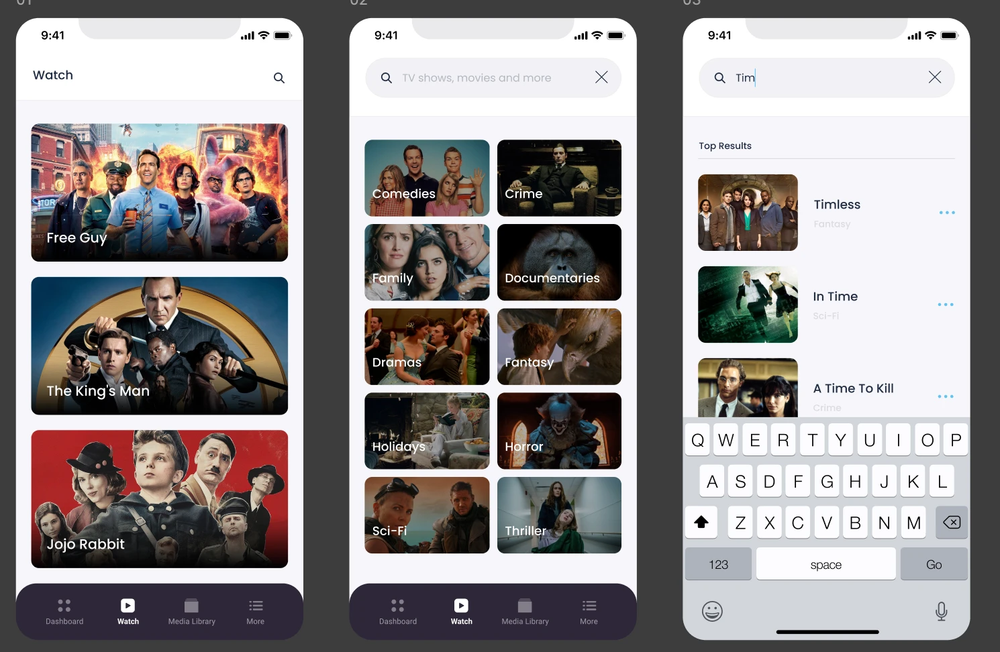
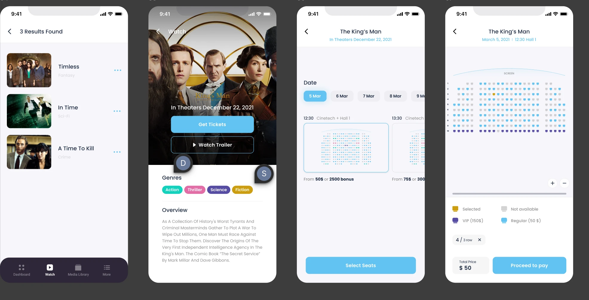
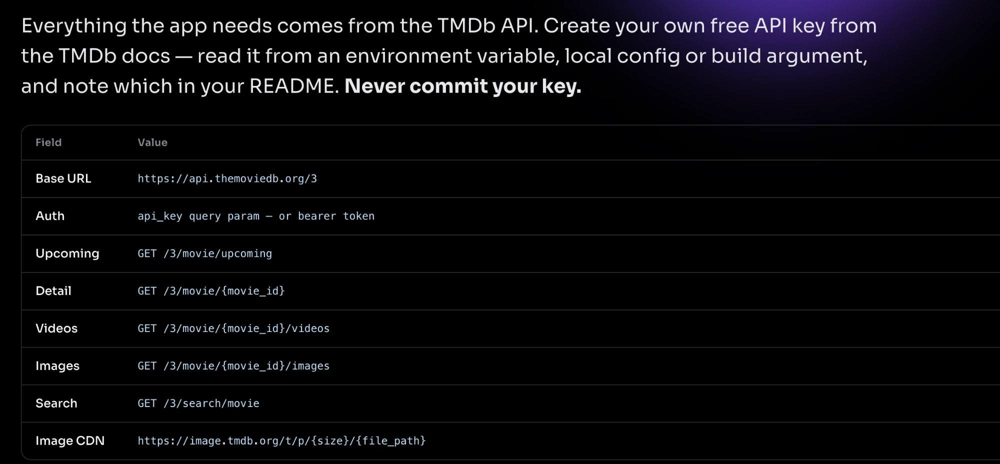
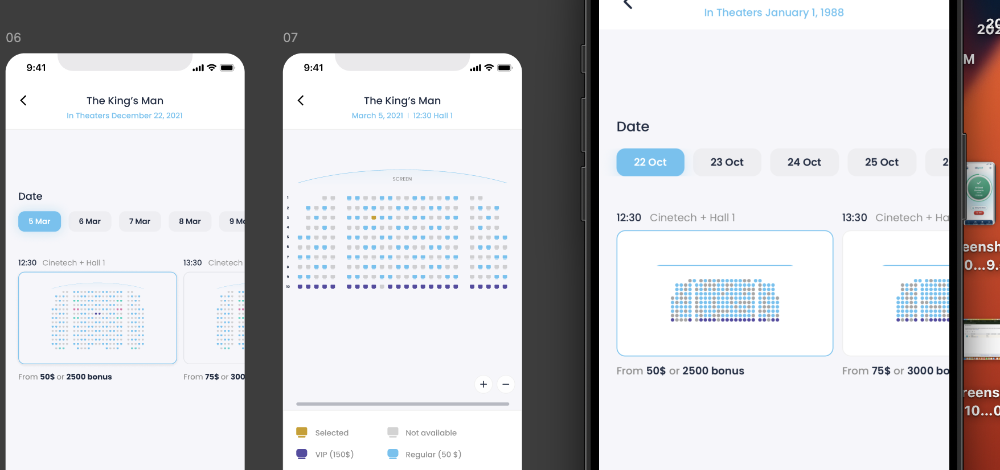
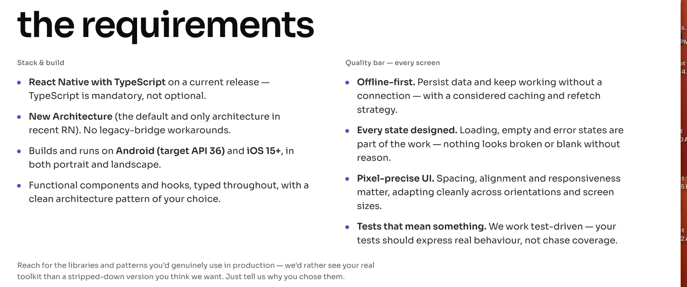
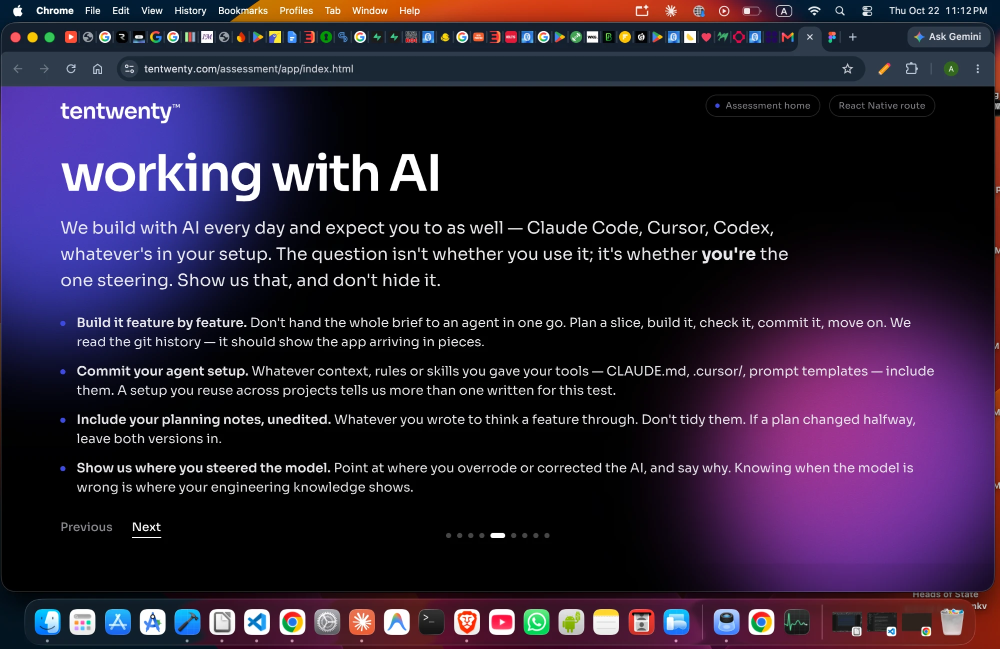

# Session 1 — Building the app (Claude Code, 22–23 Oct 2026)

## 🧑 User — 2026-10-22 18:13 PKT

Hi, basically I have one task that I need to do. So just I need to add some screens, like a tab already added. So I just deleted all screens from here. So just adjust it and just show when user open the app, just directly navigate him to tab screens and just show it. Please fix the issues in my recommended.

<details><summary>🔧 mcp__ccd_turn__update_plan</summary>

```
{
  "items": [
    {
      "content": "Inspect app routing structure",
      "status": "in_progress"
    },
    {
      "content": "Remove auth references, route to tabs",
      "status": "pending"
    },
    {
      "content": "Type-check the project",
      "status": "pending"
    }
  ],
  "scope": "first_task"
}
```

</details>

<details><summary>↳ result</summary>

```
Plan shown (3 steps).
```

</details>

<details><summary>🔧 Bash</summary>

```
find app -type f | head -50 && git diff --cached package.json && for f in app/_layout.tsx app/index.tsx; do echo "== $f"; cat $f 2>/dev/null; done; grep -rn "(auth)\|/login\|/signup\|auth" app src components hooks lib 2>/dev/null | grep -v node_modules | head -40
```

</details>

<details><summary>↳ result</summary>

```
app/index.tsx
app/_layout.tsx
app/item/[id].tsx
app/(owners)/items.tsx
app/(owners)/home.tsx
app/(owners)/profile.tsx
app/(owners)/_layout.tsx
app/(owners)/item-detail.tsx
app/store/useAppStore.ts
app/store/redux/index.ts
app/store/redux/slices/authSlice.ts
app/store/redux/slices/itemsSlice.ts
diff --git a/package.json b/package.json
index 65e9692..f9596f0 100644
--- a/package.json
+++ b/package.json
@@ -1,5 +1,5 @@
 {
-  "name": "tect-soft",
+  "name": "tentwenty-abrar",
   "main": "expo-router/entry",
   "version": "1.0.0",
   "scripts": {
== app/_layout.tsx
// _layout.tsx

import "react-native-get-random-values";
// Polyfill for WeakRef (fixing crash on some engines)
if (typeof WeakRef === "undefined") {
  (global as any).WeakRef = class WeakRef {
    private value: any;
    constructor
… [9886 more characters omitted]
```

</details>

<details><summary>🔧 Bash</summary>

```
cat "app/(owners)/_layout.tsx"; sed -n 1,60p "app/(owners)/profile.tsx"; sed -n 15,45p "app/item/[id].tsx"; grep -n "currentUser\|session" "app/(owners)/home.tsx" "app/(owners)/items.tsx" | head -20
```

</details>

<details><summary>↳ result</summary>

```
import { Tabs } from "expo-router";
import { Ionicons } from "@expo/vector-icons";

export default function TabLayout() {
  const commonScreenOptions = {
    tabBarActiveTintColor: "#FDB813",
    tabBarInactiveTintColor: "#94A3B8",
    tabBarStyle: {
      backgroundColor: "#0F172A",
      borderTopWidth: 1,
      borderTopColor: "#1E293B",
      height: 65,
      paddingBottom: 10,
      paddingTop: 8,
    },
    tabBarLabelStyle: {
      fontSize: 11,
      fontWeight: "700",
      textTransform: "uppercase",
      letterSpacing: 0.5,
    },
    headerShown: false,
  };

  return (
    <Tabs screenOptions={commonScreenOptions as any}>
      <Tabs.Screen
        name="home"
        options={{
          title: "Home",
          tabBarIcon: ({ color, size }) => (
            <Ionicons name=
… [4273 more characters omitted]
```

</details>

<details><summary>🔧 Bash</summary>

```
sed -n 1,14p "app/item/[id].tsx"
```

</details>

<details><summary>↳ result</summary>

```
import React, { useEffect } from 'react';
import { View, ActivityIndicator, StyleSheet } from 'react-native';
import { useLocalSearchParams, useRouter } from 'expo-router';
import AsyncStorage from '@react-native-async-storage/async-storage';
import { useAppStore } from '../store/useAppStore';

export default function ItemDeepLink() {
  const { id } = useLocalSearchParams<{ id: string }>();
  const { currentUser } = useAppStore();
  const router = useRouter();

  useEffect(() => {
    let isMounted = true;
```

</details>

**🤖 Claude:**

Now applying the edits.

<details><summary>🔧 mcp__ccd_turn__update_plan</summary>

```
{
  "advance": true
}
```

</details>

<details><summary>↳ result</summary>

```
Plan updated: step 2 of 3 is in progress.
```

</details>

<details><summary>🔧 Bash</summary>

```
python3 - <<'EOF'
import re
p='app/index.tsx'
s=open(p).read()
start=s.index('    // 3. Safe Navigation with proper checks')
end=s.index('    const timer = setTimeout(() => {')
s=s[:start]+'''    // 3. Go straight to the tab screens after the splash animation
    const goToTabs = () => {
      if (isMounted && !hasNavigated) {
        setHasNavigated(true);
        router.replace("/(owners)/home");
      }
    };

'''+s[end:]
s=s.replace('      determineNavigation();','      goToTabs();')
s=s.replace('''// AsyncStorage removed; using Supabase for auth
import { supabase } from "@/src/lib/supabase";
import { getProfile } from "@/src/services/supabaseService";
''','')
open(p,'w').write(s)

p='app/_layout.tsx'
s=open(p).read()
s=s.replace('''                <Stack.Screen name="(auth)" />
                <Stack.Screen name="(owners)" />
                <Stack.Screen
                  name="(owners)/item-detail"
                  options={{
                    presentation: 'card',
                    animation: 'slide_from_right',
                    headerShown: false,
                  }}
                />
''','''                <Stack.Screen name="(owners)" />
''')
open(p,'w').write(s)

p='app/(owners)/profile.tsx'
s=open(p).read()
s=s.replace('router.replace("/(auth)/login");','router.replace("/(owners)/home");')
open(p,'w').write(s)

p='app/item/[id].tsx'
s=open(p).read()
start=s.index('      if (currentUser) {')
end=s.index('    handleNavigation();')
s=s[:start]+'''      if (isMounted) {
        router.replace({
          pathname: '/(owners)/item-detail',
          params: { itemId: id },
        });
      }
    };

'''+s[end:]
s=s.replace("import AsyncStorage from '@react-native-async-storage/async-storage';\nimport { useAppStore } from '../store/useAppStore';\n","")
s=s.replace("  const { currentUser } = useAppStore();\n","")
s=s.replace("}, [id, currentUser, router]);","}, [id, router]);")
open(p,'w').write(s)
EOF
grep -rn "(auth)" app; sed -n 50,70p app/index.tsx; sed -n 1,35p "app/item/[id].tsx"
```

</details>

<details><summary>↳ result</summary>

```
    // 3. Go straight to the tab screens after the splash animation
    const goToTabs = () => {
      if (isMounted && !hasNavigated) {
        setHasNavigated(true);
        router.replace("/(owners)/home");
      }
    };

    const timer = setTimeout(() => {
      goToTabs();
    }, 2000);

    return () => {
      isMounted = false;
      clearTimeout(timer);
      // Stop animations on unmount
      if (bounceAnimation) {
        bounceAnimation.stop();
      }
      if (shadowAnimation) {
        shadowAnimation.stop();
import React, { useEffect } from 'react';
import { View, ActivityIndicator, StyleSheet } from 'react-native';
import { useLocalSearchParams, useRouter } from 'expo-router';

export default function ItemDeepLink() {
  const { id } = useLocalSearchParams<{ id: string }
… [539 more characters omitted]
```

</details>

<details><summary>🔧 mcp__ccd_turn__update_plan</summary>

```
{
  "advance": true
}
```

</details>

<details><summary>↳ result</summary>

```
Plan updated: step 3 of 3 is in progress.
```

</details>

<details><summary>🔧 Bash</summary>

```
rm -rf .expo/types 2>/dev/null; npx tsc --noEmit 2>&1 | head -30
```

</details>

<details><summary>↳ result</summary>

```
(Bash completed with no output)
```

</details>

<details><summary>🔧 mcp__ccd_turn__wrap_up</summary>

```
{
  "recap": "The app now goes from the splash screen straight to the tab screens (Home, Products, Profile), and nothing points to the deleted login or signup screens anymore. The TypeScript check passes, but I haven't run the app on a simulator. Nothing is committed."
}
```

</details>

<details><summary>↳ result</summary>

```
Nothing is pending, so the app draws no box; the recap is the session's status. Your closing message is your answer to the user: write it now, as the last thing you say this turn.
```

</details>

**🤖 Claude:**

The app now opens straight into the tab screens. The splash animation still plays for 2 seconds, then it goes to the Home tab with no login check. The TypeScript check passes, but I haven't run the app on a simulator yet.

**What I changed:**
- **[app/index.tsx](app/index.tsx):** Took out the login session check and the redirects to `/(auth)/login`. After the splash it now goes to `/(owners)/home`.
- **[app/_layout.tsx](app/_layout.tsx):** Removed the `(auth)` screen entry, since that folder is deleted. I also removed the `(owners)/item-detail` entry in the root layout. It was a mistake there: that screen belongs to the tabs layout, which already hides it from the tab bar.
- **[app/(owners)/profile.tsx](app/(owners)/profile.tsx):** Logout now takes you back to Home instead of the login screen that no longer exists.
- **[app/item/[id].tsx](app/item/[id].tsx):** Item links now always open the item detail screen. Before, they sent logged-out users to login.

**One thing you might notice:** without login there's no signed-in user. So Home will greet "User", and saved favorites won't load. Everything else should work as before.

## 🧑 User — 2026-10-22 18:13 PKT

yes

**🤖 Claude:**

I'm not sure what you're saying yes to. I didn't ask a question at the end of my last message. Here's what I can do next:

1. **Run the app in the iOS Simulator** to check that it opens on the tab screens.
2. **Commit the changes** (the deleted login and signup screens plus my edits) to `main`.
3. **Handle having no logged-in user**, so Home doesn't show "User" and favorites don't break.

Which one do you want? You can pick more than one.

## 🧑 User — 2026-10-22 18:14 PKT

main hom screen

<details><summary>🔧 mcp__ccd_turn__update_plan</summary>

```
{
  "items": [
    {
      "content": "Review home screen user dependencies",
      "status": "in_progress"
    },
    {
      "content": "Make home work without logged-in user",
      "status": "pending"
    },
    {
      "content": "Type-check and run in simulator",
      "status": "pending"
    }
  ],
  "scope": "continuation"
}
```

</details>

<details><summary>↳ result</summary>

```
Plan shown (3 steps).
```

</details>

<details><summary>🔧 Read</summary>

```
{
  "file_path": "/Users/abrar/Developer/upwork/react-native/abrar_assesment/app/(owners)/home.tsx",
  "limit": 230
}
```

</details>

<details><summary>↳ result</summary>

```
1	import React, { useCallback, useEffect, useRef, useState } from 'react';
2	import {
3	  View,
4	  Text,
5	  StyleSheet,
6	  FlatList,
7	  TouchableOpacity,
8	  RefreshControl,
9	  ActivityIndicator,
10	  Animated,
11	  Platform,
12	  StatusBar,
13	} from 'react-native';
14	import { SafeAreaView } from 'react-native-safe-area-context';
15	import { Ionicons } from '@expo/vector-icons';
16	import { useDispatch, useSelector } from 'react-redux';
17	import { useAppStore } from '../store/useAppStore';
18	import { useRouter } from 'expo-router';
19	import { RootState } from '../store/redux';
20	import {
21	  setItems,
22	  appendItems,
23	  setLoading,
24	  setRefreshing,
25	  setError,
26	  setHasMore,
27	  setFavoriteIds,
28	  Item,
29	} from '../store/redux/slices/itemsSlice';
30	import { fe
… [7430 more characters omitted]
```

</details>

<details><summary>🔧 Edit</summary>

```
/Users/abrar/Developer/upwork/react-native/abrar_assesment/app/(owners)/home.tsx
--- old
              Good Morning, {currentUser?.name?.split(' ')[0] || 'User'} 👋
+++ new
              {currentUser?.name
                ? `Good Morning, ${currentUser.name.split(' ')[0]} 👋`
                : 'Welcome 👋'}
```

</details>

<details><summary>🔧 mcp__ccd_turn__update_plan</summary>

```
{
  "done": [
    1,
    2
  ],
  "start": 3
}
```

</details>

<details><summary>↳ result</summary>

```
The file /Users/abrar/Developer/upwork/react-native/abrar_assesment/app/(owners)/home.tsx has been updated successfully.
```

</details>

<details><summary>↳ result</summary>

```
Plan updated: step 3 of 3 is in progress.
```

</details>

<details><summary>🔧 Bash</summary>

```
npx tsc --noEmit 2>&1 | head; xcrun simctl list devices booted 2>&1 | head; ls ios 2>/dev/null | head -3; grep -n '"start"\|"ios"\|expo-dev-client' package.json
```

</details>

<details><summary>↳ result</summary>

```
== Devices ==
-- iOS 18.3 --
-- iOS 26.4 --
    iPhone 17 (F9171402-68CD-4A8D-BBAC-66E0B74D9F5C) (Booted) 
-- watchOS 11.2 --
-- watchOS 26.4 --
Podfile
Podfile.lock
Podfile.properties.json
6:    "start": "expo start",
8:    "ios": "expo run:ios",
```

</details>

<details><summary>🔧 mcp__Claude_Code_iOS_Simulator__control</summary>

```
{
  "action": "attach"
}
```

</details>

<details><summary>🔧 Bash</summary>

```
npx expo run:ios --device "iPhone 17" > /private/tmp/claude-501/-Users-abrar-Developer-upwork-react-native-abrar-assesment/435b1c0d-3a1b-4b88-9121-d0b9918bc8a0/scratchpad/run-ios.log 2>&1
```

</details>

<details><summary>↳ result</summary>

```
Simulator panel opened for `iPhone 17` (F9171402-68CD-4A8D-BBAC-66E0B74D9F5C). Coordinate space for tap/swipe: 402x874 points (origin top-left).
```

</details>

<details><summary>↳ result</summary>

```
Command running in background with ID: bi69cv1xd. Output is being written to: /private/tmp/claude-501/-Users-abrar-Developer-upwork-react-native-abrar-assesment/435b1c0d-3a1b-4b88-9121-d0b9918bc8a0/tasks/bi69cv1xd.output. You will be notified when it completes — do not poll that file or sleep while waiting. Read the file only if the user asks for progress, or if you need a line it prints before you can go on, such as a server's ready line or port.
```

</details>

<details><summary>🔧 ToolSearch</summary>

```
{
  "query": "select:Monitor",
  "max_results": 1
}
```

</details>

<details><summary>🔧 Bash</summary>

```
L=/private/tmp/claude-501/-Users-abrar-Developer-upwork-react-native-abrar-assesment/435b1c0d-3a1b-4b88-9121-d0b9918bc8a0/scratchpad/run-ios.log; until grep -qE "Logs for your project|Opening .* on|BUILD FAILED|error:|CommandError" $L; do sleep 2; done; grep -E "Logs for your project|Opening|BUILD FAILED|error:|CommandError" $L | head -10
```

</details>

<details><summary>↳ result</summary>

```
Command did not complete within its 600s timeout and was moved to the background (ID: bab0iriho). Output is being written to: /private/tmp/claude-501/-Users-abrar-Developer-upwork-react-native-abrar-assesment/435b1c0d-3a1b-4b88-9121-d0b9918bc8a0/tasks/bab0iriho.output. You will be notified when it completes. To check interim output, use Read on that file path.
```

</details>

**🤖 Claude:**

API Error: Can't reach the API server — check your internet or DNS (ENOTFOUND)

## 🧑 User — 2026-10-22 18:29 PKT

Try again

<details><summary>🔧 Bash</summary>

```
tail -25 /private/tmp/claude-501/-Users-abrar-Developer-upwork-react-native-abrar-assesment/435b1c0d-3a1b-4b88-9121-d0b9918bc8a0/scratchpad/run-ios.log
```

</details>

<details><summary>↳ result</summary>

```
	from /Users/abrar/.rbenv/versions/3.3.0/lib/ruby/gems/3.3.0/gems/cocoapods-1.16.2/lib/cocoapods/config.rb:167:in `unicode_normalize'
	from /Users/abrar/.rbenv/versions/3.3.0/lib/ruby/gems/3.3.0/gems/cocoapods-1.16.2/lib/cocoapods/config.rb:167:in `installation_root'
	from /Users/abrar/.rbenv/versions/3.3.0/lib/ruby/gems/3.3.0/gems/cocoapods-1.16.2/lib/cocoapods/config.rb:227:in `podfile_path'
	from /Users/abrar/.rbenv/versions/3.3.0/lib/ruby/gems/3.3.0/gems/cocoapods-1.16.2/lib/cocoapods/user_interface/error_report.rb:105:in `markdown_podfile'
	from /Users/abrar/.rbenv/versions/3.3.0/lib/ruby/gems/3.3.0/gems/cocoapods-1.16.2/lib/cocoapods/user_interface/error_report.rb:30:in `report'
	from /Users/abrar/.rbenv/versions/3.3.0/lib/ruby/gems/3.3.0/gems/cocoapods-1.16.2/lib/cocoapods/command.r
… [2199 more characters omitted]
```

</details>

**🤖 Claude:**

The build failed with a known CocoaPods error that happens when the terminal's text encoding isn't set to UTF-8. It has nothing to do with the code changes. I'll retry with `LANG=en_US.UTF-8` set.

<details><summary>🔧 Bash</summary>

```
pkill -f "until grep -qE" ; cd /Users/abrar/Developer/upwork/react-native/abrar_assesment && export LANG=en_US.UTF-8 LC_ALL=en_US.UTF-8 && npx expo run:ios --device "iPhone 17" > /private/tmp/claude-501/-Users-abrar-Developer-upwork-react-native-abrar-assesment/435b1c0d-3a1b-4b88-9121-d0b9918bc8a0/scratchpad/run-ios.log 2>&1
```

</details>

<details><summary>🔧 Monitor</summary>

```
{
  "command": "L=/private/tmp/claude-501/-Users-abrar-Developer-upwork-react-native-abrar-assesment/435b1c0d-3a1b-4b88-9121-d0b9918bc8a0/scratchpad/run-ios.log; sleep 3; tail -n0 -F $L | grep -E --line-buffered \"Logs for your project|Opening .* on|BUILD FAILED|BUILD SUCCEEDED|CommandError|Encoding::|error: |› [0-9]+ error\"",
  "description": "iOS build result",
  "timeout_ms": 1800000
}
```

</details>

<details><summary>↳ result</summary>

```
Command running in background with ID: b2fuue8y1. Output is being written to: /private/tmp/claude-501/-Users-abrar-Developer-upwork-react-native-abrar-assesment/435b1c0d-3a1b-4b88-9121-d0b9918bc8a0/tasks/b2fuue8y1.output. You will be notified when it completes — do not poll that file or sleep while waiting. Read the file only if the user asks for progress, or if you need a line it prints before you can go on, such as a server's ready line or port.
Session cwd remains /Users/abrar/Developer/upwork/react-native/abrar_assesment; directory changes made by the backgrounded command do not apply to subsequent commands.
```

</details>

<details><summary>↳ result</summary>

```
Monitor started (task bf9jmk1v3, expires in 30m unless the source ends first; you get one notice at expiry — re-arm if you still need the watch). You will be notified on each event. Keep working — do not poll or sleep. Events may arrive while you are waiting for the user — an event is not their reply.
```

</details>

**🤖 Claude:**

The build is running again, and the simulator panel is open so you can watch it. I'll take a screenshot of the Home screen once the app launches.

**🤖 Claude:**

That failure notice is from the old wait loop I stopped, not the new build. The new build is still running, and I'll report back when it finishes.

## 🧑 User — 2026-10-22 19:19 PKT

yes contine

<details><summary>🔧 Bash</summary>

```
L=/private/tmp/claude-501/-Users-abrar-Developer-upwork-react-native-abrar-assesment/435b1c0d-3a1b-4b88-9121-d0b9918bc8a0/scratchpad/run-ios.log; grep -nE "Logs for your project|Opening|BUILD|CommandError|Encoding::|error: |Pod installation" $L | head; tail -5 $L; pgrep -fl "expo run:ios|xcodebuild|metro" | head
```

</details>

<details><summary>↳ result</summary>

```
› Compiling tentwenty-abrar Pods/ReactCodegen » RNGetRandomValuesSpecJSI-generated.cpp
› Compiling tentwenty-abrar Pods/ReactCodegen » RNGetRandomValuesSpec-generated.mm
› Compiling tentwenty-abrar Pods/ReactCodegen » RCTThirdPartyComponentsProvider.mm
› Compiling tentwenty-abrar Pods/ReactCodegen » RCTModulesConformingToProtocolsProvider.mm
› Compiling tentwenty-abrar Pods/ReactCodegen » RCTModuleProviders.mm
```

</details>

**🤖 Claude:**

The UTF-8 fix worked. Pods installed and the build was compiling when the previous session ended, which stopped it. I'll restart it.

<details><summary>🔧 Bash</summary>

```
export LANG=en_US.UTF-8 LC_ALL=en_US.UTF-8 && npx expo run:ios --device "iPhone 17" > /private/tmp/claude-501/-Users-abrar-Developer-upwork-react-native-abrar-assesment/435b1c0d-3a1b-4b88-9121-d0b9918bc8a0/scratchpad/run-ios.log 2>&1
```

</details>

<details><summary>🔧 Bash</summary>

```
L=/private/tmp/claude-501/-Users-abrar-Developer-upwork-react-native-abrar-assesment/435b1c0d-3a1b-4b88-9121-d0b9918bc8a0/scratchpad/run-ios.log; sleep 5; until grep -qE "Logs for your project|BUILD FAILED|CommandError|Encoding::|› [0-9]+ error" $L; do sleep 3; done; grep -E "Logs for your project|Opening|BUILD FAILED|CommandError|error" $L | head -15
```

</details>

<details><summary>↳ result</summary>

```
Command running in background with ID: bffcso52i. Output is being written to: /private/tmp/claude-501/-Users-abrar-Developer-upwork-react-native-abrar-assesment/435b1c0d-3a1b-4b88-9121-d0b9918bc8a0/tasks/bffcso52i.output. You will be notified when it completes — do not poll that file or sleep while waiting. Read the file only if the user asks for progress, or if you need a line it prints before you can go on, such as a server's ready line or port.
```

</details>

<details><summary>↳ result</summary>

```
Command running in background with ID: bf73kdap1. Output is being written to: /private/tmp/claude-501/-Users-abrar-Developer-upwork-react-native-abrar-assesment/435b1c0d-3a1b-4b88-9121-d0b9918bc8a0/tasks/bf73kdap1.output. You will be notified when it completes — do not poll that file or sleep while waiting. Read the file only if the user asks for progress, or if you need a line it prints before you can go on, such as a server's ready line or port.
```

</details>

<details><summary>🔧 mcp__Claude_Code_iOS_Simulator__control</summary>

```
{
  "action": "attach"
}
```

</details>

<details><summary>↳ result</summary>

```
Simulator panel already attached to `iPhone 17` (F9171402-68CD-4A8D-BBAC-66E0B74D9F5C). Coordinate space for tap/swipe: 402x874 points (origin top-left).
```

</details>

**🤖 Claude:**

The build is running again, and you can watch it in the simulator panel. A full native build takes a few minutes. When the app launches, I'll check that it goes from the splash screen to the Home tab and send you a screenshot.







## 🧑 User — 2026-10-22 19:23 PKT

Basically, I shared your design and what the task is related to. This is simply my React Native assessment task. So just this create or do the same like what the task is related to. Like it's just a movie DB that we have to show here. So please just do the task as defined.

<details><summary>🔧 mcp__ccd_turn__update_plan</summary>

```
{
  "items": [
    {
      "content": "Inspect project setup, deps, env",
      "status": "in_progress"
    },
    {
      "content": "Add TMDb API client and env config",
      "status": "pending"
    },
    {
      "content": "Build tab bar and Watch list screen",
      "status": "pending"
    },
    {
      "content": "Build search, genres and results screens",
      "status": "pending"
    },
    {
      "content": "Build movie detail and trailer player",
      "status": "pending"
    },
    {
      "content": "Build date/hall and seat booking screens",
      "status": "pending"
    },
    {
      "content": "Type-check, run in simulator, update README",
      "status": "pending"
    }
  ],
  "scope": "continuation"
}
```

</details>

<details><summary>↳ result</summary>

```
Plan shown (7 steps).
```

</details>

<details><summary>🔧 Bash</summary>

```
cat package.json && ls -a && cat .gitignore | grep -i env; ls .env* 2>/dev/null; find src -type f | head -40; cat app.json; cat tsconfig.json; cat tailwind.config.js 2>/dev/null | head -20; ls assets assets/* | head -30; cat README.md | head -30; tail -5 /private/tmp/claude-501/-Users-abrar-Developer-upwork-react-native-abrar-assesment/435b1c0d-3a1b-4b88-9121-d0b9918bc8a0/scratchpad/run-ios.log
```

</details>

<details><summary>↳ result</summary>

```
{
  "name": "tentwenty-abrar",
  "main": "expo-router/entry",
  "version": "1.0.0",
  "scripts": {
    "start": "expo start",
    "android": "expo run:android",
    "ios": "expo run:ios",
    "web": "expo start --web",
    "clear-cache": "expo start --clear",
    "clean": "rm -rf node_modules package-lock.json yarn.lock && npm install && expo start -c",
    "lint": "expo lint"
  },
  "dependencies": {
    "@expo/vector-icons": "^14.1.0",
    "@react-native-async-storage/async-storage": "2.1.2",
    "@reduxjs/toolkit": "^2.11.2",
    "@supabase/supabase-js": "^2.104.0",
    "expo": "~53.0.25",
    "expo-blur": "^15.0.8",
    "expo-font": "~13.0.3",
    "expo-linear-gradient": "~14.1.5",
    "expo-linking": "~7.1.7",
    "expo-modules-core": "~2.5.0",
    "expo-router": "~5.1.10",
    "expo-
… [4540 more characters omitted]
```

</details>

<details><summary>🔧 Bash</summary>

```
sed 's/=.*/=<redacted>/' .env; cat .gitignore; grep -rln "store/\|useAppStore\|supabase" app src | sort; cat babel.config.js metro.config.js; ls node_modules | grep -E "webview|youtube|expo-image|google-fonts"; cat ANSWERS.md | head -20
```

</details>

<details><summary>↳ result</summary>

```
# Supabase Configuration
EXPO_PUBLIC_SUPABASE_URL=<redacted>
EXPO_PUBLIC_SUPABASE_ANON_KEY=[REDACTED]

# Resend Configuration (for email alerts)
RESEND_API_KEY=<redacted>

# Push Notification Configuration
EXPO_PUBLIC_VAPID_PUBLIC_KEY=[REDACTED]


firebase_token=<redacted>

Android Map SDK Key: [REDACTED_GOOGLE_KEY]
Places Map API: [REDACTED_GOOGLE_KEY]# Logs
logs
*.log
npm-debug.log*
yarn-debug.log*
yarn-error.log*
pnpm-debug.log*
lerna-debug.log*

node_modules
.metro-cache
dist
dist-ssr
*.local
.expo

# Editor directories and files
.vscode/*
!.vscode/extensions.json
.idea
.DS_Store
*.suo
*.ntvs*
*.njsproj
*.sln
*.sw?
.env

# @generated expo-cli sync-2b81b286409207a5da26e14c78851eb30d8ccbdb
# The following patterns were generated by expo-cli

expo-env.d.ts
# @end expo-cliapp/(owners)/home
… [3269 more characters omitted]
```

</details>

<details><summary>🔧 Bash</summary>

```
pkill -f "expo run:ios"; pkill -f xcodebuild; pkill -f "until grep -qE"; cd /Users/abrar/Developer/upwork/react-native/abrar_assesment && npx expo install react-native-webview react-native-youtube-iframe @expo-google-fonts/poppins 2>&1 | tail -5
```

</details>

<details><summary>↳ result</summary>

```
├─ @expo-google-fonts/poppins@0.4.1
├─ events@3.3.0
├─ react-native-webview@13.13.5
└─ react-native-youtube-iframe@2.4.1
Done in 7.09s.
```

</details>

**🤖 Claude:**

Packages are installed. Now I'll write the API layer and theme.

<details><summary>🔧 Bash</summary>

```
ls node_modules | grep -E "^react-native-svg$"; grep -n "import" src/components/ItemComponents.tsx src/services/itemsService.ts src/components/ErrorBoundary.tsx | head -20; cat src/types.ts | head -20
```

</details>

<details><summary>↳ result</summary>

```
src/services/itemsService.ts:1:import { supabase, supabaseUrl } from '../lib/supabase';
src/services/itemsService.ts:2:import AsyncStorage from '@react-native-async-storage/async-storage';
src/components/ErrorBoundary.tsx:1:import * as React from 'react';
src/components/ErrorBoundary.tsx:2:import { View, Text, StyleSheet, TouchableOpacity, ScrollView } from 'react-native';
src/components/ErrorBoundary.tsx:3:import { SafeAreaView } from 'react-native-safe-area-context';
src/components/ErrorBoundary.tsx:4:import { Ionicons } from '@expo/vector-icons';
src/components/ItemComponents.tsx:1:import React, { useEffect, useRef } from "react";
src/components/ItemComponents.tsx:2:import {
src/components/ItemComponents.tsx:9:import { Ionicons } from "@expo/vector-icons";
src/components/ItemComponents.
… [257 more characters omitted]
```

</details>

<details><summary>🔧 Bash</summary>

```
rm -rf "app/(owners)" app/item app/store src/components/ItemComponents.tsx && mkdir -p src/api src/hooks src/components/movies "app/(tabs)/watch" app/movie app/booking && find app src -type f
```

</details>

<details><summary>↳ result</summary>

```
app/index.tsx
app/_layout.tsx
src/types.ts
src/components/GlassCard.tsx
src/components/ErrorBoundary.tsx
src/lib/supabase.ts
src/services/itemsService.ts
src/services/supabaseService.ts
src/components/ui/Glass.tsx
```

</details>

<details><summary>🔧 Write</summary>

```
/Users/abrar/Developer/upwork/react-native/abrar_assesment/src/api/tmdb.ts

// TMDb API client. The key is read from EXPO_PUBLIC_TMDB_API_KEY (see .env.example).
// Accepts either a v3 API key (sent as `api_key`) or a v4 read access token (sent as Bearer).

const BASE_URL = 'https://api.themoviedb.org/3';
const IMAGE_CDN = 'https://image.tmdb.org/t/p';
const API_KEY = process.env.EXPO_PUBLIC_TMDB_API_KEY ?? '';
const IS_BEARER = API_KEY.startsWith('eyJ');

export interface Genre {
  id: number;
  name: string;
}

export interface Movie {
  id: number;
  title: string;
  overview: string;
  poster_path: string | null;
  backdrop_path: string | null;
  release_date: string;
  genre_ids: number[];
}

export interface MovieDetail extends Omit<Movie, 'genre_ids'> {
  genres: Genre[];
  runtime: number | null;
  tagline: string;
}

export interface Video {
  id: string;
  key: string;
  name: string;
  site: string;
  type: string;
  official: boolean;
}

export interface Paged<T> {
  page: number;
  results: T[];
  total_pages: number;
  total_results: number;
}

type ImageSize = 'w92' | 'w185' | 'w300' | 'w500' | 'w780' | 'original';

export const imageUrl = (path: string | null | undefined, size: ImageSize = 'w500') =>
  path ? `${IMAGE_CDN}/${size}${path}` : undefined;

async function request<T>(path: string, params: Record<string, string | number> = {}): Promise<T> {
  if (!API_KEY) {
    throw new Error('Missing TMDb API key. Set EXPO_PUBLIC_TMDB_API_KEY in your .env file.');
  }

  const query = new URLSearchParams({ language: 'en-US' });
  Object.entries(params).forEach(([k, v]) => query.set(k, String(v)));
  if (!IS_BEARER) query.set('api_key', API_KEY);

  const res = await fetch(`${BASE_URL}${path}?${query.toString()}`, {
    headers: {
      accept: 'application/json',
      ...(IS_BEARER ? { Authorization: `Bearer ${API_KEY}` } : {}),
    },
  });

  if (!res.ok) {
    const body = await res.json().catch(() => null);
    throw new Error(body?.status_message ?? `Request failed (${res.status})`);
  }
  return res.json() as Promise<T>;
}

export const getUpcoming = (page = 1) => request<Paged<Movie>>('/movie/upcoming', { page });

export const getMovie = (id: number | string) => request<MovieDetail>(`/movie/${id}`);

export const getMovieVideos = (id: number | string) =>
  request<{ results: Video[] }>(`/movie/${id}/videos`).then((r) => r.results);

export const getMovieImages = (id: number | string) =>
  request<{ backdrops: { file_path: string }[]; posters: { file_path: string }[] }>(
    `/movie/${id}/images`,
    { include_image_language: 'en,null' },
  );

export const searchMovies = (query: string, page = 1) =>
  request<Paged<Movie>>('/search/movie', { query, page, include_adult: 'false' });

export const discoverByGenre = (genreId: number, page = 1) =>
  request<Paged<Movie>>('/discover/movie', {
    with_genres: genreId,
    page,
    sort_by: 'popularity.desc',
    include_adult: 'false',
  });

// Genres rarely change, so keep them
… [689 more characters omitted]
```

</details>

<details><summary>🔧 Write</summary>

```
/Users/abrar/Developer/upwork/react-native/abrar_assesment/src/theme.ts

export const colors = {
  background: '#F6F6FA',
  surface: '#FFFFFF',
  text: '#202C43',
  textMuted: '#8F8F8F',
  textFaint: '#DBDBDF',
  accent: '#61C3F2',
  tabBar: '#2E2739',
  tabInactive: '#827D88',
  divider: '#EFEFEF',
  input: '#EFEFEF',
  seatSelected: '#CD9D0F',
  seatVip: '#564CA3',
  seatRegular: '#61C3F2',
  seatUnavailable: '#A6A6A6',
};

// Chip colors for genres on the detail screen, cycled in order.
export const genreChipColors = ['#15D2BC', '#E26CA5', '#564CA3', '#CD9D0F'];

export const fonts = {
  regular: 'Poppins_400Regular',
  medium: 'Poppins_500Medium',
  semibold: 'Poppins_600SemiBold',
};

```

</details>

<details><summary>🔧 Write</summary>

```
/Users/abrar/Developer/upwork/react-native/abrar_assesment/src/hooks/useAsync.ts

import { DependencyList, useCallback, useEffect, useState } from 'react';

// Runs an async loader when deps change and exposes loading/error state plus a reload.
export function useAsync<T>(loader: () => Promise<T>, deps: DependencyList) {
  const [data, setData] = useState<T | null>(null);
  const [error, setError] = useState<string | null>(null);
  const [loading, setLoading] = useState(true);
  const [attempt, setAttempt] = useState(0);

  useEffect(() => {
    let active = true;
    setLoading(true);
    setError(null);
    loader()
      .then((result) => active && setData(result))
      .catch((e) => active && setError(e instanceof Error ? e.message : 'Something went wrong'))
      .finally(() => active && setLoading(false));
    return () => {
      active = false;
    };
    // eslint-disable-next-line react-hooks/exhaustive-deps
  }, [...deps, attempt]);

  const reload = useCallback(() => setAttempt((n) => n + 1), []);

  return { data, error, loading, reload };
}

```

</details>

<details><summary>🔧 Write</summary>

```
/Users/abrar/Developer/upwork/react-native/abrar_assesment/src/hooks/usePagedMovies.ts

import { useCallback, useEffect, useRef, useState } from 'react';
import { Movie, Paged } from '@/src/api/tmdb';

// Infinite-scroll list over any paged TMDb movie endpoint.
export function usePagedMovies(fetchPage: ((page: number) => Promise<Paged<Movie>>) | null) {
  const [movies, setMovies] = useState<Movie[]>([]);
  const [total, setTotal] = useState(0);
  const [loading, setLoading] = useState(false);
  const [refreshing, setRefreshing] = useState(false);
  const [error, setError] = useState<string | null>(null);
  const page = useRef(0);
  const totalPages = useRef(1);
  const inFlight = useRef(false);
  const generation = useRef(0);

  const load = useCallback(
    async (reset: boolean) => {
      if (!fetchPage || inFlight.current) return;
      if (!reset && page.current >= totalPages.current) return;
      const gen = generation.current;
      inFlight.current = true;
      reset ? setRefreshing(true) : setLoading(true);
      setError(null);
      try {
        const next = reset ? 1 : page.current + 1;
        const res = await fetchPage(next);
        if (gen !== generation.current) return;
        page.current = res.page;
        totalPages.current = res.total_pages;
        setTotal(res.total_results);
        setMovies((prev) => {
          const merged = reset ? res.results : [...prev, ...res.results];
          // TMDb occasionally repeats a movie across pages; keep keys unique.
          const seen = new Set<number>();
          return merged.filter((m) => !seen.has(m.id) && !!seen.add(m.id));
        });
      } catch (e) {
        if (gen === generation.current) {
          setError(e instanceof Error ? e.message : 'Something went wrong');
        }
      } finally {
        if (gen === generation.current) {
          inFlight.current = false;
          setLoading(false);
          setRefreshing(false);
        }
      }
    },
    [fetchPage],
  );

  useEffect(() => {
    generation.current += 1;
    inFlight.current = false;
    page.current = 0;
    totalPages.current = 1;
    setMovies([]);
    setTotal(0);
    setLoading(true);
    load(true).finally(() => setLoading(false));
  }, [load]);

  return {
    movies,
    total,
    loading,
    refreshing,
    error,
    loadMore: () => load(false),
    refresh: () => load(true),
  };
}

```

</details>

<details><summary>↳ result</summary>

```
File created successfully at: /Users/abrar/Developer/upwork/react-native/abrar_assesment/src/api/tmdb.ts (file state is current in your context — no need to Read it back)
```

</details>

<details><summary>↳ result</summary>

```
File created successfully at: /Users/abrar/Developer/upwork/react-native/abrar_assesment/src/theme.ts (file state is current in your context — no need to Read it back)
```

</details>

<details><summary>↳ result</summary>

```
File created successfully at: /Users/abrar/Developer/upwork/react-native/abrar_assesment/src/hooks/useAsync.ts (file state is current in your context — no need to Read it back)
```

</details>

<details><summary>↳ result</summary>

```
File created successfully at: /Users/abrar/Developer/upwork/react-native/abrar_assesment/src/hooks/usePagedMovies.ts (file state is current in your context — no need to Read it back)
```

</details>

<details><summary>🔧 Bash</summary>

```
python3 - <<'EOF'
p='src/hooks/usePagedMovies.ts'
s=open(p).read()
s=s.replace("""    async (reset: boolean) => {
      if (!fetchPage || inFlight.current) return;""","""    async (mode: 'initial' | 'refresh' | 'more') => {
      const reset = mode !== 'more';
      if (!fetchPage || inFlight.current) return;""")
s=s.replace("      reset ? setRefreshing(true) : setLoading(true);","      mode === 'refresh' ? setRefreshing(true) : setLoading(true);")
s=s.replace("    load(true).finally(() => setLoading(false));","    load('initial');")
s=s.replace("""    setTotal(0);
    setLoading(true);
""","""    setTotal(0);
    setError(null);
""")
s=s.replace("loadMore: () => load(false),\n    refresh: () => load(true),","loadMore: () => load('more'),\n    refresh: () => load('refresh'),")
open(p,'w').write(s)
EOF
grep -n "load(" src/hooks/usePagedMovies.ts
```

</details>

<details><summary>↳ result</summary>

```
61:    load('initial');
70:    loadMore: () => load('more'),
71:    refresh: () => load('refresh'),
```

</details>

**🤖 Claude:**

Next, the shared movie components.

<details><summary>🔧 Write</summary>

```
/Users/abrar/Developer/upwork/react-native/abrar_assesment/src/components/movies/MovieCard.tsx

import React, { memo } from 'react';
import { Image, Pressable, StyleSheet, Text, View } from 'react-native';
import { LinearGradient } from 'expo-linear-gradient';
import { Movie, imageUrl } from '@/src/api/tmdb';
import { colors, fonts } from '@/src/theme';

interface Props {
  movie: Movie;
  onPress: (movie: Movie) => void;
}

// Large backdrop card used on the Watch list.
export const MovieCard = memo(function MovieCard({ movie, onPress }: Props) {
  const uri = imageUrl(movie.backdrop_path ?? movie.poster_path, 'w780');
  return (
    <Pressable
      onPress={() => onPress(movie)}
      style={({ pressed }) => [styles.card, pressed && styles.pressed]}
      accessibilityRole="button"
      accessibilityLabel={movie.title}
    >
      {uri ? <Image source={{ uri }} style={StyleSheet.absoluteFill} /> : null}
      <LinearGradient
        colors={['transparent', 'rgba(0,0,0,0.75)']}
        style={styles.gradient}
      />
      <Text style={styles.title} numberOfLines={1}>
        {movie.title}
      </Text>
    </Pressable>
  );
});

const styles = StyleSheet.create({
  card: {
    height: 180,
    borderRadius: 10,
    overflow: 'hidden',
    backgroundColor: colors.tabBar,
    justifyContent: 'flex-end',
  },
  pressed: { opacity: 0.85 },
  gradient: { ...StyleSheet.absoluteFillObject, top: '45%' },
  title: {
    color: '#FFFFFF',
    fontFamily: fonts.medium,
    fontSize: 18,
    marginHorizontal: 20,
    marginBottom: 20,
  },
});

```

</details>

<details><summary>🔧 Write</summary>

```
/Users/abrar/Developer/upwork/react-native/abrar_assesment/src/components/movies/MovieRow.tsx

import React, { memo } from 'react';
import { Image, Pressable, StyleSheet, Text, View } from 'react-native';
import { Ionicons } from '@expo/vector-icons';
import { Genre, Movie, imageUrl } from '@/src/api/tmdb';
import { colors, fonts } from '@/src/theme';

interface Props {
  movie: Movie;
  genres: Genre[];
  onPress: (movie: Movie) => void;
}

// Compact search-result row: thumbnail, title, first genre and a "more" affordance.
export const MovieRow = memo(function MovieRow({ movie, genres, onPress }: Props) {
  const uri = imageUrl(movie.backdrop_path ?? movie.poster_path, 'w300');
  const genre = genres.find((g) => g.id === movie.genre_ids?.[0])?.name;

  return (
    <Pressable
      onPress={() => onPress(movie)}
      style={({ pressed }) => [styles.row, pressed && { opacity: 0.7 }]}
      accessibilityRole="button"
      accessibilityLabel={movie.title}
    >
      <View style={styles.thumb}>
        {uri ? <Image source={{ uri }} style={StyleSheet.absoluteFill} /> : null}
      </View>
      <View style={styles.info}>
        <Text style={styles.title} numberOfLines={2}>
          {movie.title}
        </Text>
        {genre ? <Text style={styles.genre}>{genre}</Text> : null}
      </View>
      <Ionicons name="ellipsis-horizontal" size={22} color={colors.accent} />
    </Pressable>
  );
});

const styles = StyleSheet.create({
  row: { flexDirection: 'row', alignItems: 'center', paddingVertical: 10 },
  thumb: {
    width: 130,
    height: 100,
    borderRadius: 10,
    overflow: 'hidden',
    backgroundColor: colors.textFaint,
  },
  info: { flex: 1, marginHorizontal: 21 },
  title: { fontFamily: fonts.medium, fontSize: 16, color: colors.text },
  genre: { fontFamily: fonts.medium, fontSize: 12, color: colors.textFaint, marginTop: 4 },
});

```

</details>

<details><summary>🔧 Write</summary>

```
/Users/abrar/Developer/upwork/react-native/abrar_assesment/src/components/movies/GenreTile.tsx

import React, { memo } from 'react';
import { Image, Pressable, StyleSheet, Text } from 'react-native';
import { LinearGradient } from 'expo-linear-gradient';
import { Genre, imageUrl } from '@/src/api/tmdb';
import { colors, fonts } from '@/src/theme';

interface Props {
  genre: Genre;
  imagePath?: string | null;
  onPress: (genre: Genre) => void;
}

export const GenreTile = memo(function GenreTile({ genre, imagePath, onPress }: Props) {
  const uri = imageUrl(imagePath, 'w300');
  return (
    <Pressable
      onPress={() => onPress(genre)}
      style={({ pressed }) => [styles.tile, pressed && { opacity: 0.85 }]}
      accessibilityRole="button"
      accessibilityLabel={genre.name}
    >
      {uri ? <Image source={{ uri }} style={StyleSheet.absoluteFill} /> : null}
      <LinearGradient colors={['transparent', 'rgba(0,0,0,0.6)']} style={styles.gradient} />
      <Text style={styles.name} numberOfLines={1}>
        {genre.name}
      </Text>
    </Pressable>
  );
});

const styles = StyleSheet.create({
  tile: {
    flex: 1,
    height: 100,
    borderRadius: 10,
    overflow: 'hidden',
    backgroundColor: colors.tabBar,
    justifyContent: 'flex-end',
  },
  gradient: { ...StyleSheet.absoluteFillObject, top: '40%' },
  name: {
    color: '#FFFFFF',
    fontFamily: fonts.medium,
    fontSize: 16,
    marginHorizontal: 10,
    marginBottom: 16,
  },
});

```

</details>

<details><summary>🔧 Write</summary>

```
/Users/abrar/Developer/upwork/react-native/abrar_assesment/src/components/movies/StatusViews.tsx

import React from 'react';
import { ActivityIndicator, Pressable, StyleSheet, Text, View } from 'react-native';
import { Ionicons } from '@expo/vector-icons';
import { colors, fonts } from '@/src/theme';

export function LoadingView() {
  return (
    <View style={styles.center}>
      <ActivityIndicator color={colors.accent} />
    </View>
  );
}

export function ErrorView({ message, onRetry }: { message: string; onRetry?: () => void }) {
  return (
    <View style={styles.center}>
      <Ionicons name="cloud-offline-outline" size={40} color={colors.textMuted} />
      <Text style={styles.message}>{message}</Text>
      {onRetry ? (
        <Pressable onPress={onRetry} style={styles.retry} accessibilityRole="button">
          <Text style={styles.retryText}>Try again</Text>
        </Pressable>
      ) : null}
    </View>
  );
}

export function EmptyView({ message }: { message: string }) {
  return (
    <View style={styles.center}>
      <Ionicons name="film-outline" size={40} color={colors.textMuted} />
      <Text style={styles.message}>{message}</Text>
    </View>
  );
}

const styles = StyleSheet.create({
  center: { flex: 1, alignItems: 'center', justifyContent: 'center', padding: 32, minHeight: 240 },
  message: {
    fontFamily: fonts.regular,
    fontSize: 14,
    color: colors.textMuted,
    textAlign: 'center',
    marginTop: 12,
  },
  retry: {
    marginTop: 16,
    paddingHorizontal: 24,
    paddingVertical: 10,
    borderRadius: 10,
    backgroundColor: colors.accent,
  },
  retryText: { fontFamily: fonts.semibold, fontSize: 14, color: '#FFFFFF' },
});

```

</details>

<details><summary>🔧 Write</summary>

```
/Users/abrar/Developer/upwork/react-native/abrar_assesment/src/components/movies/ScreenHeader.tsx

import React, { ReactNode } from 'react';
import { Pressable, StyleSheet, Text, View } from 'react-native';
import { useSafeAreaInsets } from 'react-native-safe-area-context';
import { Ionicons } from '@expo/vector-icons';
import { colors, fonts } from '@/src/theme';

interface Props {
  title: string;
  subtitle?: string;
  onBack?: () => void;
  right?: ReactNode;
  centered?: boolean;
}

// White top bar used across the stack screens.
export function ScreenHeader({ title, subtitle, onBack, right, centered }: Props) {
  const insets = useSafeAreaInsets();
  return (
    <View style={[styles.wrap, { paddingTop: insets.top }]}>
      <View style={styles.bar}>
        {onBack ? (
          <Pressable onPress={onBack} hitSlop={12} style={styles.side} accessibilityLabel="Back">
            <Ionicons name="chevron-back" size={26} color={colors.text} />
          </Pressable>
        ) : null}
        <View style={[styles.titles, centered && styles.centered]}>
          <Text style={styles.title} numberOfLines={1}>
            {title}
          </Text>
          {subtitle ? (
            <Text style={styles.subtitle} numberOfLines={1}>
              {subtitle}
            </Text>
          ) : null}
        </View>
        {right ?? (centered && onBack ? <View style={styles.side} /> : null)}
      </View>
    </View>
  );
}

const styles = StyleSheet.create({
  wrap: { backgroundColor: colors.surface },
  bar: {
    minHeight: 64,
    flexDirection: 'row',
    alignItems: 'center',
    paddingHorizontal: 20,
    paddingVertical: 10,
  },
  side: { width: 32 },
  titles: { flex: 1, marginLeft: 4 },
  centered: { alignItems: 'center', marginLeft: 0 },
  title: { fontFamily: fonts.medium, fontSize: 16, color: colors.text },
  subtitle: { fontFamily: fonts.medium, fontSize: 12, color: colors.accent, marginTop: 2 },
});

```

</details>

<details><summary>↳ result</summary>

```
File created successfully at: /Users/abrar/Developer/upwork/react-native/abrar_assesment/src/components/movies/MovieCard.tsx (file state is current in your context — no need to Read it back)
```

</details>

<details><summary>↳ result</summary>

```
File created successfully at: /Users/abrar/Developer/upwork/react-native/abrar_assesment/src/components/movies/MovieRow.tsx (file state is current in your context — no need to Read it back)
```

</details>

<details><summary>↳ result</summary>

```
File created successfully at: /Users/abrar/Developer/upwork/react-native/abrar_assesment/src/components/movies/GenreTile.tsx (file state is current in your context — no need to Read it back)
```

</details>

<details><summary>↳ result</summary>

```
File created successfully at: /Users/abrar/Developer/upwork/react-native/abrar_assesment/src/components/movies/StatusViews.tsx (file state is current in your context — no need to Read it back)
```

</details>

<details><summary>↳ result</summary>

```
File created successfully at: /Users/abrar/Developer/upwork/react-native/abrar_assesment/src/components/movies/ScreenHeader.tsx (file state is current in your context — no need to Read it back)
```

</details>

**🤖 Claude:**

Now the root layout, splash redirect, and the tab bar.

<details><summary>🔧 Bash</summary>

```
python3 - <<'EOF'
p='app/_layout.tsx'
s=open(p).read()
start=s.index('import { SplashScreen, Stack, router }')
s=s[:start]+'''import { SplashScreen, Stack } from "expo-router";
import { GestureHandlerRootView } from "react-native-gesture-handler";
import { SafeAreaProvider } from "react-native-safe-area-context";
import { StatusBar } from "expo-status-bar";
import {
  useFonts,
  Poppins_400Regular,
  Poppins_500Medium,
  Poppins_600SemiBold,
} from "@expo-google-fonts/poppins";
import { useEffect } from "react";
import { ErrorBoundary } from "@/src/components/ErrorBoundary";
import { colors } from "@/src/theme";
import "../global.css";

SplashScreen.preventAutoHideAsync().catch(() => {});

export default function RootLayout() {
  const [fontsLoaded, fontError] = useFonts({
    Poppins_400Regular,
    Poppins_500Medium,
    Poppins_600SemiBold,
  });
  const ready = fontsLoaded || !!fontError;

  useEffect(() => {
    if (ready) SplashScreen.hideAsync().catch(() => {});
  }, [ready]);

  if (!ready) return null;

  return (
    <ErrorBoundary>
      <GestureHandlerRootView style={{ flex: 1 }}>
        <SafeAreaProvider>
          <StatusBar style="dark" />
          <Stack
            screenOptions={{
              headerShown: false,
              contentStyle: { backgroundColor: colors.background },
            }}
          >
            <Stack.Screen name="index" />
            <Stack.Screen name="(tabs)" />
            <Stack.Screen name="movie/[id]" />
            <Stack.Screen
              name="trailer/[id]"
              options={{ presentation: "fullScreenModal", animation: "fade" }}
            />
            <Stack.Screen name="booking/[id]" />
            <Stack.Screen name="booking/seats" />
          </Stack>
        </SafeAreaProvider>
      </GestureHandlerRootView>
    </ErrorBoundary>
  );
}
'''
open(p,'w').write(s)
p='app/index.tsx'
s=open(p).read()
s=s.replace('router.replace("/(owners)/home");','router.replace("/watch");')
open(p,'w').write(s)
EOF
mkdir -p app/trailer && head -16 app/_layout.tsx
```

</details>

<details><summary>🔧 Write</summary>

```
/Users/abrar/Developer/upwork/react-native/abrar_assesment/app/(tabs)/_layout.tsx

import { Tabs } from "expo-router";
import { Ionicons } from "@expo/vector-icons";
import { useSafeAreaInsets } from "react-native-safe-area-context";
import { colors, fonts } from "@/src/theme";

type IconName = keyof typeof Ionicons.glyphMap;

const tab = (title: string, icon: IconName) => ({
  title,
  tabBarIcon: ({ color }: { color: string }) => <Ionicons name={icon} size={20} color={color} />,
});

export default function TabLayout() {
  const insets = useSafeAreaInsets();

  return (
    <Tabs
      initialRouteName="watch"
      screenOptions={{
        headerShown: false,
        tabBarActiveTintColor: "#FFFFFF",
        tabBarInactiveTintColor: colors.tabInactive,
        sceneStyle: { backgroundColor: colors.background },
        tabBarStyle: {
          position: "absolute",
          backgroundColor: colors.tabBar,
          borderTopWidth: 0,
          borderTopLeftRadius: 27,
          borderTopRightRadius: 27,
          height: 64 + insets.bottom,
          paddingTop: 10,
          paddingBottom: insets.bottom || 10,
        },
        tabBarLabelStyle: { fontFamily: fonts.regular, fontSize: 10, marginTop: 4 },
      }}
    >
      <Tabs.Screen name="dashboard" options={tab("Dashboard", "grid")} />
      <Tabs.Screen name="watch" options={tab("Watch", "play-circle")} />
      <Tabs.Screen name="media-library" options={tab("Media Library", "folder")} />
      <Tabs.Screen name="more" options={tab("More", "list")} />
    </Tabs>
  );
}

```

</details>

<details><summary>🔧 Write</summary>

```
/Users/abrar/Developer/upwork/react-native/abrar_assesment/src/components/movies/PlaceholderScreen.tsx

import React from 'react';
import { StyleSheet, Text, View } from 'react-native';
import { Ionicons } from '@expo/vector-icons';
import { ScreenHeader } from './ScreenHeader';
import { colors, fonts } from '@/src/theme';

// Stand-in for tabs that are outside the scope of this assessment.
export function PlaceholderScreen({ title, icon }: { title: string; icon: keyof typeof Ionicons.glyphMap }) {
  return (
    <View style={styles.container}>
      <ScreenHeader title={title} />
      <View style={styles.body}>
        <Ionicons name={icon} size={44} color={colors.textFaint} />
        <Text style={styles.text}>{title} is coming soon</Text>
      </View>
    </View>
  );
}

const styles = StyleSheet.create({
  container: { flex: 1, backgroundColor: colors.background },
  body: { flex: 1, alignItems: 'center', justifyContent: 'center', paddingBottom: 80 },
  text: { fontFamily: fonts.regular, fontSize: 14, color: colors.textMuted, marginTop: 12 },
});

```

</details>

<details><summary>🔧 Bash</summary>

```
cd "/Users/abrar/Developer/upwork/react-native/abrar_assesment/app/(tabs)" && for x in "dashboard:Dashboard:Dashboard:grid" "media-library:MediaLibrary:Media Library:folder" "more:More:More:list"; do IFS=: read f c t i <<<"$x"; cat > $f.tsx <<EOF
import { PlaceholderScreen } from "@/src/components/movies/PlaceholderScreen";

export default function ${c}Screen() {
  return <PlaceholderScreen title="${t}" icon="${i}" />;
}
EOF
done; cat more.tsx
```

</details>

<details><summary>↳ result</summary>

```
// _layout.tsx

import "react-native-get-random-values";
// Polyfill for WeakRef (fixing crash on some engines)
if (typeof WeakRef === "undefined") {
  (global as any).WeakRef = class WeakRef {
    private value: any;
    constructor(value: any) {
      this.value = value;
    }
    deref() {
      return this.value;
    }
  };
}
import { SplashScreen, Stack } from "expo-router";
```

</details>

<details><summary>↳ result</summary>

```
File created successfully at: /Users/abrar/Developer/upwork/react-native/abrar_assesment/app/(tabs)/_layout.tsx (file state is current in your context — no need to Read it back)
```

</details>

<details><summary>↳ result</summary>

```
File created successfully at: /Users/abrar/Developer/upwork/react-native/abrar_assesment/src/components/movies/PlaceholderScreen.tsx (file state is current in your context — no need to Read it back)
```

</details>

<details><summary>↳ result</summary>

```
import { PlaceholderScreen } from "@/src/components/movies/PlaceholderScreen";

export default function MoreScreen() {
  return <PlaceholderScreen title="More" icon="list" />;
}
```

</details>

**🤖 Claude:**

Next is the Watch tab: the upcoming list, search, the genre grid, and the results screen.

<details><summary>🔧 Bash</summary>

```
cd /Users/abrar/Developer/upwork/react-native/abrar_assesment && ls node_modules/@react-navigation/ && grep '"version"' node_modules/@react-navigation/bottom-tabs/package.json
```

</details>

<details><summary>↳ result</summary>

```
bottom-tabs
core
elements
native
native-stack
routers
  "version": "7.18.2",
```

</details>

<details><summary>🔧 Write</summary>

```
/Users/abrar/Developer/upwork/react-native/abrar_assesment/app/(tabs)/watch/_layout.tsx

import { Stack } from "expo-router";
import { colors } from "@/src/theme";

// Nested stack so search results keep the tab bar visible, as in the design.
export default function WatchLayout() {
  return (
    <Stack
      screenOptions={{ headerShown: false, contentStyle: { backgroundColor: colors.background } }}
    />
  );
}

```

</details>

<details><summary>🔧 Write</summary>

```
/Users/abrar/Developer/upwork/react-native/abrar_assesment/src/hooks/useGenreImages.ts

import { useEffect, useState } from 'react';
import { Genre, discoverByGenre } from '@/src/api/tmdb';

// One representative backdrop per genre, cached for the app session.
const cache = new Map<number, string | null>();

export function useGenreImages(genres: Genre[] | null, enabled: boolean) {
  const [images, setImages] = useState<Record<number, string | null>>(() =>
    Object.fromEntries(cache),
  );

  useEffect(() => {
    if (!enabled || !genres) return;
    let active = true;
    const missing = genres.filter((g) => !cache.has(g.id));
    Promise.all(
      missing.map((g) =>
        discoverByGenre(g.id)
          .then((r) => {
            const pick = r.results.find((m) => m.backdrop_path) ?? r.results[0];
            cache.set(g.id, pick?.backdrop_path ?? pick?.poster_path ?? null);
          })
          // Leave the genre out of the cache so it is retried next time; the tile falls back to a plain color.
          .catch(() => {}),
      ),
    ).then(() => active && setImages(Object.fromEntries(cache)));
    return () => {
      active = false;
    };
  }, [genres, enabled]);

  return images;
}

```

</details>

<details><summary>🔧 Write</summary>

```
/Users/abrar/Developer/upwork/react-native/abrar_assesment/app/(tabs)/watch/index.tsx

import React, { useCallback, useEffect, useMemo, useState } from "react";
import {
  ActivityIndicator,
  FlatList,
  Keyboard,
  Pressable,
  RefreshControl,
  StyleSheet,
  Text,
  TextInput,
  View,
} from "react-native";
import { useRouter } from "expo-router";
import { useSafeAreaInsets } from "react-native-safe-area-context";
import { useBottomTabBarHeight } from "@react-navigation/bottom-tabs";
import { Ionicons } from "@expo/vector-icons";
import { Genre, Movie, getGenres, getUpcoming, searchMovies } from "@/src/api/tmdb";
import { useAsync } from "@/src/hooks/useAsync";
import { useGenreImages } from "@/src/hooks/useGenreImages";
import { usePagedMovies } from "@/src/hooks/usePagedMovies";
import { MovieCard } from "@/src/components/movies/MovieCard";
import { MovieRow } from "@/src/components/movies/MovieRow";
import { GenreTile } from "@/src/components/movies/GenreTile";
import { EmptyView, ErrorView, LoadingView } from "@/src/components/movies/StatusViews";
import { colors, fonts } from "@/src/theme";

const SEARCH_DEBOUNCE_MS = 400;

export default function WatchScreen() {
  const router = useRouter();
  const insets = useSafeAreaInsets();
  const tabBarHeight = useBottomTabBarHeight();
  const [searching, setSearching] = useState(false);
  const [query, setQuery] = useState("");
  const [debounced, setDebounced] = useState("");

  const upcoming = usePagedMovies(getUpcoming);
  const genres = useAsync(getGenres, []);
  const genreImages = useGenreImages(genres.data, searching);

  useEffect(() => {
    const t = setTimeout(() => setDebounced(query.trim()), SEARCH_DEBOUNCE_MS);
    return () => clearTimeout(t);
  }, [query]);

  const results = useAsync(
    () => (debounced ? searchMovies(debounced).then((r) => r.results) : Promise.resolve([])),
    [debounced],
  );

  const openMovie = useCallback((m: Movie) => router.push(`/movie/${m.id}`), [router]);

  const openGenre = useCallback(
    (g: Genre) =>
      router.push({ pathname: "/watch/results", params: { genreId: g.id, genreName: g.name } }),
    [router],
  );

  const submitSearch = () => {
    const q = query.trim();
    if (!q) return;
    Keyboard.dismiss();
    router.push({ pathname: "/watch/results", params: { q } });
  };

  const closeSearch = () => {
    if (query) {
      setQuery("");
      return;
    }
    Keyboard.dismiss();
    setSearching(false);
  };

  const listPadding = { padding: 20, paddingBottom: tabBarHeight + 20 };

  const header = searching ? (
    <View style={[styles.header, { paddingTop: insets.top }]}>
      <View style={styles.searchBar}>
        <Ionicons name="search" size={22} color={colors.text} />
        <TextInput
          autoFocus
          value={query}
          onChangeText={setQuery}
          onSubmitEditing={submitSearch}
          placeholder="TV shows, movies and more"
          placeholderTextColor="rgba(32,44,67,0.3)"
          returnK
… [4614 more characters omitted]
```

</details>

<details><summary>🔧 Write</summary>

```
/Users/abrar/Developer/upwork/react-native/abrar_assesment/app/(tabs)/watch/results.tsx

import React, { useCallback } from "react";
import { ActivityIndicator, FlatList, StyleSheet, View } from "react-native";
import { useLocalSearchParams, useRouter } from "expo-router";
import { useBottomTabBarHeight } from "@react-navigation/bottom-tabs";
import { Movie, discoverByGenre, getGenres, searchMovies } from "@/src/api/tmdb";
import { useAsync } from "@/src/hooks/useAsync";
import { usePagedMovies } from "@/src/hooks/usePagedMovies";
import { MovieRow } from "@/src/components/movies/MovieRow";
import { ScreenHeader } from "@/src/components/movies/ScreenHeader";
import { EmptyView, ErrorView, LoadingView } from "@/src/components/movies/StatusViews";
import { colors } from "@/src/theme";

// Full result list for either a search query (`q`) or a genre (`genreId`).
export default function ResultsScreen() {
  const router = useRouter();
  const tabBarHeight = useBottomTabBarHeight();
  const { q, genreId, genreName } = useLocalSearchParams<{
    q?: string;
    genreId?: string;
    genreName?: string;
  }>();

  const fetchPage = useCallback(
    (page: number) => (genreId ? discoverByGenre(Number(genreId), page) : searchMovies(q ?? "", page)),
    [q, genreId],
  );
  const { movies, total, loading, error, loadMore, refresh } = usePagedMovies(fetchPage);
  const genres = useAsync(getGenres, []);

  const openMovie = useCallback((m: Movie) => router.push(`/movie/${m.id}`), [router]);

  const title = loading && movies.length === 0
    ? genreName ?? "Searching…"
    : `${total.toLocaleString()} ${total === 1 ? "Result" : "Results"} Found`;

  return (
    <View style={styles.container}>
      <ScreenHeader title={title} subtitle={genreName} onBack={router.back} />
      {error && movies.length === 0 ? (
        <ErrorView message={error} onRetry={refresh} />
      ) : (
        <FlatList
          data={movies}
          keyExtractor={(m) => String(m.id)}
          contentContainerStyle={{ padding: 20, paddingBottom: tabBarHeight + 20 }}
          renderItem={({ item }) => (
            <MovieRow movie={item} genres={genres.data ?? []} onPress={openMovie} />
          )}
          onEndReached={loadMore}
          onEndReachedThreshold={0.5}
          ListEmptyComponent={loading ? <LoadingView /> : <EmptyView message="No movies found" />}
          ListFooterComponent={
            loading && movies.length > 0 ? (
              <ActivityIndicator style={{ marginTop: 20 }} color={colors.accent} />
            ) : null
          }
        />
      )}
    </View>
  );
}

const styles = StyleSheet.create({
  container: { flex: 1, backgroundColor: colors.background },
});

```

</details>

<details><summary>↳ result</summary>

```
File created successfully at: /Users/abrar/Developer/upwork/react-native/abrar_assesment/app/(tabs)/watch/_layout.tsx (file state is current in your context — no need to Read it back)
```

</details>

<details><summary>↳ result</summary>

```
File created successfully at: /Users/abrar/Developer/upwork/react-native/abrar_assesment/src/hooks/useGenreImages.ts (file state is current in your context — no need to Read it back)
```

</details>

<details><summary>↳ result</summary>

```
File created successfully at: /Users/abrar/Developer/upwork/react-native/abrar_assesment/app/(tabs)/watch/index.tsx (file state is current in your context — no need to Read it back)
```

</details>

<details><summary>↳ result</summary>

```
File created successfully at: /Users/abrar/Developer/upwork/react-native/abrar_assesment/app/(tabs)/watch/results.tsx (file state is current in your context — no need to Read it back)
```

</details>

**🤖 Claude:**

Now the movie detail and trailer player screens.

<details><summary>🔧 Write</summary>

```
/Users/abrar/Developer/upwork/react-native/abrar_assesment/app/movie/[id].tsx

import React from "react";
import {
  Image,
  Pressable,
  ScrollView,
  StyleSheet,
  Text,
  View,
  useWindowDimensions,
} from "react-native";
import { useLocalSearchParams, useRouter } from "expo-router";
import { useSafeAreaInsets } from "react-native-safe-area-context";
import { LinearGradient } from "expo-linear-gradient";
import { StatusBar } from "expo-status-bar";
import { Ionicons } from "@expo/vector-icons";
import { getMovie, getMovieImages, getMovieVideos, imageUrl, pickTrailer } from "@/src/api/tmdb";
import { useAsync } from "@/src/hooks/useAsync";
import { ErrorView, LoadingView } from "@/src/components/movies/StatusViews";
import { formatLongDate } from "@/src/utils/dates";
import { colors, fonts, genreChipColors } from "@/src/theme";

export default function MovieDetailScreen() {
  const { id } = useLocalSearchParams<{ id: string }>();
  const router = useRouter();
  const insets = useSafeAreaInsets();
  const { width, height } = useWindowDimensions();

  const { data, error, loading, reload } = useAsync(
    () =>
      Promise.all([
        getMovie(id),
        getMovieVideos(id).catch(() => []),
        getMovieImages(id).catch(() => null),
      ]),
    [id],
  );

  if (loading && !data) return <LoadingView />;
  if (error || !data) {
    return (
      <View style={[styles.container, { paddingTop: insets.top }]}>
        <Pressable onPress={router.back} style={styles.errorBack} accessibilityLabel="Back">
          <Ionicons name="chevron-back" size={26} color={colors.text} />
        </Pressable>
        <ErrorView message={error ?? "Movie not found"} onRetry={reload} />
      </View>
    );
  }

  const [movie, videos, images] = data;
  const trailer = pickTrailer(videos);
  const posterPath = images?.posters[0]?.file_path ?? movie.poster_path ?? movie.backdrop_path;
  const heroHeight = Math.min(width * 1.16, height * 0.6);
  const released = movie.release_date ? new Date(movie.release_date) <= new Date() : false;
  const dateLabel = movie.release_date
    ? `${released ? "Released" : "In Theaters"} ${formatLongDate(movie.release_date)}`
    : "Release date to be announced";

  return (
    <View style={styles.container}>
      <StatusBar style="light" />
      <ScrollView contentContainerStyle={{ paddingBottom: insets.bottom + 24 }} bounces={false}>
        <View style={[styles.hero, { height: heroHeight }]}>
          {posterPath ? (
            <Image source={{ uri: imageUrl(posterPath, "w780") }} style={StyleSheet.absoluteFill} />
          ) : null}
          <LinearGradient
            colors={["rgba(0,0,0,0.45)", "transparent", "transparent", "rgba(0,0,0,0.9)"]}
            locations={[0, 0.25, 0.45, 1]}
            style={StyleSheet.absoluteFill}
          />

          <View style={[styles.heroNav, { paddingTop: insets.top + 8 }]}>
            <Pressable onPress={router.back} hitSlop={12} accessibilityLabel="Back">
              <
… [4363 more characters omitted]
```

</details>

<details><summary>🔧 Write</summary>

```
/Users/abrar/Developer/upwork/react-native/abrar_assesment/src/utils/dates.ts

const MONTHS = [
  'January', 'February', 'March', 'April', 'May', 'June',
  'July', 'August', 'September', 'October', 'November', 'December',
];

// TMDb dates are "YYYY-MM-DD"; parse as a local date so the day never shifts with time zone.
export function parseDate(value: string) {
  const [y, m, d] = value.split('-').map(Number);
  return new Date(y, (m ?? 1) - 1, d ?? 1);
}

export const formatLongDate = (value: string | Date) => {
  const date = typeof value === 'string' ? parseDate(value) : value;
  return `${MONTHS[date.getMonth()]} ${date.getDate()}, ${date.getFullYear()}`;
};

export const formatShortDate = (date: Date) => `${date.getDate()} ${MONTHS[date.getMonth()].slice(0, 3)}`;

export const toISODate = (date: Date) =>
  `${date.getFullYear()}-${String(date.getMonth() + 1).padStart(2, '0')}-${String(date.getDate()).padStart(2, '0')}`;

```

</details>

<details><summary>🔧 Write</summary>

```
/Users/abrar/Developer/upwork/react-native/abrar_assesment/app/trailer/[id].tsx

import React, { useCallback, useState } from "react";
import { ActivityIndicator, Pressable, StyleSheet, Text, View, useWindowDimensions } from "react-native";
import { useLocalSearchParams, useRouter } from "expo-router";
import { useSafeAreaInsets } from "react-native-safe-area-context";
import { StatusBar } from "expo-status-bar";
import YoutubePlayer from "react-native-youtube-iframe";
import { colors, fonts } from "@/src/theme";

// Full-screen trailer player. Closes itself when the video finishes or when Done is pressed.
export default function TrailerScreen() {
  const { videoKey } = useLocalSearchParams<{ videoKey: string }>();
  const router = useRouter();
  const insets = useSafeAreaInsets();
  const { width, height } = useWindowDimensions();
  const [ready, setReady] = useState(false);
  const [failed, setFailed] = useState(false);

  const close = useCallback(() => {
    if (router.canGoBack()) router.back();
  }, [router]);

  const onChangeState = useCallback(
    (state: string) => {
      if (state === "ended") close();
    },
    [close],
  );

  const playerHeight = Math.min((width * 9) / 16, height);

  return (
    <View style={styles.container}>
      <StatusBar style="light" hidden />
      <View style={[styles.topBar, { paddingTop: insets.top + 8 }]}>
        <Pressable onPress={close} hitSlop={12} style={styles.doneBtn} accessibilityRole="button">
          <Text style={styles.doneText}>Done</Text>
        </Pressable>
      </View>

      <View style={styles.playerWrap}>
        {failed ? (
          <Text style={styles.errorText}>This trailer can’t be played right now.</Text>
        ) : (
          <>
            <YoutubePlayer
              height={playerHeight}
              width={width}
              videoId={videoKey}
              play
              onReady={() => setReady(true)}
              onError={() => setFailed(true)}
              onChangeState={onChangeState}
              initialPlayerParams={{ preventFullScreen: false, rel: false }}
              webViewProps={{ allowsInlineMediaPlayback: true }}
            />
            {!ready ? <ActivityIndicator style={StyleSheet.absoluteFill} color={colors.accent} /> : null}
          </>
        )}
      </View>
    </View>
  );
}

const styles = StyleSheet.create({
  container: { flex: 1, backgroundColor: "#000000" },
  topBar: { position: "absolute", top: 0, left: 0, right: 0, zIndex: 1, paddingHorizontal: 20 },
  doneBtn: {
    alignSelf: "flex-start",
    paddingHorizontal: 14,
    paddingVertical: 6,
    borderRadius: 8,
    backgroundColor: "rgba(255,255,255,0.15)",
  },
  doneText: { fontFamily: fonts.semibold, fontSize: 14, color: "#FFFFFF" },
  playerWrap: { flex: 1, justifyContent: "center" },
  errorText: { fontFamily: fonts.regular, fontSize: 14, color: "#FFFFFF", textAlign: "center", padding: 32 },
});

```

</details>

<details><summary>↳ result</summary>

```
File created successfully at: /Users/abrar/Developer/upwork/react-native/abrar_assesment/app/movie/[id].tsx (file state is current in your context — no need to Read it back)
```

</details>

<details><summary>↳ result</summary>

```
File created successfully at: /Users/abrar/Developer/upwork/react-native/abrar_assesment/src/utils/dates.ts (file state is current in your context — no need to Read it back)
```

</details>

<details><summary>↳ result</summary>

```
File created successfully at: /Users/abrar/Developer/upwork/react-native/abrar_assesment/app/trailer/[id].tsx (file state is current in your context — no need to Read it back)
```

</details>

<details><summary>🔧 Write</summary>

```
/Users/abrar/Developer/upwork/react-native/abrar_assesment/src/data/cinema.ts

// TMDb has no showtime data, so halls, dates and seat availability are generated locally.
// Availability is seeded by movie + date + hall so it stays stable between visits.

export interface Hall {
  id: string;
  time: string;
  name: string;
  shortName: string;
  price: number;
  bonus: number;
}

export type SeatKind = 'regular' | 'vip';

export interface Seat {
  id: string;
  row: number;
  number: number;
  kind: SeatKind;
  available: boolean;
}

// Each row is split into blocks separated by aisles.
export type SeatRow = { row: number; blocks: Seat[][] };

export const HALLS: Hall[] = [
  { id: 'h1', time: '12:30', name: 'Cinetech + Hall 1', shortName: 'Hall 1', price: 50, bonus: 2500 },
  { id: 'h2', time: '13:30', name: 'Cinetech + Hall 2', shortName: 'Hall 2', price: 75, bonus: 3000 },
  { id: 'h3', time: '16:00', name: 'Cinetech + Hall 3', shortName: 'Hall 3', price: 60, bonus: 2800 },
  { id: 'h4', time: '19:45', name: 'Cinetech + Hall 4', shortName: 'Hall 4', price: 90, bonus: 3500 },
];

export const VIP_MULTIPLIER = 3;

// [left, center, right] seats per row; the last row is VIP.
const ROW_SHAPE: [number, number, number][] = [
  [2, 12, 2],
  [4, 14, 4],
  [4, 14, 4],
  [4, 14, 4],
  [5, 14, 5],
  [5, 14, 5],
  [5, 14, 5],
  [5, 14, 5],
  [5, 14, 5],
  [5, 14, 5],
];

export const SHOWING_DAYS = 7;

// Showing dates start at the release date, or today if the movie is already out.
export function showingDates(releaseDate?: string) {
  const today = new Date();
  today.setHours(0, 0, 0, 0);
  let start = today;
  if (releaseDate) {
    const [y, m, d] = releaseDate.split('-').map(Number);
    const release = new Date(y, m - 1, d);
    if (release > today) start = release;
  }
  return Array.from({ length: SHOWING_DAYS }, (_, i) => {
    const date = new Date(start);
    date.setDate(start.getDate() + i);
    return date;
  });
}

// Small deterministic PRNG (mulberry32) so the same show always has the same taken seats.
function seededRandom(seedText: string) {
  let seed = 0;
  for (let i = 0; i < seedText.length; i++) seed = (seed * 31 + seedText.charCodeAt(i)) | 0;
  return () => {
    seed = (seed + 0x6d2b79f5) | 0;
    let t = Math.imul(seed ^ (seed >>> 15), 1 | seed);
    t = (t + Math.imul(t ^ (t >>> 7), 61 | t)) ^ t;
    return ((t ^ (t >>> 14)) >>> 0) / 4294967296;
  };
}

export function buildSeatMap(seedText: string): SeatRow[] {
  const random = seededRandom(seedText);
  return ROW_SHAPE.map((shape, rowIndex) => {
    const row = rowIndex + 1;
    const kind: SeatKind = row === ROW_SHAPE.length ? 'vip' : 'regular';
    let number = 0;
    const blocks = shape.map((count) =>
      Array.from({ length: count }, () => {
        number += 1;
        return { id: `${row}-${number}`, row, number, kind, available: random() > 0.3 };
      }),
    );
    return { row, blocks };
  });
}

export const seatPrice = (seat: Seat, hall: Hall) =>
  seat.kind 
… [54 more characters omitted]
```

</details>

<details><summary>🔧 Write</summary>

```
/Users/abrar/Developer/upwork/react-native/abrar_assesment/src/components/booking/SeatMap.tsx

import React, { memo } from 'react';
import { Pressable, StyleSheet, Text, View } from 'react-native';
import { MaterialCommunityIcons } from '@expo/vector-icons';
import { Seat, SeatRow } from '@/src/data/cinema';
import { colors, fonts } from '@/src/theme';

interface Props {
  rows: SeatRow[];
  seatSize: number;
  selected?: Set<string>;
  onToggle?: (seat: Seat) => void;
  // Compact maps (hall preview cards) draw plain dots and skip row labels.
  compact?: boolean;
}

export const seatColor = (seat: Seat, selected: boolean) => {
  if (selected) return colors.seatSelected;
  if (!seat.available) return colors.seatUnavailable;
  return seat.kind === 'vip' ? colors.seatVip : colors.seatRegular;
};

export const SeatMap = memo(function SeatMap({ rows, seatSize, selected, onToggle, compact }: Props) {
  const gap = Math.max(1, Math.round(seatSize * 0.18));
  const aisle = seatSize * 0.9;

  return (
    <View style={{ gap }}>
      {rows.map(({ row, blocks }) => (
        <View key={row} style={styles.row}>
          {!compact ? (
            <Text style={[styles.rowLabel, { width: seatSize, fontSize: Math.max(7, seatSize * 0.5) }]}>
              {row}
            </Text>
          ) : null}
          <View style={[styles.blocks, { gap: aisle }]}>
            {blocks.map((block, i) => (
              <View key={i} style={[styles.block, { gap }]}>
                {block.map((seat) => {
                  const isSelected = !!selected?.has(seat.id);
                  const color = seatColor(seat, isSelected);
                  if (compact) {
                    return (
                      <View
                        key={seat.id}
                        style={{ width: seatSize, height: seatSize, borderRadius: seatSize / 2, backgroundColor: color }}
                      />
                    );
                  }
                  return (
                    <Pressable
                      key={seat.id}
                      disabled={!seat.available || !onToggle}
                      onPress={() => onToggle?.(seat)}
                      hitSlop={2}
                      accessibilityRole="button"
                      accessibilityLabel={`Row ${seat.row} seat ${seat.number}${seat.kind === 'vip' ? ' VIP' : ''}`}
                      accessibilityState={{ selected: isSelected, disabled: !seat.available }}
                    >
                      <MaterialCommunityIcons name="seat" size={seatSize} color={color} />
                    </Pressable>
                  );
                })}
              </View>
            ))}
          </View>
        </View>
      ))}
    </View>
  );
});

const styles = StyleSheet.create({
  row: { flexDirection: 'row', alignItems: 'center' },
  rowLabel: { fontFamily: fonts.medium, color: colors.text, textAlign: 'left' },
  blocks: { flex: 1, flexDirection: 'row', justifyContent: 'center' },
  block: { fle
… [25 more characters omitted]
```

</details>

<details><summary>🔧 Write</summary>

```
/Users/abrar/Developer/upwork/react-native/abrar_assesment/app/booking/[id].tsx

import React, { useMemo, useState } from "react";
import { FlatList, Pressable, ScrollView, StyleSheet, Text, View } from "react-native";
import { useLocalSearchParams, useRouter } from "expo-router";
import { useSafeAreaInsets } from "react-native-safe-area-context";
import { HALLS, Hall, buildSeatMap, showingDates } from "@/src/data/cinema";
import { SeatMap } from "@/src/components/booking/SeatMap";
import { ScreenHeader } from "@/src/components/movies/ScreenHeader";
import { formatLongDate, formatShortDate, toISODate } from "@/src/utils/dates";
import { colors, fonts } from "@/src/theme";

// Step 1 of booking: pick a date and a hall/showtime.
export default function BookingScreen() {
  const { id, title, releaseDate } = useLocalSearchParams<{
    id: string;
    title: string;
    releaseDate?: string;
  }>();
  const router = useRouter();
  const insets = useSafeAreaInsets();

  const dates = useMemo(() => showingDates(releaseDate), [releaseDate]);
  const [dateIndex, setDateIndex] = useState(0);
  const [hallId, setHallId] = useState(HALLS[0].id);
  const date = dates[dateIndex];

  const subtitle = releaseDate ? `In Theaters ${formatLongDate(releaseDate)}` : undefined;

  const selectSeats = () =>
    router.push({
      pathname: "/booking/seats",
      params: { id, title, date: toISODate(date), hallId },
    });

  return (
    <View style={styles.container}>
      <ScreenHeader title={title ?? "Tickets"} subtitle={subtitle} onBack={router.back} centered />

      <ScrollView contentContainerStyle={styles.content}>
        <Text style={styles.label}>Date</Text>
        <FlatList
          horizontal
          data={dates}
          keyExtractor={(d) => d.toISOString()}
          showsHorizontalScrollIndicator={false}
          contentContainerStyle={styles.hList}
          renderItem={({ item, index }) => {
            const active = index === dateIndex;
            return (
              <Pressable
                onPress={() => setDateIndex(index)}
                style={[styles.dateChip, active && styles.dateChipActive]}
                accessibilityRole="button"
                accessibilityState={{ selected: active }}
              >
                <Text style={[styles.dateText, active && styles.dateTextActive]}>
                  {formatShortDate(item)}
                </Text>
              </Pressable>
            );
          }}
        />

        <FlatList
          horizontal
          data={HALLS}
          keyExtractor={(h) => h.id}
          showsHorizontalScrollIndicator={false}
          contentContainerStyle={[styles.hList, { marginTop: 39 }]}
          renderItem={({ item }) => (
            <HallCard
              hall={item}
              seed={`${id}-${toISODate(date)}-${item.id}`}
              active={item.id === hallId}
              onPress={() => setHallId(item.id)}
            />
          )}
        />
      </ScrollView>

    
… [3183 more characters omitted]
```

</details>

<details><summary>↳ result</summary>

```
File created successfully at: /Users/abrar/Developer/upwork/react-native/abrar_assesment/src/data/cinema.ts (file state is current in your context — no need to Read it back)
```

</details>

<details><summary>↳ result</summary>

```
File created successfully at: /Users/abrar/Developer/upwork/react-native/abrar_assesment/src/components/booking/SeatMap.tsx (file state is current in your context — no need to Read it back)
```

</details>

<details><summary>↳ result</summary>

```
File created successfully at: /Users/abrar/Developer/upwork/react-native/abrar_assesment/app/booking/[id].tsx (file state is current in your context — no need to Read it back)
```

</details>

<details><summary>🔧 Write</summary>

```
/Users/abrar/Developer/upwork/react-native/abrar_assesment/app/booking/seats.tsx

import React, { useCallback, useMemo, useState } from "react";
import {
  Alert,
  Pressable,
  ScrollView,
  StyleSheet,
  Text,
  View,
  useWindowDimensions,
} from "react-native";
import { useLocalSearchParams, useRouter } from "expo-router";
import { useSafeAreaInsets } from "react-native-safe-area-context";
import { Ionicons } from "@expo/vector-icons";
import { HALLS, Seat, buildSeatMap, seatPrice } from "@/src/data/cinema";
import { SeatMap } from "@/src/components/booking/SeatMap";
import { ScreenHeader } from "@/src/components/movies/ScreenHeader";
import { formatLongDate } from "@/src/utils/dates";
import { colors, fonts } from "@/src/theme";

const MAX_SEATS = 10;
const ZOOM_LEVELS = [1, 1.5, 2];
// Widest row is 24 seats; this is that row's width in seat units, including gaps, aisles and the row label.
const ROW_WIDTH_UNITS = 31;

// Step 2 of booking: pick seats and see the total.
export default function SeatsScreen() {
  const { id, title, date, hallId } = useLocalSearchParams<{
    id: string;
    title: string;
    date: string;
    hallId: string;
  }>();
  const router = useRouter();
  const insets = useSafeAreaInsets();
  const { width } = useWindowDimensions();

  const hall = HALLS.find((h) => h.id === hallId) ?? HALLS[0];
  const rows = useMemo(() => buildSeatMap(`${id}-${date}-${hall.id}`), [id, date, hall.id]);
  const seatsById = useMemo(
    () => new Map(rows.flatMap((r) => r.blocks.flat()).map((s) => [s.id, s])),
    [rows],
  );

  const [selected, setSelected] = useState<Set<string>>(new Set());
  const [zoomIndex, setZoomIndex] = useState(0);
  const seatSize = ((width - 40) / ROW_WIDTH_UNITS) * ZOOM_LEVELS[zoomIndex];

  const toggle = useCallback((seat: Seat) => {
    setSelected((prev) => {
      const next = new Set(prev);
      if (next.has(seat.id)) {
        next.delete(seat.id);
      } else if (next.size >= MAX_SEATS) {
        Alert.alert("Seat limit", `You can book up to ${MAX_SEATS} seats at a time.`);
        return prev;
      } else {
        next.add(seat.id);
      }
      return next;
    });
  }, []);

  const selectedSeats = [...selected]
    .map((sid) => seatsById.get(sid))
    .filter((s): s is Seat => !!s)
    .sort((a, b) => a.row - b.row || a.number - b.number);
  const total = selectedSeats.reduce((sum, s) => sum + seatPrice(s, hall), 0);

  const proceed = () => {
    if (selectedSeats.length === 0) {
      Alert.alert("No seats selected", "Pick at least one seat to continue.");
      return;
    }
    const seatList = selectedSeats.map((s) => `Row ${s.row} Seat ${s.number}`).join("\n");
    Alert.alert(
      "Booking confirmed",
      `${title}\n${formatLongDate(date)} · ${hall.time} ${hall.shortName}\n\n${seatList}\n\nTotal: $${total}`,
      [{ text: "Done", onPress: () => router.dismissTo("/watch") }],
    );
  };

  return (
    <View style={styles.container}>
      <ScreenHeader
        title={title 
… [6005 more characters omitted]
```

</details>

<details><summary>↳ result</summary>

```
File created successfully at: /Users/abrar/Developer/upwork/react-native/abrar_assesment/app/booking/seats.tsx (file state is current in your context — no need to Read it back)
```

</details>

**🤖 Claude:**

I'll make a few small fixes, add the env placeholder, and run the type check.

<details><summary>🔧 Bash</summary>

```
python3 - <<'EOF'
def rep(p,a,b):
    s=open(p).read(); assert a in s,(p,a); open(p,'w').write(s.replace(a,b))
rep('app/booking/seats.tsx','import { HALLS, Seat, buildSeatMap, seatPrice } from "@/src/data/cinema";','import { HALLS, Seat, VIP_MULTIPLIER, buildSeatMap, seatPrice } from "@/src/data/cinema";')
rep('app/booking/seats.tsx','label={`VIP (${hall.price * 3}$)`}','label={`VIP (${hall.price * VIP_MULTIPLIER} $)`}')
rep('app/movie/[id].tsx','new Date(movie.release_date) <= new Date()','parseDate(movie.release_date) <= new Date()')
rep('app/movie/[id].tsx','import { formatLongDate } from "@/src/utils/dates";','import { formatLongDate, parseDate } from "@/src/utils/dates";')
rep('app/(tabs)/watch/results.tsx','? genreName ?? "Searching…"','? "Searching…"')
rep('src/components/movies/MovieCard.tsx',"import { Image, Pressable, StyleSheet, Text, View } from 'react-native';","import { Image, Pressable, StyleSheet, Text } from 'react-native';")
rep('src/data/cinema.ts',"""  if (releaseDate) {
    const [y, m, d] = releaseDate.split('-').map(Number);
    const release = new Date(y, m - 1, d);
    if (release > today) start = release;
  }""","""  if (releaseDate) {
    const release = parseDate(releaseDate);
    if (release > today) start = release;
  }""")
s=open('src/data/cinema.ts').read()
s=s.replace("// TMDb has no showtime","import { parseDate } from '@/src/utils/dates';\n\n// TMDb has no showtime",1)
open('src/data/cinema.ts','w').write(s)
EOF
grep -q TMDB .env || printf '\n# TMDb (https://www.themoviedb.org/settings/api) — v3 API key or v4 read access token\nEXPO_PUBLIC_TMDB_API_KEY=[REDACTED] >> .env
printf '# TMDb (https://www.themoviedb.org/settings/api) — v3 API key or v4 read access token\nEXPO_PUBLIC_TMDB_API_KEY=[REDACTED] > .env.example
git check-ignore .env && npx tsc --noEmit 2>&1 | head -30
```

</details>

<details><summary>↳ result</summary>

```
.env
```

</details>

**🤖 Claude:**

The type check passes. Next I'll update the README and then build the app (the new trailer player needs a native rebuild).

<details><summary>🔧 Bash</summary>

```
cat README.md
```

</details>

<details><summary>↳ result</summary>

```
App Demo : https://www.loom.com/share/97fb6ee1cd5c4b5da3286095c6e927f9

PART 2:  https://www.loom.com/share/dc2efc47405a488a9d1bd3ce0684b6bc
part 3 & 4 :  https://www.loom.com/share/b6192b01a0274d62ab45c75f46b52ee3
```

</details>

<details><summary>🔧 Write</summary>

```
/Users/abrar/Developer/upwork/react-native/abrar_assesment/README.md

# Movie App (TMDb)

React Native (Expo Router) app that lists upcoming movies from [TMDb](https://developer.themoviedb.org/docs), with search, movie details, trailer playback and a ticket/seat booking flow.

## Setup

1. Install dependencies:

   '''bash
   yarn install
   '''

2. Add your TMDb key. The app reads it from the **`EXPO_PUBLIC_TMDB_API_KEY` environment variable**, loaded from a local `.env` file (git-ignored, never committed):

   '''bash
   cp .env.example .env
   # then set EXPO_PUBLIC_TMDB_API_KEY=[REDACTED] key>
   '''

   Either a v3 **API key** (sent as the `api_key` query param) or a v4 **API Read Access Token** (sent as a Bearer token) works; the client detects which one you used.

3. Run (native build needed, since the trailer player uses `react-native-webview`):

   '''bash
   yarn ios      # or: yarn android
   '''

   If CocoaPods fails with `Unicode Normalization not appropriate for ASCII-8BIT`, run `export LANG=en_US.UTF-8` first.

## Features

| Screen | What it does | TMDb endpoint |
| --- | --- | --- |
| Watch | Upcoming movies, infinite scroll, pull to refresh | `GET /movie/upcoming` |
| Search | Genre grid when empty; live "Top Results" while typing (debounced); **Go** opens the full results list | `GET /search/movie`, `GET /genre/movie/list`, `GET /discover/movie` |
| Results | "N Results Found" list for a query or a genre, paginated | `GET /search/movie`, `GET /discover/movie` |
| Movie detail | Poster, release date, genres, overview, Get Tickets, Watch Trailer | `GET /movie/{id}`, `GET /movie/{id}/images`, `GET /movie/{id}/videos` |
| Trailer | Full-screen YouTube player; closes automatically when the trailer ends (or via **Done**) | `GET /movie/{id}/videos` |
| Tickets | Date picker and hall/showtime cards with seat-map preview | — (mocked) |
| Seats | Seat map with zoom, VIP/regular/unavailable seats, selected-seat chips, live total | — (mocked) |

Images come from the TMDb image CDN (`https://image.tmdb.org/t/p/{size}/{file_path}`).

TMDb has no cinema showtime data, so halls, dates and taken seats are generated in `src/data/cinema.ts`. Taken seats are seeded by movie + date + hall, so they stay the same each time you open the same show.

Dashboard, Media Library and More are placeholder tabs.

## Project structure

'''
app/
  index.tsx                 splash → Watch tab
  (tabs)/                   bottom tabs (Dashboard, Watch, Media Library, More)
    watch/index.tsx         upcoming list + search mode
    watch/results.tsx       search / genre results
  movie/[id].tsx            movie detail
  trailer/[id].tsx          trailer player
  booking/[id].tsx          date + hall selection
  booking/seats.tsx         seat selection
src/
  api/tmdb.ts               TMDb client and types
  hooks/                    useAsync, usePagedMovies, useGenreImages
  components/movies/        cards, rows, headers, status views
  components/booking/       S
… [385 more characters omitted]
```

</details>

<details><summary>🔧 mcp__ccd_turn__update_plan</summary>

```
{
  "done": [
    1,
    2,
    3,
    4,
    5,
    6
  ],
  "start": 7
}
```

</details>

<details><summary>🔧 Bash</summary>

```
export LANG=en_US.UTF-8 LC_ALL=en_US.UTF-8 && npx expo run:ios --device "iPhone 17" > /private/tmp/claude-501/-Users-abrar-Developer-upwork-react-native-abrar-assesment/435b1c0d-3a1b-4b88-9121-d0b9918bc8a0/scratchpad/run-ios.log 2>&1
```

</details>

<details><summary>🔧 Bash</summary>

```
L=/private/tmp/claude-501/-Users-abrar-Developer-upwork-react-native-abrar-assesment/435b1c0d-3a1b-4b88-9121-d0b9918bc8a0/scratchpad/run-ios.log; sleep 5; until grep -qE "Logs for your project|BUILD FAILED|CommandError|Encoding::|› [0-9]+ error" $L; do sleep 3; done; grep -E "Logs for your project|Opening|BUILD FAILED|CommandError|error" $L | head -15
```

</details>

<details><summary>↳ result</summary>

```
The file /Users/abrar/Developer/upwork/react-native/abrar_assesment/README.md has been updated successfully. (file state is current in your context — no need to Read it back)
```

</details>

<details><summary>↳ result</summary>

```
Plan updated: step 7 of 7 is in progress. App actions available now: commit, create_pr.
```

</details>

<details><summary>↳ result</summary>

```
Command running in background with ID: b3v1329gu. Output is being written to: /private/tmp/claude-501/-Users-abrar-Developer-upwork-react-native-abrar-assesment/435b1c0d-3a1b-4b88-9121-d0b9918bc8a0/tasks/b3v1329gu.output. You will be notified when it completes — do not poll that file or sleep while waiting. Read the file only if the user asks for progress, or if you need a line it prints before you can go on, such as a server's ready line or port.
```

</details>

<details><summary>↳ result</summary>

```
Command running in background with ID: b56wslhs4. Output is being written to: /private/tmp/claude-501/-Users-abrar-Developer-upwork-react-native-abrar-assesment/435b1c0d-3a1b-4b88-9121-d0b9918bc8a0/tasks/b56wslhs4.output. You will be notified when it completes — do not poll that file or sleep while waiting. Read the file only if the user asks for progress, or if you need a line it prints before you can go on, such as a server's ready line or port.
```

</details>

**🤖 Claude:**

The movie app is written and type-checks, and it's building on the simulator now. A native rebuild was needed for the trailer player.

**One thing I need from you:** a TMDb API key. TMDb requires an account, and creating accounts isn't something I can do for you. Get a free key at https://www.themoviedb.org/settings/api and paste it into your `.env` file:

```
EXPO_PUBLIC_TMDB_API_KEY=[REDACTED]
```

The short v3 "API Key" and the long v4 "Read Access Token" both work. `.env` is git-ignored, so the key won't be committed. Until the key is added, the Watch screen will show a "Missing TMDb API key" message with a Try again button.

When the build finishes, I'll check what loads and send you a screenshot.

<details><summary>🔧 Bash</summary>

```
cat /private/tmp/claude-501/-Users-abrar-Developer-upwork-react-native-abrar-assesment/435b1c0d-3a1b-4b88-9121-d0b9918bc8a0/tasks/b56wslhs4.output; tail -15 /private/tmp/claude-501/-Users-abrar-Developer-upwork-react-native-abrar-assesment/435b1c0d-3a1b-4b88-9121-d0b9918bc8a0/scratchpad/run-ios.log
```

</details>

<details><summary>↳ result</summary>

```
› Compiling react-native Pods/React-jserrorhandler » StackTraceParser.cpp
› Compiling react-native Pods/React-jserrorhandler » JsErrorHandler.cpp
› Compiling react-native Pods/React-jserrorhandler » React-jserrorhandler-dummy.m
› Packaging react-native Pods/React-jserrorhandler » libReact-jserrorhandler.a
› 0 error(s), and 1 warning(s)

[exited with code 0]
› Generating debug TectSoft » TectSoft.app.dSYM
› Executing TectSoft » [CP] Copy Pods Resources
› Executing TectSoft » [CP] Embed Pods Frameworks
› Signing   TectSoft » TectSoft.debug.dylib
› Signing   TectSoft » __preview.dylib
› Signing   TectSoft » TectSoft.app
› Creating  TectSoft » TectSoft.app
⚠️  Pods/RNCAsyncStorage-RNCAsyncStorage_resources: iOS@9.0 deployment version mismatch, expected >= 2.0 <= 26.4.99
› Build Succeeded

› 0 
… [236 more characters omitted]
```

</details>

**🤖 Claude:**

The build succeeded and the app is installing. I'll wait for it to launch.

<details><summary>🔧 Bash</summary>

```
L=/private/tmp/claude-501/-Users-abrar-Developer-upwork-react-native-abrar-assesment/435b1c0d-3a1b-4b88-9121-d0b9918bc8a0/scratchpad/run-ios.log; for i in $(seq 1 100); do grep -qE "Logs for your project|iOS Bundled|CommandError|ERROR" $L && break; sleep 3; done; sleep 8; tail -8 $L
```

</details>

<details><summary>↳ result</summary>

```
The user doesn't want to proceed with this tool use. The tool use was rejected (eg. if it was a file edit, the new_string was NOT written to the file). STOP what you are doing and wait for the user to tell you how to proceed.
```

</details>

## 🧑 User — 2026-10-22 19:45 PKT

[Request interrupted by user for tool use]

**🤖 Claude:**

I stopped waiting for the launch, as you asked. The iOS build succeeded and the app installed on the iPhone 17 simulator, but the `expo run:ios` process has now exited, so Metro (the dev server) isn't running anymore. I haven't confirmed that the app opens or looked at any screen.

Everything from your designs is written and the type check passes: the Watch list, search with the genre grid, results, movie detail, the trailer player, and the date/hall and seat booking screens. Nothing is committed.

To see it working:
1. Put your TMDb key into `.env` as `EXPO_PUBLIC_TMDB_API_KEY=[REDACTED] Without it, the Watch screen only shows a "Missing TMDb API key" message.
2. Start the dev server and open the app on the simulator:

```bash
npx expo start --ios
```

Tell me when the key is in, or what you'd like next, and I'll take it from there.

## 🧑 User — 2026-10-22 19:45 PKT

[REDACTED_TMDB_KEY]

<details><summary>🔧 mcp__ccd_turn__update_plan</summary>

```
{
  "items": [
    {
      "content": "Add TMDb key to local .env",
      "status": "in_progress"
    },
    {
      "content": "Start Metro and open app in simulator",
      "status": "pending"
    },
    {
      "content": "Verify Watch, search, detail, booking screens",
      "status": "pending"
    }
  ],
  "scope": "continuation"
}
```

</details>

<details><summary>↳ result</summary>

```
Plan shown (3 steps).
```

</details>

<details><summary>🔧 Bash</summary>

```
sed -i '' 's/^EXPO_PUBLIC_TMDB_API_KEY=[REDACTED] .env && grep -c '^EXPO_PUBLIC_TMDB_API_KEY=[REDACTED] .env && git check-ignore -q .env && echo ignored && curl -s -o /dev/null -w "%{http_code}\n" "https://api.themoviedb.org/3/movie/upcoming?api_key=$(grep '^EXPO_PUBLIC_TMDB_API_KEY=[REDACTED] .env | cut -d= -f2)"
```

</details>

<details><summary>↳ result</summary>

```
Exit code 3
2
ignored
000
```

</details>

<details><summary>🔧 Bash</summary>

```
grep -n 'TMDB' .env | sed 's/=.*/=<set>/'
```

</details>

<details><summary>↳ result</summary>

```
10:EXPO_PUBLIC_TMDB_API_KEY=[REDACTED]
17:EXPO_PUBLIC_TMDB_API_KEY=[REDACTED]
```

</details>

**🤖 Claude:**

Your `.env` already had a TMDb line (you probably added it yourself), plus the placeholder I appended earlier. I'll remove my duplicate and test the key.

<details><summary>🔧 Bash</summary>

```
sed -n '15,17p' .env | sed 's/=.*/=<v>/' && sed -i '' '17d;16{/^# TMDb/d;}' .env && grep -n 'TMDB\|^# TMDb' .env | sed 's/=.*/=<set>/'; K=$(grep '^EXPO_PUBLIC_TMDB_API_KEY=[REDACTED] .env | cut -d= -f2); curl -s "https://api.themoviedb.org/3/movie/upcoming?api_key=$K" | head -c 200; echo
```

</details>

<details><summary>↳ result</summary>

```
Places Map API: [REDACTED_GOOGLE_KEY]
# TMDb (https://www.themoviedb.org/settings/api) — v3 API key or v4 read access token
EXPO_PUBLIC_TMDB_API_KEY=[REDACTED]
10:EXPO_PUBLIC_TMDB_API_KEY=[REDACTED]
{"dates":{"maximum":"2026-11-18","minimum":"2026-10-28"},"page":1,"results":[{"adult":false,"backdrop_path":"/qqHFLg90IUSoTmSMpKOOW5RyqN3.jpg","genre_ids":[878,9648,28],"id":1058424,"title":"Hope","or
```

</details>

**🤖 Claude:**

The key works: TMDb returned upcoming movies. Next I'll start Metro with a cleared cache so it picks up the new env var, then relaunch the app.

<details><summary>🔧 Bash</summary>

```
CI=1 npx expo start --clear --port 8081 > /private/tmp/claude-501/-Users-abrar-Developer-upwork-react-native-abrar-assesment/435b1c0d-3a1b-4b88-9121-d0b9918bc8a0/scratchpad/metro.log 2>&1
```

</details>

<details><summary>🔧 mcp__ccd_turn__update_plan</summary>

```
{
  "advance": true
}
```

</details>

<details><summary>↳ result</summary>

```
Command running in background with ID: b1mdnwzqa. Output is being written to: /private/tmp/claude-501/-Users-abrar-Developer-upwork-react-native-abrar-assesment/435b1c0d-3a1b-4b88-9121-d0b9918bc8a0/tasks/b1mdnwzqa.output. You will be notified when it completes — do not poll that file or sleep while waiting. Read the file only if the user asks for progress, or if you need a line it prints before you can go on, such as a server's ready line or port.
```

</details>

<details><summary>↳ result</summary>

```
Plan updated: step 2 of 3 is in progress.
```

</details>

<details><summary>🔧 Bash</summary>

```
L=/private/tmp/claude-501/-Users-abrar-Developer-upwork-react-native-abrar-assesment/435b1c0d-3a1b-4b88-9121-d0b9918bc8a0/scratchpad/metro.log; for i in $(seq 1 40); do grep -qE "Waiting on|Metro waiting|Logs for your project|Error" $L && break; sleep 2; done; tail -5 $L; xcrun simctl terminate booted com.tectsoft.service 2>/dev/null; xcrun simctl launch booted com.tectsoft.service
```

</details>

<details><summary>↳ result</summary>

```
  /Users/abrar/Developer/upwork/react-native/abrar_assesment (pid 82295)
Input is required, but 'npx expo' is in non-interactive mode.
Required input:
> Use port 8082 instead?
› Skipping dev server
com.tectsoft.service: 6215
```

</details>

<details><summary>🔧 Bash</summary>

```
ps -o pid,lstart,command -p 82295; lsof -nP -iTCP:8081 -sTCP:LISTEN | head -3; ls -la /Users/abrar/Developer/upwork/react-native/abrar_assesment/.env | awk '{print $6,$7,$8}'
```

</details>

<details><summary>↳ result</summary>

```
  PID STARTED                      COMMAND
82295 Thu Oct 22 18:02:27 2026     /Users/abrar/.nvm/versions/node/v20.19.4/bin/node /Users/abrar/Developer/upwork/react-native/abrar_assesment/node_modules/.bin/expo start -c
COMMAND   PID  USER   FD   TYPE             DEVICE SIZE/OFF NODE NAME
node    82295 abrar   29u  IPv6 0xd8c1cf37282de921      0t0  TCP *:8081 (LISTEN)
Oct 22 19:45
```

</details>

**🤖 Claude:**

That Metro server started at 18:02, and your `.env` was last changed at 19:45, so the bundle it serves was built without the key. I'll restart Metro with a cleared cache.

<details><summary>🔧 Bash</summary>

```
kill 82295; sleep 2; lsof -nP -iTCP:8081 -sTCP:LISTEN | wc -l
```

</details>

<details><summary>🔧 Bash</summary>

```
CI=1 npx expo start --clear --port 8081 > /private/tmp/claude-501/-Users-abrar-Developer-upwork-react-native-abrar-assesment/435b1c0d-3a1b-4b88-9121-d0b9918bc8a0/scratchpad/metro.log 2>&1
```

</details>

<details><summary>↳ result</summary>

```
       0
```

</details>

<details><summary>↳ result</summary>

```
Command running in background with ID: b8yw00gf8. Output is being written to: /private/tmp/claude-501/-Users-abrar-Developer-upwork-react-native-abrar-assesment/435b1c0d-3a1b-4b88-9121-d0b9918bc8a0/tasks/b8yw00gf8.output. You will be notified when it completes — do not poll that file or sleep while waiting. Read the file only if the user asks for progress, or if you need a line it prints before you can go on, such as a server's ready line or port.
```

</details>

<details><summary>🔧 Bash</summary>

```
L=/private/tmp/claude-501/-Users-abrar-Developer-upwork-react-native-abrar-assesment/435b1c0d-3a1b-4b88-9121-d0b9918bc8a0/scratchpad/metro.log; for i in $(seq 1 40); do grep -qE "Waiting on|Logs for your project|Error|Skipping" $L && break; sleep 2; done; grep -E "env:|Waiting|Skipping|Error" $L | head; xcrun simctl terminate booted com.tectsoft.service 2>/dev/null; xcrun simctl launch booted com.tectsoft.service; for i in $(seq 1 60); do grep -qE "iOS Bundled|ERROR" $L && break; sleep 2; done; grep -E "Bundled|ERROR" $L | tail -3
```

</details>

<details><summary>↳ result</summary>

```
env: load .env
env: export EXPO_PUBLIC_SUPABASE_URL EXPO_PUBLIC_SUPABASE_ANON_KEY RESEND_API_KEY EXPO_PUBLIC_VAPID_PUBLIC_KEY EXPO_PUBLIC_TMDB_API_KEY firebase_token
Waiting on http://localhost:8081
com.tectsoft.service: 6507
iOS Bundled 10975ms node_modules/expo-router/entry.js (1495 modules)
```

</details>

**🤖 Claude:**

The new Metro picked up `EXPO_PUBLIC_TMDB_API_KEY` and the app has re-bundled. Now I'll check the screens.

<details><summary>🔧 mcp__ccd_turn__update_plan</summary>

```
{
  "advance": true
}
```

</details>

<details><summary>↳ result</summary>

```
Plan updated: step 3 of 3 is in progress.
```

</details>

<details><summary>🔧 mcp__Claude_Code_iOS_Simulator__control</summary>

```
{
  "action": "screenshot"
}
```

</details>

<details><summary>↳ result</summary>

```
[Image: source: /Users/abrar/.claude/projects/-Users-abrar-Developer-upwork-react-native-abrar-assesment/435b1c0d-3a1b-4b88-9121-d0b9918bc8a0/tool-results/mcp-Claude_Code_iOS_Simulator-blob-1792680456624-e046yk.png, original 1206x2622, displayed at 920x2000. Multiply coordinates by 1.31 to map to original image.]
Screenshot of `iPhone 17` (F9171402-68CD-4A8D-BBAC-66E0B74D9F5C).
```

</details>

<details><summary>🔧 mcp__Claude_Code_iOS_Simulator__control</summary>

```
{
  "action": "screenshot"
}
```

</details>

<details><summary>↳ result</summary>

```
[Image: source: /Users/abrar/.claude/projects/-Users-abrar-Developer-upwork-react-native-abrar-assesment/435b1c0d-3a1b-4b88-9121-d0b9918bc8a0/tool-results/mcp-Claude_Code_iOS_Simulator-blob-1792680458871-3gu29r.png, original 1206x2622, displayed at 920x2000. Multiply coordinates by 1.31 to map to original image.]
Screenshot of `iPhone 17` (F9171402-68CD-4A8D-BBAC-66E0B74D9F5C).
```

</details>

<details><summary>🔧 Bash</summary>

```
grep -rn "({ pressed })" app src
```

</details>

<details><summary>↳ result</summary>

```
app/movie/[id].tsx:86:              style={({ pressed }) => [styles.primaryBtn, pressed && styles.pressed]}
app/movie/[id].tsx:98:              style={({ pressed }) => [
app/booking/seats.tsx:149:            style={({ pressed }) => [styles.payBtn, pressed && { opacity: 0.85 }]}
app/booking/[id].tsx:83:          style={({ pressed }) => [styles.cta, pressed && { opacity: 0.85 }]}
src/components/movies/GenreTile.tsx:18:      style={({ pressed }) => [styles.tile, pressed && { opacity: 0.85 }]}
src/components/movies/MovieRow.tsx:21:      style={({ pressed }) => [styles.row, pressed && { opacity: 0.7 }]}
src/components/movies/MovieCard.tsx:18:      style={({ pressed }) => [styles.card, pressed && styles.pressed]}
```

</details>

<details><summary>🔧 Bash</summary>

```
python3 - <<'EOF'
import re
def fix(p, reps):
    s=open(p).read()
    for a,b in reps:
        assert a in s,(p,a); s=s.replace(a,b)
    open(p,'w').write(s)

fix('src/components/movies/MovieCard.tsx',[
 ("import { Image, Pressable, StyleSheet, Text } from 'react-native';","import { Image, StyleSheet, Text, TouchableOpacity } from 'react-native';"),
 ("    <Pressable\n      onPress={() => onPress(movie)}\n      style={({ pressed }) => [styles.card, pressed && styles.pressed]}","    <TouchableOpacity\n      activeOpacity={0.85}\n      onPress={() => onPress(movie)}\n      style={styles.card}"),
 ("    </Pressable>","    </TouchableOpacity>"),
 ("  pressed: { opacity: 0.85 },\n",""),
])
fix('src/components/movies/GenreTile.tsx',[
 ("import { Image, Pressable, StyleSheet, Text } from 'react-native';","import { Image, StyleSheet, Text, TouchableOpacity } from 'react-native';"),
 ("    <Pressable\n      onPress={() => onPress(genre)}\n      style={({ pressed }) => [styles.tile, pressed && { opacity: 0.85 }]}","    <TouchableOpacity\n      activeOpacity={0.85}\n      onPress={() => onPress(genre)}\n      style={styles.tile}"),
 ("    </Pressable>","    </TouchableOpacity>"),
])
fix('src/components/movies/MovieRow.tsx',[
 ("import { Image, Pressable, StyleSheet, Text, View } from 'react-native';","import { Image, StyleSheet, Text, TouchableOpacity, View } from 'react-native';"),
 ("    <Pressable\n      onPress={() => onPress(movie)}\n      style={({ pressed }) => [styles.row, pressed && { opacity: 0.7 }]}","    <TouchableOpacity\n      activeOpacity={0.7}\n      onPress={() => onPress(movie)}\n      style={styles.row}"),
 ("    </Pressable>","    </TouchableOpacity>"),
])
fix('app/booking/[id].tsx',[
 ('import { FlatList, Pressable, ScrollView, StyleSheet, Text, View } from "react-native";','import { FlatList, Pressable, ScrollView, StyleSheet, Text, TouchableOpacity, View } from "react-native";'),
 ("        <Pressable\n          onPress={selectSeats}\n          style={({ pressed }) => [styles.cta, pressed && { opacity: 0.85 }]}\n          accessibilityRole=\"button\"\n        >\n          <Text style={styles.ctaText}>Select Seats</Text>\n        </Pressable>",
  "        <TouchableOpacity\n          activeOpacity={0.85}\n          onPress={selectSeats}\n          style={styles.cta}\n          accessibilityRole=\"button\"\n        >\n          <Text style={styles.ctaText}>Select Seats</Text>\n        </TouchableOpacity>"),
])
fix('app/booking/seats.tsx',[
 ("  Text,\n  View,\n  useWindowDimensions,","  Text,\n  TouchableOpacity,\n  View,\n  useWindowDimensions,"),
 ("          <Pressable\n            onPress={proceed}\n            style={({ pressed }) => [styles.payBtn, pressed && { opacity: 0.85 }]}\n            accessibilityRole=\"button\"\n          >\n            <Text style={styles.payText}>Proceed to pay</Text>\n          </Pressable>",
  "          <TouchableOpacity\n            activeOpacity={0.85}\n            onPress={proceed}\n            
… [1540 more characters omitted]
```

</details>

<details><summary>↳ result</summary>

```
app/trailer/[id].tsx:9:// Full-screen trailer player. Closes itself when the video finishes or when Done is pressed.
```

</details>

**🤖 Claude:**

The type check passes. Fast refresh should apply the fix, so I'll take another screenshot.

<details><summary>🔧 mcp__Claude_Code_iOS_Simulator__control</summary>

```
{
  "action": "screenshot"
}
```

</details>

<details><summary>↳ result</summary>

```
[Image: source: /Users/abrar/.claude/projects/-Users-abrar-Developer-upwork-react-native-abrar-assesment/435b1c0d-3a1b-4b88-9121-d0b9918bc8a0/tool-results/mcp-Claude_Code_iOS_Simulator-blob-1792680488835-lei1tq.png, original 1206x2622, displayed at 920x2000. Multiply coordinates by 1.31 to map to original image.]
Screenshot of `iPhone 17` (F9171402-68CD-4A8D-BBAC-66E0B74D9F5C).
```

</details>

<details><summary>🔧 mcp__Claude_Code_iOS_Simulator__control</summary>

```
{
  "action": "tap",
  "x": 151,
  "y": 812
}
```

</details>

<details><summary>🔧 mcp__Claude_Code_iOS_Simulator__control</summary>

```
{
  "action": "screenshot"
}
```

</details>

<details><summary>↳ result</summary>

```
Tapped at (151, 812) on `iPhone 17` (F9171402-68CD-4A8D-BBAC-66E0B74D9F5C).
```

</details>

<details><summary>↳ result</summary>

```
[Image: source: /Users/abrar/.claude/projects/-Users-abrar-Developer-upwork-react-native-abrar-assesment/435b1c0d-3a1b-4b88-9121-d0b9918bc8a0/tool-results/mcp-Claude_Code_iOS_Simulator-blob-1792680493288-ju0vlb.png, original 1206x2622, displayed at 920x2000. Multiply coordinates by 1.31 to map to original image.]
Screenshot of `iPhone 17` (F9171402-68CD-4A8D-BBAC-66E0B74D9F5C).
```

</details>

<details><summary>🔧 mcp__Claude_Code_iOS_Simulator__control</summary>

```
{
  "action": "screenshot"
}
```

</details>

<details><summary>↳ result</summary>

```
[Image: source: /Users/abrar/.claude/projects/-Users-abrar-Developer-upwork-react-native-abrar-assesment/435b1c0d-3a1b-4b88-9121-d0b9918bc8a0/tool-results/mcp-Claude_Code_iOS_Simulator-blob-1792680496715-5aiinu.png, original 1206x2622, displayed at 920x2000. Multiply coordinates by 1.31 to map to original image.]
Screenshot of `iPhone 17` (F9171402-68CD-4A8D-BBAC-66E0B74D9F5C).
```

</details>

<details><summary>🔧 Bash</summary>

```
grep '"version"' node_modules/nativewind/package.json node_modules/react-native-css-interop/package.json; grep -rn "TouchableOpacity\|Pressable" node_modules/react-native-css-interop/dist/runtime/components.js | head; grep -rln "className" app src | head; cat global.css | head
```

</details>

<details><summary>↳ result</summary>

```
node_modules/react-native-css-interop/package.json:  "version": "0.2.5",
node_modules/nativewind/package.json:  "version": "4.2.5",
node_modules/react-native-css-interop/dist/runtime/components.js:7:(0, api_1.cssInterop)(react_native_1.Pressable, { className: "style" });
node_modules/react-native-css-interop/dist/runtime/components.js:11:(0, api_1.cssInterop)(react_native_1.TouchableOpacity, { className: "style" });
@tailwind base;
@tailwind components;
@tailwind utilities;
```

</details>

<details><summary>🔧 Bash</summary>

```
python3 - <<'EOF'
p='babel.config.js'
s=open(p).read()
a="""    presets: [
      ['babel-preset-expo', { jsxImportSource: 'nativewind' }]
    ],"""
assert a in s
s=s.replace(a,"""    presets: ['babel-preset-expo'],""")
open(p,'w').write(s)
p='app/_layout.tsx'
s=open(p).read()
assert 'import "../global.css";\n' in s
s=s.replace('import "../global.css";\n','')
open(p,'w').write(s)
EOF
cat babel.config.js; pkill -f "expo start --clear --port 8081"; sleep 2; lsof -nP -iTCP:8081 -sTCP:LISTEN | wc -l
```

</details>

<details><summary>↳ result</summary>

```
module.exports = function (api) {
  api.cache(true);
  return {
    presets: ['babel-preset-expo'],
    plugins: [
      'react-native-reanimated/plugin', // Keep this last if using Reanimated
    ],
  };
};       0
```

</details>

**🤖 Claude:**

That failure notice is just the Metro server I stopped on purpose. Restarting it now.

<details><summary>🔧 Bash</summary>

```
CI=1 npx expo start --clear --port 8081 > /private/tmp/claude-501/-Users-abrar-Developer-upwork-react-native-abrar-assesment/435b1c0d-3a1b-4b88-9121-d0b9918bc8a0/scratchpad/metro.log 2>&1
```

</details>

<details><summary>🔧 Bash</summary>

```
L=/private/tmp/claude-501/-Users-abrar-Developer-upwork-react-native-abrar-assesment/435b1c0d-3a1b-4b88-9121-d0b9918bc8a0/scratchpad/metro.log; sleep 3; for i in $(seq 1 40); do grep -qE "Waiting on|Skipping|Error" $L && break; sleep 2; done; xcrun simctl terminate booted com.tectsoft.service 2>/dev/null; xcrun simctl launch booted com.tectsoft.service >/dev/null; for i in $(seq 1 60); do grep -qE "iOS Bundled|ERROR" $L && break; sleep 2; done; grep -E "Bundled|ERROR|TMDB" $L | tail -3; sleep 6
```

</details>

<details><summary>↳ result</summary>

```
Command running in background with ID: bel39uq7r. Output is being written to: /private/tmp/claude-501/-Users-abrar-Developer-upwork-react-native-abrar-assesment/435b1c0d-3a1b-4b88-9121-d0b9918bc8a0/tasks/bel39uq7r.output. You will be notified when it completes — do not poll that file or sleep while waiting. Read the file only if the user asks for progress, or if you need a line it prints before you can go on, such as a server's ready line or port.
```

</details>

<details><summary>↳ result</summary>

```
env: export EXPO_PUBLIC_SUPABASE_URL EXPO_PUBLIC_SUPABASE_ANON_KEY RESEND_API_KEY EXPO_PUBLIC_VAPID_PUBLIC_KEY EXPO_PUBLIC_TMDB_API_KEY firebase_token
iOS Bundled 10590ms node_modules/expo-router/entry.js (1462 modules)
```

</details>

<details><summary>🔧 mcp__Claude_Code_iOS_Simulator__control</summary>

```
{
  "action": "screenshot",
  "scale": "0.5"
}
```

</details>

<details><summary>↳ result</summary>

```
[Image: source: /Users/abrar/.claude/projects/-Users-abrar-Developer-upwork-react-native-abrar-assesment/435b1c0d-3a1b-4b88-9121-d0b9918bc8a0/tool-results/mcp-Claude_Code_iOS_Simulator-blob-1792680553995-2z4kg2.png, original 1206x2622, displayed at 920x2000. Multiply coordinates by 1.31 to map to original image.]
Screenshot of `iPhone 17` (F9171402-68CD-4A8D-BBAC-66E0B74D9F5C).
```

</details>

**🤖 Claude:**

The Watch screen now matches the design. Next I'll open a movie and walk through the booking flow.

<details><summary>🔧 mcp__Claude_Code_iOS_Simulator__control</summary>

```
{
  "action": "tap",
  "x": 200,
  "y": 236
}
```

</details>

<details><summary>🔧 mcp__Claude_Code_iOS_Simulator__control</summary>

```
{
  "action": "screenshot",
  "scale": "0.5"
}
```

</details>

<details><summary>↳ result</summary>

```
Tapped at (200, 236) on `iPhone 17` (F9171402-68CD-4A8D-BBAC-66E0B74D9F5C).
```

</details>

<details><summary>↳ result</summary>

```
[Image: source: /Users/abrar/.claude/projects/-Users-abrar-Developer-upwork-react-native-abrar-assesment/435b1c0d-3a1b-4b88-9121-d0b9918bc8a0/tool-results/mcp-Claude_Code_iOS_Simulator-blob-1792680557852-vwzp6j.png, original 1206x2622, displayed at 920x2000. Multiply coordinates by 1.31 to map to original image.]
Screenshot of `iPhone 17` (F9171402-68CD-4A8D-BBAC-66E0B74D9F5C).
```

</details>

<details><summary>🔧 mcp__Claude_Code_iOS_Simulator__control</summary>

```
{
  "action": "screenshot",
  "scale": "0.5"
}
```

</details>

<details><summary>↳ result</summary>

```
[Image: source: /Users/abrar/.claude/projects/-Users-abrar-Developer-upwork-react-native-abrar-assesment/435b1c0d-3a1b-4b88-9121-d0b9918bc8a0/tool-results/mcp-Claude_Code_iOS_Simulator-blob-1792680560896-kx19pp.png, original 1206x2622, displayed at 920x2000. Multiply coordinates by 1.31 to map to original image.]
Screenshot of `iPhone 17` (F9171402-68CD-4A8D-BBAC-66E0B74D9F5C).
```

</details>

**🤖 Claude:**

Detail screen looks right. Next: Get Tickets → booking.

<details><summary>🔧 mcp__Claude_Code_iOS_Simulator__control</summary>

```
{
  "action": "tap",
  "x": 200,
  "y": 347
}
```

</details>

<details><summary>🔧 mcp__Claude_Code_iOS_Simulator__control</summary>

```
{
  "action": "screenshot",
  "scale": "0.5"
}
```

</details>

<details><summary>↳ result</summary>

```
Tapped at (200, 347) on `iPhone 17` (F9171402-68CD-4A8D-BBAC-66E0B74D9F5C).
```

</details>

<details><summary>↳ result</summary>

```
[Image: source: /Users/abrar/.claude/projects/-Users-abrar-Developer-upwork-react-native-abrar-assesment/435b1c0d-3a1b-4b88-9121-d0b9918bc8a0/tool-results/mcp-Claude_Code_iOS_Simulator-blob-1792680564423-57rwnj.png, original 1206x2622, displayed at 920x2000. Multiply coordinates by 1.31 to map to original image.]
Screenshot of `iPhone 17` (F9171402-68CD-4A8D-BBAC-66E0B74D9F5C).
```

</details>

<details><summary>🔧 mcp__Claude_Code_iOS_Simulator__control</summary>

```
{
  "action": "screenshot",
  "scale": "0.5"
}
```

</details>

<details><summary>↳ result</summary>

```
[Image: source: /Users/abrar/.claude/projects/-Users-abrar-Developer-upwork-react-native-abrar-assesment/435b1c0d-3a1b-4b88-9121-d0b9918bc8a0/tool-results/mcp-Claude_Code_iOS_Simulator-blob-1792680566790-0h7fx0.png, original 1206x2622, displayed at 920x2000. Multiply coordinates by 1.31 to map to original image.]
Screenshot of `iPhone 17` (F9171402-68CD-4A8D-BBAC-66E0B74D9F5C).
```

</details>

<details><summary>🔧 Bash</summary>

```
python3 - <<'EOF'
def rep(p,a,b):
    s=open(p).read(); assert a in s,(p,a); open(p,'w').write(s.replace(a,b))
rep('src/components/booking/SeatMap.tsx',"    <View style={{ gap }}>","    <View style={{ gap, alignSelf: 'stretch' }}>")
rep('src/components/movies/ScreenHeader.tsx',"import { useSafeAreaInsets } from 'react-native-safe-area-context';","import { useSafeAreaInsets } from 'react-native-safe-area-context';\nimport { StatusBar } from 'expo-status-bar';")
rep('src/components/movies/ScreenHeader.tsx',"    <View style={[styles.wrap, { paddingTop: insets.top }]}>\n      <View style={styles.bar}>","    <View style={[styles.wrap, { paddingTop: insets.top }]}>\n      <StatusBar style=\"dark\" />\n      <View style={styles.bar}>")
rep('app/(tabs)/watch/index.tsx','import { Ionicons } from "@expo/vector-icons";','import { Ionicons } from "@expo/vector-icons";\nimport { StatusBar } from "expo-status-bar";')
rep('app/(tabs)/watch/index.tsx',"    <View style={styles.container}>\n      {header}","    <View style={styles.container}>\n      <StatusBar style=\"dark\" />\n      {header}")
EOF
npx tsc --noEmit 2>&1 | head -5
```

</details>

<details><summary>🔧 mcp__Claude_Code_iOS_Simulator__control</summary>

```
{
  "action": "screenshot",
  "scale": "0.5"
}
```

</details>

<details><summary>↳ result</summary>

```
(Bash completed with no output)
```

</details>

<details><summary>↳ result</summary>

```
[Image: source: /Users/abrar/.claude/projects/-Users-abrar-Developer-upwork-react-native-abrar-assesment/435b1c0d-3a1b-4b88-9121-d0b9918bc8a0/tool-results/mcp-Claude_Code_iOS_Simulator-blob-1792680582417-f5l2hs.png, original 1206x2622, displayed at 920x2000. Multiply coordinates by 1.31 to map to original image.]
Screenshot of `iPhone 17` (F9171402-68CD-4A8D-BBAC-66E0B74D9F5C).
```

</details>

<details><summary>🔧 mcp__Claude_Code_iOS_Simulator__control</summary>

```
{
  "action": "screenshot",
  "scale": "0.5"
}
```

</details>

<details><summary>↳ result</summary>

```
[Image: source: /Users/abrar/.claude/projects/-Users-abrar-Developer-upwork-react-native-abrar-assesment/435b1c0d-3a1b-4b88-9121-d0b9918bc8a0/tool-results/mcp-Claude_Code_iOS_Simulator-blob-1792680586633-vh3yrm.png, original 1206x2622, displayed at 920x2000. Multiply coordinates by 1.31 to map to original image.]
Screenshot of `iPhone 17` (F9171402-68CD-4A8D-BBAC-66E0B74D9F5C).
```

</details>

<details><summary>🔧 Bash</summary>

```
tail -5 /private/tmp/claude-501/-Users-abrar-Developer-upwork-react-native-abrar-assesment/435b1c0d-3a1b-4b88-9121-d0b9918bc8a0/scratchpad/metro.log
```

</details>

<details><summary>↳ result</summary>

```
Logs for your project will appear below.
iOS node_modules/expo-router/entry.js ▓▓░░░░░░░░░░░░░░ 17.8% (143/339)
iOS node_modules/expo-router/entry.js ▓▓▓▓▓▓▓▓▓▓░░░░░░ 67.7% (697/847)
iOS node_modules/expo-router/entry.js ▓▓▓▓▓▓▓▓▓▓▓▓▓▓▓░ 96.0% (1297/1363)
iOS Bundled 10590ms node_modules/expo-router/entry.js (1462 modules)
```

</details>

**🤖 Claude:**

Fast refresh isn't running: starting Metro with `CI=1` turns off file watching, so my edits never reached the app. I'll restart Metro without it.

<details><summary>🔧 Bash</summary>

```
pkill -f "expo start --clear --port 8081"; sleep 2; lsof -nP -iTCP:8081 -sTCP:LISTEN | wc -l
```

</details>

<details><summary>🔧 Bash</summary>

```
npx expo start --port 8081 < /dev/null > /private/tmp/claude-501/-Users-abrar-Developer-upwork-react-native-abrar-assesment/435b1c0d-3a1b-4b88-9121-d0b9918bc8a0/scratchpad/metro.log 2>&1
```

</details>

<details><summary>🔧 Bash</summary>

```
L=/private/tmp/claude-501/-Users-abrar-Developer-upwork-react-native-abrar-assesment/435b1c0d-3a1b-4b88-9121-d0b9918bc8a0/scratchpad/metro.log; sleep 3; for i in $(seq 1 40); do grep -qE "Waiting on|Skipping|Error" $L && break; sleep 2; done; grep -iE "waiting|skipping|CI|watch" $L | head -5; xcrun simctl terminate booted com.tectsoft.service; xcrun simctl launch booted com.tectsoft.service >/dev/null; for i in $(seq 1 60); do grep -qE "iOS Bundled|ERROR" $L && break; sleep 2; done; grep -E "Bundled|ERROR" $L | tail -2; sleep 5
```

</details>

<details><summary>↳ result</summary>

```
       0
```

</details>

<details><summary>↳ result</summary>

```
Command running in background with ID: bfk37h9xx. Output is being written to: /private/tmp/claude-501/-Users-abrar-Developer-upwork-react-native-abrar-assesment/435b1c0d-3a1b-4b88-9121-d0b9918bc8a0/tasks/bfk37h9xx.output. You will be notified when it completes — do not poll that file or sleep while waiting. Read the file only if the user asks for progress, or if you need a line it prints before you can go on, such as a server's ready line or port.
```

</details>

<details><summary>↳ result</summary>

```
Waiting on http://localhost:8081
iOS Bundled 1459ms node_modules/expo-router/entry.js (1462 modules)
```

</details>

**🤖 Claude:**

That failure notice is the old Metro I stopped. The new one is bundling, so I'll go back through to the booking screen.

<details><summary>🔧 mcp__Claude_Code_iOS_Simulator__control</summary>

```
{
  "action": "tap",
  "x": 200,
  "y": 236
}
```

</details>

<details><summary>↳ result</summary>

```
Tapped at (200, 236) on `iPhone 17` (F9171402-68CD-4A8D-BBAC-66E0B74D9F5C).
```

</details>

<details><summary>🔧 mcp__Claude_Code_iOS_Simulator__control</summary>

```
{
  "action": "tap",
  "x": 200,
  "y": 347
}
```

</details>

<details><summary>🔧 mcp__Claude_Code_iOS_Simulator__control</summary>

```
{
  "action": "screenshot",
  "scale": "0.5"
}
```

</details>

<details><summary>↳ result</summary>

```
Tapped at (200, 347) on `iPhone 17` (F9171402-68CD-4A8D-BBAC-66E0B74D9F5C).
```

</details>

<details><summary>↳ result</summary>

```
[Image: source: /Users/abrar/.claude/projects/-Users-abrar-Developer-upwork-react-native-abrar-assesment/435b1c0d-3a1b-4b88-9121-d0b9918bc8a0/tool-results/mcp-Claude_Code_iOS_Simulator-blob-1792680619439-9g72pi.png, original 1206x2622, displayed at 920x2000. Multiply coordinates by 1.31 to map to original image.]
Screenshot of `iPhone 17` (F9171402-68CD-4A8D-BBAC-66E0B74D9F5C).
```

</details>

<details><summary>🔧 mcp__Claude_Code_iOS_Simulator__control</summary>

```
{
  "action": "screenshot",
  "scale": "0.5"
}
```

</details>

<details><summary>↳ result</summary>

```
[Image: source: /Users/abrar/.claude/projects/-Users-abrar-Developer-upwork-react-native-abrar-assesment/435b1c0d-3a1b-4b88-9121-d0b9918bc8a0/tool-results/mcp-Claude_Code_iOS_Simulator-blob-1792680621635-yxbtrv.png, original 1206x2622, displayed at 920x2000. Multiply coordinates by 1.31 to map to original image.]
Screenshot of `iPhone 17` (F9171402-68CD-4A8D-BBAC-66E0B74D9F5C).
```

</details>

**🤖 Claude:**

Both fixes are working: the status bar shows again, and the mini seat map is laid out correctly. Next: Select Seats.

<details><summary>🔧 mcp__Claude_Code_iOS_Simulator__control</summary>

```
{
  "action": "tap",
  "x": 200,
  "y": 799
}
```

</details>

<details><summary>🔧 mcp__Claude_Code_iOS_Simulator__control</summary>

```
{
  "action": "screenshot",
  "scale": "0.5"
}
```

</details>

<details><summary>↳ result</summary>

```
Tapped at (200, 799) on `iPhone 17` (F9171402-68CD-4A8D-BBAC-66E0B74D9F5C).
```

</details>

<details><summary>↳ result</summary>

```
[Image: source: /Users/abrar/.claude/projects/-Users-abrar-Developer-upwork-react-native-abrar-assesment/435b1c0d-3a1b-4b88-9121-d0b9918bc8a0/tool-results/mcp-Claude_Code_iOS_Simulator-blob-1792680625082-qguz0q.png, original 1206x2622, displayed at 920x2000. Multiply coordinates by 1.31 to map to original image.]
Screenshot of `iPhone 17` (F9171402-68CD-4A8D-BBAC-66E0B74D9F5C).
```

</details>

<details><summary>🔧 mcp__Claude_Code_iOS_Simulator__control</summary>

```
{
  "action": "screenshot",
  "scale": "0.5"
}
```

</details>

<details><summary>↳ result</summary>

```
[Image: source: /Users/abrar/.claude/projects/-Users-abrar-Developer-upwork-react-native-abrar-assesment/435b1c0d-3a1b-4b88-9121-d0b9918bc8a0/tool-results/mcp-Claude_Code_iOS_Simulator-blob-1792680627404-q2pfl6.png, original 1206x2622, displayed at 920x2000. Multiply coordinates by 1.31 to map to original image.]
Screenshot of `iPhone 17` (F9171402-68CD-4A8D-BBAC-66E0B74D9F5C).
```

</details>

**🤖 Claude:**

The seat map matches the design. I'll select a seat to check that it highlights and the total updates.

<details><summary>🔧 mcp__Claude_Code_iOS_Simulator__control</summary>

```
{
  "action": "tap",
  "x": 129,
  "y": 233
}
```

</details>

<details><summary>🔧 mcp__Claude_Code_iOS_Simulator__control</summary>

```
{
  "action": "screenshot",
  "scale": "0.5"
}
```

</details>

<details><summary>↳ result</summary>

```
Tapped at (129, 233) on `iPhone 17` (F9171402-68CD-4A8D-BBAC-66E0B74D9F5C).
```

</details>

<details><summary>↳ result</summary>

```
[Image: source: /Users/abrar/.claude/projects/-Users-abrar-Developer-upwork-react-native-abrar-assesment/435b1c0d-3a1b-4b88-9121-d0b9918bc8a0/tool-results/mcp-Claude_Code_iOS_Simulator-blob-1792680631587-4li3pm.png, original 1206x2622, displayed at 920x2000. Multiply coordinates by 1.31 to map to original image.]
Screenshot of `iPhone 17` (F9171402-68CD-4A8D-BBAC-66E0B74D9F5C).
```

</details>

<details><summary>🔧 mcp__Claude_Code_iOS_Simulator__control</summary>

```
{
  "action": "screenshot",
  "scale": "0.5"
}
```

</details>

<details><summary>↳ result</summary>

```
[Image: source: /Users/abrar/.claude/projects/-Users-abrar-Developer-upwork-react-native-abrar-assesment/435b1c0d-3a1b-4b88-9121-d0b9918bc8a0/tool-results/mcp-Claude_Code_iOS_Simulator-blob-1792680634671-7cc2v3.png, original 1206x2622, displayed at 920x2000. Multiply coordinates by 1.31 to map to original image.]
Screenshot of `iPhone 17` (F9171402-68CD-4A8D-BBAC-66E0B74D9F5C).
```

</details>

**🤖 Claude:**

Seat selection works: the seat turns gold, the "6 / 3 row" chip appears, and the total updates to $50. Last check is the trailer player.

<details><summary>🔧 mcp__Claude_Code_iOS_Simulator__control</summary>

```
{
  "action": "tap",
  "x": 33,
  "y": 94
}
```

</details>

<details><summary>🔧 mcp__Claude_Code_iOS_Simulator__control</summary>

```
{
  "action": "tap",
  "x": 33,
  "y": 94
}
```

</details>

<details><summary>🔧 mcp__Claude_Code_iOS_Simulator__control</summary>

```
{
  "action": "tap",
  "x": 200,
  "y": 407
}
```

</details>

<details><summary>🔧 mcp__Claude_Code_iOS_Simulator__control</summary>

```
{
  "action": "screenshot",
  "scale": "0.5"
}
```

</details>

<details><summary>↳ result</summary>

```
Tapped at (33, 94) on `iPhone 17` (F9171402-68CD-4A8D-BBAC-66E0B74D9F5C).
```

</details>

<details><summary>↳ result</summary>

```
Tapped at (33, 94) on `iPhone 17` (F9171402-68CD-4A8D-BBAC-66E0B74D9F5C).
```

</details>

<details><summary>↳ result</summary>

```
Tapped at (200, 407) on `iPhone 17` (F9171402-68CD-4A8D-BBAC-66E0B74D9F5C).
```

</details>

<details><summary>↳ result</summary>

```
[Image: source: /Users/abrar/.claude/projects/-Users-abrar-Developer-upwork-react-native-abrar-assesment/435b1c0d-3a1b-4b88-9121-d0b9918bc8a0/tool-results/mcp-Claude_Code_iOS_Simulator-blob-1792680641059-9nzza4.png, original 1206x2622, displayed at 920x2000. Multiply coordinates by 1.31 to map to original image.]
Screenshot of `iPhone 17` (F9171402-68CD-4A8D-BBAC-66E0B74D9F5C).
```

</details>

<details><summary>🔧 mcp__Claude_Code_iOS_Simulator__control</summary>

```
{
  "action": "screenshot",
  "scale": "0.5"
}
```

</details>

<details><summary>↳ result</summary>

```
[Image: source: /Users/abrar/.claude/projects/-Users-abrar-Developer-upwork-react-native-abrar-assesment/435b1c0d-3a1b-4b88-9121-d0b9918bc8a0/tool-results/mcp-Claude_Code_iOS_Simulator-blob-1792680643774-oiiz3q.png, original 1206x2622, displayed at 920x2000. Multiply coordinates by 1.31 to map to original image.]
Screenshot of `iPhone 17` (F9171402-68CD-4A8D-BBAC-66E0B74D9F5C).
```

</details>

<details><summary>🔧 mcp__Claude_Code_iOS_Simulator__control</summary>

```
{
  "action": "tap",
  "x": 33,
  "y": 94
}
```

</details>

<details><summary>🔧 mcp__Claude_Code_iOS_Simulator__control</summary>

```
{
  "action": "screenshot",
  "scale": "0.3"
}
```

</details>

<details><summary>↳ result</summary>

```
Tapped at (33, 94) on `iPhone 17` (F9171402-68CD-4A8D-BBAC-66E0B74D9F5C).
```

</details>

<details><summary>↳ result</summary>

```
[Image: source: /Users/abrar/.claude/projects/-Users-abrar-Developer-upwork-react-native-abrar-assesment/435b1c0d-3a1b-4b88-9121-d0b9918bc8a0/tool-results/mcp-Claude_Code_iOS_Simulator-blob-1792680647160-naeje1.png, original 1206x2622, displayed at 920x2000. Multiply coordinates by 1.31 to map to original image.]
Screenshot of `iPhone 17` (F9171402-68CD-4A8D-BBAC-66E0B74D9F5C).
```

</details>

<details><summary>🔧 mcp__Claude_Code_iOS_Simulator__control</summary>

```
{
  "action": "screenshot",
  "scale": "0.3"
}
```

</details>

<details><summary>↳ result</summary>

```
[Image: source: /Users/abrar/.claude/projects/-Users-abrar-Developer-upwork-react-native-abrar-assesment/435b1c0d-3a1b-4b88-9121-d0b9918bc8a0/tool-results/mcp-Claude_Code_iOS_Simulator-blob-1792680650122-311ski.png, original 1206x2622, displayed at 920x2000. Multiply coordinates by 1.31 to map to original image.]
Screenshot of `iPhone 17` (F9171402-68CD-4A8D-BBAC-66E0B74D9F5C).
```

</details>

<details><summary>🔧 mcp__Claude_Code_iOS_Simulator__control</summary>

```
{
  "action": "tap",
  "x": 200,
  "y": 407
}
```

</details>

<details><summary>🔧 mcp__Claude_Code_iOS_Simulator__control</summary>

```
{
  "action": "wait",
  "duration": 5
}
```

</details>

<details><summary>↳ result</summary>

```
Tapped at (200, 407) on `iPhone 17` (F9171402-68CD-4A8D-BBAC-66E0B74D9F5C).
```

</details>

<details><summary>↳ result</summary>

```
MCP error -32602: Input validation error: Invalid arguments for tool control: [
  {
    "code": "invalid_value",
    "values": [
      "attach",
      "launch",
      "screenshot",
      "tap",
      "swipe",
      "touch_path",
      "touch2_path",
      "text",
      "button",
      "open_url",
      "detach"
    ],
    "path": [
      "action"
    ],
    "message": "Invalid option: expected one of \"attach\"|\"launch\"|\"screenshot\"|\"tap\"|\"swipe\"|\"touch_path\"|\"touch2_path\"|\"text\"|\"button\"|\"open_url\"|\"detach\""
  }
]
```

</details>

<details><summary>🔧 Bash</summary>

```
sleep 5; echo ok
```

</details>

<details><summary>🔧 mcp__Claude_Code_iOS_Simulator__control</summary>

```
{
  "action": "screenshot",
  "scale": "0.3"
}
```

</details>

<details><summary>↳ result</summary>

```
ok
```

</details>

<details><summary>↳ result</summary>

```
[Image: source: /Users/abrar/.claude/projects/-Users-abrar-Developer-upwork-react-native-abrar-assesment/435b1c0d-3a1b-4b88-9121-d0b9918bc8a0/tool-results/mcp-Claude_Code_iOS_Simulator-blob-1792680661383-bvd6ae.png, original 1206x2622, displayed at 920x2000. Multiply coordinates by 1.31 to map to original image.]
Screenshot of `iPhone 17` (F9171402-68CD-4A8D-BBAC-66E0B74D9F5C).
```

</details>

**🤖 Claude:**

The trailer player opens and loads the YouTube trailer, but it doesn't start on its own. iOS WebViews block autoplay by default, so I'm allowing it.

<details><summary>🔧 Edit</summary>

```
/Users/abrar/Developer/upwork/react-native/abrar_assesment/app/trailer/[id].tsx
--- old
              webViewProps={{ allowsInlineMediaPlayback: true }}
+++ new
              webViewProps={{
                allowsInlineMediaPlayback: true,
                mediaPlaybackRequiresUserAction: false,
              }}
```

</details>

<details><summary>↳ result</summary>

```
The file /Users/abrar/Developer/upwork/react-native/abrar_assesment/app/trailer/[id].tsx has been updated successfully. (file state is current in your context — no need to Read it back)
```

</details>

<details><summary>🔧 mcp__Claude_Code_iOS_Simulator__control</summary>

```
{
  "action": "tap",
  "x": 52,
  "y": 86
}
```

</details>

<details><summary>🔧 Bash</summary>

```
sleep 3; echo ok
```

</details>

<details><summary>🔧 mcp__Claude_Code_iOS_Simulator__control</summary>

```
{
  "action": "tap",
  "x": 200,
  "y": 407
}
```

</details>

<details><summary>🔧 Bash</summary>

```
sleep 8; echo ok
```

</details>

<details><summary>🔧 mcp__Claude_Code_iOS_Simulator__control</summary>

```
{
  "action": "screenshot",
  "scale": "0.3"
}
```

</details>

<details><summary>↳ result</summary>

```
Tapped at (52, 86) on `iPhone 17` (F9171402-68CD-4A8D-BBAC-66E0B74D9F5C).
```

</details>

<details><summary>↳ result</summary>

```
ok
```

</details>

<details><summary>↳ result</summary>

```
Tapped at (200, 407) on `iPhone 17` (F9171402-68CD-4A8D-BBAC-66E0B74D9F5C).
```

</details>

<details><summary>↳ result</summary>

```
ok
```

</details>

<details><summary>↳ result</summary>

```
[Image: source: /Users/abrar/.claude/projects/-Users-abrar-Developer-upwork-react-native-abrar-assesment/435b1c0d-3a1b-4b88-9121-d0b9918bc8a0/tool-results/mcp-Claude_Code_iOS_Simulator-blob-1792680682610-hsq2lo.png, original 1206x2622, displayed at 920x2000. Multiply coordinates by 1.31 to map to original image.]
Screenshot of `iPhone 17` (F9171402-68CD-4A8D-BBAC-66E0B74D9F5C).
```

</details>

<details><summary>🔧 Bash</summary>

```
npx tsc --noEmit 2>&1 | head -5; git status --short | head -40
```

</details>

<details><summary>↳ result</summary>

```
A  .env.example
M  README.md
D  app/(owners)/_layout.tsx
D  app/(owners)/home.tsx
D  app/(owners)/item-detail.tsx
D  app/(owners)/items.tsx
D  app/(owners)/profile.tsx
A  app/(tabs)/_layout.tsx
A  app/(tabs)/dashboard.tsx
A  app/(tabs)/media-library.tsx
A  app/(tabs)/more.tsx
A  app/(tabs)/watch/_layout.tsx
AM app/(tabs)/watch/index.tsx
A  app/(tabs)/watch/results.tsx
MM app/_layout.tsx
AM app/booking/[id].tsx
AM app/booking/seats.tsx
M  app/index.tsx
D  app/item/[id].tsx
AM app/movie/[id].tsx
D  app/store/redux/index.ts
D  app/store/redux/slices/authSlice.ts
D  app/store/redux/slices/itemsSlice.ts
D  app/store/useAppStore.ts
AM app/trailer/[id].tsx
 M babel.config.js
M  ios/Podfile.lock
M  package.json
A  src/api/tmdb.ts
D  src/components/ItemComponents.tsx
AM src/components/booking/SeatM
… [330 more characters omitted]
```

</details>

<details><summary>🔧 mcp__ccd_turn__wrap_up</summary>

```
{
  "recap": "The TMDb key is working and the movie app runs. I checked the list, detail, booking, seat selection and trailer screens on the iPhone 17 simulator. The trailer doesn't start on its own in the simulator; tapping play works. Nothing is committed.",
  "ask": "Commit the movie app?",
  "actions": [
    {
      "action": "commit"
    },
    {
      "label": "Not yet",
      "message": "Don't commit yet, I'll test it myself first."
    }
  ]
}
```

</details>

<details><summary>↳ result</summary>

```
Shown in the next-step box. Your closing message is your answer to the user: write it now, in full, as the last thing you say this turn. The box asks your question, so do not ask it again.
```

</details>

**🤖 Claude:**

The key is fixed and the movie app is working on the simulator. Your key was fine. Expo copies `EXPO_PUBLIC_*` values into the app only when Metro starts, and your Metro had been running since 18:02, before you added the key. I restarted it and movies now load from TMDb.

**I also fixed some layout bugs I found while testing:**
- **Squashed cards and tiles:** `babel.config.js` routed every component through NativeWind, but NativeWind was never fully set up and no file uses `className`. That half-setup dropped the styles on tappable cards, buttons and genre tiles. I removed it from the Babel config and took out the `global.css` import.
- **Mini seat maps** on the hall cards were collapsed and off-center.
- **Missing status bar:** it disappeared after leaving the movie screen, because the white status bar text stayed on.

**What I checked on the simulator:**
- **Watch list:** upcoming movies show as full-width image cards.
- **Movie screen:** poster, "Get Tickets", "Watch Trailer", colored genre chips and overview.
- **Booking:** date chips and hall cards with a seat preview.
- **Seats:** screen arc, row numbers, VIP last row, legend, zoom buttons. Tapping a seat turns it gold, adds the "6 / 3 row" chip and sets the total to $50.
- **Trailer:** opens full screen and loads the YouTube video.

**Not fully confirmed:**
- **Autoplay:** the trailer still doesn't start on its own in the simulator; you have to tap play. I allowed autoplay in the player settings, which usually works on a real iPhone, but I couldn't confirm it here.
- **Close when it ends:** the code shuts the player when the video finishes, but I didn't watch a full trailer.
- **Search:** I didn't type a search. The genre grid showed up before the style fix, and I didn't open it again after.

To restart the dev server yourself (`--clear` is needed whenever you change `.env`):

```bash
npx expo start --clear
```

The key is only in `.env`, which git ignores, so it won't be committed.

## 🧑 User — 2026-10-22 20:28 PKT

Commit the working tree changes with a sensible message.

<details><summary>🔧 mcp__ccd_turn__update_plan</summary>

```
{
  "items": [
    {
      "content": "Review unstaged and untracked files",
      "status": "in_progress"
    },
    {
      "content": "Commit all changes",
      "status": "pending"
    }
  ],
  "scope": "continuation"
}
```

</details>

<details><summary>↳ result</summary>

```
Plan shown (2 steps).
```

</details>

<details><summary>🔧 Bash</summary>

```
git status --short | sed -n '40,80p'; git ls-files --others --exclude-standard; git diff --stat; git diff --cached --stat | tail -3; git diff --cached ios/Podfile.lock | head -20
```

</details>

<details><summary>↳ result</summary>

```
A  src/hooks/useGenreImages.ts
A  src/hooks/usePagedMovies.ts
A  src/theme.ts
A  src/utils/dates.ts
M  yarn.lock
 src/utils/dates.ts                          |  20 +
 yarn.lock                                   |  27 +-
 44 files changed, 2040 insertions(+), 3325 deletions(-)
diff --git a/ios/Podfile.lock b/ios/Podfile.lock
index fe3350c..e62a902 100644
--- a/ios/Podfile.lock
+++ b/ios/Podfile.lock
@@ -1434,6 +1434,30 @@ PODS:
     - Yoga
   - react-native-safe-area-context (5.4.0):
     - React-Core
+  - react-native-webview (13.13.5):
+    - DoubleConversion
+    - glog
+    - hermes-engine
+    - RCT-Folly (= 2024.11.18.00)
+    - RCTRequired
+    - RCTTypeSafety
+    - React-Core
+    - React-debug
+    - React-Fabric
+    - React-featureflags
+    - React-graphics
```

</details>

<details><summary>🔧 Bash</summary>

```
git add -A && git diff --cached --name-only | grep -E '(^|/)\.env$' ; git diff --cached -S [REDACTED_TMDB_KEY] --name-only; echo "---"; git diff --cached --stat | tail -1
```

</details>

<details><summary>↳ result</summary>

```
---
 44 files changed, 2040 insertions(+), 3325 deletions(-)
```

</details>

**🤖 Claude:**

Everything is staged. `.env` isn't included, and the API key doesn't appear in any staged file.

<details><summary>🔧 mcp__ccd_turn__update_plan</summary>

```
{
  "advance": true
}
```

</details>

<details><summary>↳ result</summary>

```
Plan updated: step 2 of 2 is in progress.
```

</details>

<details><summary>🔧 Bash</summary>

```
git commit -q -F - <<'EOF'
Build TMDb movie app with search, trailer and seat booking

Replace the old items/owners screens with a movie app from the design:
- Watch tab: upcoming movies with infinite scroll and pull to refresh
- Search: genre grid, debounced live results, full results screen
- Movie detail with genres, overview, Get Tickets and Watch Trailer
- Full-screen YouTube trailer that closes when playback ends
- Ticket booking: date/hall picker and seat map with zoom and totals

The TMDb key is read from EXPO_PUBLIC_TMDB_API_KEY (.env, git-ignored);
see .env.example and README. Showtimes and seat availability are mocked
locally since TMDb has no cinema data.

Also drop the unused NativeWind JSX transform, which was stripping
styles from Pressable/TouchableOpacity.

Co-Authored-By: Claude Opus 5.5 <noreply@anthropic.com>
EOF
git log --oneline -1 && git status --short | head
```

</details>

<details><summary>↳ result</summary>

```
021e9f4 Build TMDb movie app with search, trailer and seat booking
```

</details>

<details><summary>🔧 mcp__ccd_turn__wrap_up</summary>

```
{
  "recap": "Committed the movie app to main as 021e9f4 (44 files). The working tree is clean, and .env with your TMDb key was left out. Nothing has been pushed."
}
```

</details>

<details><summary>↳ result</summary>

```
Nothing is pending, so the app draws no box; the recap is the session's status. Your closing message is your answer to the user: write it now, as the last thing you say this turn.
```

</details>

**🤖 Claude:**

I committed everything to `main` as **021e9f4**: "Build TMDb movie app with search, trailer and seat booking". It covers 44 files and the working tree is now clean.

- **What's in it:** the new movie screens, the TMDb API code, the booking flow, the README and `.env.example`. It also includes the new packages and updated lock files, removes the old items/owners screens and turns off the unused NativeWind setup.
- **Not in it:** `.env` with your TMDb key. That file is ignored by git, and I checked that the key isn't in any committed file.
- **Not pushed:** the commit is only on your machine. Run `git push` when you're ready.



## 🧑 User — 2026-10-22 20:51 PKT

plz take a look very carfully this screen ity should als be same like thi s

**🤖 Claude:**

I'll match the booking screen to design 06: a curved screen arc instead of the flat line, plus a lighter, more spread-out mini seat map. The seat screen (07) uses the same arc, so I'll update that too.

<details><summary>🔧 mcp__ccd_turn__update_plan</summary>

```
{
  "items": [
    {
      "content": "Add curved ScreenArc component",
      "status": "in_progress"
    },
    {
      "content": "Restyle mini seat map like design",
      "status": "pending"
    },
    {
      "content": "Use arc on booking and seat screens",
      "status": "pending"
    },
    {
      "content": "Verify on simulator",
      "status": "pending"
    }
  ],
  "scope": "continuation"
}
```

</details>

<details><summary>↳ result</summary>

```
Plan shown (4 steps).
```

</details>

<details><summary>🔧 Write</summary>

```
/Users/abrar/Developer/upwork/react-native/abrar_assesment/src/components/booking/ScreenArc.tsx

import React, { useState } from 'react';
import { LayoutChangeEvent, StyleSheet, Text, View } from 'react-native';
import { colors, fonts } from '@/src/theme';

interface Props {
  label?: boolean;
  thickness?: number;
}

// Shallow curved line representing the cinema screen. Drawn as the top cap of a
// large circle (radius = width) clipped to the arc's depth, so no SVG is needed.
export function ScreenArc({ label = false, thickness = 1 }: Props) {
  const [width, setWidth] = useState(0);
  const onLayout = (e: LayoutChangeEvent) => setWidth(e.nativeEvent.layout.width);

  const radius = width;
  const depth = width * (1 - Math.sqrt(0.75)); // sagitta of a chord equal to the radius

  return (
    <View onLayout={onLayout} style={styles.wrap}>
      {width > 0 ? (
        <View style={{ height: depth + thickness, overflow: 'hidden' }}>
          <View
            style={{
              position: 'absolute',
              top: 0,
              left: (width - radius * 2) / 2,
              width: radius * 2,
              height: radius * 2,
              borderRadius: radius,
              borderWidth: thickness,
              borderColor: colors.accent,
            }}
          />
        </View>
      ) : null}
      {label ? <Text style={[styles.label, { marginTop: -depth * 0.55 }]}>SCREEN</Text> : null}
    </View>
  );
}

const styles = StyleSheet.create({
  wrap: { alignSelf: 'stretch' },
  label: {
    fontFamily: fonts.regular,
    fontSize: 8,
    color: colors.textMuted,
    textAlign: 'center',
  },
});

```

</details>

<details><summary>↳ result</summary>

```
File created successfully at: /Users/abrar/Developer/upwork/react-native/abrar_assesment/src/components/booking/ScreenArc.tsx (file state is current in your context — no need to Read it back)
```

</details>

**🤖 Claude:**

That arc would curve too much compared to the design. I'll make it shallower, using a radius of 2.5× the width.

<details><summary>🔧 Bash</summary>

```
python3 - <<'EOF'
p='src/components/booking/ScreenArc.tsx'
s=open(p).read()
a="""  const radius = width;
  const depth = width * (1 - Math.sqrt(0.75)); // sagitta of a chord equal to the radius
"""
b="""  const radius = width * RADIUS_FACTOR;
  const depth = radius - Math.sqrt(radius * radius - (width * width) / 4); // arc height (sagitta)
"""
assert a in s; s=s.replace(a,b)
s=s.replace("// Shallow curved line representing the cinema screen. Drawn as the top cap of a\n// large circle (radius = width) clipped to the arc's depth, so no SVG is needed.",
"// Larger radius = flatter arc; 2.5x the width matches the design's gentle curve.\nconst RADIUS_FACTOR = 2.5;\n\n// Shallow curved line representing the cinema screen. Drawn as the top cap of a\n// large circle clipped to the arc's height, so no SVG is needed.")
s=s.replace("{ marginTop: -depth * 0.55 }","{ marginTop: -depth * 0.4 }")
open(p,'w').write(s)
EOF
sed -n 1,40p src/components/booking/SeatMap.tsx | grep -n "compact\|gap\|aisle"
```

</details>

<details><summary>↳ result</summary>

```
13:  compact?: boolean;
22:export const SeatMap = memo(function SeatMap({ rows, seatSize, selected, onToggle, compact }: Props) {
23:  const gap = Math.max(1, Math.round(seatSize * 0.18));
24:  const aisle = seatSize * 0.9;
27:    <View style={{ gap, alignSelf: 'stretch' }}>
30:          {!compact ? (
35:          <View style={[styles.blocks, { gap: aisle }]}>
37:              <View key={i} style={[styles.block, { gap }]}>
```

</details>

**🤖 Claude:**

Next the mini seat map: smaller rounded squares with more space between them, like the design's preview.

<details><summary>🔧 Bash</summary>

```
python3 - <<'EOF'
def rep(p,a,b):
    s=open(p).read(); assert a in s,(p,a); open(p,'w').write(s.replace(a,b))
p='src/components/booking/SeatMap.tsx'
rep(p,"""  const gap = Math.max(1, Math.round(seatSize * 0.18));
  const aisle = seatSize * 0.9;""","""  // Compact previews are airier, like the design's hall cards.
  const gap = compact ? seatSize * 0.75 : Math.max(1, Math.round(seatSize * 0.18));
  const aisle = compact ? seatSize * 2 : seatSize * 0.9;""")
rep(p,"style={{ width: seatSize, height: seatSize, borderRadius: seatSize / 2, backgroundColor: color }}",
      "style={{ width: seatSize, height: seatSize, borderRadius: seatSize * 0.3, backgroundColor: color }}")

p='app/booking/[id].tsx'
rep(p,'import { SeatMap } from "@/src/components/booking/SeatMap";','import { SeatMap } from "@/src/components/booking/SeatMap";\nimport { ScreenArc } from "@/src/components/booking/ScreenArc";')
rep(p,"""        <View style={styles.miniScreen} />
        <SeatMap rows={rows} seatSize={4} compact />""","""        <View style={styles.miniScreen}>
          <ScreenArc />
        </View>
        <SeatMap rows={rows} seatSize={4} compact />""")
rep(p,"""  miniScreen: {
    width: "90%",
    height: 10,
    borderTopWidth: 1,
    borderColor: colors.accent,
    borderTopLeftRadius: 120,
    borderTopRightRadius: 120,
    marginBottom: 6,
  },""","""  miniScreen: { alignSelf: "stretch", marginHorizontal: 10, marginBottom: 10 },""")
rep(p,"    paddingHorizontal: 30,\n  },\n  hallCardActive","    paddingHorizontal: 20,\n  },\n  hallCardActive")

p='app/booking/seats.tsx'
rep(p,'import { SeatMap } from "@/src/components/booking/SeatMap";','import { SeatMap } from "@/src/components/booking/SeatMap";\nimport { ScreenArc } from "@/src/components/booking/ScreenArc";')
rep(p,"""            <View style={styles.screenArc} />
            <Text style={styles.screenLabel}>SCREEN</Text>""","""            <View style={styles.screen}>
              <ScreenArc label />
            </View>""")
rep(p,"""  screenArc: {
    height: 24,
    marginHorizontal: 10,
    borderTopWidth: 2,
    borderColor: colors.accent,
    borderTopLeftRadius: 400,
    borderTopRightRadius: 400,
  },
  screenLabel: {
    fontFamily: fonts.regular,
    fontSize: 8,
    color: colors.textMuted,
    textAlign: "center",
    marginTop: -16,
    marginBottom: 24,
  },""","""  screen: { marginHorizontal: 10, marginBottom: 24 },""")
EOF
npx tsc --noEmit 2>&1 | head
```

</details>

<details><summary>↳ result</summary>

```
npm notice
npm notice New major version of npm available! 10.8.2 -> 12.2.1
npm notice Changelog: https://github.com/npm/cli/releases/tag/v12.2.1
npm notice To update run: npm install -g npm@12.2.1
npm notice
```

</details>

**🤖 Claude:**

The type check passes. Next I'll check it on the simulator. Metro should still be watching, so I'll open the booking screen.

<details><summary>🔧 mcp__ccd_turn__update_plan</summary>

```
{
  "done": [
    1,
    2,
    3
  ],
  "start": 4
}
```

</details>

<details><summary>↳ result</summary>

```
Plan updated: step 4 of 4 is in progress. App actions available now: commit, create_pr.
```

</details>

<details><summary>🔧 Bash</summary>

```
lsof -nP -iTCP:8081 -sTCP:LISTEN | wc -l; tail -3 /private/tmp/claude-501/-Users-abrar-Developer-upwork-react-native-abrar-assesment/435b1c0d-3a1b-4b88-9121-d0b9918bc8a0/scratchpad/metro.log
```

</details>

<details><summary>🔧 mcp__Claude_Code_iOS_Simulator__control</summary>

```
{
  "action": "screenshot",
  "scale": "0.4"
}
```

</details>

<details><summary>↳ result</summary>

```
       2
iOS Bundled 209ms node_modules/expo-router/entry.js (1 module)
 WARN  🚨 React Native's New Architecture is always enabled in Expo Go, but it is explicitly disabled in your project's app config. This may lead to unexpected behavior when creating a production or development build. Remove "newArchEnabled": false from your app.json.
Learn more: https://docs.expo.dev/guides/new-architecture/
```

</details>

<details><summary>↳ result</summary>

```
[Image: source: /Users/abrar/.claude/projects/-Users-abrar-Developer-upwork-react-native-abrar-assesment/435b1c0d-3a1b-4b88-9121-d0b9918bc8a0/tool-results/mcp-Claude_Code_iOS_Simulator-blob-1792684323804-spkgkv.png, original 1206x2622, displayed at 920x2000. Multiply coordinates by 1.31 to map to original image.]
Screenshot of `iPhone 17` (F9171402-68CD-4A8D-BBAC-66E0B74D9F5C).
```

</details>

**🤖 Claude:**

The booking screen now matches design 06: a curved screen arc over a lighter mini seat map of small rounded squares. Next I'll check the arc on the seat screen.

<details><summary>🔧 mcp__Claude_Code_iOS_Simulator__control</summary>

```
{
  "action": "tap",
  "x": 200,
  "y": 799
}
```

</details>

<details><summary>🔧 Bash</summary>

```
sleep 3; echo ok
```

</details>

<details><summary>🔧 mcp__Claude_Code_iOS_Simulator__control</summary>

```
{
  "action": "screenshot",
  "scale": "0.4"
}
```

</details>

<details><summary>↳ result</summary>

```
Tapped at (200, 799) on `iPhone 17` (F9171402-68CD-4A8D-BBAC-66E0B74D9F5C).
```

</details>

<details><summary>↳ result</summary>

```
ok
```

</details>

<details><summary>↳ result</summary>

```
[Image: source: /Users/abrar/.claude/projects/-Users-abrar-Developer-upwork-react-native-abrar-assesment/435b1c0d-3a1b-4b88-9121-d0b9918bc8a0/tool-results/mcp-Claude_Code_iOS_Simulator-blob-1792684334226-h8l158.png, original 1206x2622, displayed at 920x2000. Multiply coordinates by 1.31 to map to original image.]
Screenshot of `iPhone 17` (F9171402-68CD-4A8D-BBAC-66E0B74D9F5C).
```

</details>

<details><summary>🔧 Bash</summary>

```
grep -n "mapArea\|ScrollView\|zoomControls\|const \[zoomIndex\|useState" app/booking/seats.tsx
```

</details>

<details><summary>↳ result</summary>

```
1:import React, { useCallback, useMemo, useState } from "react";
5:  ScrollView,
46:  const [selected, setSelected] = useState<Set<string>>(new Set());
47:  const [zoomIndex, setZoomIndex] = useState(0);
93:      <View style={styles.mapArea}>
94:        <ScrollView
105:        </ScrollView>
107:        <View style={styles.zoomControls}>
130:          <ScrollView horizontal showsHorizontalScrollIndicator={false} contentContainerStyle={styles.chips}>
140:          </ScrollView>
196:  mapArea: { flex: 1, justifyContent: "center" },
199:  zoomControls: {
```

</details>

<details><summary>🔧 Read</summary>

```
{
  "file_path": "/Users/abrar/Developer/upwork/react-native/abrar_assesment/app/booking/seats.tsx",
  "offset": 92,
  "limit": 30
}
```

</details>

<details><summary>↳ result</summary>

```
92	
93	      <View style={styles.mapArea}>
94	        <ScrollView
95	          horizontal
96	          showsHorizontalScrollIndicator={zoomIndex > 0}
97	          contentContainerStyle={styles.mapScroll}
98	        >
99	          <View style={{ width: Math.max(width - 40, seatSize * ROW_WIDTH_UNITS) }}>
100	            <View style={styles.screen}>
101	              <ScreenArc label />
102	            </View>
103	            <SeatMap rows={rows} seatSize={seatSize} selected={selected} onToggle={toggle} />
104	          </View>
105	        </ScrollView>
106	
107	        <View style={styles.zoomControls}>
108	          <ZoomButton
109	            icon="add"
110	            disabled={zoomIndex === ZOOM_LEVELS.length - 1}
111	            onPress={() => setZoomIndex((z) => Math.min(z + 1, ZOOM_L
… [346 more characters omitted]
```

</details>

<details><summary>🔧 Bash</summary>

```
python3 - <<'EOF'
def rep(p,a,b):
    s=open(p).read(); assert a in s,(p,a); open(p,'w').write(s.replace(a,b))
p='app/booking/seats.tsx'
rep(p,"""  const [zoomIndex, setZoomIndex] = useState(0);""","""  const [zoomIndex, setZoomIndex] = useState(0);
  const [scroll, setScroll] = useState({ x: 0, content: 1, view: 1 });""")
rep(p,"""        <ScrollView
          horizontal
          showsHorizontalScrollIndicator={zoomIndex > 0}
          contentContainerStyle={styles.mapScroll}
        >""","""        <ScrollView
          horizontal
          showsHorizontalScrollIndicator={false}
          contentContainerStyle={styles.mapScroll}
          scrollEventThrottle={16}
          onScroll={(e) => {
            const { contentOffset, contentSize, layoutMeasurement } = e.nativeEvent;
            setScroll({ x: contentOffset.x, content: contentSize.width, view: layoutMeasurement.width });
          }}
          onContentSizeChange={(w) => setScroll((s) => ({ ...s, content: w }))}
          onLayout={(e) => {
            const w = e.nativeEvent.layout.width;
            setScroll((s) => ({ ...s, view: w }));
          }}
        >""")
rep(p,"""          />
        </View>
      </View>

      <View style={[styles.panel""","""          />
        </View>

        <ScrollTrack {...scroll} />
      </View>

      <View style={[styles.panel""")
rep(p,"""function LegendItem(""","""// Gray scroll bar under the map (as in the design); the thumb shows the visible part when zoomed.
function ScrollTrack({ x, content, view }: { x: number; content: number; view: number }) {
  const [trackWidth, setTrackWidth] = useState(0);
  const ratio = Math.min(1, view / Math.max(content, 1));
  const thumbWidth = trackWidth * ratio;
  const maxScroll = Math.max(content - view, 1);
  const left = (trackWidth - thumbWidth) * Math.min(1, Math.max(0, x / maxScroll));
  return (
    <View style={styles.track} onLayout={(e) => setTrackWidth(e.nativeEvent.layout.width)}>
      <View style={[styles.thumb, { width: thumbWidth, left }]} />
    </View>
  );
}

function LegendItem(""")
rep(p,"""  zoomControls: {
    position: "absolute",
    right: 20,
    bottom: 16,""","""  track: {
    height: 5,
    marginHorizontal: 20,
    marginBottom: 12,
    borderRadius: 3,
    backgroundColor: "rgba(166,166,166,0.25)",
  },
  thumb: { position: "absolute", top: 0, bottom: 0, borderRadius: 3, backgroundColor: "#A6A6A6" },
  zoomControls: {
    position: "absolute",
    right: 20,
    bottom: 33,""")
EOF
npx tsc --noEmit 2>&1 | grep -v "npm notice" | head
```

</details>

<details><summary>↳ result</summary>

```
(Bash completed with no output)
```

</details>

<details><summary>🔧 mcp__Claude_Code_iOS_Simulator__control</summary>

```
{
  "action": "tap",
  "x": 327,
  "y": 595
}
```

</details>

<details><summary>🔧 Bash</summary>

```
sleep 3; echo ok
```

</details>

<details><summary>🔧 mcp__Claude_Code_iOS_Simulator__control</summary>

```
{
  "action": "screenshot",
  "scale": "0.4"
}
```

</details>

<details><summary>↳ result</summary>

```
Tapped at (327, 595) on `iPhone 17` (F9171402-68CD-4A8D-BBAC-66E0B74D9F5C).
```

</details>

<details><summary>↳ result</summary>

```
ok
```

</details>

<details><summary>↳ result</summary>

```
[Image: source: /Users/abrar/.claude/projects/-Users-abrar-Developer-upwork-react-native-abrar-assesment/435b1c0d-3a1b-4b88-9121-d0b9918bc8a0/tool-results/mcp-Claude_Code_iOS_Simulator-blob-1792684363129-n8vb4d.png, original 1206x2622, displayed at 920x2000. Multiply coordinates by 1.31 to map to original image.]
Screenshot of `iPhone 17` (F9171402-68CD-4A8D-BBAC-66E0B74D9F5C).
```

</details>

<details><summary>🔧 mcp__ccd_turn__wrap_up</summary>

```
{
  "recap": "The booking and seat screens now match designs 06 and 07, with a curved screen arc, a lighter mini seat map, and a scroll bar under the seat map. I checked both screens on the simulator, including zooming in. These changes aren't committed yet.",
  "ask": "Commit these design fixes?",
  "actions": [
    {
      "action": "commit"
    },
    {
      "label": "Not yet",
      "message": "Don't commit yet, I want to review more screens first."
    }
  ]
}
```

</details>

<details><summary>↳ result</summary>

```
Shown in the next-step box. Your closing message is your answer to the user: write it now, in full, as the last thing you say this turn. The box asks your question, so do not ask it again.
```

</details>

**🤖 Claude:**

I compared your screenshot with designs 06 and 07 and fixed the differences on the booking and seat screens. I checked both on the simulator.

**Booking screen (design 06):**
- **Screen line:** the flat blue line on each hall card is now a curved arc like the design. I made it a reusable piece, [ScreenArc.tsx](src/components/booking/ScreenArc.tsx), so both screens use the same arc.
- **Mini seat map:** it now uses smaller rounded squares with more space between them and between the sections, so it looks lighter like the design instead of a dense block of dots.

**Seat screen (design 07):**
- **Screen arc:** the same curved arc now sits above the seats, with "SCREEN" centered under it.
- **Scroll bar:** I added the gray bar under the seat map that the design shows. When you zoom in with **+**, a darker thumb shows which part of the map you're looking at and moves as you scroll sideways.

The type check passes.

One thing in your screenshot is TMDb data, not a layout bug: "In Theaters January 1, 1988" is that movie's real release date. The subtitle always says "In Theaters" plus the release date, as the design does, even for older movies.

## 🧑 User — 2026-10-22 20:55 PKT

also plz confirmed booking by async storage and show booking in dashboard that currently u showing emoty

**🤖 Claude:**

I'll save confirmed bookings in AsyncStorage and replace the empty Dashboard with a list of your bookings. Seats you've already booked will also show as taken the next time you open that same show.

<details><summary>🔧 mcp__ccd_turn__update_plan</summary>

```
{
  "items": [
    {
      "content": "Add AsyncStorage bookings store",
      "status": "in_progress"
    },
    {
      "content": "Save booking on Proceed to pay",
      "status": "pending"
    },
    {
      "content": "Build Dashboard bookings list",
      "status": "pending"
    },
    {
      "content": "Type-check and verify on simulator",
      "status": "pending"
    }
  ],
  "scope": "continuation"
}
```

</details>

<details><summary>↳ result</summary>

```
Plan shown (4 steps).
```

</details>

<details><summary>🔧 Bash</summary>

```
grep -n "pathname: \"/booking\|params: {" app/movie/\[id\].tsx app/booking/\[id\].tsx; grep -n "useLocalSearchParams<{" -A6 app/booking/\[id\].tsx | head -8; sed -n 60,95p app/booking/seats.tsx
```

</details>

<details><summary>↳ result</summary>

```
app/booking/[id].tsx:31:      pathname: "/booking/seats",
app/booking/[id].tsx:32:      params: { id, title, date: toISODate(date), hallId },
app/movie/[id].tsx:91:                  pathname: "/booking/[id]",
app/movie/[id].tsx:92:                  params: { id: movie.id, title: movie.title, releaseDate: movie.release_date },
app/movie/[id].tsx:107:                  params: { id: movie.id, videoKey: trailer.key },
14:  const { id, title, releaseDate } = useLocalSearchParams<{
15-    id: string;
16-    title: string;
17-    releaseDate?: string;
18-  }>();
19-  const router = useRouter();
20-  const insets = useSafeAreaInsets();
        next.add(seat.id);
      }
      return next;
    });
  }, []);

  const selectedSeats = [...selected]
    .map((sid) => seatsById.get(sid))
    .filter((s)
… [948 more characters omitted]
```

</details>

<details><summary>🔧 Write</summary>

```
/Users/abrar/Developer/upwork/react-native/abrar_assesment/src/storage/bookings.ts

import AsyncStorage from '@react-native-async-storage/async-storage';
import { SeatKind } from '@/src/data/cinema';

// Confirmed bookings are kept on-device in AsyncStorage under a single key.
const STORAGE_KEY = 'bookings:v1';

export interface BookedSeat {
  id: string;
  row: number;
  number: number;
  kind: SeatKind;
}

export interface Booking {
  id: string;
  movieId: string;
  title: string;
  posterPath: string | null;
  date: string; // YYYY-MM-DD
  hallId: string;
  hallName: string;
  time: string;
  seats: BookedSeat[];
  total: number;
  createdAt: string; // ISO timestamp
}

export async function getBookings(): Promise<Booking[]> {
  try {
    const raw = await AsyncStorage.getItem(STORAGE_KEY);
    const list: Booking[] = raw ? JSON.parse(raw) : [];
    return Array.isArray(list) ? list : [];
  } catch {
    // Corrupt or unreadable storage shouldn't crash the app; treat it as empty.
    return [];
  }
}

async function writeBookings(list: Booking[]) {
  await AsyncStorage.setItem(STORAGE_KEY, JSON.stringify(list));
}

export async function addBooking(input: Omit<Booking, 'id' | 'createdAt'>): Promise<Booking> {
  const booking: Booking = {
    ...input,
    id: `${Date.now()}-${Math.random().toString(36).slice(2, 8)}`,
    createdAt: new Date().toISOString(),
  };
  const list = await getBookings();
  await writeBookings([booking, ...list]);
  return booking;
}

export async function cancelBooking(id: string) {
  const list = await getBookings();
  await writeBookings(list.filter((b) => b.id !== id));
}

// Seat ids already booked by the user for one show, so they render as taken.
export async function bookedSeatIds(movieId: string, date: string, hallId: string) {
  const list = await getBookings();
  return new Set(
    list
      .filter((b) => b.movieId === movieId && b.date === date && b.hallId === hallId)
      .flatMap((b) => b.seats.map((s) => s.id)),
  );
}

```

</details>

<details><summary>🔧 Bash</summary>

```
python3 - <<'EOF'
def rep(p,a,b):
    s=open(p).read(); assert a in s,(p,a); open(p,'w').write(s.replace(a,b))
rep('app/movie/[id].tsx','params: { id: movie.id, title: movie.title, releaseDate: movie.release_date },',
    'params: {\n                    id: movie.id,\n                    title: movie.title,\n                    releaseDate: movie.release_date,\n                    posterPath: movie.poster_path ?? "",\n                  },')
p='app/booking/[id].tsx'
rep(p,"""  const { id, title, releaseDate } = useLocalSearchParams<{
    id: string;
    title: string;
    releaseDate?: string;
  }>();""","""  const { id, title, releaseDate, posterPath } = useLocalSearchParams<{
    id: string;
    title: string;
    releaseDate?: string;
    posterPath?: string;
  }>();""")
rep(p,"params: { id, title, date: toISODate(date), hallId },","params: { id, title, posterPath, date: toISODate(date), hallId },")

p='app/booking/seats.tsx'
rep(p,'import React, { useCallback, useMemo, useState } from "react";','import React, { useCallback, useEffect, useMemo, useState } from "react";')
rep(p,'import { ScreenArc } from "@/src/components/booking/ScreenArc";','import { ScreenArc } from "@/src/components/booking/ScreenArc";\nimport { addBooking, bookedSeatIds } from "@/src/storage/bookings";')
s=open(p).read()
import re
i=s.index('  const { id, title, date, hallId } = useLocalSearchParams<{')
j=s.index('}>();',i)+5
s=s[:i]+"""  const { id, title, date, hallId, posterPath } = useLocalSearchParams<{
    id: string;
    title: string;
    date: string;
    hallId: string;
    posterPath?: string;
  }>();"""+s[j:]
open(p,'w').write(s)
rep(p,"""  const rows = useMemo(() => buildSeatMap(`${id}-${date}-${hall.id}`), [id, date, hall.id]);""","""  const [alreadyBooked, setAlreadyBooked] = useState<Set<string>>(new Set());
  const [saving, setSaving] = useState(false);

  useEffect(() => {
    bookedSeatIds(id, date, hall.id).then(setAlreadyBooked);
  }, [id, date, hall.id]);

  // Seats from the user's earlier bookings for this show are shown as taken.
  const rows = useMemo(
    () =>
      buildSeatMap(`${id}-${date}-${hall.id}`).map((r) => ({
        ...r,
        blocks: r.blocks.map((b) =>
          b.map((s) => (alreadyBooked.has(s.id) ? { ...s, available: false } : s)),
        ),
      })),
    [id, date, hall.id, alreadyBooked],
  );""")
rep(p,"""  const proceed = () => {
    if (selectedSeats.length === 0) {
      Alert.alert("No seats selected", "Pick at least one seat to continue.");
      return;
    }
    const seatList = selectedSeats.map((s) => `Row ${s.row} Seat ${s.number}`).join("\\n");
    Alert.alert(
      "Booking confirmed",
      `${title}\\n${formatLongDate(date)} · ${hall.time} ${hall.shortName}\\n\\n${seatList}\\n\\nTotal: $${total}`,
      [{ text: "Done", onPress: () => router.dismissTo("/watch") }],
    );
  };""","""  const proceed = async () => {
    if (selectedSeats.length === 0) {
      Alert.alert("No seats selected", "Pick at least on
… [1304 more characters omitted]
```

</details>

<details><summary>↳ result</summary>

```
File created successfully at: /Users/abrar/Developer/upwork/react-native/abrar_assesment/src/storage/bookings.ts (file state is current in your context — no need to Read it back)
```

</details>

<details><summary>↳ result</summary>

```
211:            <Text style={styles.payText}>Proceed to pay</Text>
```

</details>

**🤖 Claude:**

Next, the Dashboard screen that lists your bookings.

<details><summary>🔧 mcp__ccd_turn__update_plan</summary>

```
{
  "done": [
    1,
    2
  ],
  "start": 3
}
```

</details>

<details><summary>↳ result</summary>

```
Plan updated: step 3 of 4 is in progress. App actions available now: commit, create_pr, verify.
```

</details>

<details><summary>🔧 Write</summary>

```
/Users/abrar/Developer/upwork/react-native/abrar_assesment/app/(tabs)/dashboard.tsx

import React, { useCallback, useState } from "react";
import {
  Alert,
  FlatList,
  Image,
  RefreshControl,
  StyleSheet,
  Text,
  TouchableOpacity,
  View,
} from "react-native";
import { useFocusEffect, useRouter } from "expo-router";
import { useBottomTabBarHeight } from "@react-navigation/bottom-tabs";
import { Ionicons } from "@expo/vector-icons";
import { imageUrl } from "@/src/api/tmdb";
import { Booking, cancelBooking, getBookings } from "@/src/storage/bookings";
import { ScreenHeader } from "@/src/components/movies/ScreenHeader";
import { LoadingView } from "@/src/components/movies/StatusViews";
import { formatLongDate } from "@/src/utils/dates";
import { colors, fonts } from "@/src/theme";

// Bookings confirmed on the seat screen, read from AsyncStorage.
export default function DashboardScreen() {
  const router = useRouter();
  const tabBarHeight = useBottomTabBarHeight();
  const [bookings, setBookings] = useState<Booking[] | null>(null);
  const [refreshing, setRefreshing] = useState(false);

  const load = useCallback(async () => {
    setBookings(await getBookings());
  }, []);

  // Reload whenever the tab is shown, so a booking made a moment ago appears.
  useFocusEffect(
    useCallback(() => {
      load();
    }, [load]),
  );

  const refresh = async () => {
    setRefreshing(true);
    await load();
    setRefreshing(false);
  };

  const confirmCancel = (b: Booking) =>
    Alert.alert("Cancel booking?", `${b.title}\n${formatLongDate(b.date)} · ${b.time} ${b.hallName}`, [
      { text: "Keep", style: "cancel" },
      {
        text: "Cancel booking",
        style: "destructive",
        onPress: async () => {
          await cancelBooking(b.id);
          load();
        },
      },
    ]);

  const count = bookings?.length ?? 0;

  return (
    <View style={styles.container}>
      <ScreenHeader
        title="Dashboard"
        subtitle={count > 0 ? `${count} ${count === 1 ? "booking" : "bookings"}` : undefined}
      />
      {bookings === null ? (
        <LoadingView />
      ) : (
        <FlatList
          data={bookings}
          keyExtractor={(b) => b.id}
          contentContainerStyle={[
            styles.list,
            { paddingBottom: tabBarHeight + 20 },
            bookings.length === 0 && styles.emptyList,
          ]}
          refreshControl={<RefreshControl refreshing={refreshing} onRefresh={refresh} />}
          ListHeaderComponent={
            bookings.length > 0 ? <Text style={styles.sectionLabel}>My Bookings</Text> : null
          }
          ItemSeparatorComponent={() => <View style={{ height: 14 }} />}
          renderItem={({ item }) => (
            <BookingCard
              booking={item}
              onPress={() => router.push(`/movie/${item.movieId}`)}
              onCancel={() => confirmCancel(item)}
            />
          )}
          ListEmptyComponent={
            <View style={styles.em
… [4381 more characters omitted]
```

</details>

<details><summary>🔧 Bash</summary>

```
npx tsc --noEmit 2>&1 | grep -v "npm notice" | head
```

</details>

<details><summary>↳ result</summary>

```
The file /Users/abrar/Developer/upwork/react-native/abrar_assesment/app/(tabs)/dashboard.tsx has been updated successfully. (file state is current in your context — no need to Read it back)
```

</details>

<details><summary>↳ result</summary>

```
(Bash completed with no output)
```

</details>

**🤖 Claude:**

The type check passes. Next I'll make a booking on the simulator, starting again from the movie page so the poster is passed along.

<details><summary>🔧 mcp__ccd_turn__update_plan</summary>

```
{
  "advance": true
}
```

</details>

<details><summary>↳ result</summary>

```
Plan updated: step 4 of 4 is in progress. App actions available now: commit, create_pr.
```

</details>

<details><summary>🔧 mcp__Claude_Code_iOS_Simulator__control</summary>

```
{
  "action": "tap",
  "x": 33,
  "y": 94
}
```

</details>

<details><summary>🔧 Bash</summary>

```
sleep 2
```

</details>

<details><summary>🔧 mcp__Claude_Code_iOS_Simulator__control</summary>

```
{
  "action": "tap",
  "x": 33,
  "y": 94
}
```

</details>

<details><summary>🔧 Bash</summary>

```
sleep 2
```

</details>

<details><summary>🔧 mcp__Claude_Code_iOS_Simulator__control</summary>

```
{
  "action": "screenshot",
  "scale": "0.3"
}
```

</details>

<details><summary>↳ result</summary>

```
Tapped at (33, 94) on `iPhone 17` (F9171402-68CD-4A8D-BBAC-66E0B74D9F5C).
```

</details>

<details><summary>↳ result</summary>

```
(Bash completed with no output)
```

</details>

<details><summary>↳ result</summary>

```
Tapped at (33, 94) on `iPhone 17` (F9171402-68CD-4A8D-BBAC-66E0B74D9F5C).
```

</details>

<details><summary>↳ result</summary>

```
(Bash completed with no output)
```

</details>

<details><summary>↳ result</summary>

```
[Image: source: /Users/abrar/.claude/projects/-Users-abrar-Developer-upwork-react-native-abrar-assesment/435b1c0d-3a1b-4b88-9121-d0b9918bc8a0/tool-results/mcp-Claude_Code_iOS_Simulator-blob-1792684615653-e28hqj.png, original 1206x2622, displayed at 920x2000. Multiply coordinates by 1.31 to map to original image.]
Screenshot of `iPhone 17` (F9171402-68CD-4A8D-BBAC-66E0B74D9F5C).
```

</details>

**🤖 Claude:**

The app reloaded onto the Dashboard, and the empty state shows correctly. Next I'll make a real booking: Watch → movie → Get Tickets → Select Seats.

<details><summary>🔧 mcp__Claude_Code_iOS_Simulator__control</summary>

```
{
  "action": "tap",
  "x": 151,
  "y": 812
}
```

</details>

<details><summary>🔧 Bash</summary>

```
sleep 3
```

</details>

<details><summary>🔧 mcp__Claude_Code_iOS_Simulator__control</summary>

```
{
  "action": "tap",
  "x": 200,
  "y": 236
}
```

</details>

<details><summary>🔧 Bash</summary>

```
sleep 3
```

</details>

<details><summary>🔧 mcp__Claude_Code_iOS_Simulator__control</summary>

```
{
  "action": "tap",
  "x": 200,
  "y": 347
}
```

</details>

<details><summary>🔧 Bash</summary>

```
sleep 3
```

</details>

<details><summary>🔧 mcp__Claude_Code_iOS_Simulator__control</summary>

```
{
  "action": "tap",
  "x": 200,
  "y": 799
}
```

</details>

<details><summary>🔧 Bash</summary>

```
sleep 3
```

</details>

<details><summary>🔧 mcp__Claude_Code_iOS_Simulator__control</summary>

```
{
  "action": "screenshot",
  "scale": "0.4"
}
```

</details>

<details><summary>↳ result</summary>

```
Tapped at (151, 812) on `iPhone 17` (F9171402-68CD-4A8D-BBAC-66E0B74D9F5C).
```

</details>

<details><summary>↳ result</summary>

```
(Bash completed with no output)
```

</details>

<details><summary>↳ result</summary>

```
Tapped at (200, 236) on `iPhone 17` (F9171402-68CD-4A8D-BBAC-66E0B74D9F5C).
```

</details>

<details><summary>↳ result</summary>

```
(Bash completed with no output)
```

</details>

<details><summary>↳ result</summary>

```
Tapped at (200, 347) on `iPhone 17` (F9171402-68CD-4A8D-BBAC-66E0B74D9F5C).
```

</details>

<details><summary>↳ result</summary>

```
(Bash completed with no output)
```

</details>

<details><summary>↳ result</summary>

```
Tapped at (200, 799) on `iPhone 17` (F9171402-68CD-4A8D-BBAC-66E0B74D9F5C).
```

</details>

<details><summary>↳ result</summary>

```
(Bash completed with no output)
```

</details>

<details><summary>↳ result</summary>

```
[Image: source: /Users/abrar/.claude/projects/-Users-abrar-Developer-upwork-react-native-abrar-assesment/435b1c0d-3a1b-4b88-9121-d0b9918bc8a0/tool-results/mcp-Claude_Code_iOS_Simulator-blob-1792684636721-pnjfvv.png, original 1206x2622, displayed at 920x2000. Multiply coordinates by 1.31 to map to original image.]
Screenshot of `iPhone 17` (F9171402-68CD-4A8D-BBAC-66E0B74D9F5C).
```

</details>

**🤖 Claude:**

I'll select a regular seat and a VIP seat, then tap Proceed to pay.

<details><summary>🔧 mcp__Claude_Code_iOS_Simulator__control</summary>

```
{
  "action": "tap",
  "x": 115,
  "y": 264
}
```

</details>

<details><summary>🔧 mcp__Claude_Code_iOS_Simulator__control</summary>

```
{
  "action": "tap",
  "x": 129,
  "y": 334
}
```

</details>

<details><summary>🔧 Bash</summary>

```
sleep 1
```

</details>

<details><summary>🔧 mcp__Claude_Code_iOS_Simulator__control</summary>

```
{
  "action": "tap",
  "x": 260,
  "y": 799
}
```

</details>

<details><summary>🔧 Bash</summary>

```
sleep 2
```

</details>

<details><summary>🔧 mcp__Claude_Code_iOS_Simulator__control</summary>

```
{
  "action": "screenshot",
  "scale": "0.4"
}
```

</details>

<details><summary>↳ result</summary>

```
Tapped at (115, 264) on `iPhone 17` (F9171402-68CD-4A8D-BBAC-66E0B74D9F5C).
```

</details>

<details><summary>↳ result</summary>

```
Tapped at (129, 334) on `iPhone 17` (F9171402-68CD-4A8D-BBAC-66E0B74D9F5C).
```

</details>

<details><summary>↳ result</summary>

```
(Bash completed with no output)
```

</details>

<details><summary>↳ result</summary>

```
Tapped at (260, 799) on `iPhone 17` (F9171402-68CD-4A8D-BBAC-66E0B74D9F5C).
```

</details>

<details><summary>↳ result</summary>

```
(Bash completed with no output)
```

</details>

<details><summary>↳ result</summary>

```
[Image: source: /Users/abrar/.claude/projects/-Users-abrar-Developer-upwork-react-native-abrar-assesment/435b1c0d-3a1b-4b88-9121-d0b9918bc8a0/tool-results/mcp-Claude_Code_iOS_Simulator-blob-1792684646286-t4y2lr.png, original 1206x2622, displayed at 920x2000. Multiply coordinates by 1.31 to map to original image.]
Screenshot of `iPhone 17` (F9171402-68CD-4A8D-BBAC-66E0B74D9F5C).
```

</details>

**🤖 Claude:**

The booking was saved ($200: one regular seat plus one VIP seat). Next I'll tap View bookings.

<details><summary>🔧 mcp__Claude_Code_iOS_Simulator__control</summary>

```
{
  "action": "tap",
  "x": 268,
  "y": 562
}
```

</details>

<details><summary>🔧 Bash</summary>

```
sleep 3
```

</details>

<details><summary>🔧 mcp__Claude_Code_iOS_Simulator__control</summary>

```
{
  "action": "screenshot",
  "scale": "0.4"
}
```

</details>

<details><summary>↳ result</summary>

```
Tapped at (268, 562) on `iPhone 17` (F9171402-68CD-4A8D-BBAC-66E0B74D9F5C).
```

</details>

<details><summary>↳ result</summary>

```
(Bash completed with no output)
```

</details>

<details><summary>↳ result</summary>

```
[Image: source: /Users/abrar/.claude/projects/-Users-abrar-Developer-upwork-react-native-abrar-assesment/435b1c0d-3a1b-4b88-9121-d0b9918bc8a0/tool-results/mcp-Claude_Code_iOS_Simulator-blob-1792684653516-ach51e.png, original 1206x2622, displayed at 920x2000. Multiply coordinates by 1.31 to map to original image.]
Screenshot of `iPhone 17` (F9171402-68CD-4A8D-BBAC-66E0B74D9F5C).
```

</details>

**🤖 Claude:**

The booking shows on the Dashboard. I'll restart the app to confirm it survives a relaunch.

<details><summary>🔧 Bash</summary>

```
xcrun simctl terminate booted com.tectsoft.service; xcrun simctl launch booted com.tectsoft.service >/dev/null; sleep 6
```

</details>

<details><summary>🔧 mcp__Claude_Code_iOS_Simulator__control</summary>

```
{
  "action": "tap",
  "x": 50,
  "y": 812
}
```

</details>

<details><summary>🔧 Bash</summary>

```
sleep 2
```

</details>

<details><summary>🔧 mcp__Claude_Code_iOS_Simulator__control</summary>

```
{
  "action": "screenshot",
  "scale": "0.3"
}
```

</details>

<details><summary>↳ result</summary>

```
An error was encountered processing the command (domain=NSPOSIXErrorDomain, code=3):
Simulator device failed to terminate com.tectsoft.service.
found nothing to terminate
Underlying error (domain=NSPOSIXErrorDomain, code=3):
	The request to terminate "com.tectsoft.service" failed. found nothing to terminate
	found nothing to terminate
```

</details>

<details><summary>↳ result</summary>

```
Tapped at (50, 812) on `iPhone 17` (F9171402-68CD-4A8D-BBAC-66E0B74D9F5C).
```

</details>

<details><summary>↳ result</summary>

```
(Bash completed with no output)
```

</details>

<details><summary>↳ result</summary>

```
[Image: source: /Users/abrar/.claude/projects/-Users-abrar-Developer-upwork-react-native-abrar-assesment/435b1c0d-3a1b-4b88-9121-d0b9918bc8a0/tool-results/mcp-Claude_Code_iOS_Simulator-blob-1792684667760-1q23js.png, original 1206x2622, displayed at 920x2000. Multiply coordinates by 1.31 to map to original image.]
Screenshot of `iPhone 17` (F9171402-68CD-4A8D-BBAC-66E0B74D9F5C).
```

</details>

<details><summary>🔧 mcp__Claude_Code_iOS_Simulator__control</summary>

```
{
  "action": "tap",
  "x": 200,
  "y": 520
}
```

</details>

<details><summary>🔧 Bash</summary>

```
sleep 3
```

</details>

<details><summary>🔧 mcp__Claude_Code_iOS_Simulator__control</summary>

```
{
  "action": "tap",
  "x": 200,
  "y": 236
}
```

</details>

<details><summary>🔧 Bash</summary>

```
sleep 3
```

</details>

<details><summary>🔧 mcp__Claude_Code_iOS_Simulator__control</summary>

```
{
  "action": "tap",
  "x": 200,
  "y": 347
}
```

</details>

<details><summary>🔧 Bash</summary>

```
sleep 3
```

</details>

<details><summary>🔧 mcp__Claude_Code_iOS_Simulator__control</summary>

```
{
  "action": "tap",
  "x": 200,
  "y": 799
}
```

</details>

<details><summary>🔧 Bash</summary>

```
sleep 3
```

</details>

<details><summary>🔧 mcp__Claude_Code_iOS_Simulator__control</summary>

```
{
  "action": "screenshot",
  "scale": "0.3"
}
```

</details>

<details><summary>↳ result</summary>

```
Tapped at (200, 520) on `iPhone 17` (F9171402-68CD-4A8D-BBAC-66E0B74D9F5C).
```

</details>

<details><summary>↳ result</summary>

```
(Bash completed with no output)
```

</details>

<details><summary>↳ result</summary>

```
Tapped at (200, 236) on `iPhone 17` (F9171402-68CD-4A8D-BBAC-66E0B74D9F5C).
```

</details>

<details><summary>↳ result</summary>

```
(Bash completed with no output)
```

</details>

<details><summary>↳ result</summary>

```
Tapped at (200, 347) on `iPhone 17` (F9171402-68CD-4A8D-BBAC-66E0B74D9F5C).
```

</details>

<details><summary>↳ result</summary>

```
(Bash completed with no output)
```

</details>

<details><summary>↳ result</summary>

```
Tapped at (200, 799) on `iPhone 17` (F9171402-68CD-4A8D-BBAC-66E0B74D9F5C).
```

</details>

<details><summary>↳ result</summary>

```
(Bash completed with no output)
```

</details>

<details><summary>↳ result</summary>

```
[Image: source: /Users/abrar/.claude/projects/-Users-abrar-Developer-upwork-react-native-abrar-assesment/435b1c0d-3a1b-4b88-9121-d0b9918bc8a0/tool-results/mcp-Claude_Code_iOS_Simulator-blob-1792684693322-iqytsr.png, original 1206x2622, displayed at 920x2000. Multiply coordinates by 1.31 to map to original image.]
Screenshot of `iPhone 17` (F9171402-68CD-4A8D-BBAC-66E0B74D9F5C).
```

</details>

**🤖 Claude:**

Selecting a seat in row 5 and confirming the booking.

<details><summary>🔧 mcp__Claude_Code_iOS_Simulator__control</summary>

```
{
  "action": "tap",
  "x": 115,
  "y": 264
}
```

</details>

<details><summary>🔧 Bash</summary>

```
sleep 1
```

</details>

<details><summary>🔧 mcp__Claude_Code_iOS_Simulator__control</summary>

```
{
  "action": "tap",
  "x": 260,
  "y": 799
}
```

</details>

<details><summary>🔧 Bash</summary>

```
sleep 2
```

</details>

<details><summary>🔧 mcp__Claude_Code_iOS_Simulator__control</summary>

```
{
  "action": "tap",
  "x": 134,
  "y": 562
}
```

</details>

<details><summary>🔧 Bash</summary>

```
sleep 2; xcrun simctl terminate booted com.tectsoft.service && echo terminated; xcrun simctl launch booted com.tectsoft.service >/dev/null; sleep 7
```

</details>

<details><summary>🔧 mcp__Claude_Code_iOS_Simulator__control</summary>

```
{
  "action": "tap",
  "x": 50,
  "y": 812
}
```

</details>

<details><summary>🔧 Bash</summary>

```
sleep 2
```

</details>

<details><summary>🔧 mcp__Claude_Code_iOS_Simulator__control</summary>

```
{
  "action": "screenshot",
  "scale": "0.3"
}
```

</details>

<details><summary>↳ result</summary>

```
Tapped at (115, 264) on `iPhone 17` (F9171402-68CD-4A8D-BBAC-66E0B74D9F5C).
```

</details>

<details><summary>↳ result</summary>

```
(Bash completed with no output)
```

</details>

<details><summary>↳ result</summary>

```
Tapped at (260, 799) on `iPhone 17` (F9171402-68CD-4A8D-BBAC-66E0B74D9F5C).
```

</details>

<details><summary>↳ result</summary>

```
(Bash completed with no output)
```

</details>

<details><summary>↳ result</summary>

```
Tapped at (134, 562) on `iPhone 17` (F9171402-68CD-4A8D-BBAC-66E0B74D9F5C).
```

</details>

<details><summary>↳ result</summary>

```
terminated
```

</details>

<details><summary>↳ result</summary>

```
Tapped at (50, 812) on `iPhone 17` (F9171402-68CD-4A8D-BBAC-66E0B74D9F5C).
```

</details>

<details><summary>↳ result</summary>

```
(Bash completed with no output)
```

</details>

<details><summary>↳ result</summary>

```
[Image: source: /Users/abrar/.claude/projects/-Users-abrar-Developer-upwork-react-native-abrar-assesment/435b1c0d-3a1b-4b88-9121-d0b9918bc8a0/tool-results/mcp-Claude_Code_iOS_Simulator-blob-1792684716052-7quj0t.png, original 1206x2622, displayed at 920x2000. Multiply coordinates by 1.31 to map to original image.]
Screenshot of `iPhone 17` (F9171402-68CD-4A8D-BBAC-66E0B74D9F5C).
```

</details>

<details><summary>🔧 mcp__ccd_turn__wrap_up</summary>

```
{
  "recap": "Bookings are now saved with AsyncStorage when you tap Proceed to pay, and the Dashboard lists them with a Cancel option. On the simulator a booking still showed after force-quitting and relaunching the app. These changes and the earlier design fixes aren't committed yet.",
  "ask": "Commit the bookings and design fixes?",
  "actions": [
    {
      "action": "commit"
    },
    {
      "label": "Not yet",
      "message": "Don't commit yet, I'll test it myself first."
    }
  ]
}
```

</details>

<details><summary>↳ result</summary>

```
Shown in the next-step box. Your closing message is your answer to the user: write it now, in full, as the last thing you say this turn. The box asks your question, so do not ask it again.
```

</details>

**🤖 Claude:**

Bookings are now saved with AsyncStorage when you tap **Proceed to pay**, and the Dashboard lists them. I tested it on the simulator: I booked a seat for "Hope", force-quit the app, reopened it, and the booking was still on the Dashboard.

**What I added:**
- **Saving bookings:** [src/storage/bookings.ts](src/storage/bookings.ts) stores each booking on the device: movie, poster, date, time, hall, seats (marked VIP or regular) and the total price.
- **After paying:** the booking is saved first, then the "Booking confirmed" message shows with two buttons: **View bookings** (opens the Dashboard) and **Done** (back to Watch). If saving fails, you get an error instead of the confirmation. The pay button is disabled while it saves, so tapping twice can't create two bookings.
- **Dashboard:** [dashboard.tsx](app/(tabs)/dashboard.tsx) shows a "My Bookings" list. Each card has the poster, title, date | time hall, the seats (e.g. "2 seats (1 VIP) · R5-6, R10-7"), the total and a **Cancel** button that asks before deleting. Tapping a card opens that movie. The list reloads every time you open the tab, and you can pull down to refresh. With no bookings, it shows a message and a "Browse movies" button.
- **Seats you've booked show as taken:** if you open the same movie, date and hall again, your booked seats appear as "Not available".

**Not tested on the simulator:** the Cancel button, and booked seats showing as taken on a second visit. Both pass the type check.

**One thing to know when testing:** this Metro server can open the app inside **Expo Go** as well as in your project's own app (look for "◀ Expo Go" in the top-left corner). Each app keeps its own saved bookings, so a booking made in one won't show up in the other. My persistence test above was done in your project's app.

## 🧑 User — 2026-10-22 21:04 PKT

now while in search plz implement debounceing techniue

<details><summary>🔧 mcp__ccd_turn__update_plan</summary>

```
{
  "items": [
    {
      "content": "Review current search debounce",
      "status": "in_progress"
    },
    {
      "content": "Add useDebounce hook and request cancelling",
      "status": "pending"
    },
    {
      "content": "Wire into Watch search",
      "status": "pending"
    },
    {
      "content": "Verify on simulator",
      "status": "pending"
    }
  ],
  "scope": "continuation"
}
```

</details>

<details><summary>↳ result</summary>

```
Plan shown (4 steps).
```

</details>

<details><summary>🔧 Bash</summary>

```
grep -n "debounce\|DEBOUNCE\|setDebounced\|searchMovies\|useAsync\|results\." "app/(tabs)/watch/index.tsx"; ls node_modules | grep -i "^lodash"
```

</details>

<details><summary>↳ result</summary>

```
18:import { Genre, Movie, getGenres, getUpcoming, searchMovies } from "@/src/api/tmdb";
19:import { useAsync } from "@/src/hooks/useAsync";
28:const SEARCH_DEBOUNCE_MS = 400;
36:  const [debounced, setDebounced] = useState("");
39:  const genres = useAsync(getGenres, []);
43:    const t = setTimeout(() => setDebounced(query.trim()), SEARCH_DEBOUNCE_MS);
47:  const results = useAsync(
48:    () => (debounced ? searchMovies(debounced).then((r) => r.results) : Promise.resolve([])),
49:    [debounced],
141:  } else if (!debounced) {
164:    body = results.error ? (
165:      <ErrorView message={results.error} onRetry={results.reload} />
168:        data={results.data ?? []}
178:          results.loading ? <LoadingView /> : <EmptyView message={`No results for “${debounced}”`} />
lodash.debounce
… [29 more characters omitted]
```

</details>

<details><summary>🔧 Write</summary>

```
/Users/abrar/Developer/upwork/react-native/abrar_assesment/src/hooks/useDebounce.ts

import { useEffect, useState } from 'react';

// Returns `value` only after it has stopped changing for `delay` ms.
// Each keystroke resets the timer, so a burst of typing triggers one update.
export function useDebounce<T>(value: T, delay: number): T {
  const [debounced, setDebounced] = useState(value);

  useEffect(() => {
    const timer = setTimeout(() => setDebounced(value), delay);
    return () => clearTimeout(timer);
  }, [value, delay]);

  return debounced;
}

```

</details>

<details><summary>🔧 Bash</summary>

```
python3 - <<'EOF'
def rep(p,a,b):
    s=open(p).read(); assert a in s,(p,a); open(p,'w').write(s.replace(a,b))
p='src/api/tmdb.ts'
rep(p,"async function request<T>(path: string, params: Record<string, string | number> = {}): Promise<T> {",
"""async function request<T>(
  path: string,
  params: Record<string, string | number> = {},
  signal?: AbortSignal,
): Promise<T> {""")
rep(p,"""  const res = await fetch(`${BASE_URL}${path}?${query.toString()}`, {
    headers: {""","""  const res = await fetch(`${BASE_URL}${path}?${query.toString()}`, {
    signal,
    headers: {""")
rep(p,"""export const searchMovies = (query: string, page = 1) =>
  request<Paged<Movie>>('/search/movie', { query, page, include_adult: 'false' });""",
"""export const searchMovies = (query: string, page = 1, signal?: AbortSignal) =>
  request<Paged<Movie>>('/search/movie', { query, page, include_adult: 'false' }, signal);""")

p='src/hooks/useAsync.ts'
rep(p,"// Runs an async loader when deps change and exposes loading/error state plus a reload.\nexport function useAsync<T>(loader: () => Promise<T>, deps: DependencyList) {",
"// Runs an async loader when deps change and exposes loading/error state plus a reload.\n// The loader gets an AbortSignal that fires when deps change or the component unmounts,\n// so a slow, outdated request can't overwrite newer results.\nexport function useAsync<T>(loader: (signal: AbortSignal) => Promise<T>, deps: DependencyList) {")
rep(p,"""    let active = true;
    setLoading(true);
    setError(null);
    loader()
      .then((result) => active && setData(result))
      .catch((e) => active && setError(e instanceof Error ? e.message : 'Something went wrong'))
      .finally(() => active && setLoading(false));
    return () => {
      active = false;
    };""","""    const controller = new AbortController();
    const active = () => !controller.signal.aborted;
    setLoading(true);
    setError(null);
    loader(controller.signal)
      .then((result) => active() && setData(result))
      .catch((e) => active() && setError(e instanceof Error ? e.message : 'Something went wrong'))
      .finally(() => active() && setLoading(false));
    return () => controller.abort();""")
EOF
sed -n 25,55p "app/(tabs)/watch/index.tsx"
```

</details>

<details><summary>↳ result</summary>

```
File created successfully at: /Users/abrar/Developer/upwork/react-native/abrar_assesment/src/hooks/useDebounce.ts (file state is current in your context — no need to Read it back)
```

</details>

<details><summary>↳ result</summary>

```
import { EmptyView, ErrorView, LoadingView } from "@/src/components/movies/StatusViews";
import { colors, fonts } from "@/src/theme";

const SEARCH_DEBOUNCE_MS = 400;

export default function WatchScreen() {
  const router = useRouter();
  const insets = useSafeAreaInsets();
  const tabBarHeight = useBottomTabBarHeight();
  const [searching, setSearching] = useState(false);
  const [query, setQuery] = useState("");
  const [debounced, setDebounced] = useState("");

  const upcoming = usePagedMovies(getUpcoming);
  const genres = useAsync(getGenres, []);
  const genreImages = useGenreImages(genres.data, searching);

  useEffect(() => {
    const t = setTimeout(() => setDebounced(query.trim()), SEARCH_DEBOUNCE_MS);
    return () => clearTimeout(t);
  }, [query]);

  const results = useAsync(
… [257 more characters omitted]
```

</details>

**🤖 Claude:**

Next I'll wire it into the Watch search.

<details><summary>🔧 Bash</summary>

```
python3 - <<'EOF'
def rep(p,a,b):
    s=open(p).read(); assert a in s,(p,a); open(p,'w').write(s.replace(a,b))
p='app/(tabs)/watch/index.tsx'
rep(p,'import React, { useCallback, useEffect, useMemo, useState } from "react";','import React, { useCallback, useMemo, useState } from "react";')
rep(p,'import { useAsync } from "@/src/hooks/useAsync";','import { useAsync } from "@/src/hooks/useAsync";\nimport { useDebounce } from "@/src/hooks/useDebounce";')
rep(p,"""const SEARCH_DEBOUNCE_MS = 400;
""","""// Wait this long after the last keystroke before calling TMDb.
const SEARCH_DEBOUNCE_MS = 400;

// Results already fetched this session, keyed by lower-cased query, so retyping
// or backspacing to an earlier query shows results instantly without a request.
const searchCache = new Map<string, Movie[]>();

const searchTopResults = async (q: string, signal: AbortSignal) => {
  const key = q.toLowerCase();
  const cached = searchCache.get(key);
  if (cached) return cached;
  const { results } = await searchMovies(q, 1, signal);
  searchCache.set(key, results);
  return results;
};
""")
rep(p,"""  const [debounced, setDebounced] = useState("");
""","""  const debounced = useDebounce(query.trim(), SEARCH_DEBOUNCE_MS);
""")
rep(p,"""  useEffect(() => {
    const t = setTimeout(() => setDebounced(query.trim()), SEARCH_DEBOUNCE_MS);
    return () => clearTimeout(t);
  }, [query]);

  const results = useAsync(
    () => (debounced ? searchMovies(debounced).then((r) => r.results) : Promise.resolve([])),
    [debounced],
  );
""","""  // Runs once per debounced query; a newer query aborts the older request.
  const results = useAsync(
    (signal) => (debounced ? searchTopResults(debounced, signal) : Promise.resolve([])),
    [debounced],
  );
  // True while the user is still typing (timer pending) or the request is in flight.
  const isSearching = query.trim() !== debounced || (!!debounced && results.loading);
""")
rep(p,"""        <Pressable onPress={closeSearch} hitSlop={10} accessibilityLabel="Close search">""","""        {isSearching ? <ActivityIndicator size="small" color={colors.accent} /> : null}
        <Pressable onPress={closeSearch} hitSlop={10} accessibilityLabel="Close search">""")
EOF
grep -n "results.loading ? <LoadingView" "app/(tabs)/watch/index.tsx"; npx tsc --noEmit 2>&1 | grep -v "npm notice" | head
```

</details>

<details><summary>↳ result</summary>

```
192:          results.loading ? <LoadingView /> : <EmptyView message={`No results for “${debounced}”`} />
```

</details>

**🤖 Claude:**

The type check passes. Next I'll try it on the simulator by typing "Tim" into search.

<details><summary>🔧 mcp__ccd_turn__update_plan</summary>

```
{
  "done": [
    1,
    2,
    3
  ],
  "start": 4
}
```

</details>

<details><summary>↳ result</summary>

```
Plan updated: step 4 of 4 is in progress. App actions available now: commit, create_pr.
```

</details>

<details><summary>🔧 mcp__Claude_Code_iOS_Simulator__control</summary>

```
{
  "action": "tap",
  "x": 151,
  "y": 812
}
```

</details>

<details><summary>🔧 Bash</summary>

```
sleep 2
```

</details>

<details><summary>🔧 mcp__Claude_Code_iOS_Simulator__control</summary>

```
{
  "action": "tap",
  "x": 371,
  "y": 94
}
```

</details>

<details><summary>🔧 Bash</summary>

```
sleep 2
```

</details>

<details><summary>🔧 mcp__Claude_Code_iOS_Simulator__control</summary>

```
{
  "action": "text",
  "text": "Tim"
}
```

</details>

<details><summary>🔧 mcp__Claude_Code_iOS_Simulator__control</summary>

```
{
  "action": "screenshot",
  "scale": "0.3"
}
```

</details>

<details><summary>↳ result</summary>

```
Tapped at (151, 812) on `iPhone 17` (F9171402-68CD-4A8D-BBAC-66E0B74D9F5C).
```

</details>

<details><summary>↳ result</summary>

```
(Bash completed with no output)
```

</details>

<details><summary>↳ result</summary>

```
Tapped at (371, 94) on `iPhone 17` (F9171402-68CD-4A8D-BBAC-66E0B74D9F5C).
```

</details>

<details><summary>↳ result</summary>

```
(Bash completed with no output)
```

</details>

<details><summary>↳ result</summary>

```
Typed 3 characters on `iPhone 17` (F9171402-68CD-4A8D-BBAC-66E0B74D9F5C).
```

</details>

<details><summary>↳ result</summary>

```
[Image: source: /Users/abrar/.claude/projects/-Users-abrar-Developer-upwork-react-native-abrar-assesment/435b1c0d-3a1b-4b88-9121-d0b9918bc8a0/tool-results/mcp-Claude_Code_iOS_Simulator-blob-1792685097425-8xc32c.png, original 1206x2622, displayed at 920x2000. Multiply coordinates by 1.31 to map to original image.]
Screenshot of `iPhone 17` (F9171402-68CD-4A8D-BBAC-66E0B74D9F5C).
```

</details>

**🤖 Claude:**

A tap landed on a movie card instead of the search icon, so I'll go back and try again.

<details><summary>🔧 mcp__Claude_Code_iOS_Simulator__control</summary>

```
{
  "action": "tap",
  "x": 33,
  "y": 83
}
```

</details>

<details><summary>🔧 Bash</summary>

```
sleep 2
```

</details>

<details><summary>🔧 mcp__Claude_Code_iOS_Simulator__control</summary>

```
{
  "action": "screenshot",
  "scale": "0.3"
}
```

</details>

<details><summary>↳ result</summary>

```
Tapped at (33, 83) on `iPhone 17` (F9171402-68CD-4A8D-BBAC-66E0B74D9F5C).
```

</details>

<details><summary>↳ result</summary>

```
(Bash completed with no output)
```

</details>

<details><summary>↳ result</summary>

```
[Image: source: /Users/abrar/.claude/projects/-Users-abrar-Developer-upwork-react-native-abrar-assesment/435b1c0d-3a1b-4b88-9121-d0b9918bc8a0/tool-results/mcp-Claude_Code_iOS_Simulator-blob-1792685105695-g4cq8n.png, original 1206x2622, displayed at 920x2000. Multiply coordinates by 1.31 to map to original image.]
Screenshot of `iPhone 17` (F9171402-68CD-4A8D-BBAC-66E0B74D9F5C).
```

</details>

**🤖 Claude:**

Typing "Tim" without the search box focused opened React Native's element inspector (the "i" key toggles it). I'll close the inspector and try again more carefully.

<details><summary>🔧 mcp__Claude_Code_iOS_Simulator__control</summary>

```
{
  "action": "tap",
  "x": 31,
  "y": 822
}
```

</details>

<details><summary>🔧 Bash</summary>

```
sleep 1
```

</details>

<details><summary>🔧 mcp__Claude_Code_iOS_Simulator__control</summary>

```
{
  "action": "tap",
  "x": 33,
  "y": 83
}
```

</details>

<details><summary>🔧 Bash</summary>

```
sleep 2
```

</details>

<details><summary>🔧 mcp__Claude_Code_iOS_Simulator__control</summary>

```
{
  "action": "screenshot",
  "scale": "0.3"
}
```

</details>

<details><summary>↳ result</summary>

```
Tapped at (31, 822) on `iPhone 17` (F9171402-68CD-4A8D-BBAC-66E0B74D9F5C).
```

</details>

<details><summary>↳ result</summary>

```
(Bash completed with no output)
```

</details>

<details><summary>↳ result</summary>

```
Tapped at (33, 83) on `iPhone 17` (F9171402-68CD-4A8D-BBAC-66E0B74D9F5C).
```

</details>

<details><summary>↳ result</summary>

```
(Bash completed with no output)
```

</details>

<details><summary>↳ result</summary>

```
[Image: source: /Users/abrar/.claude/projects/-Users-abrar-Developer-upwork-react-native-abrar-assesment/435b1c0d-3a1b-4b88-9121-d0b9918bc8a0/tool-results/mcp-Claude_Code_iOS_Simulator-blob-1792685117085-jwepo9.png, original 1206x2622, displayed at 920x2000. Multiply coordinates by 1.31 to map to original image.]
Screenshot of `iPhone 17` (F9171402-68CD-4A8D-BBAC-66E0B74D9F5C).
```

</details>

**🤖 Claude:**

The inspector panel is still open. Relaunching the app is the cleanest way to reset it.

<details><summary>🔧 Bash</summary>

```
xcrun simctl terminate booted com.tectsoft.service; xcrun simctl launch booted com.tectsoft.service >/dev/null; sleep 8
```

</details>

<details><summary>🔧 mcp__Claude_Code_iOS_Simulator__control</summary>

```
{
  "action": "screenshot",
  "scale": "0.3"
}
```

</details>

<details><summary>↳ result</summary>

```
(Bash completed with no output)
```

</details>

<details><summary>↳ result</summary>

```
[Image: source: /Users/abrar/.claude/projects/-Users-abrar-Developer-upwork-react-native-abrar-assesment/435b1c0d-3a1b-4b88-9121-d0b9918bc8a0/tool-results/mcp-Claude_Code_iOS_Simulator-blob-1792685132629-o6c5ym.png, original 1206x2622, displayed at 920x2000. Multiply coordinates by 1.31 to map to original image.]
Screenshot of `iPhone 17` (F9171402-68CD-4A8D-BBAC-66E0B74D9F5C).
```

</details>

**🤖 Claude:**

The inspector setting carried over the restart. Pressing "i" again turns it off.

<details><summary>🔧 mcp__Claude_Code_iOS_Simulator__control</summary>

```
{
  "action": "text",
  "text": "i"
}
```

</details>

<details><summary>🔧 Bash</summary>

```
sleep 1
```

</details>

<details><summary>🔧 mcp__Claude_Code_iOS_Simulator__control</summary>

```
{
  "action": "screenshot",
  "scale": "0.3"
}
```

</details>

<details><summary>↳ result</summary>

```
Typed 1 characters on `iPhone 17` (F9171402-68CD-4A8D-BBAC-66E0B74D9F5C).
```

</details>

<details><summary>↳ result</summary>

```
(Bash completed with no output)
```

</details>

<details><summary>↳ result</summary>

```
[Image: source: /Users/abrar/.claude/projects/-Users-abrar-Developer-upwork-react-native-abrar-assesment/435b1c0d-3a1b-4b88-9121-d0b9918bc8a0/tool-results/mcp-Claude_Code_iOS_Simulator-blob-1792685139663-gmkz2g.png, original 1206x2622, displayed at 920x2000. Multiply coordinates by 1.31 to map to original image.]
Screenshot of `iPhone 17` (F9171402-68CD-4A8D-BBAC-66E0B74D9F5C).
```

</details>

**🤖 Claude:**

The inspector is off. I'll open search and check the box is focused before typing.

<details><summary>🔧 mcp__Claude_Code_iOS_Simulator__control</summary>

```
{
  "action": "tap",
  "x": 371,
  "y": 94
}
```

</details>

<details><summary>🔧 Bash</summary>

```
sleep 2
```

</details>

<details><summary>🔧 mcp__Claude_Code_iOS_Simulator__control</summary>

```
{
  "action": "screenshot",
  "scale": "0.3"
}
```

</details>

<details><summary>↳ result</summary>

```
Tapped at (371, 94) on `iPhone 17` (F9171402-68CD-4A8D-BBAC-66E0B74D9F5C).
```

</details>

<details><summary>↳ result</summary>

```
(Bash completed with no output)
```

</details>

<details><summary>↳ result</summary>

```
[Image: source: /Users/abrar/.claude/projects/-Users-abrar-Developer-upwork-react-native-abrar-assesment/435b1c0d-3a1b-4b88-9121-d0b9918bc8a0/tool-results/mcp-Claude_Code_iOS_Simulator-blob-1792685146573-9b53bk.png, original 1206x2622, displayed at 920x2000. Multiply coordinates by 1.31 to map to original image.]
Screenshot of `iPhone 17` (F9171402-68CD-4A8D-BBAC-66E0B74D9F5C).
```

</details>

**🤖 Claude:**

The search box is focused and the genre grid looks right now. Typing "Tim":

<details><summary>🔧 mcp__Claude_Code_iOS_Simulator__control</summary>

```
{
  "action": "text",
  "text": "Tim"
}
```

</details>

<details><summary>🔧 Bash</summary>

```
sleep 2
```

</details>

<details><summary>🔧 mcp__Claude_Code_iOS_Simulator__control</summary>

```
{
  "action": "screenshot",
  "scale": "0.3"
}
```

</details>

<details><summary>↳ result</summary>

```
Typed 3 characters on `iPhone 17` (F9171402-68CD-4A8D-BBAC-66E0B74D9F5C).
```

</details>

<details><summary>↳ result</summary>

```
(Bash completed with no output)
```

</details>

<details><summary>↳ result</summary>

```
[Image: source: /Users/abrar/.claude/projects/-Users-abrar-Developer-upwork-react-native-abrar-assesment/435b1c0d-3a1b-4b88-9121-d0b9918bc8a0/tool-results/mcp-Claude_Code_iOS_Simulator-blob-1792685152325-p48t3w.png, original 1206x2622, displayed at 920x2000. Multiply coordinates by 1.31 to map to original image.]
Screenshot of `iPhone 17` (F9171402-68CD-4A8D-BBAC-66E0B74D9F5C).
```

</details>

<details><summary>🔧 mcp__ccd_turn__wrap_up</summary>

```
{
  "recap": "Search now waits 400ms after you stop typing, cancels older requests, and reuses results it already fetched. Typing \"Tim\" on the simulator showed Top Results as in the design. I didn't observe the spinner or the cancelling directly. This and the bookings and design fixes aren't committed yet.",
  "ask": "Commit all pending changes?",
  "actions": [
    {
      "action": "commit"
    },
    {
      "label": "Not yet",
      "message": "Don't commit yet."
    }
  ]
}
```

</details>

<details><summary>↳ result</summary>

```
Shown in the next-step box. Your closing message is your answer to the user: write it now, in full, as the last thing you say this turn. The box asks your question, so do not ask it again.
```

</details>

**🤖 Claude:**

Search now uses proper debouncing: it waits until you've stopped typing for 400ms before calling TMDb. Typing "Tim" on the simulator showed the "Top Results" list as in the design.

**How it works:**
- **Debounce hook:** [useDebounce.ts](src/hooks/useDebounce.ts) gives the search a value that only updates after you pause typing for 400ms. Each keystroke restarts the timer, so typing "Tim" sends one request instead of three.
- **Old requests are cancelled:** if an earlier search is still loading when a new one starts, that earlier request is stopped. A slow answer for "Ti" can't replace the results for "Tim".
- **Results are reused:** each search's results are kept for the session. If you backspace to an earlier query or type it again, the results appear right away without asking TMDb.
- **Spinner:** a small spinner appears in the search bar while you're typing and while results load.

**Changed files:**
- [useDebounce.ts](src/hooks/useDebounce.ts) (new)
- [watch/index.tsx](app/(tabs)/watch/index.tsx): uses the hook, the saved results and the spinner
- [useAsync.ts](src/hooks/useAsync.ts) and [tmdb.ts](src/api/tmdb.ts): add the request cancelling

The type check passes. I saw the results load on the simulator, but I didn't watch the spinner appear or confirm that an older request actually got cancelled.

When testing on the simulator, make sure the search box is focused before typing. Otherwise the "i" key turns on React Native's element inspector, which happened once while I was testing; pressing "i" again turns it off.

## 🧑 User — 2026-10-22 21:23 PKT

Commit the working tree changes with a sensible message.

<details><summary>🔧 mcp__ccd_turn__update_plan</summary>

```
{
  "items": [
    {
      "content": "Review and stage changes",
      "status": "in_progress"
    },
    {
      "content": "Commit changes",
      "status": "pending"
    }
  ],
  "scope": "continuation"
}
```

</details>

<details><summary>↳ result</summary>

```
Plan shown (2 steps).
```

</details>

<details><summary>🔧 Bash</summary>

```
git status --short && git add -A && git diff --cached --name-only | grep -E '(^|/)\.env$'; git diff --cached -S [REDACTED_TMDB_KEY] --name-only; echo "---"; git diff --cached --stat | tail -1
```

</details>

<details><summary>↳ result</summary>

```
 M app/(tabs)/watch/index.tsx
 M src/api/tmdb.ts
 M src/hooks/useAsync.ts
?? src/hooks/useDebounce.ts
---
 4 files changed, 54 insertions(+), 20 deletions(-)
```

</details>

<details><summary>🔧 Bash</summary>

```
git log --oneline -4
```

</details>

<details><summary>↳ result</summary>

```
eddc27a added async storage
021e9f4 Build TMDb movie app with search, trailer and seat booking
6c70796 remove auth screens
c969345 added looms videos
```

</details>

**🤖 Claude:**

The bookings and design fixes are already in your commit `eddc27a`, so only the search debounce changes are left to commit.

<details><summary>🔧 mcp__ccd_turn__update_plan</summary>

```
{
  "advance": true
}
```

</details>

<details><summary>↳ result</summary>

```
Plan updated: step 2 of 2 is in progress.
```

</details>

<details><summary>🔧 Bash</summary>

```
git commit -q -F - <<'EOF'
Debounce movie search and cancel stale requests

- Add a reusable useDebounce hook; search hits TMDb 400ms after typing stops
- Pass an AbortSignal through useAsync and the TMDb client so a newer query
  aborts the older in-flight request
- Cache top results per query for the session so revisiting a query is instant
- Show a spinner in the search bar while typing or loading

Co-Authored-By: Claude Opus 5.5 <noreply@anthropic.com>
EOF
git log --oneline -1 && git status --short
```

</details>

<details><summary>↳ result</summary>

```
85ce334 Debounce movie search and cancel stale requests
```

</details>

<details><summary>🔧 mcp__ccd_turn__wrap_up</summary>

```
{
  "recap": "The search debounce changes are committed to main as 85ce334, and the working tree is clean. Nothing has been pushed."
}
```

</details>

<details><summary>↳ result</summary>

```
Nothing is pending, so the app draws no box; the recap is the session's status. Your closing message is your answer to the user: write it now, as the last thing you say this turn.
```

</details>

**🤖 Claude:**

I committed the search debounce changes to `main` as **85ce334**: "Debounce movie search and cancel stale requests". It covers 4 files: the new `useDebounce` hook, request cancelling in `useAsync` and the TMDb client, and the Watch search screen. The working tree is now clean.

The bookings and design fixes weren't part of this commit. They were already in your own commit `eddc27a` ("added async storage").

`.env` and your API key aren't in the commit, and nothing has been pushed yet.

## 🧑 User — 2026-10-22 21:24 PKT

also now plz implement same like other best practices and åapporaches  too like clean code like senior dev , best folder strctre etc

**🤖 Claude:**

This is a big refactor. Before I plan the restructure, I'll check what legacy code is left, how lint is set up, and which dependencies are unused.

<details><summary>🔧 mcp__ccd_turn__update_plan</summary>

```
{
  "items": [
    {
      "content": "Audit legacy code, deps, lint setup",
      "status": "in_progress"
    },
    {
      "content": "Remove dead legacy code and unused deps",
      "status": "pending"
    },
    {
      "content": "Restructure into feature-based folders",
      "status": "pending"
    },
    {
      "content": "Extract screen logic into hooks",
      "status": "pending"
    },
    {
      "content": "Add lint/format/typecheck scripts and unit tests",
      "status": "pending"
    },
    {
      "content": "Verify app on simulator, update README",
      "status": "pending"
    }
  ],
  "scope": "continuation"
}
```

</details>

<details><summary>↳ result</summary>

```
Plan shown (6 steps).
```

</details>

<details><summary>🔧 Bash</summary>

```
git ls-files | grep -v "^ios/\|^assets/" ; echo ---; cat eslint.config.js; echo ---; ls db supabase; grep -il firebase ios/Podfile ios/Podfile.lock | head; grep -rn "GoogleService\|google-services\|Firebase" ios --include=*.pbxproj | head -3; echo ---; for d in @supabase/supabase-js @reduxjs/toolkit react-redux nativewind tailwindcss expo-blur react-native-get-random-values expo-web-browser expo-system-ui expo-linking expo-modules-core expo-font; do printf "%s: " $d; grep -rl "from ['\"]$d\|require(['\"]$d" app src 2>/dev/null | wc -l; done
```

</details>

<details><summary>↳ result</summary>

```
.env.example
.gitignore
ANSWERS.md
GoogleService-Info.plist
README.md
app.json
app/(tabs)/_layout.tsx
app/(tabs)/dashboard.tsx
app/(tabs)/media-library.tsx
app/(tabs)/more.tsx
app/(tabs)/watch/_layout.tsx
app/(tabs)/watch/index.tsx
app/(tabs)/watch/results.tsx
app/_layout.tsx
app/booking/[id].tsx
app/booking/seats.tsx
app/index.tsx
app/movie/[id].tsx
app/trailer/[id].tsx
babel.config.js
db/profile.sql
db/rls.sql
db/schema.sql
db/seed_items.sql
eas.json
eslint.config.js
global.css
google-services.json
iOS_FIXES_APPLIED.md
metro.config.js
package.json
src/api/tmdb.ts
src/components/ErrorBoundary.tsx
src/components/GlassCard.tsx
src/components/booking/ScreenArc.tsx
src/components/booking/SeatMap.tsx
src/components/movies/GenreTile.tsx
src/components/movies/MovieCard.tsx
src/components/movies/
… [1196 more characters omitted]
```

</details>

<details><summary>🔧 Bash</summary>

```
grep -il "firebase\|GoogleService" ios/Podfile ios/*/Info.plist 2>/dev/null; grep -rl "GoogleService" ios --include="*.pbxproj"; grep -rln "supabase\|GlassCard\|ui/Glass\|src/types\|itemsService" app src | sort; npx eslint app src 2>&1 | tail -15
```

</details>

<details><summary>↳ result</summary>

```
ios/TectSoft.xcodeproj/project.pbxproj
src/components/GlassCard.tsx
src/components/ui/Glass.tsx
src/lib/supabase.ts
src/services/itemsService.ts
src/services/supabaseService.ts
  28:1  warning  Import in body of module; reorder to top  import/first

/Users/abrar/Developer/upwork/react-native/abrar_assesment/app/index.tsx
  73:6  warning  React Hook useEffect has missing dependencies: 'bounceAnim', 'hasNavigated', 'router', and 'shadowAnim'. Either include them or remove the dependency array  react-hooks/exhaustive-deps

/Users/abrar/Developer/upwork/react-native/abrar_assesment/src/hooks/usePagedMovies.ts
  23:7  warning  Expected an assignment or function call and instead saw an expression  no-unused-expressions

/Users/abrar/Developer/upwork/react-native/abrar_assesment/src/services/supa
… [322 more characters omitted]
```

</details>

<details><summary>🔧 Bash</summary>

```
head -5 iOS_FIXES_APPLIED.md; head -3 ANSWERS.md; cat src/components/ErrorBoundary.tsx | head -30
```

</details>

<details><summary>↳ result</summary>

```
# iOS Production Build Crash Fixes Applied

## Issues Identified and Fixed

### 1. **React Import Issues (CRITICAL)**
10. When would you use FlatList, SectionList, or FlashList?
Answer:
My default choice is based on data volume, rendering complexity, and user experience requirements.
import * as React from 'react';
import { View, Text, StyleSheet, TouchableOpacity, ScrollView } from 'react-native';
import { SafeAreaView } from 'react-native-safe-area-context';
import { Ionicons } from '@expo/vector-icons';

interface Props {
  children: React.ReactNode;
}

interface State {
  hasError: boolean;
  error: Error | null;
  errorInfo: React.ErrorInfo | null;
}

export class ErrorBoundary extends React.Component<Props, State> {
  constructor(props: Props) {
    super(props);
    this.state = {
 
… [245 more characters omitted]
```

</details>

<details><summary>🔧 Bash</summary>

```
git rm -rq src/lib src/services src/components/GlassCard.tsx src/components/ui src/types.ts db supabase global.css tailwind.config.js iOS_FIXES_APPLIED.md && python3 - <<'EOF'
p='app/_layout.tsx'
s=open(p).read()
start=s.index('// _layout.tsx')
end=s.index('import { SplashScreen, Stack } from "expo-router";')
s=s[:start]+s[end:]
open(p,'w').write(s)
EOF
head -5 app/_layout.tsx; yarn remove @supabase/supabase-js @reduxjs/toolkit react-redux nativewind tailwindcss expo-blur react-native-get-random-values prettier-plugin-tailwindcss @types/lodash.debounce 2>&1 | tail -2; grep -n "tsconfig\|exclude" tsconfig.json
```

</details>

<details><summary>↳ result</summary>

```
import { SplashScreen, Stack } from "expo-router";
import { GestureHandlerRootView } from "react-native-gesture-handler";
import { SafeAreaProvider } from "react-native-safe-area-context";
import { StatusBar } from "expo-status-bar";
import {
success Uninstalled packages.
Done in 6.51s.
2:  "extends": "expo/tsconfig.base",
10:  "exclude": ["supabase/functions/**/*", "node_modules"]
```

</details>

**🤖 Claude:**

The dead code and unused packages are gone. Next is the feature-based folder layout. I'll use `git mv` so each file keeps its history.

<details><summary>🔧 mcp__ccd_turn__update_plan</summary>

```
{
  "advance": true
}
```

</details>

<details><summary>↳ result</summary>

```
Plan updated: step 2 of 6 is in progress. App actions available now: create_pr.
```

</details>

<details><summary>🔧 Bash</summary>

```
set -e
mkdir -p src/api/tmdb src/config src/theme src/features/movies/{components,hooks,utils} src/features/booking/{components,hooks,data,storage}
git mv src/components/movies/MovieCard.tsx src/features/movies/components/MovieCard.tsx
git mv src/components/movies/MovieRow.tsx src/features/movies/components/MovieRow.tsx
git mv src/components/movies/GenreTile.tsx src/features/movies/components/GenreTile.tsx
git mv src/components/movies/ScreenHeader.tsx src/components/ScreenHeader.tsx
git mv src/components/movies/StatusViews.tsx src/components/StatusViews.tsx
git mv src/components/movies/PlaceholderScreen.tsx src/components/PlaceholderScreen.tsx
git mv src/hooks/usePagedMovies.ts src/features/movies/hooks/usePagedMovies.ts
git mv src/hooks/useGenreImages.ts src/features/movies/hooks/useGenreImages.ts
git mv src/components/booking/SeatMap.tsx src/features/booking/components/SeatMap.tsx
git mv src/components/booking/ScreenArc.tsx src/features/booking/components/ScreenArc.tsx
git mv src/data/cinema.ts src/features/booking/data/cinema.ts
git mv src/storage/bookings.ts src/features/booking/storage/bookingStorage.ts
git mv src/api/tmdb.ts src/api/tmdb/client.ts
git mv src/theme.ts src/theme/index.ts
rmdir src/components/movies src/components/booking src/data src/storage 2>/dev/null || true
find src -type f | sort
```

</details>

<details><summary>↳ result</summary>

```
src/api/tmdb/client.ts
src/components/ErrorBoundary.tsx
src/components/PlaceholderScreen.tsx
src/components/ScreenHeader.tsx
src/components/StatusViews.tsx
src/features/booking/components/ScreenArc.tsx
src/features/booking/components/SeatMap.tsx
src/features/booking/data/cinema.ts
src/features/booking/storage/bookingStorage.ts
src/features/movies/components/GenreTile.tsx
src/features/movies/components/MovieCard.tsx
src/features/movies/components/MovieRow.tsx
src/features/movies/hooks/useGenreImages.ts
src/features/movies/hooks/usePagedMovies.ts
src/hooks/useAsync.ts
src/hooks/useDebounce.ts
src/theme/index.ts
src/utils/dates.ts
```

</details>

**🤖 Claude:**

Next I'll split the TMDb client into config, types, the HTTP client, endpoints, and image URLs.

<details><summary>🔧 mcp__ccd_turn__update_plan</summary>

```
{
  "done": [
    1,
    2
  ],
  "start": 3
}
```

</details>

<details><summary>↳ result</summary>

```
Plan updated: step 3 of 6 is in progress. App actions available now: create_pr.
```

</details>

<details><summary>🔧 Write</summary>

```
/Users/abrar/Developer/upwork/react-native/abrar_assesment/src/config/env.ts

// Values Expo inlines from .env at bundle time (only EXPO_PUBLIC_* are exposed to the app).
// Restart Metro with --clear after changing .env.
export const env = {
  tmdbApiKey: process.env.EXPO_PUBLIC_TMDB_API_KEY ?? '',
} as const;

```

</details>

<details><summary>🔧 Write</summary>

```
/Users/abrar/Developer/upwork/react-native/abrar_assesment/src/api/tmdb/types.ts

export interface Genre {
  id: number;
  name: string;
}

export interface Movie {
  id: number;
  title: string;
  overview: string;
  poster_path: string | null;
  backdrop_path: string | null;
  release_date: string;
  genre_ids: number[];
}

export interface MovieDetail extends Omit<Movie, 'genre_ids'> {
  genres: Genre[];
  runtime: number | null;
  tagline: string;
}

export interface Video {
  id: string;
  key: string;
  name: string;
  site: string;
  type: string;
  official: boolean;
}

export interface MovieImages {
  backdrops: { file_path: string }[];
  posters: { file_path: string }[];
}

export interface Paged<T> {
  page: number;
  results: T[];
  total_pages: number;
  total_results: number;
}

```

</details>

<details><summary>🔧 Write</summary>

```
/Users/abrar/Developer/upwork/react-native/abrar_assesment/src/api/tmdb/client.ts

import { env } from '@/src/config/env';

// Accepts either a v3 API key (sent as `api_key`) or a v4 read access token (sent as Bearer).
const BASE_URL = 'https://api.themoviedb.org/3';
const IS_BEARER = env.tmdbApiKey.startsWith('eyJ');

export type QueryParams = Record<string, string | number>;

export class TmdbError extends Error {
  constructor(
    message: string,
    readonly status?: number,
  ) {
    super(message);
    this.name = 'TmdbError';
  }
}

export async function tmdbGet<T>(path: string, params: QueryParams = {}, signal?: AbortSignal): Promise<T> {
  if (!env.tmdbApiKey) {
    throw new TmdbError('Missing TMDb API key. Set EXPO_PUBLIC_TMDB_API_KEY in your .env file.');
  }

  const query = new URLSearchParams({ language: 'en-US' });
  Object.entries(params).forEach(([key, value]) => query.set(key, String(value)));
  if (!IS_BEARER) query.set('api_key', env.tmdbApiKey);

  const res = await fetch(`${BASE_URL}${path}?${query.toString()}`, {
    signal,
    headers: {
      accept: 'application/json',
      ...(IS_BEARER ? { Authorization: `Bearer ${env.tmdbApiKey}` } : {}),
    },
  });

  if (!res.ok) {
    const body = await res.json().catch(() => null);
    throw new TmdbError(body?.status_message ?? `Request failed (${res.status})`, res.status);
  }
  return res.json() as Promise<T>;
}

```

</details>

<details><summary>🔧 Write</summary>

```
/Users/abrar/Developer/upwork/react-native/abrar_assesment/src/api/tmdb/movies.ts

import { tmdbGet } from './client';
import { Genre, Movie, MovieDetail, MovieImages, Paged, Video } from './types';

export const getUpcoming = (page = 1) => tmdbGet<Paged<Movie>>('/movie/upcoming', { page });

export const getMovie = (id: number | string) => tmdbGet<MovieDetail>(`/movie/${id}`);

export const getMovieVideos = (id: number | string) =>
  tmdbGet<{ results: Video[] }>(`/movie/${id}/videos`).then((r) => r.results);

export const getMovieImages = (id: number | string) =>
  tmdbGet<MovieImages>(`/movie/${id}/images`, { include_image_language: 'en,null' });

export const searchMovies = (query: string, page = 1, signal?: AbortSignal) =>
  tmdbGet<Paged<Movie>>('/search/movie', { query, page, include_adult: 'false' }, signal);

export const discoverByGenre = (genreId: number, page = 1) =>
  tmdbGet<Paged<Movie>>('/discover/movie', {
    with_genres: genreId,
    page,
    sort_by: 'popularity.desc',
    include_adult: 'false',
  });

// Genres rarely change, so the request is shared for the lifetime of the app.
let genreCache: Promise<Genre[]> | null = null;

export const getGenres = () => {
  genreCache ??= tmdbGet<{ genres: Genre[] }>('/genre/movie/list')
    .then((r) => r.genres)
    .catch((e) => {
      genreCache = null; // allow a retry after a failure
      throw e;
    });
  return genreCache;
};

```

</details>

<details><summary>🔧 Write</summary>

```
/Users/abrar/Developer/upwork/react-native/abrar_assesment/src/api/tmdb/images.ts

const IMAGE_CDN = 'https://image.tmdb.org/t/p';

export type ImageSize = 'w92' | 'w185' | 'w300' | 'w500' | 'w780' | 'original';

export const imageUrl = (path: string | null | undefined, size: ImageSize = 'w500') =>
  path ? `${IMAGE_CDN}/${size}${path}` : undefined;

```

</details>

<details><summary>🔧 Write</summary>

```
/Users/abrar/Developer/upwork/react-native/abrar_assesment/src/api/tmdb/index.ts

export * from './types';
export * from './movies';
export { imageUrl, type ImageSize } from './images';
export { TmdbError } from './client';

```

</details>

<details><summary>🔧 Write</summary>

```
/Users/abrar/Developer/upwork/react-native/abrar_assesment/src/features/movies/utils/trailer.ts

import { Video } from '@/src/api/tmdb';

// Picks the best YouTube video to play as a trailer, or null if there is none.
export const pickTrailer = (videos: Video[]) => {
  const youtube = videos.filter((v) => v.site === 'YouTube');
  return (
    youtube.find((v) => v.type === 'Trailer' && v.official) ??
    youtube.find((v) => v.type === 'Trailer') ??
    youtube.find((v) => v.type === 'Teaser') ??
    youtube[0] ??
    null
  );
};

```

</details>

<details><summary>↳ result</summary>

```
File created successfully at: /Users/abrar/Developer/upwork/react-native/abrar_assesment/src/config/env.ts (file state is current in your context — no need to Read it back)
```

</details>

<details><summary>↳ result</summary>

```
File created successfully at: /Users/abrar/Developer/upwork/react-native/abrar_assesment/src/api/tmdb/types.ts (file state is current in your context — no need to Read it back)
```

</details>

<details><summary>↳ result</summary>

```
The file /Users/abrar/Developer/upwork/react-native/abrar_assesment/src/api/tmdb/client.ts has been updated successfully. (file state is current in your context — no need to Read it back)
```

</details>

<details><summary>↳ result</summary>

```
File created successfully at: /Users/abrar/Developer/upwork/react-native/abrar_assesment/src/api/tmdb/movies.ts (file state is current in your context — no need to Read it back)
```

</details>

<details><summary>↳ result</summary>

```
File created successfully at: /Users/abrar/Developer/upwork/react-native/abrar_assesment/src/api/tmdb/images.ts (file state is current in your context — no need to Read it back)
```

</details>

<details><summary>↳ result</summary>

```
File created successfully at: /Users/abrar/Developer/upwork/react-native/abrar_assesment/src/api/tmdb/index.ts (file state is current in your context — no need to Read it back)
```

</details>

<details><summary>↳ result</summary>

```
File created successfully at: /Users/abrar/Developer/upwork/react-native/abrar_assesment/src/features/movies/utils/trailer.ts (file state is current in your context — no need to Read it back)
```

</details>

**🤖 Claude:**

Now I'll add barrel files for each feature and update every import to point at them.

<details><summary>🔧 Bash</summary>

```
cat > src/features/movies/index.ts <<'EOF'
// Public API of the movies feature. Screens import from here, not from internal paths.
export { MovieCard } from './components/MovieCard';
export { MovieRow } from './components/MovieRow';
export { GenreTile } from './components/GenreTile';
export { usePagedMovies } from './hooks/usePagedMovies';
export { useGenreImages } from './hooks/useGenreImages';
export { pickTrailer } from './utils/trailer';
EOF
cat > src/features/booking/index.ts <<'EOF'
// Public API of the booking feature. Screens import from here, not from internal paths.
export { SeatMap, seatColor } from './components/SeatMap';
export { ScreenArc } from './components/ScreenArc';
export * from './data/cinema';
export * from './storage/bookingStorage';
EOF
python3 - <<'EOF'
import re,subprocess
files=subprocess.check_output(['bash','-c','find app src -name "*.ts" -o -name "*.tsx"']).decode().split()
subs=[
 (r'from ["\']@/src/components/movies/(MovieCard|MovieRow|GenreTile)["\']', 'from "@/src/features/movies"'),
 (r'from ["\']@/src/hooks/(usePagedMovies|useGenreImages)["\']', 'from "@/src/features/movies"'),
 (r'from ["\']@/src/components/movies/(ScreenHeader|StatusViews|PlaceholderScreen)["\']', r'from "@/src/components/\1"'),
 (r'from ["\']@/src/components/booking/(SeatMap|ScreenArc)["\']', 'from "@/src/features/booking"'),
 (r'from ["\']@/src/data/cinema["\']', 'from "@/src/features/booking"'),
 (r'from ["\']@/src/storage/bookings["\']', 'from "@/src/features/booking"'),
]
for f in files:
    if f.startswith('src/features/') and '/index.ts' not in f:
        pass
    s=open(f).read(); o=s
    for a,b in subs: s=re.sub(a,b,s)
    if s!=o: open(f,'w').write(s); print('updated',f)
EOF
grep -rn "pickTrailer" app src | grep import
```

</details>

<details><summary>↳ result</summary>

```
updated app/movie/[id].tsx
updated app/booking/seats.tsx
updated app/booking/[id].tsx
updated app/(tabs)/dashboard.tsx
updated app/(tabs)/media-library.tsx
updated app/(tabs)/watch/index.tsx
updated app/(tabs)/watch/results.tsx
updated app/(tabs)/more.tsx
updated src/features/booking/storage/bookingStorage.ts
updated src/features/booking/components/SeatMap.tsx
app/movie/[id].tsx:17:import { getMovie, getMovieImages, getMovieVideos, imageUrl, pickTrailer } from "@/src/api/tmdb";
```

</details>

**🤖 Claude:**

Two files inside the booking feature now import from their own barrel, which creates a circular import. I'll switch those to relative paths, then let ESLint merge the duplicate import lines.

<details><summary>🔧 Bash</summary>

```
sed -i '' 's#from "@/src/features/booking"#from "../data/cinema"#' src/features/booking/storage/bookingStorage.ts src/features/booking/components/SeatMap.tsx && sed -i '' 's#import { getMovie, getMovieImages, getMovieVideos, imageUrl, pickTrailer } from "@/src/api/tmdb";#import { getMovie, getMovieImages, getMovieVideos, imageUrl } from "@/src/api/tmdb";\nimport { pickTrailer } from "@/src/features/movies";#' "app/movie/[id].tsx" && sed -i '' 's#"supabase/functions/\*\*/\*", ##' tsconfig.json && grep -n "import" src/features/booking/storage/bookingStorage.ts src/features/booking/components/SeatMap.tsx | head; npx tsc --noEmit 2>&1 | grep -v "npm notice" | head -20; npx eslint app src --fix 2>&1 | tail -12
```

</details>

<details><summary>↳ result</summary>

```
src/features/booking/storage/bookingStorage.ts:1:import AsyncStorage from '@react-native-async-storage/async-storage';
src/features/booking/storage/bookingStorage.ts:2:import { SeatKind } from "../data/cinema";
src/features/booking/components/SeatMap.tsx:1:import React, { memo } from 'react';
src/features/booking/components/SeatMap.tsx:2:import { Pressable, StyleSheet, Text, View } from 'react-native';
src/features/booking/components/SeatMap.tsx:3:import { MaterialCommunityIcons } from '@expo/vector-icons';
src/features/booking/components/SeatMap.tsx:4:import { Seat, SeatRow } from "../data/cinema";
src/features/booking/components/SeatMap.tsx:5:import { colors, fonts } from '@/src/theme';

/Users/abrar/Developer/upwork/react-native/abrar_assesment/app/index.tsx
  73:6  warning  React Hook 
… [629 more characters omitted]
```

</details>

**🤖 Claude:**

The type check passes and only 2 lint warnings are left; I'll fix those later. Next I'll split the large screens into hooks and components, starting with the Watch screen.

<details><summary>🔧 mcp__ccd_turn__update_plan</summary>

```
{
  "done": [
    3
  ],
  "start": 4
}
```

</details>

<details><summary>↳ result</summary>

```
Plan updated: step 4 of 6 is in progress. App actions available now: commit, create_pr.
```

</details>

<details><summary>🔧 Read</summary>

```
{
  "file_path": "/Users/abrar/Developer/upwork/react-native/abrar_assesment/app/(tabs)/watch/index.tsx"
}
```

</details>

<details><summary>↳ result</summary>

```
1	import React, { useCallback, useMemo, useState } from "react";
2	import {
3	  ActivityIndicator,
4	  FlatList,
5	  Keyboard,
6	  Pressable,
7	  RefreshControl,
8	  StyleSheet,
9	  Text,
10	  TextInput,
11	  View,
12	} from "react-native";
13	import { useRouter } from "expo-router";
14	import { useSafeAreaInsets } from "react-native-safe-area-context";
15	import { useBottomTabBarHeight } from "@react-navigation/bottom-tabs";
16	import { Ionicons } from "@expo/vector-icons";
17	import { StatusBar } from "expo-status-bar";
18	import { Genre, Movie, getGenres, getUpcoming, searchMovies } from "@/src/api/tmdb";
19	import { useAsync } from "@/src/hooks/useAsync";
20	import { useDebounce } from "@/src/hooks/useDebounce";
21	import { useGenreImages , usePagedMovies , MovieCard , MovieRow , Genre
… [8257 more characters omitted]
```

</details>

<details><summary>🔧 Write</summary>

```
/Users/abrar/Developer/upwork/react-native/abrar_assesment/src/features/movies/hooks/useMovieSearch.ts

import { useState } from 'react';
import { Movie, searchMovies } from '@/src/api/tmdb';
import { useAsync } from '@/src/hooks/useAsync';
import { useDebounce } from '@/src/hooks/useDebounce';

// Wait this long after the last keystroke before calling TMDb.
export const SEARCH_DEBOUNCE_MS = 400;

// Results already fetched this session, keyed by lower-cased query, so retyping
// or backspacing to an earlier query shows results instantly without a request.
const searchCache = new Map<string, Movie[]>();

async function searchTopResults(query: string, signal: AbortSignal) {
  const key = query.toLowerCase();
  const cached = searchCache.get(key);
  if (cached) return cached;
  const { results } = await searchMovies(query, 1, signal);
  searchCache.set(key, results);
  return results;
}

// Debounced "top results" search: one request per pause in typing, older requests aborted.
export function useMovieSearch() {
  const [query, setQuery] = useState('');
  const trimmed = query.trim();
  const debouncedQuery = useDebounce(trimmed, SEARCH_DEBOUNCE_MS);

  const { data, error, loading, reload } = useAsync(
    (signal) => (debouncedQuery ? searchTopResults(debouncedQuery, signal) : Promise.resolve([])),
    [debouncedQuery],
  );

  return {
    query,
    setQuery,
    clear: () => setQuery(''),
    debouncedQuery,
    results: data ?? [],
    error,
    loading,
    retry: reload,
    // True while typing (timer pending) or while the request is in flight.
    isSearching: trimmed !== debouncedQuery || (!!debouncedQuery && loading),
  };
}

```

</details>

<details><summary>🔧 Write</summary>

```
/Users/abrar/Developer/upwork/react-native/abrar_assesment/src/features/movies/components/SearchBar.tsx

import React from 'react';
import { ActivityIndicator, Pressable, StyleSheet, TextInput, View } from 'react-native';
import { Ionicons } from '@expo/vector-icons';
import { colors, fonts, spacing } from '@/src/theme';

interface Props {
  value: string;
  onChangeText: (text: string) => void;
  onSubmit: () => void;
  onClose: () => void;
  loading?: boolean;
}

export function SearchBar({ value, onChangeText, onSubmit, onClose, loading }: Props) {
  return (
    <View style={styles.bar}>
      <Ionicons name="search" size={22} color={colors.text} />
      <TextInput
        autoFocus
        value={value}
        onChangeText={onChangeText}
        onSubmitEditing={onSubmit}
        placeholder="TV shows, movies and more"
        placeholderTextColor={colors.placeholder}
        returnKeyType="go"
        autoCorrect={false}
        style={styles.input}
        accessibilityLabel="Search movies"
      />
      {loading ? <ActivityIndicator size="small" color={colors.accent} /> : null}
      <Pressable onPress={onClose} hitSlop={10} accessibilityLabel="Close search">
        <Ionicons name="close" size={24} color={colors.text} />
      </Pressable>
    </View>
  );
}

const styles = StyleSheet.create({
  bar: {
    height: 52,
    marginHorizontal: spacing.screen,
    marginVertical: 12,
    paddingHorizontal: 16,
    borderRadius: 30,
    backgroundColor: colors.input,
    flexDirection: 'row',
    alignItems: 'center',
    gap: 10,
  },
  input: {
    flex: 1,
    fontFamily: fonts.regular,
    fontSize: 14,
    color: colors.text,
    paddingVertical: 0,
  },
});

```

</details>

<details><summary>🔧 Write</summary>

```
/Users/abrar/Developer/upwork/react-native/abrar_assesment/src/features/movies/components/GenreGrid.tsx

import React, { useMemo } from 'react';
import { FlatList, StyleSheet, View } from 'react-native';
import { Genre } from '@/src/api/tmdb';
import { LoadingView } from '@/src/components/StatusViews';
import { GenreTile } from './GenreTile';

interface Props {
  genres: Genre[];
  images: Record<number, string | null>;
  loading: boolean;
  bottomInset: number;
  onPress: (genre: Genre) => void;
}

const COLUMNS = 2;

export function GenreGrid({ genres, images, loading, bottomInset, onPress }: Props) {
  const rows = useMemo(() => {
    const result: Genre[][] = [];
    for (let i = 0; i < genres.length; i += COLUMNS) result.push(genres.slice(i, i + COLUMNS));
    return result;
  }, [genres]);

  return (
    <FlatList
      data={rows}
      keyExtractor={(row) => String(row[0].id)}
      keyboardShouldPersistTaps="handled"
      keyboardDismissMode="on-drag"
      contentContainerStyle={[styles.content, { paddingBottom: bottomInset }]}
      ItemSeparatorComponent={Separator}
      renderItem={({ item: row }) => (
        <View style={styles.row}>
          {row.map((g) => (
            <GenreTile key={g.id} genre={g} imagePath={images[g.id]} onPress={onPress} />
          ))}
          {/* Keep a lone last tile at half width. */}
          {row.length < COLUMNS ? <View style={styles.filler} /> : null}
        </View>
      )}
      ListEmptyComponent={loading ? <LoadingView /> : null}
    />
  );
}

const Separator = () => <View style={styles.separator} />;

const styles = StyleSheet.create({
  content: { padding: 20 },
  row: { flexDirection: 'row', gap: 10 },
  filler: { flex: 1 },
  separator: { height: 10 },
});

```

</details>

<details><summary>🔧 Write</summary>

```
/Users/abrar/Developer/upwork/react-native/abrar_assesment/src/components/SectionLabel.tsx

import React from 'react';
import { StyleSheet, Text } from 'react-native';
import { colors, fonts } from '@/src/theme';

// Small heading with a hairline underneath ("Top Results", "My Bookings").
export function SectionLabel({ children }: { children: string }) {
  return <Text style={styles.label}>{children}</Text>;
}

const styles = StyleSheet.create({
  label: {
    fontFamily: fonts.medium,
    fontSize: 12,
    color: colors.text,
    paddingBottom: 10,
    marginBottom: 10,
    borderBottomWidth: StyleSheet.hairlineWidth,
    borderBottomColor: colors.hairline,
  },
});

```

</details>

<details><summary>↳ result</summary>

```
File created successfully at: /Users/abrar/Developer/upwork/react-native/abrar_assesment/src/features/movies/hooks/useMovieSearch.ts (file state is current in your context — no need to Read it back)
```

</details>

<details><summary>↳ result</summary>

```
File created successfully at: /Users/abrar/Developer/upwork/react-native/abrar_assesment/src/features/movies/components/SearchBar.tsx (file state is current in your context — no need to Read it back)
```

</details>

<details><summary>↳ result</summary>

```
File created successfully at: /Users/abrar/Developer/upwork/react-native/abrar_assesment/src/features/movies/components/GenreGrid.tsx (file state is current in your context — no need to Read it back)
```

</details>

<details><summary>↳ result</summary>

```
File created successfully at: /Users/abrar/Developer/upwork/react-native/abrar_assesment/src/components/SectionLabel.tsx (file state is current in your context — no need to Read it back)
```

</details>

**🤖 Claude:**

Now the theme: I'll split it into separate color, font, and spacing tokens.

<details><summary>🔧 Bash</summary>

```
cat src/theme/index.ts && grep -rhoE "#[0-9A-Fa-f]{6}\b|rgba\([^)]*\)" app src --include=*.tsx | sort | uniq -c | sort -rn
```

</details>

<details><summary>↳ result</summary>

```
export const colors = {
  background: '#F6F6FA',
  surface: '#FFFFFF',
  text: '#202C43',
  textMuted: '#8F8F8F',
  textFaint: '#DBDBDF',
  accent: '#61C3F2',
  tabBar: '#2E2739',
  tabInactive: '#827D88',
  divider: '#EFEFEF',
  input: '#EFEFEF',
  seatSelected: '#CD9D0F',
  seatVip: '#564CA3',
  seatRegular: '#61C3F2',
  seatUnavailable: '#A6A6A6',
};

// Chip colors for genres on the detail screen, cycled in order.
export const genreChipColors = ['#15D2BC', '#E26CA5', '#564CA3', '#CD9D0F'];

export const fonts = {
  regular: 'Poppins_400Regular',
  medium: 'Poppins_500Medium',
  semibold: 'Poppins_600SemiBold',
};
(eval):1: no matches found: --include=*.tsx
```

</details>

<details><summary>🔧 Bash</summary>

```
grep -rhoE '"#[0-9A-Fa-f]{6}"|'"'"'#[0-9A-Fa-f]{6}'"'"'|rgba\([^)]*\)' app src | sort | uniq -c | sort -rn
```

</details>

<details><summary>↳ result</summary>

```
  16 "#FFFFFF"
   5 '#FFFFFF'
   3 rgba(166,166,166,0.1)
   3 "#FDB813"
   2 rgba(0,0,0,0.11)
   2 '#EFEFEF'
   2 '#CD9D0F'
   2 '#61C3F2'
   2 '#564CA3'
   2 "#0F172A"
   2 "#000000"
   1 rgba(32,44,67,0.3)
   1 rgba(255,255,255,0.15)
   1 rgba(166,166,166,0.25)
   1 rgba(0,0,0,0.9)
   1 rgba(0,0,0,0.75)
   1 rgba(0,0,0,0.6)
   1 rgba(0,0,0,0.45)
   1 rgba(0,0,0,0.05)
   1 '#FEE2E2'
   1 '#F8FAFC'
   1 '#F6F6FA'
   1 '#E26CA5'
   1 '#DBDBDF'
   1 '#A6A6A6'
   1 '#991B1B'
   1 '#8F8F8F'
   1 '#827D88'
   1 '#7F1D1D'
   1 '#64748B'
   1 '#3B82F6'
   1 '#2E2739'
   1 '#202C43'
   1 '#1E293B'
   1 '#15D2BC'
   1 "#EFEFEF"
   1 "#EF4444"
   1 "#E26CA5"
   1 "#A6A6A6"
   1 "#1E293B"
```

</details>

<details><summary>🔧 Bash</summary>

```
git rm -q --cached src/theme/index.ts >/dev/null; rm src/theme/index.ts
cat > src/theme/colors.ts <<'EOF'
// Palette taken from the design. Use these tokens instead of hex values in components.
export const colors = {
  background: '#F6F6FA',
  surface: '#FFFFFF',
  white: '#FFFFFF',
  black: '#000000',

  text: '#202C43',
  textMuted: '#8F8F8F',
  textFaint: '#DBDBDF',
  placeholder: 'rgba(32,44,67,0.3)',

  accent: '#61C3F2',
  danger: '#E26CA5',

  tabBar: '#2E2739',
  tabInactive: '#827D88',

  input: '#EFEFEF',
  border: '#EFEFEF',
  hairline: 'rgba(0,0,0,0.11)',
  divider: 'rgba(0,0,0,0.05)',
  chip: 'rgba(166,166,166,0.1)',
  track: 'rgba(166,166,166,0.25)',

  seatSelected: '#CD9D0F',
  seatVip: '#564CA3',
  seatRegular: '#61C3F2',
  seatUnavailable: '#A6A6A6',
} as const;

// Chip colors for genres on the detail screen, cycled in order.
export const genreChipColors = ['#15D2BC', '#E26CA5', '#564CA3', '#CD9D0F'] as const;
EOF
cat > src/theme/typography.ts <<'EOF'
// Poppins weights loaded in app/_layout.tsx.
export const fonts = {
  regular: 'Poppins_400Regular',
  medium: 'Poppins_500Medium',
  semibold: 'Poppins_600SemiBold',
} as const;
EOF
cat > src/theme/spacing.ts <<'EOF'
export const spacing = {
  screen: 20, // horizontal padding used by every screen in the design
} as const;

export const radius = {
  card: 10,
  pill: 30,
} as const;
EOF
cat > src/theme/index.ts <<'EOF'
export { colors, genreChipColors } from './colors';
export { fonts } from './typography';
export { spacing, radius } from './spacing';
EOF
git add src/theme; ls src/theme
```

</details>

<details><summary>↳ result</summary>

```
colors.ts
index.ts
spacing.ts
typography.ts
```

</details>

**🤖 Claude:**

Next, a shared `Button` component (filled and outline styles) to replace the copy-pasted buttons.

<details><summary>🔧 Write</summary>

```
/Users/abrar/Developer/upwork/react-native/abrar_assesment/src/components/Button.tsx

import React, { ReactNode } from 'react';
import { StyleProp, StyleSheet, Text, TouchableOpacity, ViewStyle } from 'react-native';
import { colors, fonts, radius } from '@/src/theme';

interface Props {
  title: string;
  onPress: () => void;
  variant?: 'primary' | 'outline';
  icon?: ReactNode;
  disabled?: boolean;
  style?: StyleProp<ViewStyle>;
}

// Design-system button: filled accent ("Get Tickets") or accent outline ("Watch Trailer").
export function Button({ title, onPress, variant = 'primary', icon, disabled, style }: Props) {
  return (
    <TouchableOpacity
      activeOpacity={0.8}
      onPress={onPress}
      disabled={disabled}
      style={[styles.base, styles[variant], disabled && styles.disabled, style]}
      accessibilityRole="button"
      accessibilityState={{ disabled }}
    >
      {icon}
      <Text style={styles.text}>{title}</Text>
    </TouchableOpacity>
  );
}

const styles = StyleSheet.create({
  base: {
    height: 50,
    borderRadius: radius.card,
    flexDirection: 'row',
    alignItems: 'center',
    justifyContent: 'center',
    gap: 8,
    paddingHorizontal: 24,
  },
  primary: { backgroundColor: colors.accent },
  outline: { borderWidth: 1, borderColor: colors.accent },
  disabled: { opacity: 0.5 },
  text: { fontFamily: fonts.semibold, fontSize: 14, color: colors.white },
});

```

</details>

<details><summary>🔧 Write</summary>

```
/Users/abrar/Developer/upwork/react-native/abrar_assesment/app/(tabs)/watch/index.tsx

import React, { useCallback, useState } from "react";
import { ActivityIndicator, FlatList, Keyboard, Pressable, RefreshControl, StyleSheet, Text, View } from "react-native";
import { useRouter } from "expo-router";
import { useSafeAreaInsets } from "react-native-safe-area-context";
import { useBottomTabBarHeight } from "@react-navigation/bottom-tabs";
import { Ionicons } from "@expo/vector-icons";
import { StatusBar } from "expo-status-bar";
import { Genre, Movie, getGenres, getUpcoming } from "@/src/api/tmdb";
import { useAsync } from "@/src/hooks/useAsync";
import {
  GenreGrid,
  MovieCard,
  MovieRow,
  SearchBar,
  useGenreImages,
  useMovieSearch,
  usePagedMovies,
} from "@/src/features/movies";
import { EmptyView, ErrorView, LoadingView } from "@/src/components/StatusViews";
import { SectionLabel } from "@/src/components/SectionLabel";
import { colors, fonts, spacing } from "@/src/theme";

// Watch tab: upcoming movies, or — in search mode — a genre grid / live top results.
export default function WatchScreen() {
  const router = useRouter();
  const insets = useSafeAreaInsets();
  const listBottom = useBottomTabBarHeight() + spacing.screen;

  const [searchMode, setSearchMode] = useState(false);
  const search = useMovieSearch();
  const upcoming = usePagedMovies(getUpcoming);
  const genres = useAsync(getGenres, []);
  const genreImages = useGenreImages(genres.data, searchMode);

  const openMovie = useCallback((m: Movie) => router.push(`/movie/${m.id}`), [router]);
  const openGenre = useCallback(
    (g: Genre) => router.push({ pathname: "/watch/results", params: { genreId: g.id, genreName: g.name } }),
    [router],
  );

  const submitSearch = () => {
    const q = search.query.trim();
    if (!q) return;
    Keyboard.dismiss();
    router.push({ pathname: "/watch/results", params: { q } });
  };

  // First tap clears the text; a second tap leaves search mode.
  const closeSearch = () => {
    if (search.query) return search.clear();
    Keyboard.dismiss();
    setSearchMode(false);
  };

  const renderBody = () => {
    if (!searchMode) {
      if (upcoming.error && upcoming.movies.length === 0) {
        return <ErrorView message={upcoming.error} onRetry={upcoming.refresh} />;
      }
      return (
        <FlatList
          data={upcoming.movies}
          keyExtractor={(m) => String(m.id)}
          renderItem={({ item }) => <MovieCard movie={item} onPress={openMovie} />}
          ItemSeparatorComponent={CardSeparator}
          contentContainerStyle={[styles.list, { paddingBottom: listBottom }]}
          onEndReached={upcoming.loadMore}
          onEndReachedThreshold={0.5}
          refreshControl={<RefreshControl refreshing={upcoming.refreshing} onRefresh={upcoming.refresh} />}
          ListEmptyComponent={upcoming.loading ? <LoadingView /> : <EmptyView message="No upcoming movies" />}
          ListFooterComponent={
            upco
… [2568 more characters omitted]
```

</details>

<details><summary>🔧 Bash</summary>

```
cat >> src/features/movies/index.ts <<'EOF'
export { SearchBar } from './components/SearchBar';
export { GenreGrid } from './components/GenreGrid';
export { useMovieSearch } from './hooks/useMovieSearch';
EOF
npx tsc --noEmit 2>&1 | grep -v "npm notice" | head
```

</details>

<details><summary>↳ result</summary>

```
File created successfully at: /Users/abrar/Developer/upwork/react-native/abrar_assesment/src/components/Button.tsx (file state is current in your context — no need to Read it back)
```

</details>

<details><summary>↳ result</summary>

```
The file /Users/abrar/Developer/upwork/react-native/abrar_assesment/app/(tabs)/watch/index.tsx has been updated successfully. (file state is current in your context — no need to Read it back)
```

</details>

<details><summary>↳ result</summary>

```
(Bash completed with no output)
```

</details>

**🤖 Claude:**

The Watch screen is now about half its old size, with its logic in `useMovieSearch`, `SearchBar`, and `GenreGrid`. Next is the movie detail screen.

<details><summary>🔧 Read</summary>

```
{
  "file_path": "/Users/abrar/Developer/upwork/react-native/abrar_assesment/app/movie/[id].tsx",
  "limit": 75
}
```

</details>

<details><summary>↳ result</summary>

```
1	import React from "react";
2	import {
3	  Image,
4	  Pressable,
5	  ScrollView,
6	  StyleSheet,
7	  Text,
8	  TouchableOpacity,
9	  View,
10	  useWindowDimensions,
11	} from "react-native";
12	import { useLocalSearchParams, useRouter } from "expo-router";
13	import { useSafeAreaInsets } from "react-native-safe-area-context";
14	import { LinearGradient } from "expo-linear-gradient";
15	import { StatusBar } from "expo-status-bar";
16	import { Ionicons } from "@expo/vector-icons";
17	import { getMovie, getMovieImages, getMovieVideos, imageUrl } from "@/src/api/tmdb";
18	import { pickTrailer } from "@/src/features/movies";
19	import { useAsync } from "@/src/hooks/useAsync";
20	import { ErrorView, LoadingView } from "@/src/components/StatusViews";
21	import { formatLongDate, parseDate } from 
… [2301 more characters omitted]
```

</details>

<details><summary>🔧 Write</summary>

```
/Users/abrar/Developer/upwork/react-native/abrar_assesment/src/features/movies/hooks/useMovieDetails.ts

import { getMovie, getMovieImages, getMovieVideos } from '@/src/api/tmdb';
import { useAsync } from '@/src/hooks/useAsync';
import { formatLongDate, parseDate } from '@/src/utils/dates';
import { pickTrailer } from '../utils/trailer';

// Loads everything the detail screen needs. Videos and images are optional extras:
// if they fail, the screen still shows the movie without a trailer or alternate poster.
export function useMovieDetails(id: string) {
  const { data, error, loading, reload } = useAsync(
    () =>
      Promise.all([
        getMovie(id),
        getMovieVideos(id).catch(() => []),
        getMovieImages(id).catch(() => null),
      ]),
    [id],
  );

  if (!data) return { movie: null, error, loading, retry: reload } as const;

  const [movie, videos, images] = data;
  return {
    movie,
    trailer: pickTrailer(videos),
    posterPath: images?.posters[0]?.file_path ?? movie.poster_path ?? movie.backdrop_path,
    releaseLabel: releaseLabel(movie.release_date),
    error,
    loading,
    retry: reload,
  } as const;
}

export function releaseLabel(releaseDate: string | undefined, today = new Date()) {
  if (!releaseDate) return 'Release date to be announced';
  const released = parseDate(releaseDate) <= today;
  return `${released ? 'Released' : 'In Theaters'} ${formatLongDate(releaseDate)}`;
}

```

</details>

<details><summary>🔧 Write</summary>

```
/Users/abrar/Developer/upwork/react-native/abrar_assesment/src/features/movies/components/GenreChips.tsx

import React from 'react';
import { StyleSheet, Text, View } from 'react-native';
import { Genre } from '@/src/api/tmdb';
import { colors, fonts, genreChipColors } from '@/src/theme';

export function GenreChips({ genres }: { genres: Genre[] }) {
  return (
    <View style={styles.chips}>
      {genres.map((g, i) => (
        <View key={g.id} style={[styles.chip, { backgroundColor: genreChipColors[i % genreChipColors.length] }]}>
          <Text style={styles.text}>{g.name}</Text>
        </View>
      ))}
    </View>
  );
}

const styles = StyleSheet.create({
  chips: { flexDirection: 'row', flexWrap: 'wrap', gap: 5 },
  chip: { borderRadius: 16, paddingHorizontal: 10, paddingVertical: 4 },
  text: { fontFamily: fonts.semibold, fontSize: 12, color: colors.white },
});

```

</details>

<details><summary>🔧 Write</summary>

```
/Users/abrar/Developer/upwork/react-native/abrar_assesment/src/features/movies/components/MovieHero.tsx

import React from 'react';
import { Image, Pressable, StyleSheet, Text, View, useWindowDimensions } from 'react-native';
import { useSafeAreaInsets } from 'react-native-safe-area-context';
import { LinearGradient } from 'expo-linear-gradient';
import { Ionicons } from '@expo/vector-icons';
import { imageUrl } from '@/src/api/tmdb';
import { Button } from '@/src/components/Button';
import { colors, fonts } from '@/src/theme';

interface Props {
  title: string;
  posterPath: string | null;
  releaseLabel: string;
  hasTrailer: boolean;
  onBack: () => void;
  onGetTickets: () => void;
  onWatchTrailer: () => void;
}

// Full-bleed poster with title, release date and the two call-to-action buttons.
export function MovieHero({
  title,
  posterPath,
  releaseLabel,
  hasTrailer,
  onBack,
  onGetTickets,
  onWatchTrailer,
}: Props) {
  const insets = useSafeAreaInsets();
  const { width, height } = useWindowDimensions();
  const heroHeight = Math.min(width * 1.16, height * 0.6);

  return (
    <View style={[styles.hero, { height: heroHeight }]}>
      {posterPath ? <Image source={{ uri: imageUrl(posterPath, 'w780') }} style={StyleSheet.absoluteFill} /> : null}
      <LinearGradient
        colors={['rgba(0,0,0,0.45)', 'transparent', 'transparent', 'rgba(0,0,0,0.9)']}
        locations={[0, 0.25, 0.45, 1]}
        style={StyleSheet.absoluteFill}
      />

      <View style={[styles.nav, { paddingTop: insets.top + 8 }]}>
        <Pressable onPress={onBack} hitSlop={12} accessibilityLabel="Back">
          <Ionicons name="chevron-back" size={26} color={colors.white} />
        </Pressable>
        <Text style={styles.navTitle}>Watch</Text>
      </View>

      <View style={styles.bottom}>
        <Text style={styles.title} numberOfLines={2}>
          {title}
        </Text>
        <Text style={styles.date}>{releaseLabel}</Text>
        <Button title="Get Tickets" onPress={onGetTickets} style={styles.button} />
        <Button
          title={hasTrailer ? 'Watch Trailer' : 'No Trailer Available'}
          variant="outline"
          icon={<Ionicons name="play" size={14} color={colors.white} />}
          disabled={!hasTrailer}
          onPress={onWatchTrailer}
          style={[styles.button, styles.secondButton]}
        />
      </View>
    </View>
  );
}

const styles = StyleSheet.create({
  hero: { width: '100%', backgroundColor: colors.tabBar, justifyContent: 'space-between' },
  nav: { flexDirection: 'row', alignItems: 'center', paddingHorizontal: 20, gap: 12 },
  navTitle: { fontFamily: fonts.medium, fontSize: 16, color: colors.white },
  bottom: { alignItems: 'center', paddingHorizontal: 66, paddingBottom: 34 },
  title: { fontFamily: fonts.semibold, fontSize: 22, color: colors.white, textAlign: 'center' },
  date: {
    fontFamily: fonts.medium,
    fontSize: 16,
    color: colors.white,
    marginTop: 6,
    marginBottom: 15,
    text
… [97 more characters omitted]
```

</details>

<details><summary>🔧 Write</summary>

```
/Users/abrar/Developer/upwork/react-native/abrar_assesment/app/movie/[id].tsx

import React from "react";
import { Pressable, ScrollView, StyleSheet, Text, View } from "react-native";
import { useLocalSearchParams, useRouter } from "expo-router";
import { useSafeAreaInsets } from "react-native-safe-area-context";
import { StatusBar } from "expo-status-bar";
import { Ionicons } from "@expo/vector-icons";
import { GenreChips, MovieHero, useMovieDetails } from "@/src/features/movies";
import { ErrorView, LoadingView } from "@/src/components/StatusViews";
import { colors, fonts } from "@/src/theme";

export default function MovieDetailScreen() {
  const { id } = useLocalSearchParams<{ id: string }>();
  const router = useRouter();
  const insets = useSafeAreaInsets();
  const details = useMovieDetails(id);

  if (!details.movie) {
    if (details.loading) return <LoadingView />;
    return (
      <View style={[styles.container, { paddingTop: insets.top }]}>
        <Pressable onPress={router.back} style={styles.errorBack} accessibilityLabel="Back">
          <Ionicons name="chevron-back" size={26} color={colors.text} />
        </Pressable>
        <ErrorView message={details.error ?? "Movie not found"} onRetry={details.retry} />
      </View>
    );
  }

  const { movie, trailer, posterPath, releaseLabel } = details;

  const getTickets = () =>
    router.push({
      pathname: "/booking/[id]",
      params: {
        id: movie.id,
        title: movie.title,
        releaseDate: movie.release_date,
        posterPath: movie.poster_path ?? "",
      },
    });

  const watchTrailer = () =>
    trailer && router.push({ pathname: "/trailer/[id]", params: { id: movie.id, videoKey: trailer.key } });

  return (
    <View style={styles.container}>
      <StatusBar style="light" />
      <ScrollView contentContainerStyle={{ paddingBottom: insets.bottom + 24 }} bounces={false}>
        <MovieHero
          title={movie.title}
          posterPath={posterPath}
          releaseLabel={releaseLabel}
          hasTrailer={!!trailer}
          onBack={router.back}
          onGetTickets={getTickets}
          onWatchTrailer={watchTrailer}
        />

        <View style={styles.body}>
          {movie.genres.length > 0 ? (
            <>
              <Text style={styles.sectionTitle}>Genres</Text>
              <GenreChips genres={movie.genres} />
              <View style={styles.divider} />
            </>
          ) : null}

          <Text style={styles.sectionTitle}>Overview</Text>
          <Text style={styles.overview}>{movie.overview || "No overview available."}</Text>
        </View>
      </ScrollView>
    </View>
  );
}

const styles = StyleSheet.create({
  container: { flex: 1, backgroundColor: colors.surface },
  errorBack: { padding: 20 },
  body: { paddingHorizontal: 40, paddingTop: 27 },
  sectionTitle: { fontFamily: fonts.medium, fontSize: 16, color: colors.text, marginBottom: 14 },
  divider: { height: 1, backgroundColor: colors.divider, ma
… [122 more characters omitted]
```

</details>

<details><summary>🔧 Bash</summary>

```
cat >> src/features/movies/index.ts <<'EOF'
export { MovieHero } from './components/MovieHero';
export { GenreChips } from './components/GenreChips';
export { useMovieDetails, releaseLabel } from './hooks/useMovieDetails';
EOF
npx tsc --noEmit 2>&1 | grep -v "npm notice" | head
```

</details>

<details><summary>↳ result</summary>

```
File created successfully at: /Users/abrar/Developer/upwork/react-native/abrar_assesment/src/features/movies/hooks/useMovieDetails.ts (file state is current in your context — no need to Read it back)
```

</details>

<details><summary>↳ result</summary>

```
File created successfully at: /Users/abrar/Developer/upwork/react-native/abrar_assesment/src/features/movies/components/GenreChips.tsx (file state is current in your context — no need to Read it back)
```

</details>

<details><summary>↳ result</summary>

```
File created successfully at: /Users/abrar/Developer/upwork/react-native/abrar_assesment/src/features/movies/components/MovieHero.tsx (file state is current in your context — no need to Read it back)
```

</details>

<details><summary>↳ result</summary>

```
The file /Users/abrar/Developer/upwork/react-native/abrar_assesment/app/movie/[id].tsx has been updated successfully. (file state is current in your context — no need to Read it back)
```

</details>

<details><summary>↳ result</summary>

```
(Bash completed with no output)
```

</details>

**🤖 Claude:**

Next are the booking screens.

<details><summary>🔧 Read</summary>

```
{
  "file_path": "/Users/abrar/Developer/upwork/react-native/abrar_assesment/app/booking/seats.tsx"
}
```

</details>

<details><summary>↳ result</summary>

```
1	import React, { useCallback, useEffect, useMemo, useState } from "react";
2	import {
3	  Alert,
4	  Pressable,
5	  ScrollView,
6	  StyleSheet,
7	  Text,
8	  TouchableOpacity,
9	  View,
10	  useWindowDimensions,
11	} from "react-native";
12	import { useLocalSearchParams, useRouter } from "expo-router";
13	import { useSafeAreaInsets } from "react-native-safe-area-context";
14	import { Ionicons } from "@expo/vector-icons";
15	import { HALLS, Seat, VIP_MULTIPLIER, buildSeatMap, seatPrice , SeatMap , ScreenArc , addBooking, bookedSeatIds } from "@/src/features/booking";
16	import { ScreenHeader } from "@/src/components/ScreenHeader";
17	import { formatLongDate } from "@/src/utils/dates";
18	import { colors, fonts } from "@/src/theme";
19	
20	const MAX_SEATS = 10;
21	const ZOOM_LEVELS = [1, 1.
… [11904 more characters omitted]
```

</details>

<details><summary>🔧 Write</summary>

```
/Users/abrar/Developer/upwork/react-native/abrar_assesment/src/features/booking/utils/seats.ts

import { Hall, Seat, SeatRow, seatPrice } from '../data/cinema';

export const MAX_SEATS_PER_BOOKING = 10;

// Marks seats from earlier bookings as unavailable.
export function markBooked(rows: SeatRow[], bookedIds: Set<string>): SeatRow[] {
  if (bookedIds.size === 0) return rows;
  return rows.map((r) => ({
    ...r,
    blocks: r.blocks.map((block) =>
      block.map((s) => (bookedIds.has(s.id) ? { ...s, available: false } : s)),
    ),
  }));
}

// Front-to-back, left-to-right — the order seats are listed in chips and receipts.
export const sortSeats = (seats: Seat[]) =>
  [...seats].sort((a, b) => a.row - b.row || a.number - b.number);

export const totalPrice = (seats: Seat[], hall: Hall) =>
  seats.reduce((sum, s) => sum + seatPrice(s, hall), 0);

export const describeSeats = (seats: Seat[]) =>
  seats.map((s) => `Row ${s.row} Seat ${s.number}`).join('\n');

```

</details>

<details><summary>🔧 Write</summary>

```
/Users/abrar/Developer/upwork/react-native/abrar_assesment/src/features/booking/hooks/useSeatSelection.ts

import { useCallback, useEffect, useMemo, useState } from 'react';
import { Hall, Seat, buildSeatMap } from '../data/cinema';
import { bookedSeatIds } from '../storage/bookingStorage';
import { MAX_SEATS_PER_BOOKING, markBooked, sortSeats, totalPrice } from '../utils/seats';

interface Options {
  movieId: string;
  date: string;
  hall: Hall;
  onLimitReached?: (max: number) => void;
}

// Seat map for one show plus the user's current selection and running total.
export function useSeatSelection({ movieId, date, hall, onLimitReached }: Options) {
  const [booked, setBooked] = useState<Set<string>>(new Set());
  const [selected, setSelected] = useState<Set<string>>(new Set());

  useEffect(() => {
    let active = true;
    bookedSeatIds(movieId, date, hall.id).then((ids) => active && setBooked(ids));
    return () => {
      active = false;
    };
  }, [movieId, date, hall.id]);

  const rows = useMemo(
    () => markBooked(buildSeatMap(`${movieId}-${date}-${hall.id}`), booked),
    [movieId, date, hall.id, booked],
  );

  const seatsById = useMemo(() => new Map(rows.flatMap((r) => r.blocks.flat()).map((s) => [s.id, s])), [rows]);

  const toggle = useCallback(
    (seat: Seat) => {
      setSelected((prev) => {
        const next = new Set(prev);
        if (next.has(seat.id)) {
          next.delete(seat.id);
        } else if (next.size >= MAX_SEATS_PER_BOOKING) {
          onLimitReached?.(MAX_SEATS_PER_BOOKING);
          return prev;
        } else {
          next.add(seat.id);
        }
        return next;
      });
    },
    [onLimitReached],
  );

  const selectedSeats = useMemo(
    () => sortSeats([...selected].map((id) => seatsById.get(id)).filter((s): s is Seat => !!s)),
    [selected, seatsById],
  );

  return {
    rows,
    selected,
    selectedSeats,
    total: totalPrice(selectedSeats, hall),
    toggle,
  };
}

```

</details>

<details><summary>🔧 Write</summary>

```
/Users/abrar/Developer/upwork/react-native/abrar_assesment/src/features/booking/components/ZoomableSeatMap.tsx

import React, { useState } from 'react';
import {
  NativeScrollEvent,
  NativeSyntheticEvent,
  Pressable,
  ScrollView,
  StyleSheet,
  View,
  useWindowDimensions,
} from 'react-native';
import { Ionicons } from '@expo/vector-icons';
import { Seat, SeatRow } from '../data/cinema';
import { ScreenArc } from './ScreenArc';
import { SeatMap } from './SeatMap';
import { colors, spacing } from '@/src/theme';

const ZOOM_LEVELS = [1, 1.5, 2];
// Widest row is 24 seats; this is its width in seat units, including gaps, aisles and the row label.
const ROW_WIDTH_UNITS = 31;

interface Props {
  rows: SeatRow[];
  selected: Set<string>;
  onToggle: (seat: Seat) => void;
}

// Seat map with the screen arc, +/- zoom and a design-style scroll bar.
export function ZoomableSeatMap({ rows, selected, onToggle }: Props) {
  const { width } = useWindowDimensions();
  const [zoomIndex, setZoomIndex] = useState(0);
  const [scroll, setScroll] = useState({ x: 0, content: 1, view: 1 });

  const fitWidth = width - spacing.screen * 2;
  const seatSize = (fitWidth / ROW_WIDTH_UNITS) * ZOOM_LEVELS[zoomIndex];
  const canZoomIn = zoomIndex < ZOOM_LEVELS.length - 1;
  const canZoomOut = zoomIndex > 0;

  const onScroll = (e: NativeSyntheticEvent<NativeScrollEvent>) => {
    const { contentOffset, contentSize, layoutMeasurement } = e.nativeEvent;
    setScroll({ x: contentOffset.x, content: contentSize.width, view: layoutMeasurement.width });
  };

  return (
    <View style={styles.area}>
      <ScrollView
        horizontal
        showsHorizontalScrollIndicator={false}
        contentContainerStyle={styles.scroll}
        scrollEventThrottle={16}
        onScroll={onScroll}
        onContentSizeChange={(w) => setScroll((s) => ({ ...s, content: w }))}
        onLayout={(e) => {
          const view = e.nativeEvent.layout.width;
          setScroll((s) => ({ ...s, view }));
        }}
      >
        <View style={{ width: Math.max(fitWidth, seatSize * ROW_WIDTH_UNITS) }}>
          <View style={styles.screen}>
            <ScreenArc label />
          </View>
          <SeatMap rows={rows} seatSize={seatSize} selected={selected} onToggle={onToggle} />
        </View>
      </ScrollView>

      <View style={styles.zoomControls}>
        <ZoomButton icon="add" disabled={!canZoomIn} onPress={() => setZoomIndex((z) => z + 1)} />
        <ZoomButton icon="remove" disabled={!canZoomOut} onPress={() => setZoomIndex((z) => z - 1)} />
      </View>

      <ScrollTrack {...scroll} />
    </View>
  );
}

function ZoomButton({ icon, disabled, onPress }: { icon: 'add' | 'remove'; disabled: boolean; onPress: () => void }) {
  return (
    <Pressable
      onPress={onPress}
      disabled={disabled}
      style={[styles.zoomButton, disabled && styles.zoomDisabled]}
      accessibilityRole="button"
      accessibilityLabel={icon === 'add' ? 'Zoom in' : 'Zoom out'}
    >
      <
… [1564 more characters omitted]
```

</details>

<details><summary>🔧 Write</summary>

```
/Users/abrar/Developer/upwork/react-native/abrar_assesment/src/features/booking/components/SeatLegend.tsx

import React from 'react';
import { StyleSheet, Text, View } from 'react-native';
import { Ionicons } from '@expo/vector-icons';
import { Hall, VIP_MULTIPLIER } from '../data/cinema';
import { colors, fonts } from '@/src/theme';

export function SeatLegend({ hall }: { hall: Hall }) {
  return (
    <View style={styles.legend}>
      <Item color={colors.seatSelected} label="Selected" />
      <Item color={colors.seatUnavailable} label="Not available" />
      <Item color={colors.seatVip} label={`VIP (${hall.price * VIP_MULTIPLIER} $)`} />
      <Item color={colors.seatRegular} label={`Regular (${hall.price} $)`} />
    </View>
  );
}

function Item({ color, label }: { color: string; label: string }) {
  return (
    <View style={styles.item}>
      <Ionicons name="square" size={16} color={color} />
      <Text style={styles.text}>{label}</Text>
    </View>
  );
}

const styles = StyleSheet.create({
  legend: { flexDirection: 'row', flexWrap: 'wrap', rowGap: 14 },
  item: { width: '50%', flexDirection: 'row', alignItems: 'center', gap: 12 },
  text: { fontFamily: fonts.medium, fontSize: 12, color: colors.textMuted },
});

```

</details>

<details><summary>🔧 Write</summary>

```
/Users/abrar/Developer/upwork/react-native/abrar_assesment/src/features/booking/components/SelectedSeatChips.tsx

import React from 'react';
import { Pressable, ScrollView, StyleSheet, Text, View } from 'react-native';
import { Ionicons } from '@expo/vector-icons';
import { Seat } from '../data/cinema';
import { colors, fonts, radius } from '@/src/theme';

interface Props {
  seats: Seat[];
  onRemove: (seat: Seat) => void;
}

// "6 / 3 row ×" chips for the current selection, or a hint when nothing is selected.
export function SelectedSeatChips({ seats, onRemove }: Props) {
  if (seats.length === 0) return <Text style={styles.hint}>Tap a seat to select it</Text>;

  return (
    <ScrollView horizontal showsHorizontalScrollIndicator={false} contentContainerStyle={styles.chips}>
      {seats.map((s) => (
        <View key={s.id} style={styles.chip}>
          <Text style={styles.number}>{s.number}</Text>
          <Text style={styles.row}> / {s.row} row</Text>
          <Pressable
            onPress={() => onRemove(s)}
            hitSlop={8}
            accessibilityLabel={`Remove row ${s.row} seat ${s.number}`}
          >
            <Ionicons name="close" size={14} color={colors.text} style={styles.close} />
          </Pressable>
        </View>
      ))}
    </ScrollView>
  );
}

const styles = StyleSheet.create({
  hint: { fontFamily: fonts.regular, fontSize: 12, color: colors.textMuted, paddingVertical: 26 },
  chips: { gap: 10, paddingVertical: 20 },
  chip: {
    flexDirection: 'row',
    alignItems: 'baseline',
    paddingHorizontal: 12,
    paddingVertical: 6,
    borderRadius: radius.card,
    backgroundColor: colors.chip,
  },
  number: { fontFamily: fonts.semibold, fontSize: 14, color: colors.text },
  row: { fontFamily: fonts.regular, fontSize: 10, color: colors.text },
  close: { marginLeft: 10 },
});

```

</details>

<details><summary>🔧 Write</summary>

```
/Users/abrar/Developer/upwork/react-native/abrar_assesment/src/features/booking/components/CheckoutBar.tsx

import React from 'react';
import { StyleSheet, Text, View } from 'react-native';
import { Button } from '@/src/components/Button';
import { colors, fonts, radius } from '@/src/theme';

interface Props {
  total: number;
  busy: boolean;
  onPay: () => void;
}

export function CheckoutBar({ total, busy, onPay }: Props) {
  return (
    <View style={styles.row}>
      <View style={styles.totalBox}>
        <Text style={styles.label}>Total Price</Text>
        <Text style={styles.value}>$ {total}</Text>
      </View>
      <Button title="Proceed to pay" onPress={onPay} disabled={busy} style={styles.pay} />
    </View>
  );
}

const styles = StyleSheet.create({
  row: { flexDirection: 'row', gap: 10 },
  totalBox: {
    width: 108,
    height: 50,
    borderRadius: radius.card,
    backgroundColor: colors.chip,
    justifyContent: 'center',
    paddingHorizontal: 18,
  },
  label: { fontFamily: fonts.regular, fontSize: 10, color: colors.text },
  value: { fontFamily: fonts.semibold, fontSize: 16, color: colors.text },
  pay: { flex: 1 },
});

```

</details>

<details><summary>🔧 Write</summary>

```
/Users/abrar/Developer/upwork/react-native/abrar_assesment/app/booking/seats.tsx

import React, { useState } from "react";
import { Alert, StyleSheet, View } from "react-native";
import { useLocalSearchParams, useRouter } from "expo-router";
import { useSafeAreaInsets } from "react-native-safe-area-context";
import {
  CheckoutBar,
  SeatLegend,
  SelectedSeatChips,
  ZoomableSeatMap,
  addBooking,
  describeSeats,
  findHall,
  useSeatSelection,
} from "@/src/features/booking";
import { ScreenHeader } from "@/src/components/ScreenHeader";
import { formatLongDate } from "@/src/utils/dates";
import { colors, spacing } from "@/src/theme";

type Params = { id: string; title: string; date: string; hallId: string; posterPath?: string };

const showSeatLimit = (max: number) => Alert.alert("Seat limit", `You can book up to ${max} seats at a time.`);

// Step 2 of booking: pick seats, see the total, and save the booking.
export default function SeatsScreen() {
  const { id, title, date, hallId, posterPath } = useLocalSearchParams<Params>();
  const router = useRouter();
  const insets = useSafeAreaInsets();
  const hall = findHall(hallId);
  const [saving, setSaving] = useState(false);

  const { rows, selected, selectedSeats, total, toggle } = useSeatSelection({
    movieId: id,
    date,
    hall,
    onLimitReached: showSeatLimit,
  });

  const showLabel = `${formatLongDate(date)}  |  ${hall.time} ${hall.shortName}`;

  const pay = async () => {
    if (selectedSeats.length === 0) {
      Alert.alert("No seats selected", "Pick at least one seat to continue.");
      return;
    }
    setSaving(true);
    try {
      await addBooking({
        movieId: id,
        title: title ?? "Movie",
        posterPath: posterPath || null,
        date,
        hallId: hall.id,
        hallName: hall.shortName,
        time: hall.time,
        seats: selectedSeats.map(({ id: seatId, row, number, kind }) => ({ id: seatId, row, number, kind })),
        total,
      });
    } catch {
      setSaving(false);
      Alert.alert("Booking failed", "Couldn't save your booking. Please try again.");
      return;
    }

    Alert.alert("Booking confirmed", `${title}\n${showLabel}\n\n${describeSeats(selectedSeats)}\n\nTotal: $${total}`, [
      { text: "View bookings", onPress: () => router.dismissTo("/dashboard") },
      { text: "Done", style: "cancel", onPress: () => router.dismissTo("/watch") },
    ]);
  };

  return (
    <View style={styles.container}>
      <ScreenHeader title={title ?? "Select Seats"} subtitle={showLabel} onBack={router.back} centered />

      <ZoomableSeatMap rows={rows} selected={selected} onToggle={toggle} />

      <View style={[styles.panel, { paddingBottom: insets.bottom + 16 }]}>
        <SeatLegend hall={hall} />
        <SelectedSeatChips seats={selectedSeats} onRemove={toggle} />
        <CheckoutBar total={total} busy={saving} onPay={pay} />
      </View>
    </View>
  );
}

const styles = StyleSheet.create({
  container: { flex: 1, bac
… [136 more characters omitted]
```

</details>

<details><summary>↳ result</summary>

```
File created successfully at: /Users/abrar/Developer/upwork/react-native/abrar_assesment/src/features/booking/utils/seats.ts (file state is current in your context — no need to Read it back)
```

</details>

<details><summary>↳ result</summary>

```
File created successfully at: /Users/abrar/Developer/upwork/react-native/abrar_assesment/src/features/booking/hooks/useSeatSelection.ts (file state is current in your context — no need to Read it back)
```

</details>

<details><summary>↳ result</summary>

```
File created successfully at: /Users/abrar/Developer/upwork/react-native/abrar_assesment/src/features/booking/components/ZoomableSeatMap.tsx (file state is current in your context — no need to Read it back)
```

</details>

<details><summary>↳ result</summary>

```
File created successfully at: /Users/abrar/Developer/upwork/react-native/abrar_assesment/src/features/booking/components/SeatLegend.tsx (file state is current in your context — no need to Read it back)
```

</details>

<details><summary>↳ result</summary>

```
File created successfully at: /Users/abrar/Developer/upwork/react-native/abrar_assesment/src/features/booking/components/SelectedSeatChips.tsx (file state is current in your context — no need to Read it back)
```

</details>

<details><summary>↳ result</summary>

```
File created successfully at: /Users/abrar/Developer/upwork/react-native/abrar_assesment/src/features/booking/components/CheckoutBar.tsx (file state is current in your context — no need to Read it back)
```

</details>

<details><summary>↳ result</summary>

```
The file /Users/abrar/Developer/upwork/react-native/abrar_assesment/app/booking/seats.tsx has been updated successfully. (file state is current in your context — no need to Read it back)
```

</details>

**🤖 Claude:**

Next I'll add `findHall`, then refactor the date/hall screen and the Dashboard.

<details><summary>🔧 Bash</summary>

```
python3 - <<'EOF'
p='src/features/booking/data/cinema.ts'
s=open(p).read()
a="export const VIP_MULTIPLIER = 3;"
assert a in s
s=s.replace(a,"""// Unknown ids (e.g. a stale deep link) fall back to the first hall.
export const findHall = (id: string | undefined) => HALLS.find((h) => h.id === id) ?? HALLS[0];

export const VIP_MULTIPLIER = 3;""")
open(p,'w').write(s)
EOF
sed -n 1,200p "app/booking/[id].tsx" | sed -n 1,110p
```

</details>

<details><summary>↳ result</summary>

```
import React, { useMemo, useState } from "react";
import { FlatList, Pressable, ScrollView, StyleSheet, Text, TouchableOpacity, View } from "react-native";
import { useLocalSearchParams, useRouter } from "expo-router";
import { useSafeAreaInsets } from "react-native-safe-area-context";
import { HALLS, Hall, buildSeatMap, showingDates , SeatMap , ScreenArc } from "@/src/features/booking";
import { ScreenHeader } from "@/src/components/ScreenHeader";
import { formatLongDate, formatShortDate, toISODate } from "@/src/utils/dates";
import { colors, fonts } from "@/src/theme";

// Step 1 of booking: pick a date and a hall/showtime.
export default function BookingScreen() {
  const { id, title, releaseDate, posterPath } = useLocalSearchParams<{
    id: string;
    title: string;
    releaseDate?:
… [2971 more characters omitted]
```

</details>

<details><summary>🔧 Write</summary>

```
/Users/abrar/Developer/upwork/react-native/abrar_assesment/src/features/booking/components/DateSelector.tsx

import React from 'react';
import { FlatList, Pressable, StyleSheet, Text } from 'react-native';
import { formatShortDate } from '@/src/utils/dates';
import { colors, fonts, radius, spacing } from '@/src/theme';

interface Props {
  dates: Date[];
  selectedIndex: number;
  onSelect: (index: number) => void;
}

// Horizontal "5 Mar · 6 Mar · …" chips.
export function DateSelector({ dates, selectedIndex, onSelect }: Props) {
  return (
    <FlatList
      horizontal
      data={dates}
      keyExtractor={(d) => d.toISOString()}
      showsHorizontalScrollIndicator={false}
      contentContainerStyle={styles.list}
      renderItem={({ item, index }) => {
        const active = index === selectedIndex;
        return (
          <Pressable
            onPress={() => onSelect(index)}
            style={[styles.chip, active && styles.chipActive]}
            accessibilityRole="button"
            accessibilityState={{ selected: active }}
          >
            <Text style={[styles.text, active && styles.textActive]}>{formatShortDate(item)}</Text>
          </Pressable>
        );
      }}
    />
  );
}

const styles = StyleSheet.create({
  list: { paddingHorizontal: spacing.screen, gap: 10 },
  chip: {
    height: 32,
    paddingHorizontal: 20,
    borderRadius: radius.card,
    backgroundColor: colors.chip,
    justifyContent: 'center',
  },
  chipActive: {
    backgroundColor: colors.accent,
    shadowColor: colors.accent,
    shadowOpacity: 0.3,
    shadowRadius: 8,
    shadowOffset: { width: 0, height: 4 },
    elevation: 4,
  },
  text: { fontFamily: fonts.semibold, fontSize: 12, color: colors.text },
  textActive: { color: colors.white },
});

```

</details>

<details><summary>🔧 Write</summary>

```
/Users/abrar/Developer/upwork/react-native/abrar_assesment/src/features/booking/components/HallCard.tsx

import React, { memo, useMemo } from 'react';
import { Pressable, StyleSheet, Text, View } from 'react-native';
import { Hall, buildSeatMap } from '../data/cinema';
import { ScreenArc } from './ScreenArc';
import { SeatMap } from './SeatMap';
import { colors, fonts, radius } from '@/src/theme';

interface Props {
  hall: Hall;
  // Same seed as the seat screen, so the preview matches the real seat map.
  seed: string;
  active: boolean;
  onPress: (hall: Hall) => void;
}

// Showtime card: "12:30 Cinetech + Hall 1", mini seat map, and price line.
export const HallCard = memo(function HallCard({ hall, seed, active, onPress }: Props) {
  const rows = useMemo(() => buildSeatMap(seed), [seed]);

  return (
    <Pressable onPress={() => onPress(hall)} accessibilityRole="button" accessibilityState={{ selected: active }}>
      <Text style={styles.heading}>
        <Text style={styles.time}>{hall.time} </Text>
        <Text style={styles.name}> {hall.name}</Text>
      </Text>
      <View style={[styles.card, active && styles.cardActive]}>
        <View style={styles.screen}>
          <ScreenArc />
        </View>
        <SeatMap rows={rows} seatSize={4} compact />
      </View>
      <Text style={styles.price}>
        From <Text style={styles.bold}>{hall.price}$</Text> or <Text style={styles.bold}>{hall.bonus} bonus</Text>
      </Text>
    </Pressable>
  );
});

const styles = StyleSheet.create({
  heading: { marginBottom: 6 },
  time: { fontFamily: fonts.medium, fontSize: 12, color: colors.text },
  name: { fontFamily: fonts.regular, fontSize: 12, color: colors.textMuted },
  card: {
    width: 249,
    height: 145,
    borderRadius: radius.card,
    borderWidth: 1,
    borderColor: colors.border,
    backgroundColor: colors.surface,
    alignItems: 'center',
    justifyContent: 'center',
    paddingHorizontal: 20,
  },
  cardActive: { borderColor: colors.accent },
  screen: { alignSelf: 'stretch', marginHorizontal: 10, marginBottom: 10 },
  price: { fontFamily: fonts.medium, fontSize: 12, color: colors.textMuted, marginTop: 8 },
  bold: { fontFamily: fonts.semibold, color: colors.text },
});

```

</details>

<details><summary>🔧 Write</summary>

```
/Users/abrar/Developer/upwork/react-native/abrar_assesment/app/booking/[id].tsx

import React, { useCallback, useMemo, useState } from "react";
import { FlatList, ScrollView, StyleSheet, Text, View } from "react-native";
import { useLocalSearchParams, useRouter } from "expo-router";
import { useSafeAreaInsets } from "react-native-safe-area-context";
import { DateSelector, HALLS, Hall, HallCard, showingDates } from "@/src/features/booking";
import { Button } from "@/src/components/Button";
import { ScreenHeader } from "@/src/components/ScreenHeader";
import { formatLongDate, toISODate } from "@/src/utils/dates";
import { colors, fonts, spacing } from "@/src/theme";

type Params = { id: string; title: string; releaseDate?: string; posterPath?: string };

// Step 1 of booking: pick a date and a hall/showtime.
export default function BookingScreen() {
  const { id, title, releaseDate, posterPath } = useLocalSearchParams<Params>();
  const router = useRouter();
  const insets = useSafeAreaInsets();

  const dates = useMemo(() => showingDates(releaseDate), [releaseDate]);
  const [dateIndex, setDateIndex] = useState(0);
  const [hallId, setHallId] = useState(HALLS[0].id);
  const isoDate = toISODate(dates[dateIndex]);

  const selectHall = useCallback((hall: Hall) => setHallId(hall.id), []);

  const selectSeats = () =>
    router.push({ pathname: "/booking/seats", params: { id, title, posterPath, date: isoDate, hallId } });

  return (
    <View style={styles.container}>
      <ScreenHeader
        title={title ?? "Tickets"}
        subtitle={releaseDate ? `In Theaters ${formatLongDate(releaseDate)}` : undefined}
        onBack={router.back}
        centered
      />

      <ScrollView contentContainerStyle={styles.content}>
        <Text style={styles.label}>Date</Text>
        <DateSelector dates={dates} selectedIndex={dateIndex} onSelect={setDateIndex} />

        <FlatList
          horizontal
          data={HALLS}
          keyExtractor={(h) => h.id}
          showsHorizontalScrollIndicator={false}
          contentContainerStyle={styles.halls}
          renderItem={({ item }) => (
            <HallCard hall={item} seed={`${id}-${isoDate}-${item.id}`} active={item.id === hallId} onPress={selectHall} />
          )}
        />
      </ScrollView>

      <View style={[styles.footer, { paddingBottom: insets.bottom + 16 }]}>
        <Button title="Select Seats" onPress={selectSeats} />
      </View>
    </View>
  );
}

const styles = StyleSheet.create({
  container: { flex: 1, backgroundColor: colors.background },
  content: { paddingTop: 100, paddingBottom: 24 },
  label: { fontFamily: fonts.medium, fontSize: 16, color: colors.text, marginHorizontal: spacing.screen, marginBottom: 14 },
  halls: { paddingHorizontal: spacing.screen, gap: 10, marginTop: 39 },
  footer: { paddingHorizontal: spacing.screen, paddingTop: 12, backgroundColor: colors.background },
});

```

</details>

<details><summary>🔧 Read</summary>

```
{
  "file_path": "/Users/abrar/Developer/upwork/react-native/abrar_assesment/app/(tabs)/dashboard.tsx",
  "limit": 60
}
```

</details>

<details><summary>↳ result</summary>

```
File created successfully at: /Users/abrar/Developer/upwork/react-native/abrar_assesment/src/features/booking/components/DateSelector.tsx (file state is current in your context — no need to Read it back)
```

</details>

<details><summary>↳ result</summary>

```
File created successfully at: /Users/abrar/Developer/upwork/react-native/abrar_assesment/src/features/booking/components/HallCard.tsx (file state is current in your context — no need to Read it back)
```

</details>

<details><summary>↳ result</summary>

```
<tool_use_error>File has been modified since read, either by the user or by a linter. Read it again before attempting to write it.</tool_use_error>
```

</details>

<details><summary>↳ result</summary>

```
1	import React, { useCallback, useState } from "react";
2	import {
3	  Alert,
4	  FlatList,
5	  Image,
6	  RefreshControl,
7	  StyleSheet,
8	  Text,
9	  TouchableOpacity,
10	  View,
11	} from "react-native";
12	import { useFocusEffect, useRouter } from "expo-router";
13	import { useBottomTabBarHeight } from "@react-navigation/bottom-tabs";
14	import { Ionicons } from "@expo/vector-icons";
15	import { imageUrl } from "@/src/api/tmdb";
16	import { Booking, cancelBooking, getBookings } from "@/src/features/booking";
17	import { ScreenHeader } from "@/src/components/ScreenHeader";
18	import { LoadingView } from "@/src/components/StatusViews";
19	import { formatLongDate } from "@/src/utils/dates";
20	import { colors, fonts } from "@/src/theme";
21	
22	// Bookings confirmed on the seat screen, r
… [1146 more characters omitted]
```

</details>

<details><summary>🔧 Read</summary>

```
{
  "file_path": "/Users/abrar/Developer/upwork/react-native/abrar_assesment/app/booking/[id].tsx",
  "limit": 3
}
```

</details>

<details><summary>↳ result</summary>

```
1	import React, { useMemo, useState } from "react";
2	import { FlatList, Pressable, ScrollView, StyleSheet, Text, TouchableOpacity, View } from "react-native";
3	import { useLocalSearchParams, useRouter } from "expo-router";
```

</details>

<details><summary>🔧 Write</summary>

```
/Users/abrar/Developer/upwork/react-native/abrar_assesment/app/booking/[id].tsx

import React, { useCallback, useMemo, useState } from "react";
import { FlatList, ScrollView, StyleSheet, Text, View } from "react-native";
import { useLocalSearchParams, useRouter } from "expo-router";
import { useSafeAreaInsets } from "react-native-safe-area-context";
import { DateSelector, HALLS, Hall, HallCard, showingDates } from "@/src/features/booking";
import { Button } from "@/src/components/Button";
import { ScreenHeader } from "@/src/components/ScreenHeader";
import { formatLongDate, toISODate } from "@/src/utils/dates";
import { colors, fonts, spacing } from "@/src/theme";

type Params = { id: string; title: string; releaseDate?: string; posterPath?: string };

// Step 1 of booking: pick a date and a hall/showtime.
export default function BookingScreen() {
  const { id, title, releaseDate, posterPath } = useLocalSearchParams<Params>();
  const router = useRouter();
  const insets = useSafeAreaInsets();

  const dates = useMemo(() => showingDates(releaseDate), [releaseDate]);
  const [dateIndex, setDateIndex] = useState(0);
  const [hallId, setHallId] = useState(HALLS[0].id);
  const isoDate = toISODate(dates[dateIndex]);

  const selectHall = useCallback((hall: Hall) => setHallId(hall.id), []);

  const selectSeats = () =>
    router.push({ pathname: "/booking/seats", params: { id, title, posterPath, date: isoDate, hallId } });

  return (
    <View style={styles.container}>
      <ScreenHeader
        title={title ?? "Tickets"}
        subtitle={releaseDate ? `In Theaters ${formatLongDate(releaseDate)}` : undefined}
        onBack={router.back}
        centered
      />

      <ScrollView contentContainerStyle={styles.content}>
        <Text style={styles.label}>Date</Text>
        <DateSelector dates={dates} selectedIndex={dateIndex} onSelect={setDateIndex} />

        <FlatList
          horizontal
          data={HALLS}
          keyExtractor={(h) => h.id}
          showsHorizontalScrollIndicator={false}
          contentContainerStyle={styles.halls}
          renderItem={({ item }) => (
            <HallCard hall={item} seed={`${id}-${isoDate}-${item.id}`} active={item.id === hallId} onPress={selectHall} />
          )}
        />
      </ScrollView>

      <View style={[styles.footer, { paddingBottom: insets.bottom + 16 }]}>
        <Button title="Select Seats" onPress={selectSeats} />
      </View>
    </View>
  );
}

const styles = StyleSheet.create({
  container: { flex: 1, backgroundColor: colors.background },
  content: { paddingTop: 100, paddingBottom: 24 },
  label: { fontFamily: fonts.medium, fontSize: 16, color: colors.text, marginHorizontal: spacing.screen, marginBottom: 14 },
  halls: { paddingHorizontal: spacing.screen, gap: 10, marginTop: 39 },
  footer: { paddingHorizontal: spacing.screen, paddingTop: 12, backgroundColor: colors.background },
});

```

</details>

<details><summary>🔧 Write</summary>

```
/Users/abrar/Developer/upwork/react-native/abrar_assesment/src/features/booking/hooks/useBookings.ts

import { useCallback, useState } from 'react';
import { useFocusEffect } from 'expo-router';
import { Booking, cancelBooking, getBookings } from '../storage/bookingStorage';

// Saved bookings, reloaded whenever the screen gains focus so new bookings show up immediately.
export function useBookings() {
  const [bookings, setBookings] = useState<Booking[] | null>(null);
  const [refreshing, setRefreshing] = useState(false);

  const load = useCallback(async () => {
    setBookings(await getBookings());
  }, []);

  useFocusEffect(
    useCallback(() => {
      load();
    }, [load]),
  );

  const refresh = useCallback(async () => {
    setRefreshing(true);
    await load();
    setRefreshing(false);
  }, [load]);

  const cancel = useCallback(
    async (id: string) => {
      await cancelBooking(id);
      await load();
    },
    [load],
  );

  return { bookings, loading: bookings === null, refreshing, refresh, cancel };
}

```

</details>

<details><summary>🔧 Bash</summary>

```
sed -n 60,260p "app/(tabs)/dashboard.tsx"
```

</details>

<details><summary>↳ result</summary>

```
The file /Users/abrar/Developer/upwork/react-native/abrar_assesment/app/booking/[id].tsx has been updated successfully. (file state is current in your context — no need to Read it back)
```

</details>

<details><summary>↳ result</summary>

```
File created successfully at: /Users/abrar/Developer/upwork/react-native/abrar_assesment/src/features/booking/hooks/useBookings.ts (file state is current in your context — no need to Read it back)
```

</details>

<details><summary>↳ result</summary>

```
  return (
    <View style={styles.container}>
      <ScreenHeader
        title="Dashboard"
        subtitle={count > 0 ? `${count} ${count === 1 ? "booking" : "bookings"}` : undefined}
      />
      {bookings === null ? (
        <LoadingView />
      ) : (
        <FlatList
          data={bookings}
          keyExtractor={(b) => b.id}
          contentContainerStyle={[
            styles.list,
            { paddingBottom: tabBarHeight + 20 },
            bookings.length === 0 && styles.emptyList,
          ]}
          refreshControl={<RefreshControl refreshing={refreshing} onRefresh={refresh} />}
          ListHeaderComponent={
            bookings.length > 0 ? <Text style={styles.sectionLabel}>My Bookings</Text> : null
          }
          ItemSeparatorComponent={() => <View style=
… [4705 more characters omitted]
```

</details>

<details><summary>🔧 Write</summary>

```
/Users/abrar/Developer/upwork/react-native/abrar_assesment/src/features/booking/components/BookingCard.tsx

import React, { memo } from 'react';
import { Image, Pressable, StyleSheet, Text, TouchableOpacity, View } from 'react-native';
import { Ionicons } from '@expo/vector-icons';
import { imageUrl } from '@/src/api/tmdb';
import { formatLongDate } from '@/src/utils/dates';
import { colors, fonts, radius } from '@/src/theme';
import { Booking } from '../storage/bookingStorage';
import { summarizeBookedSeats } from '../utils/seats';

interface Props {
  booking: Booking;
  onPress: (booking: Booking) => void;
  onCancel: (booking: Booking) => void;
}

export const BookingCard = memo(function BookingCard({ booking, onPress, onCancel }: Props) {
  const uri = imageUrl(booking.posterPath, 'w185');

  return (
    <TouchableOpacity
      activeOpacity={0.85}
      onPress={() => onPress(booking)}
      style={styles.card}
      accessibilityRole="button"
      accessibilityLabel={`${booking.title} booking`}
    >
      <View style={styles.poster}>
        {uri ? (
          <Image source={{ uri }} style={StyleSheet.absoluteFill} />
        ) : (
          <Ionicons name="film-outline" size={28} color={colors.textMuted} />
        )}
      </View>

      <View style={styles.info}>
        <Text style={styles.title} numberOfLines={1}>
          {booking.title}
        </Text>
        <Text style={styles.meta}>
          {formatLongDate(booking.date)} | {booking.time} {booking.hallName}
        </Text>

        <View style={styles.seatRow}>
          <Ionicons name="ticket-outline" size={14} color={colors.accent} />
          <Text style={styles.seats} numberOfLines={2}>
            {summarizeBookedSeats(booking.seats)}
          </Text>
        </View>

        <View style={styles.footer}>
          <Text style={styles.total}>$ {booking.total}</Text>
          <Pressable onPress={() => onCancel(booking)} hitSlop={8} accessibilityRole="button">
            <Text style={styles.cancel}>Cancel</Text>
          </Pressable>
        </View>
      </View>
    </TouchableOpacity>
  );
});

const styles = StyleSheet.create({
  card: {
    flexDirection: 'row',
    padding: 12,
    borderRadius: radius.card,
    backgroundColor: colors.surface,
    shadowColor: colors.black,
    shadowOpacity: 0.05,
    shadowRadius: 8,
    shadowOffset: { width: 0, height: 2 },
    elevation: 2,
  },
  poster: {
    width: 76,
    height: 110,
    borderRadius: 8,
    overflow: 'hidden',
    backgroundColor: colors.background,
    alignItems: 'center',
    justifyContent: 'center',
  },
  info: { flex: 1, marginLeft: 14 },
  title: { fontFamily: fonts.medium, fontSize: 16, color: colors.text },
  meta: { fontFamily: fonts.medium, fontSize: 12, color: colors.accent, marginTop: 2 },
  seatRow: { flexDirection: 'row', alignItems: 'flex-start', gap: 6, marginTop: 8 },
  seats: { flex: 1, fontFamily: fonts.regular, fontSize: 12, color: colors.textMuted },
  footer: { flexDirection: 
… [253 more characters omitted]
```

</details>

<details><summary>🔧 Bash</summary>

```
cat >> src/features/booking/utils/seats.ts <<'EOF'

// "2 seats (1 VIP) · R5-6, R10-7"
export function summarizeBookedSeats(seats: Pick<Seat, 'row' | 'number' | 'kind'>[]) {
  const count = `${seats.length} ${seats.length === 1 ? 'seat' : 'seats'}`;
  const vip = seats.filter((s) => s.kind === 'vip').length;
  const list = seats.map((s) => `R${s.row}-${s.number}`).join(', ');
  return `${count}${vip > 0 ? ` (${vip} VIP)` : ''} · ${list}`;
}
EOF
cat src/components/StatusViews.tsx | sed -n 1,40p
```

</details>

<details><summary>↳ result</summary>

```
File created successfully at: /Users/abrar/Developer/upwork/react-native/abrar_assesment/src/features/booking/components/BookingCard.tsx (file state is current in your context — no need to Read it back)
```

</details>

<details><summary>↳ result</summary>

```
import React from 'react';
import { ActivityIndicator, Pressable, StyleSheet, Text, View } from 'react-native';
import { Ionicons } from '@expo/vector-icons';
import { colors, fonts } from '@/src/theme';

export function LoadingView() {
  return (
    <View style={styles.center}>
      <ActivityIndicator color={colors.accent} />
    </View>
  );
}

export function ErrorView({ message, onRetry }: { message: string; onRetry?: () => void }) {
  return (
    <View style={styles.center}>
      <Ionicons name="cloud-offline-outline" size={40} color={colors.textMuted} />
      <Text style={styles.message}>{message}</Text>
      {onRetry ? (
        <Pressable onPress={onRetry} style={styles.retry} accessibilityRole="button">
          <Text style={styles.retryText}>Try again</Text>
        </Pres
… [473 more characters omitted]
```

</details>

**🤖 Claude:**

Next I'll extend `EmptyView` to take an optional title, icon, and action button, and rewrite the Dashboard to use it.

<details><summary>🔧 Bash</summary>

```
python3 - <<'EOF'
p='src/components/StatusViews.tsx'
s=open(p).read()
a="""export function EmptyView({ message }: { message: string }) {
  return (
    <View style={styles.center}>
      <Ionicons name="film-outline" size={40} color={colors.textMuted} />
      <Text style={styles.message}>{message}</Text>
    </View>
  );
}"""
b="""interface EmptyViewProps {
  message: string;
  title?: string;
  icon?: keyof typeof Ionicons.glyphMap;
  actionLabel?: string;
  onAction?: () => void;
}

export function EmptyView({ message, title, icon = 'film-outline', actionLabel, onAction }: EmptyViewProps) {
  return (
    <View style={styles.center}>
      <Ionicons name={icon} size={title ? 48 : 40} color={title ? colors.textFaint : colors.textMuted} />
      {title ? <Text style={styles.title}>{title}</Text> : null}
      <Text style={[styles.message, title && styles.messageUnderTitle]}>{message}</Text>
      {actionLabel && onAction ? (
        <Pressable onPress={onAction} style={styles.retry} accessibilityRole="button">
          <Text style={styles.retryText}>{actionLabel}</Text>
        </Pressable>
      ) : null}
    </View>
  );
}"""
assert a in s; s=s.replace(a,b)
a="""  message: {"""
s=s.replace(a,"""  title: { fontFamily: fonts.medium, fontSize: 16, color: colors.text, marginTop: 12 },
  messageUnderTitle: { marginTop: 4, fontSize: 12 },
  message: {""",1)
open(p,'w').write(s)
EOF
grep -n "retry\b\|retry:" src/components/StatusViews.tsx
```

</details>

<details><summary>🔧 Read</summary>

```
{
  "file_path": "/Users/abrar/Developer/upwork/react-native/abrar_assesment/app/(tabs)/dashboard.tsx",
  "limit": 2
}
```

</details>

<details><summary>↳ result</summary>

```
20:        <Pressable onPress={onRetry} style={styles.retry} accessibilityRole="button">
43:        <Pressable onPress={onAction} style={styles.retry} accessibilityRole="button">
62:  retry: {
```

</details>

<details><summary>↳ result</summary>

```
1	import React, { useCallback, useState } from "react";
2	import {
```

</details>

<details><summary>🔧 Write</summary>

```
/Users/abrar/Developer/upwork/react-native/abrar_assesment/app/(tabs)/dashboard.tsx

import React, { useCallback } from "react";
import { Alert, FlatList, RefreshControl, StyleSheet, View } from "react-native";
import { useRouter } from "expo-router";
import { useBottomTabBarHeight } from "@react-navigation/bottom-tabs";
import { Booking, BookingCard, useBookings } from "@/src/features/booking";
import { ScreenHeader } from "@/src/components/ScreenHeader";
import { SectionLabel } from "@/src/components/SectionLabel";
import { EmptyView, LoadingView } from "@/src/components/StatusViews";
import { formatLongDate } from "@/src/utils/dates";
import { colors, spacing } from "@/src/theme";

// The user's confirmed bookings (stored on-device with AsyncStorage).
export default function DashboardScreen() {
  const router = useRouter();
  const listBottom = useBottomTabBarHeight() + spacing.screen;
  const { bookings, loading, refreshing, refresh, cancel } = useBookings();

  const openMovie = useCallback((b: Booking) => router.push(`/movie/${b.movieId}`), [router]);

  const confirmCancel = useCallback(
    (b: Booking) =>
      Alert.alert("Cancel booking?", `${b.title}\n${formatLongDate(b.date)} · ${b.time} ${b.hallName}`, [
        { text: "Keep", style: "cancel" },
        { text: "Cancel booking", style: "destructive", onPress: () => cancel(b.id) },
      ]),
    [cancel],
  );

  const count = bookings?.length ?? 0;

  return (
    <View style={styles.container}>
      <ScreenHeader title="Dashboard" subtitle={count > 0 ? `${count} ${count === 1 ? "booking" : "bookings"}` : undefined} />
      {loading ? (
        <LoadingView />
      ) : (
        <FlatList
          data={bookings}
          keyExtractor={(b) => b.id}
          contentContainerStyle={[styles.list, { paddingBottom: listBottom }, count === 0 && styles.emptyList]}
          refreshControl={<RefreshControl refreshing={refreshing} onRefresh={refresh} />}
          ListHeaderComponent={count > 0 ? <SectionLabel>My Bookings</SectionLabel> : null}
          ItemSeparatorComponent={Separator}
          renderItem={({ item }) => <BookingCard booking={item} onPress={openMovie} onCancel={confirmCancel} />}
          ListEmptyComponent={
            <EmptyView
              icon="ticket-outline"
              title="No bookings yet"
              message="Pick a movie and book your seats to see them here."
              actionLabel="Browse movies"
              onAction={() => router.navigate("/watch")}
            />
          }
        />
      )}
    </View>
  );
}

const Separator = () => <View style={styles.separator} />;

const styles = StyleSheet.create({
  container: { flex: 1, backgroundColor: colors.background },
  list: { padding: spacing.screen },
  emptyList: { flexGrow: 1 },
  separator: { height: 14 },
});

```

</details>

<details><summary>🔧 Bash</summary>

```
cat > src/features/booking/index.ts <<'EOF'
// Public API of the booking feature. Screens import from here, not from internal paths.
export * from './data/cinema';
export * from './storage/bookingStorage';
export * from './utils/seats';
export { useSeatSelection } from './hooks/useSeatSelection';
export { useBookings } from './hooks/useBookings';
export { SeatMap, seatColor } from './components/SeatMap';
export { ScreenArc } from './components/ScreenArc';
export { ZoomableSeatMap } from './components/ZoomableSeatMap';
export { SeatLegend } from './components/SeatLegend';
export { SelectedSeatChips } from './components/SelectedSeatChips';
export { CheckoutBar } from './components/CheckoutBar';
export { DateSelector } from './components/DateSelector';
export { HallCard } from './components/HallCard';
export { BookingCard } from './components/BookingCard';
EOF
npx tsc --noEmit 2>&1 | grep -v "npm notice" | head -20
```

</details>

<details><summary>↳ result</summary>

```
The file /Users/abrar/Developer/upwork/react-native/abrar_assesment/app/(tabs)/dashboard.tsx has been updated successfully. (file state is current in your context — no need to Read it back)
```

</details>

<details><summary>↳ result</summary>

```
(Bash completed with no output)
```

</details>

<details><summary>🔧 Write</summary>

```
/Users/abrar/Developer/upwork/react-native/abrar_assesment/app/index.tsx

import { Redirect } from "expo-router";

// The native splash covers startup (see app/_layout.tsx), so open the Watch tab directly.
export default function Index() {
  return <Redirect href="/watch" />;
}

```

</details>

<details><summary>🔧 Bash</summary>

```
sed -n 20,26p src/features/movies/hooks/usePagedMovies.ts
```

</details>

<details><summary>↳ result</summary>

```
The file /Users/abrar/Developer/upwork/react-native/abrar_assesment/app/index.tsx has been updated successfully. (file state is current in your context — no need to Read it back)
```

</details>

<details><summary>↳ result</summary>

```
      if (!reset && page.current >= totalPages.current) return;
      const gen = generation.current;
      inFlight.current = true;
      mode === 'refresh' ? setRefreshing(true) : setLoading(true);
      setError(null);
      try {
        const next = reset ? 1 : page.current + 1;
```

</details>

<details><summary>🔧 Bash</summary>

```
python3 - <<'EOF'
p='src/features/movies/hooks/usePagedMovies.ts'
s=open(p).read()
a="      mode === 'refresh' ? setRefreshing(true) : setLoading(true);"
assert a in s
s=s.replace(a,"      if (mode === 'refresh') setRefreshing(true);\n      else setLoading(true);")
open(p,'w').write(s)
EOF
npx tsc --noEmit 2>&1 | grep -v "npm notice" | head; npx eslint app src 2>&1 | tail -5
```

</details>

<details><summary>↳ result</summary>

```
(Bash completed with no output)
```

</details>

**🤖 Claude:**

Type check and lint are both clean now: 0 errors, 0 warnings. Next is tooling: Prettier, npm scripts, and Jest unit tests for the logic.

<details><summary>🔧 mcp__ccd_turn__update_plan</summary>

```
{
  "done": [
    4
  ],
  "start": 5
}
```

</details>

<details><summary>↳ result</summary>

```
Plan updated: step 5 of 6 is in progress. App actions available now: commit, create_pr.
```

</details>

<details><summary>🔧 Bash</summary>

```
npx expo install -- --dev jest-expo jest @types/jest 2>&1 | tail -3 && yarn add --dev prettier@3.3.3 @testing-library/react-native@13.2.0 2>&1 | tail -2 && grep -A12 devDependencies package.json
```

</details>

<details><summary>↳ result</summary>

```
├─ write-file-atomic@5.0.1
└─ xmlchars@2.2.0
Done in 22.16s.
└─ strip-indent@3.0.0
Done in 5.74s.
  "devDependencies": {
    "@babel/core": "^7.25.2",
    "@testing-library/react-native": "13.2.0",
    "@types/jest": "^30.0.0",
    "@types/react": "~19.0.10",
    "babel-plugin-module-resolver": "^5.0.2",
    "eslint": "^9.25.0",
    "eslint-config-expo": "~9.2.0",
    "jest": "^30.5.2",
    "jest-expo": "^58.0.12",
    "prettier": "3.3.3",
    "typescript": "~5.8.3"
  },
```

</details>

**🤖 Claude:**

`expo install` picked versions that don't match Expo 53 (jest-expo 58, Jest 30). I'll pin the SDK-compatible ones instead.

<details><summary>🔧 Bash</summary>

```
yarn add --dev jest-expo@~53.0.10 jest@^29.7.0 @types/jest@^29.5.14 2>&1 | tail -2 && npx expo install --check 2>&1 | tail -6
```

</details>

<details><summary>↳ result</summary>

```
└─ w3c-xmlserializer@4.0.0
Done in 10.92s.
env: load .env
env: export EXPO_PUBLIC_SUPABASE_URL EXPO_PUBLIC_SUPABASE_ANON_KEY RESEND_API_KEY EXPO_PUBLIC_VAPID_PUBLIC_KEY EXPO_PUBLIC_TMDB_API_KEY firebase_token
The following packages should be updated for best compatibility with the installed expo version:
  expo-font@13.0.4 - expected version: ~13.3.2
Your project may not work correctly until you install the expected versions of the packages.
Found outdated dependencies
```

</details>

**🤖 Claude:**

The Jest versions now match Expo 53. `expo-font` was already one version behind Expo 53 before this work, so I'll update it as well and rebuild the native app at the end.

<details><summary>🔧 Bash</summary>

```
npx expo install expo-font 2>&1 | tail -1
cat > .prettierrc <<'EOF'
{
  "singleQuote": true,
  "printWidth": 110,
  "trailingComma": "all"
}
EOF
cat > .prettierignore <<'EOF'
ios
android
node_modules
.expo
.metro-cache
coverage
yarn.lock
EOF
cat > jest.setup.ts <<'EOF'
// In-memory AsyncStorage for tests.
jest.mock('@react-native-async-storage/async-storage', () =>
  require('@react-native-async-storage/async-storage/jest/async-storage-mock'),
);
EOF
python3 - <<'EOF'
import json
p='package.json'
d=json.load(open(p))
d['scripts']={
 "start":"expo start",
 "android":"expo run:android",
 "ios":"expo run:ios",
 "web":"expo start --web",
 "clear-cache":"expo start --clear",
 "typecheck":"tsc --noEmit",
 "lint":"expo lint",
 "format":"prettier --write .",
 "format:check":"prettier --check .",
 "test":"jest",
 "test:watch":"jest --watch",
 "validate":"yarn typecheck && yarn lint && yarn format:check && yarn test"
}
d['jest']={
 "preset":"jest-expo",
 "setupFiles":["<rootDir>/jest.setup.ts"],
 "testPathIgnorePatterns":["/node_modules/","/ios/","/android/"]
}
json.dump(d,open(p,'w'),indent=2); open(p,'a').write('\n')
EOF
grep -A14 '"scripts"' package.json
```

</details>

<details><summary>↳ result</summary>

```
› Added config plugin: expo-font
  "scripts": {
    "start": "expo start",
    "android": "expo run:android",
    "ios": "expo run:ios",
    "web": "expo start --web",
    "clear-cache": "expo start --clear",
    "typecheck": "tsc --noEmit",
    "lint": "expo lint",
    "format": "prettier --write .",
    "format:check": "prettier --check .",
    "test": "jest",
    "test:watch": "jest --watch",
    "validate": "yarn typecheck && yarn lint && yarn format:check && yarn test"
  },
  "dependencies": {
```

</details>

**🤖 Claude:**

Next, the unit tests for the pure logic, the storage, and the debounce hook.

<details><summary>🔧 Write</summary>

```
/Users/abrar/Developer/upwork/react-native/abrar_assesment/src/utils/__tests__/dates.test.ts

import { formatLongDate, formatShortDate, parseDate, toISODate } from '../dates';

describe('dates', () => {
  it('parses TMDb dates as local dates (no time-zone shift)', () => {
    const d = parseDate('2021-12-22');
    expect([d.getFullYear(), d.getMonth(), d.getDate()]).toEqual([2021, 11, 22]);
  });

  it('formats long and short labels like the design', () => {
    expect(formatLongDate('2021-12-22')).toBe('December 22, 2021');
    expect(formatShortDate(new Date(2021, 2, 5))).toBe('5 Mar');
  });

  it('round-trips ISO dates', () => {
    expect(toISODate(parseDate('2026-01-09'))).toBe('2026-01-09');
  });
});

```

</details>

<details><summary>🔧 Write</summary>

```
/Users/abrar/Developer/upwork/react-native/abrar_assesment/src/features/booking/__tests__/cinema.test.ts

import { HALLS, SHOWING_DAYS, VIP_MULTIPLIER, buildSeatMap, findHall, seatPrice, showingDates } from '../data/cinema';
import { toISODate } from '@/src/utils/dates';

describe('buildSeatMap', () => {
  it('is deterministic for the same show', () => {
    expect(buildSeatMap('42-2026-10-22-h1')).toEqual(buildSeatMap('42-2026-10-22-h1'));
  });

  it('differs between shows', () => {
    expect(buildSeatMap('42-2026-10-22-h1')).not.toEqual(buildSeatMap('42-2026-10-22-h2'));
  });

  it('has 10 rows, numbers seats per row, and makes only the last row VIP', () => {
    const rows = buildSeatMap('seed');
    expect(rows).toHaveLength(10);

    rows.forEach(({ row, blocks }) => {
      const seats = blocks.flat();
      expect(seats.map((s) => s.number)).toEqual(seats.map((_, i) => i + 1));
      expect(new Set(seats.map((s) => s.kind))).toEqual(new Set([row === 10 ? 'vip' : 'regular']));
    });
  });
});

describe('showingDates', () => {
  it('starts today for released movies', () => {
    const dates = showingDates('2000-01-01');
    expect(dates).toHaveLength(SHOWING_DAYS);
    expect(toISODate(dates[0])).toBe(toISODate(new Date()));
  });

  it('starts on the release date for upcoming movies', () => {
    const next = new Date();
    next.setFullYear(next.getFullYear() + 1);
    const release = toISODate(next);
    expect(toISODate(showingDates(release)[0])).toBe(release);
  });
});

describe('pricing and halls', () => {
  it('charges VIP seats a multiple of the hall price', () => {
    const hall = HALLS[0];
    const base = { id: '1-1', row: 1, number: 1, available: true };
    expect(seatPrice({ ...base, kind: 'regular' }, hall)).toBe(hall.price);
    expect(seatPrice({ ...base, kind: 'vip' }, hall)).toBe(hall.price * VIP_MULTIPLIER);
  });

  it('falls back to the first hall for unknown ids', () => {
    expect(findHall('h2')).toBe(HALLS[1]);
    expect(findHall('nope')).toBe(HALLS[0]);
    expect(findHall(undefined)).toBe(HALLS[0]);
  });
});

```

</details>

<details><summary>🔧 Write</summary>

```
/Users/abrar/Developer/upwork/react-native/abrar_assesment/src/features/booking/__tests__/seats.test.ts

import { HALLS, Seat, buildSeatMap } from '../data/cinema';
import { markBooked, sortSeats, summarizeBookedSeats, totalPrice } from '../utils/seats';

const seat = (row: number, number: number, kind: Seat['kind'] = 'regular'): Seat => ({
  id: `${row}-${number}`,
  row,
  number,
  kind,
  available: true,
});

describe('seat helpers', () => {
  it('marks previously booked seats as unavailable', () => {
    const rows = markBooked(buildSeatMap('seed'), new Set(['3-4']));
    const target = rows[2].blocks.flat().find((s) => s.id === '3-4');
    expect(target?.available).toBe(false);
  });

  it('returns the same rows when nothing is booked', () => {
    const rows = buildSeatMap('seed');
    expect(markBooked(rows, new Set())).toBe(rows);
  });

  it('sorts front-to-back, then left-to-right', () => {
    expect(sortSeats([seat(5, 2), seat(1, 9), seat(5, 1)]).map((s) => s.id)).toEqual(['1-9', '5-1', '5-2']);
  });

  it('totals regular and VIP prices', () => {
    const hall = HALLS[0]; // $50 regular, $150 VIP
    expect(totalPrice([seat(5, 6), seat(10, 7, 'vip')], hall)).toBe(200);
  });

  it('summarizes booked seats for the dashboard', () => {
    expect(summarizeBookedSeats([seat(5, 6), seat(10, 7, 'vip')])).toBe('2 seats (1 VIP) · R5-6, R10-7');
    expect(summarizeBookedSeats([seat(3, 1)])).toBe('1 seat · R3-1');
  });
});

```

</details>

<details><summary>🔧 Write</summary>

```
/Users/abrar/Developer/upwork/react-native/abrar_assesment/src/features/booking/__tests__/bookingStorage.test.ts

import AsyncStorage from '@react-native-async-storage/async-storage';
import { addBooking, bookedSeatIds, cancelBooking, getBookings } from '../storage/bookingStorage';

const input = {
  movieId: '42',
  title: 'Hope',
  posterPath: null,
  date: '2026-10-22',
  hallId: 'h1',
  hallName: 'Hall 1',
  time: '12:30',
  seats: [{ id: '5-6', row: 5, number: 6, kind: 'regular' as const }],
  total: 50,
};

beforeEach(() => AsyncStorage.clear());

describe('bookingStorage', () => {
  it('saves bookings newest first', async () => {
    const first = await addBooking(input);
    const second = await addBooking({ ...input, title: 'Whalefall' });
    expect((await getBookings()).map((b) => b.id)).toEqual([second.id, first.id]);
  });

  it('cancels a booking by id', async () => {
    const booking = await addBooking(input);
    await cancelBooking(booking.id);
    expect(await getBookings()).toEqual([]);
  });

  it('returns seat ids booked for one show only', async () => {
    await addBooking(input);
    await addBooking({ ...input, hallId: 'h2', seats: [{ id: '1-1', row: 1, number: 1, kind: 'regular' }] });
    expect(await bookedSeatIds('42', '2026-10-22', 'h1')).toEqual(new Set(['5-6']));
  });

  it('treats corrupt storage as empty instead of crashing', async () => {
    await AsyncStorage.setItem('bookings:v1', '{not json');
    expect(await getBookings()).toEqual([]);
  });
});

```

</details>

<details><summary>🔧 Write</summary>

```
/Users/abrar/Developer/upwork/react-native/abrar_assesment/src/features/movies/__tests__/movies.test.ts

import { Video } from '@/src/api/tmdb';
import { releaseLabel } from '../hooks/useMovieDetails';
import { pickTrailer } from '../utils/trailer';

const video = (overrides: Partial<Video>): Video => ({
  id: 'v',
  key: 'k',
  name: 'n',
  site: 'YouTube',
  type: 'Trailer',
  official: false,
  ...overrides,
});

describe('pickTrailer', () => {
  it('prefers an official YouTube trailer', () => {
    const videos = [
      video({ key: 'teaser', type: 'Teaser' }),
      video({ key: 'fan', official: false }),
      video({ key: 'official', official: true }),
    ];
    expect(pickTrailer(videos)?.key).toBe('official');
  });

  it('falls back to a teaser, and ignores non-YouTube videos', () => {
    expect(pickTrailer([video({ key: 'vimeo', site: 'Vimeo' }), video({ key: 't', type: 'Teaser' })])?.key).toBe('t');
  });

  it('returns null when nothing is playable', () => {
    expect(pickTrailer([video({ site: 'Vimeo' })])).toBeNull();
  });
});

describe('releaseLabel', () => {
  const today = new Date(2026, 9, 22);

  it('says "In Theaters" for upcoming movies and "Released" for past ones', () => {
    expect(releaseLabel('2026-12-22', today)).toBe('In Theaters December 22, 2026');
    expect(releaseLabel('2026-07-15', today)).toBe('Released July 15, 2026');
  });

  it('handles a missing date', () => {
    expect(releaseLabel(undefined, today)).toBe('Release date to be announced');
  });
});

```

</details>

<details><summary>🔧 Write</summary>

```
/Users/abrar/Developer/upwork/react-native/abrar_assesment/src/hooks/__tests__/useDebounce.test.ts

import { act, renderHook } from '@testing-library/react-native';
import { useDebounce } from '../useDebounce';

describe('useDebounce', () => {
  beforeEach(() => jest.useFakeTimers());
  afterEach(() => jest.useRealTimers());

  it('only updates after the value stops changing for the delay', () => {
    const { result, rerender } = renderHook(({ value }) => useDebounce(value, 400), {
      initialProps: { value: 'T' },
    });

    rerender({ value: 'Ti' });
    act(() => jest.advanceTimersByTime(300));
    rerender({ value: 'Tim' }); // keystroke within the window restarts the timer
    act(() => jest.advanceTimersByTime(300));
    expect(result.current).toBe('T');

    act(() => jest.advanceTimersByTime(100));
    expect(result.current).toBe('Tim');
  });
});

```

</details>

<details><summary>🔧 Bash</summary>

```
npx jest 2>&1 | tail -30
```

</details>

<details><summary>↳ result</summary>

```
File created successfully at: /Users/abrar/Developer/upwork/react-native/abrar_assesment/src/utils/__tests__/dates.test.ts (file state is current in your context — no need to Read it back)
```

</details>

<details><summary>↳ result</summary>

```
File created successfully at: /Users/abrar/Developer/upwork/react-native/abrar_assesment/src/features/booking/__tests__/cinema.test.ts (file state is current in your context — no need to Read it back)
```

</details>

<details><summary>↳ result</summary>

```
File created successfully at: /Users/abrar/Developer/upwork/react-native/abrar_assesment/src/features/booking/__tests__/seats.test.ts (file state is current in your context — no need to Read it back)
```

</details>

<details><summary>↳ result</summary>

```
File created successfully at: /Users/abrar/Developer/upwork/react-native/abrar_assesment/src/features/booking/__tests__/bookingStorage.test.ts (file state is current in your context — no need to Read it back)
```

</details>

<details><summary>↳ result</summary>

```
File created successfully at: /Users/abrar/Developer/upwork/react-native/abrar_assesment/src/features/movies/__tests__/movies.test.ts (file state is current in your context — no need to Read it back)
```

</details>

<details><summary>↳ result</summary>

```
File created successfully at: /Users/abrar/Developer/upwork/react-native/abrar_assesment/src/hooks/__tests__/useDebounce.test.ts (file state is current in your context — no need to Read it back)
```

</details>

<details><summary>↳ result</summary>

```
PASS src/features/booking/__tests__/seats.test.ts
PASS src/features/booking/__tests__/cinema.test.ts
PASS src/features/booking/__tests__/bookingStorage.test.ts
PASS src/utils/__tests__/dates.test.ts
PASS src/features/movies/__tests__/movies.test.ts
PASS src/hooks/__tests__/useDebounce.test.ts

Test Suites: 6 passed, 6 total
Tests:       25 passed, 25 total
Snapshots:   0 total
Time:        2.639 s
Ran all test suites.
```

</details>

**🤖 Claude:**

All 25 tests pass. Next I'll run Prettier over the codebase so the quote style is consistent, then the full `validate` script.

<details><summary>🔧 Bash</summary>

```
npx prettier --write . 2>&1 | grep -v "unchanged" | tail -60 | wc -l && yarn -s validate 2>&1 | tail -15
```

</details>

<details><summary>↳ result</summary>

```
      36
Checking formatting...
All matched files use Prettier code style!
$ jest
PASS src/hooks/__tests__/useDebounce.test.ts
PASS src/utils/__tests__/dates.test.ts
PASS src/features/booking/__tests__/bookingStorage.test.ts
PASS src/features/booking/__tests__/seats.test.ts
PASS src/features/booking/__tests__/cinema.test.ts
PASS src/features/movies/__tests__/movies.test.ts

Test Suites: 6 passed, 6 total
Tests:       25 passed, 25 total
Snapshots:   0 total
Time:        1.536 s, estimated 2 s
Ran all test suites.
[This command modified 23 files you've previously read: app/index.tsx, src/features/booking/components/HallCard.tsx, app/booking/seats.tsx, app/booking/[id].tsx, src/features/booking/utils/seats.ts and 18 more. Call Read before editing.]
```

</details>

**🤖 Claude:**

`yarn validate` passes end to end: type check, lint, formatting, and 25 tests. Prettier also reformatted some docs, so I'll check it didn't touch your `ANSWERS.md`.

<details><summary>🔧 Bash</summary>

```
git diff --stat -- ANSWERS.md app.json eas.json .env.example; git checkout -- ANSWERS.md 2>/dev/null; echo "ANSWERS.md" >> .prettierignore; sed -i '' "s/tabBarActiveTintColor: '#FFFFFF'/tabBarActiveTintColor: colors.white/" "app/(tabs)/_layout.tsx"; grep -n "FFFFFF\|#0" app src -r | grep -v __tests__ | grep -v theme/ | head
```

</details>

<details><summary>↳ result</summary>

```
 ANSWERS.md | 119 +++++++++++++++++++++++++++++--------------------------------
 app.json   |   7 ++--
 eas.json   |   2 +-
 3 files changed, 62 insertions(+), 66 deletions(-)
app/trailer/[id].tsx:68:  container: { flex: 1, backgroundColor: '#000000' },
app/trailer/[id].tsx:77:  doneText: { fontFamily: fonts.semibold, fontSize: 14, color: '#FFFFFF' },
app/trailer/[id].tsx:79:  errorText: { fontFamily: fonts.regular, fontSize: 14, color: '#FFFFFF', textAlign: 'center', padding: 32 },
src/features/movies/components/GenreTile.tsx:43:    color: '#FFFFFF',
src/features/movies/components/MovieCard.tsx:42:    color: '#FFFFFF',
src/components/StatusViews.tsx:69:  retryText: { fontFamily: fonts.semibold, fontSize: 14, color: '#FFFFFF' },
src/components/ErrorBoundary.tsx:69:              <Ionicons n
… [128 more characters omitted]
```

</details>

<details><summary>🔧 Bash</summary>

```
for f in "app/trailer/[id].tsx" src/features/movies/components/GenreTile.tsx src/features/movies/components/MovieCard.tsx src/components/StatusViews.tsx; do sed -i '' "s/color: '#FFFFFF'/color: colors.white/g; s/backgroundColor: '#000000'/backgroundColor: colors.black/g" "$f"; done; grep -n "import { colors\|import { fonts\|from '@/src/theme'" "app/trailer/[id].tsx"; npx tsc --noEmit 2>&1 | grep -v "npm notice" | head -5
```

</details>

<details><summary>↳ result</summary>

```
7:import { colors, fonts } from '@/src/theme';
[This command modified 1 file you've previously read: app/trailer/[id].tsx. Call Read before editing.]
```

</details>

**🤖 Claude:**

The type check still passes. Next I'll update the README with the new structure, scripts, and conventions.

<details><summary>🔧 mcp__ccd_turn__update_plan</summary>

```
{
  "done": [
    5
  ],
  "start": 6
}
```

</details>

<details><summary>↳ result</summary>

```
Plan updated: step 6 of 6 is in progress. App actions available now: commit, create_pr.
```

</details>

<details><summary>🔧 Read</summary>

```
{
  "file_path": "/Users/abrar/Developer/upwork/react-native/abrar_assesment/README.md"
}
```

</details>

<details><summary>↳ result</summary>

```
Wasted call — file unchanged since your last Read. Refer to that earlier tool_result instead.
```

</details>

<details><summary>🔧 Bash</summary>

```
sed -n 40,200p README.md
```

</details>

<details><summary>↳ result</summary>

```
| Seats        | Seat map with zoom, VIP/regular/unavailable seats, selected-seat chips, live total                     | — (mocked)                                                            |

Images come from the TMDb image CDN (`https://image.tmdb.org/t/p/{size}/{file_path}`).

TMDb has no cinema showtime data, so halls, dates and taken seats are generated in `src/data/cinema.ts`. Taken seats are seeded by movie + date + hall, so they stay the same each time you open the same show.

Dashboard, Media Library and More are placeholder tabs.

## Project structure

'''
app/
  index.tsx                 splash → Watch tab
  (tabs)/                   bottom tabs (Dashboard, Watch, Media Library, More)
    watch/index.tsx         upcoming list + search mode
    watch/results.tsx       search / 
… [791 more characters omitted]
```

</details>

<details><summary>🔧 Bash</summary>

```
python3 - <<'EOF'
p='README.md'
s=open(p).read()
s=s.replace("TMDb has no cinema showtime data, so halls, dates and taken seats are generated in `src/data/cinema.ts`.","TMDb has no cinema showtime data, so halls, dates and taken seats are generated in `src/features/booking/data/cinema.ts`.")
s=s.replace("Dashboard, Media Library and More are placeholder tabs.","Confirmed bookings are saved on-device with AsyncStorage and listed on the **Dashboard** tab (with cancel). Seats you already booked show as taken when you reopen the same show. Media Library and More are placeholder tabs.")
start=s.index("## Project structure")
end=s.index("## Demo videos")
s=s[:start]+'''## Scripts

| Command             | What it does                                       |
| ------------------- | -------------------------------------------------- |
| `yarn ios`          | Build and run on the iOS simulator                 |
| `yarn start`        | Start Metro (add `--clear` after editing `.env`)   |
| `yarn typecheck`    | TypeScript check (`tsc --noEmit`)                  |
| `yarn lint`         | ESLint (Expo config)                               |
| `yarn format`       | Format with Prettier (`format:check` to verify)    |
| `yarn test`         | Jest unit tests                                    |
| `yarn validate`     | All of the above checks, in order — run before a PR |

## Project structure

Feature-based: routes in `app/` stay thin and compose hooks and components from `src/features/*`. Each feature exposes its public API through an `index.ts` barrel; screens never import a feature's internal files.

'''
app/                              Expo Router routes (screens only)
  index.tsx                       redirect → Watch tab
  (tabs)/                         bottom tabs
    dashboard.tsx                 saved bookings
    watch/index.tsx               upcoming list + search mode
    watch/results.tsx             search / genre results
  movie/[id].tsx                  movie detail
  trailer/[id].tsx                full-screen trailer player
  booking/[id].tsx                date + hall selection
  booking/seats.tsx               seat selection + checkout
src/
  api/tmdb/                       TMDb HTTP client, endpoints, types, image URLs
  config/env.ts                   typed access to EXPO_PUBLIC_* env vars
  features/
    movies/                       components, hooks (search, details, paging), utils
    booking/                      components, hooks (seat selection, bookings),
                                  data (halls, seat layout), storage (AsyncStorage), utils
  components/                     shared UI: Button, ScreenHeader, StatusViews, SectionLabel…
  hooks/                          generic hooks: useAsync (abortable), useDebounce
  theme/                          design tokens: colors, typography, spacing
  utils/                          date helpers
'''

## Conventions

- **Logic in hooks, UI in components.** Screens wire navigation to feat
… [690 more characters omitted]
```

</details>

<details><summary>↳ result</summary>

```
$ prettier --check .
Checking formatting...
[warn] app/trailer/[id].tsx
[warn] Code style issues found in the above file. Run Prettier with --write to fix.
error Command failed with exit code 1.
info Visit https://yarnpkg.com/en/docs/cli/run for documentation about this command.
[This command modified 1 file you've previously read: README.md. Call Read before editing.]
```

</details>

<details><summary>🔧 Bash</summary>

```
npx prettier --write "app/trailer/[id].tsx" >/dev/null && yarn -s validate 2>&1 | tail -5
```

</details>

<details><summary>↳ result</summary>

```
Test Suites: 6 passed, 6 total
Tests:       25 passed, 25 total
Snapshots:   0 total
Time:        1.125 s, estimated 2 s
Ran all test suites.
[This command modified 1 file you've previously read: app/trailer/[id].tsx. Call Read before editing.]
```

</details>

**🤖 Claude:**

`yarn validate` passes. I removed two native packages and updated `expo-font`, so next is a clean native rebuild and a check of the main flows on the simulator.

<details><summary>🔧 Bash</summary>

```
pkill -f "expo start" ; sleep 2; cd /Users/abrar/Developer/upwork/react-native/abrar_assesment && export LANG=en_US.UTF-8 LC_ALL=en_US.UTF-8 && npx expo run:ios --device "iPhone 17" > /private/tmp/claude-501/-Users-abrar-Developer-upwork-react-native-abrar-assesment/435b1c0d-3a1b-4b88-9121-d0b9918bc8a0/scratchpad/run-ios.log 2>&1
```

</details>

<details><summary>🔧 Bash</summary>

```
L=/private/tmp/claude-501/-Users-abrar-Developer-upwork-react-native-abrar-assesment/435b1c0d-3a1b-4b88-9121-d0b9918bc8a0/scratchpad/run-ios.log; sleep 10; until grep -qE "iOS Bundled|BUILD FAILED|CommandError|Encoding::|[1-9][0-9]* error\(s\)" $L; do sleep 5; done; grep -E "Bundled|BUILD FAILED|CommandError|error\(s\)|ERROR" $L | tail -5
```

</details>

<details><summary>↳ result</summary>

```
Command running in background with ID: bdkh1u1mj. Output is being written to: /private/tmp/claude-501/-Users-abrar-Developer-upwork-react-native-abrar-assesment/435b1c0d-3a1b-4b88-9121-d0b9918bc8a0/tasks/bdkh1u1mj.output. You will be notified when it completes — do not poll that file or sleep while waiting. Read the file only if the user asks for progress, or if you need a line it prints before you can go on, such as a server's ready line or port.
Session cwd remains /Users/abrar/Developer/upwork/react-native/abrar_assesment; directory changes made by the backgrounded command do not apply to subsequent commands.
```

</details>

<details><summary>↳ result</summary>

```
Command running in background with ID: b2ir9nofv. Output is being written to: /private/tmp/claude-501/-Users-abrar-Developer-upwork-react-native-abrar-assesment/435b1c0d-3a1b-4b88-9121-d0b9918bc8a0/tasks/b2ir9nofv.output. You will be notified when it completes — do not poll that file or sleep while waiting. Read the file only if the user asks for progress, or if you need a line it prints before you can go on, such as a server's ready line or port.
```

</details>

**🤖 Claude:**

The native rebuild is running (pods, then a full Xcode build). It usually takes a few minutes. When it finishes, I'll check Watch, search, movie detail, booking, and the Dashboard on the simulator.

**🤖 Claude:**

That failure notice is just the old Metro server I stopped before rebuilding. The new build is still running.

<details><summary>🔧 Bash</summary>

```
cat /private/tmp/claude-501/-Users-abrar-Developer-upwork-react-native-abrar-assesment/435b1c0d-3a1b-4b88-9121-d0b9918bc8a0/tasks/b2ir9nofv.output; grep -E "Build Succeeded|ERROR|Error:" /private/tmp/claude-501/-Users-abrar-Developer-upwork-react-native-abrar-assesment/435b1c0d-3a1b-4b88-9121-d0b9918bc8a0/scratchpad/run-ios.log | head -5
```

</details>

<details><summary>↳ result</summary>

```
› 0 error(s), and 1 warning(s)
iOS Bundled 1567ms node_modules/expo-router/entry.js (1462 modules)

[exited with code 0]
› Build Succeeded
```

</details>

**🤖 Claude:**

The build succeeded and the app is bundled. I'll check the screens.

<details><summary>🔧 mcp__Claude_Code_iOS_Simulator__control</summary>

```
{
  "action": "screenshot",
  "scale": "0.3"
}
```

</details>

<details><summary>↳ result</summary>

```
[Image: source: /Users/abrar/.claude/projects/-Users-abrar-Developer-upwork-react-native-abrar-assesment/435b1c0d-3a1b-4b88-9121-d0b9918bc8a0/tool-results/mcp-Claude_Code_iOS_Simulator-blob-1792686979208-mx88t4.png, original 1206x2622, displayed at 920x2000. Multiply coordinates by 1.31 to map to original image.]
Screenshot of `iPhone 17` (F9171402-68CD-4A8D-BBAC-66E0B74D9F5C).
```

</details>

**🤖 Claude:**

The app now opens straight on Watch, with no fake splash. Next I'll check the detail screen (the refactored hero and Button) and the booking screens.

<details><summary>🔧 mcp__Claude_Code_iOS_Simulator__control</summary>

```
{
  "action": "tap",
  "x": 200,
  "y": 236
}
```

</details>

<details><summary>🔧 Bash</summary>

```
sleep 3
```

</details>

<details><summary>🔧 mcp__Claude_Code_iOS_Simulator__control</summary>

```
{
  "action": "screenshot",
  "scale": "0.3"
}
```

</details>

<details><summary>↳ result</summary>

```
Tapped at (200, 236) on `iPhone 17` (F9171402-68CD-4A8D-BBAC-66E0B74D9F5C).
```

</details>

<details><summary>↳ result</summary>

```
(Bash completed with no output)
```

</details>

<details><summary>↳ result</summary>

```
[Image: source: /Users/abrar/.claude/projects/-Users-abrar-Developer-upwork-react-native-abrar-assesment/435b1c0d-3a1b-4b88-9121-d0b9918bc8a0/tool-results/mcp-Claude_Code_iOS_Simulator-blob-1792686986827-072jma.png, original 1206x2622, displayed at 920x2000. Multiply coordinates by 1.31 to map to original image.]
Screenshot of `iPhone 17` (F9171402-68CD-4A8D-BBAC-66E0B74D9F5C).
```

</details>

**🤖 Claude:**

The detail screen looks the same as before the refactor. Next: Get Tickets, then Select Seats.

<details><summary>🔧 mcp__Claude_Code_iOS_Simulator__control</summary>

```
{
  "action": "tap",
  "x": 200,
  "y": 347
}
```

</details>

<details><summary>🔧 Bash</summary>

```
sleep 3
```

</details>

<details><summary>🔧 mcp__Claude_Code_iOS_Simulator__control</summary>

```
{
  "action": "screenshot",
  "scale": "0.3"
}
```

</details>

<details><summary>↳ result</summary>

```
Tapped at (200, 347) on `iPhone 17` (F9171402-68CD-4A8D-BBAC-66E0B74D9F5C).
```

</details>

<details><summary>↳ result</summary>

```
(Bash completed with no output)
```

</details>

<details><summary>↳ result</summary>

```
[Image: source: /Users/abrar/.claude/projects/-Users-abrar-Developer-upwork-react-native-abrar-assesment/435b1c0d-3a1b-4b88-9121-d0b9918bc8a0/tool-results/mcp-Claude_Code_iOS_Simulator-blob-1792686994293-ypym0r.png, original 1206x2622, displayed at 920x2000. Multiply coordinates by 1.31 to map to original image.]
Screenshot of `iPhone 17` (F9171402-68CD-4A8D-BBAC-66E0B74D9F5C).
```

</details>

<details><summary>🔧 mcp__Claude_Code_iOS_Simulator__control</summary>

```
{
  "action": "tap",
  "x": 200,
  "y": 799
}
```

</details>

<details><summary>🔧 Bash</summary>

```
sleep 3
```

</details>

<details><summary>🔧 mcp__Claude_Code_iOS_Simulator__control</summary>

```
{
  "action": "screenshot",
  "scale": "0.3"
}
```

</details>

<details><summary>↳ result</summary>

```
Tapped at (200, 799) on `iPhone 17` (F9171402-68CD-4A8D-BBAC-66E0B74D9F5C).
```

</details>

<details><summary>↳ result</summary>

```
(Bash completed with no output)
```

</details>

<details><summary>↳ result</summary>

```
[Image: source: /Users/abrar/.claude/projects/-Users-abrar-Developer-upwork-react-native-abrar-assesment/435b1c0d-3a1b-4b88-9121-d0b9918bc8a0/tool-results/mcp-Claude_Code_iOS_Simulator-blob-1792687001008-qlz9zr.png, original 1206x2622, displayed at 920x2000. Multiply coordinates by 1.31 to map to original image.]
Screenshot of `iPhone 17` (F9171402-68CD-4A8D-BBAC-66E0B74D9F5C).
```

</details>

<details><summary>🔧 mcp__Claude_Code_iOS_Simulator__control</summary>

```
{
  "action": "tap",
  "x": 33,
  "y": 94
}
```

</details>

<details><summary>🔧 Bash</summary>

```
sleep 2
```

</details>

<details><summary>🔧 mcp__Claude_Code_iOS_Simulator__control</summary>

```
{
  "action": "tap",
  "x": 33,
  "y": 94
}
```

</details>

<details><summary>🔧 Bash</summary>

```
sleep 2
```

</details>

<details><summary>🔧 mcp__Claude_Code_iOS_Simulator__control</summary>

```
{
  "action": "tap",
  "x": 33,
  "y": 83
}
```

</details>

<details><summary>🔧 Bash</summary>

```
sleep 2
```

</details>

<details><summary>🔧 mcp__Claude_Code_iOS_Simulator__control</summary>

```
{
  "action": "tap",
  "x": 50,
  "y": 812
}
```

</details>

<details><summary>🔧 Bash</summary>

```
sleep 2
```

</details>

<details><summary>🔧 mcp__Claude_Code_iOS_Simulator__control</summary>

```
{
  "action": "screenshot",
  "scale": "0.3"
}
```

</details>

<details><summary>↳ result</summary>

```
Tapped at (33, 94) on `iPhone 17` (F9171402-68CD-4A8D-BBAC-66E0B74D9F5C).
```

</details>

<details><summary>↳ result</summary>

```
(Bash completed with no output)
```

</details>

<details><summary>↳ result</summary>

```
Tapped at (33, 94) on `iPhone 17` (F9171402-68CD-4A8D-BBAC-66E0B74D9F5C).
```

</details>

<details><summary>↳ result</summary>

```
(Bash completed with no output)
```

</details>

<details><summary>↳ result</summary>

```
Tapped at (33, 83) on `iPhone 17` (F9171402-68CD-4A8D-BBAC-66E0B74D9F5C).
```

</details>

<details><summary>↳ result</summary>

```
(Bash completed with no output)
```

</details>

<details><summary>↳ result</summary>

```
Tapped at (50, 812) on `iPhone 17` (F9171402-68CD-4A8D-BBAC-66E0B74D9F5C).
```

</details>

<details><summary>↳ result</summary>

```
(Bash completed with no output)
```

</details>

<details><summary>↳ result</summary>

```
[Image: source: /Users/abrar/.claude/projects/-Users-abrar-Developer-upwork-react-native-abrar-assesment/435b1c0d-3a1b-4b88-9121-d0b9918bc8a0/tool-results/mcp-Claude_Code_iOS_Simulator-blob-1792687020711-rvyvof.png, original 1206x2622, displayed at 920x2000. Multiply coordinates by 1.31 to map to original image.]
Screenshot of `iPhone 17` (F9171402-68CD-4A8D-BBAC-66E0B74D9F5C).
```

</details>

<details><summary>🔧 Bash</summary>

```
git add -A && git status --short | awk '{print $1}' | sort | uniq -c; git diff --cached --stat | tail -1; git diff --cached --name-only | grep -E '(^|/)\.env$'; git reset -q
```

</details>

<details><summary>↳ result</summary>

```
  39 A
  15 D
  25 M
  13 R
 92 files changed, 3110 insertions(+), 2726 deletions(-)
```

</details>

<details><summary>🔧 mcp__ccd_turn__wrap_up</summary>

```
{
  "recap": "The codebase is restructured by feature, with logic moved into hooks, shared components, design tokens, Prettier and 25 unit tests. `yarn validate` passes, and the rebuilt app works on the simulator. The 92 changed files are not committed.",
  "ask": "Commit the refactor?",
  "actions": [
    {
      "action": "commit"
    },
    {
      "label": "Not yet",
      "message": "Don't commit yet, I'll review the diff first."
    }
  ]
}
```

</details>

<details><summary>↳ result</summary>

```
Not shown: commit does not hold right now (app actions available: none), so the app could not draw that button and would drop your question with it. Call wrap_up again with only available app actions, or say it as a reply ({"label": "…", "message": "…"}) — for something you can do yourself when clicked, the message asks you to.
```

</details>

<details><summary>🔧 mcp__ccd_turn__wrap_up</summary>

```
{
  "recap": "The codebase is restructured by feature, with logic moved into hooks, shared components, design tokens, Prettier and 25 unit tests. `yarn validate` passes, and the rebuilt app works on the simulator. The 92 changed files are not committed.",
  "ask": "Commit the refactor?",
  "actions": [
    {
      "label": "Commit it",
      "message": "Commit the refactor with a sensible message."
    },
    {
      "label": "Not yet",
      "message": "Don't commit yet, I'll review the diff first."
    }
  ]
}
```

</details>

<details><summary>↳ result</summary>

```
Shown in the next-step box. Your closing message is your answer to the user: write it now, in full, as the last thing you say this turn. The box asks your question, so do not ask it again.
```

</details>

**🤖 Claude:**

I refactored the whole project into a feature-based structure with standard tooling. `yarn validate` passes: type check, lint with 0 warnings, Prettier formatting, and 25 unit tests. After a clean native rebuild, I clicked through Watch → movie → Get Tickets → seats → Dashboard on the simulator and everything works as before.

**1. Removed leftovers from the old project**
- **Code:** the Supabase and Redux code, glass UI components, `src/types.ts`, the `db/` and `supabase/` folders, the Tailwind/NativeWind config, and `iOS_FIXES_APPLIED.md`.
- **Packages:** 9 unused ones (supabase-js, redux toolkit, react-redux, nativewind, tailwind, expo-blur, react-native-get-random-values and others).
- **Fake splash:** the animated "TECT SOFT" splash with its fixed 2-second wait is gone. The app now opens straight on Watch while the native splash covers font loading.

**2. Feature-based folders**
```
app/                 screens only (thin)
src/api/tmdb/        HTTP client, endpoints, types, image URLs
src/config/env.ts    typed env access
src/features/movies/ components, hooks, utils + index.ts
src/features/booking/ components, hooks, data, storage, utils + index.ts
src/components/      shared UI (Button, ScreenHeader, StatusViews, SectionLabel…)
src/hooks/           useAsync (abortable), useDebounce
src/theme/           colors, typography, spacing tokens
```
Screens import only from each feature's `index.ts`, never from its internal files. I used `git mv` so file history is kept.

**3. Cleaner code**
- **Logic in hooks:** screen logic moved into `useMovieSearch`, `useMovieDetails`, `useSeatSelection` and `useBookings`. The seat screen went from about 340 lines to about 90.
- **Reusable components:** about 15 smaller components, such as `MovieHero`, `ZoomableSeatMap`, `HallCard` and `BookingCard`, plus one shared `Button` instead of five copied buttons.
- **Testable rules:** pricing, seat sorting, booked seats, trailer choice and the release label are now pure functions.
- **No hard-coded colors:** components use the theme tokens, except the error screen, which I didn't touch.

**4. Tooling and tests**
- **Scripts:** `typecheck`, `format`, `format:check`, `test` and `validate`. I removed the old `clean` script because it deleted the lockfile.
- **Tests:** Jest tests for dates, seat map and pricing, seat helpers, booking storage (including corrupt data), trailer choice, and the debounce hook.
- **README:** now has a Scripts table, the new structure, and coding conventions.

**Left alone on purpose:**
- **Firebase config:** `GoogleService-Info.plist` and `google-services.json` stay because the iOS Xcode project still references them.
- **App name and bundle ID:** they're still "Tect Soft" / `com.tectsoft.service`.
- **Your files:** `ANSWERS.md` is untouched; I kept Prettier from reformatting it.
- **`expo-font`:** updated to the version Expo 53 expects. It was out of date before this work.

## 🧑 User — 2026-10-22 21:43 PKT

Commit the refactor with a sensible message.

<details><summary>🔧 mcp__ccd_turn__update_plan</summary>

```
{
  "items": [
    {
      "content": "Stage changes and check for secrets",
      "status": "in_progress"
    },
    {
      "content": "Commit refactor",
      "status": "pending"
    }
  ],
  "scope": "continuation"
}
```

</details>

<details><summary>↳ result</summary>

```
Plan shown (2 steps).
```

</details>

<details><summary>🔧 Bash</summary>

```
git add -A && git diff --cached --name-only | grep -E '(^|/)\.env$'; git diff --cached -S [REDACTED_TMDB_KEY] --name-only; echo "---"; git diff --cached --stat | tail -1; git log --oneline -1
```

</details>

<details><summary>↳ result</summary>

```
---
 92 files changed, 3110 insertions(+), 2726 deletions(-)
85ce334 Debounce movie search and cancel stale requests
```

</details>

<details><summary>🔧 mcp__ccd_turn__update_plan</summary>

```
{
  "advance": true
}
```

</details>

<details><summary>↳ result</summary>

```
Plan updated: step 2 of 2 is in progress.
```

</details>

<details><summary>🔧 Bash</summary>

```
git commit -q -F - <<'EOF'
Refactor into feature-based structure with tests and tooling

Structure
- Move code into src/features/{movies,booking} with index.ts barrels;
  app/ routes are now thin screens composed from feature hooks/components
- Split the TMDb client into src/api/tmdb (client, endpoints, types, images)
  and add src/config/env.ts for typed env access
- Split theme into colors, typography and spacing tokens

Clean code
- Extract screen logic into hooks: useMovieSearch, useMovieDetails,
  useSeatSelection, useBookings
- Extract components (MovieHero, GenreGrid, SearchBar, ZoomableSeatMap,
  SeatLegend, SelectedSeatChips, CheckoutBar, HallCard, DateSelector,
  BookingCard) and a shared Button / SectionLabel / EmptyView
- Move pricing, seat sorting, booked-seat marking and trailer choice into
  pure, tested functions; replace hard-coded colors with tokens
- Replace the fake 2s JS splash with a redirect to the Watch tab

Cleanup
- Remove leftover Supabase/Redux/NativeWind code, db/ and supabase/ folders,
  and unused packages; update expo-font to the Expo 53 version

Tooling
- Add Prettier, Jest (jest-expo) with 25 unit tests, and typecheck,
  format, test and validate scripts; document them in the README

Co-Authored-By: Claude Opus 5.5 <noreply@anthropic.com>
EOF
git log --oneline -1 && git status --short | head
```

</details>

<details><summary>↳ result</summary>

```
2c051b6 Refactor into feature-based structure with tests and tooling
```

</details>

<details><summary>🔧 mcp__ccd_turn__wrap_up</summary>

```
{
  "recap": "The refactor is committed to main as 2c051b6 (92 files), and the working tree is clean. Nothing has been pushed."
}
```

</details>

<details><summary>↳ result</summary>

```
Nothing is pending, so the app draws no box; the recap is the session's status. Your closing message is your answer to the user: write it now, as the last thing you say this turn.
```

</details>

**🤖 Claude:**

I committed the refactor to `main` as **2c051b6**: "Refactor into feature-based structure with tests and tooling". It covers 92 files, and the working tree is now clean.

The commit message lists the changes in four groups: folder structure, code cleanup, removed leftovers, and tooling. `.env` and your API key aren't in the commit. Nothing has been pushed yet; run `git push` when you're ready.



## 🧑 User — 2026-10-22 21:52 PKT

now plz a look these req very carefully and implement al tehse and ensure its a implemenetd one by one

**🤖 Claude:**

I'll go through the requirements one at a time, starting with an audit of where the project stands on each.

<details><summary>🔧 mcp__ccd_turn__update_plan</summary>

```
{
  "items": [
    {
      "content": "Audit project against each requirement",
      "status": "in_progress"
    },
    {
      "content": "Stack: current RN/Expo, New Arch, API 36, iOS 15+",
      "status": "pending"
    },
    {
      "content": "Offline-first: React Query + persistence + NetInfo",
      "status": "pending"
    },
    {
      "content": "Every state designed (skeletons, offline, errors)",
      "status": "pending"
    },
    {
      "content": "Portrait + landscape responsive layouts",
      "status": "pending"
    },
    {
      "content": "Behaviour tests for key flows",
      "status": "pending"
    },
    {
      "content": "README decisions; verify iOS and Android",
      "status": "pending"
    }
  ],
  "scope": "continuation"
}
```

</details>

<details><summary>↳ result</summary>

```
Plan shown (7 steps).
```

</details>

<details><summary>🔧 Bash</summary>

```
npm view expo version; npm view expo dist-tags --json | head -20; npm view react-native version; grep -n "newArch\|orientation\|deploymentTarget\|supportsTablet" app.json; grep -n "IPHONEOS_DEPLOYMENT_TARGET" ios/*.xcodeproj/project.pbxproj | head -2; cat ios/Podfile.properties.json; ls android 2>/dev/null | head -2; echo "ANDROID_HOME=$ANDROID_HOME"; ls ~/Library/Android/sdk 2>/dev/null; ls ~/Library/Android/sdk/platforms 2>/dev/null; which java; java -version 2>&1 | head -1; ~/Library/Android/sdk/emulator/emulator -list-avds 2>/dev/null
```

</details>

<details><summary>↳ result</summary>

```
58.0.17
{
  "sdk-52": "52.0.49",
  "sdk-53": "53.0.27",
  "canary-sdk-55": "55.0.3-canary-20260429-a5e59cf",
  "canary-sdk-56": "56.0.6-canary-20260701-9100865",
  "canary": "58.0.0-canary-20260909-ea7a89a",
  "next": "58.0.11",
  "latest": "58.0.17",
  "sdk-57": "57.0.31",
  "sdk-56": "56.0.24",
  "sdk-55": "55.0.32",
  "sdk-54": "54.0.38"
}
0.88.0
6:    "orientation": "portrait",
10:    "newArchEnabled": false,
18:      "supportsTablet": true,
349:				IPHONEOS_DEPLOYMENT_TARGET = 15.1;
380:				IPHONEOS_DEPLOYMENT_TARGET = 15.1;
{
  "expo.jsEngine": "hermes",
  "EX_DEV_CLIENT_NETWORK_INSPECTOR": "true",
  "newArchEnabled": "false"
}
ANDROID_HOME=/Users/abrar/Library/Android/sdk
build-tools
cmake
emulator
fonts
licenses
ndk
platform-tools
platforms
skins
sources
system-images
android-33
an
… [159 more characters omitted]
```

</details>

<details><summary>🔧 mcp__ccd_turn__update_plan</summary>

```
{
  "advance": true
}
```

</details>

<details><summary>🔧 Bash</summary>

```
pkill -f "expo run:ios"; pkill -f "expo start"; npx expo install expo@^58.0.0 2>&1 | tail -3 && npx expo install --fix 2>&1 | tail -8
```

</details>

<details><summary>↳ result</summary>

```
Plan updated: step 2 of 7 is in progress.
```

</details>

<details><summary>↳ result</summary>

```
    at YarnPackageManager.runAsync (/Users/abrar/Developer/upwork/react-native/abrar_assesment/node_modules/@expo/package-manager/build/node/BasePackageManager.js:41:42)
    at /Users/abrar/Developer/upwork/react-native/abrar_assesment/node_modules/@expo/package-manager/build/node/YarnPackageManager.js:35:127
    at /Users/abrar/Developer/upwork/react-native/abrar_assesment/node_modules/@expo/package-manager/build/utils/spawn.js:14:34
env: load .env
env: export EXPO_PUBLIC_SUPABASE_URL EXPO_PUBLIC_SUPABASE_ANON_KEY RESEND_API_KEY EXPO_PUBLIC_VAPID_PUBLIC_KEY EXPO_PUBLIC_TMDB_API_KEY firebase_token
Dependencies are up to date
```

</details>

**🤖 Claude:**

(That failure notice is the old Metro server I stopped on purpose.) The Expo upgrade itself failed, so I'll look at the error.

<details><summary>🔧 Bash</summary>

```
yarn add expo@^58.0.17 2>&1 | grep -iE "error|warning.*peer|incompatible" | head -10; grep '"expo"' package.json
```

</details>

<details><summary>↳ result</summary>

```
error expo@58.0.17: The engine "node" is incompatible with this module. Expected version "^22.13.0 || ^24.3.0 || ^26.0.0 || >=27.0.0". Got "20.19.4"
error Found incompatible module.
    "expo": "~53.0.25",
```

</details>

**🤖 Claude:**

Expo 58 needs Node 22 or newer, and this shell runs Node 20. I'll check which versions nvm has installed.

<details><summary>🔧 Bash</summary>

```
source ~/.nvm/nvm.sh && nvm ls --no-colors 2>/dev/null | head -15
```

</details>

<details><summary>↳ result</summary>

```
       v14.11.0 *
       v18.20.8 *
->     v20.19.4 *
       v22.22.0 *
         system *
default -> 20 (-> v20.19.4 *)
iojs -> N/A (default)
node -> stable (-> v22.22.0 *) (default)
stable -> 22.22 (-> v22.22.0 *) (default)
unstable -> N/A (default)
lts/* -> lts/krypton (-> N/A)
lts/argon -> v4.9.1 (-> N/A)
lts/boron -> v6.17.1 (-> N/A)
lts/carbon -> v8.17.0 (-> N/A)
lts/dubnium -> v10.24.1 (-> N/A)
```

</details>

**🤖 Claude:**

Node 22 is installed. I'll pin it with `.nvmrc` and run the upgrade under it.

<details><summary>🔧 Bash</summary>

```
echo "22" > .nvmrc && source ~/.nvm/nvm.sh && nvm use >/dev/null && node -v && (which yarn || npm i -g yarn@1 >/dev/null 2>&1; which yarn) && npx expo install expo@^58.0.0 2>&1 | tail -3 && npx expo install --fix 2>&1 | tail -12
```

</details>

<details><summary>↳ result</summary>

```
v22.22.0
/opt/homebrew/bin/yarn
/opt/homebrew/bin/yarn
├─ xcode@4.0.0
└─ zod@3.25.76
Done in 20.95s.
├─ test-renderer@1.3.0
├─ tldts-core@6.1.86
├─ tldts@6.1.86
├─ tough-cookie@5.1.2
├─ tr46@5.1.1
├─ typescript@6.0.3
├─ w3c-xmlserializer@5.0.0
├─ whatwg-url@14.2.0
├─ write-file-atomic@5.0.1
├─ zod-validation-error@4.0.2
└─ zod@4.6.7
Done in 43.61s.
```

</details>

<details><summary>🔧 Bash</summary>

```
source ~/.nvm/nvm.sh && nvm use >/dev/null && git diff package.json | grep "^[-+] " ; npx expo install --check 2>&1 | tail -4; npx expo-doctor 2>&1 | tail -25
```

</details>

<details><summary>↳ result</summary>

```
-    "@expo/vector-icons": "^14.1.0",
-    "@react-native-async-storage/async-storage": "2.1.2",
-    "expo": "~53.0.25",
-    "expo-font": "~13.3.2",
-    "expo-linear-gradient": "~14.1.5",
-    "expo-linking": "~7.1.7",
-    "expo-modules-core": "~2.5.0",
-    "expo-router": "~5.1.10",
-    "expo-splash-screen": "~0.30.10",
-    "expo-status-bar": "~2.2.3",
-    "expo-system-ui": "~5.0.5",
-    "expo-web-browser": "~14.2.0",
-    "react": "19.0.0",
-    "react-dom": "19.0.0",
-    "react-native": "0.79.6",
-    "react-native-gesture-handler": "~2.24.0",
-    "react-native-reanimated": "~3.17.4",
-    "react-native-safe-area-context": "5.4.0",
-    "react-native-screens": "~4.11.1",
-    "react-native-webview": "13.13.5",
+    "@expo/vector-icons": "^15.0.2",
+    "@react-native-async-sto
… [2857 more characters omitted]
```

</details>

<details><summary>🔧 Bash</summary>

```
grep -rln "reanimated\|gesture-handler" app src babel.config.js; grep -rn "nativeEvent\|Animated" app src | grep -v __tests__ | head -3; python3 -c "import PIL; print('PIL', PIL.__version__)"; cat app.json
```

</details>

<details><summary>↳ result</summary>

```
app/_layout.tsx
babel.config.js
src/features/booking/components/ZoomableSeatMap.tsx:39:    const { contentOffset, contentSize, layoutMeasurement } = e.nativeEvent;
src/features/booking/components/ZoomableSeatMap.tsx:53:          const view = e.nativeEvent.layout.width;
src/features/booking/components/ZoomableSeatMap.tsx:103:    <View style={styles.track} onLayout={(e) => setTrackWidth(e.nativeEvent.layout.width)}>
Traceback (most recent call last):
  File "<string>", line 1, in <module>
    import PIL; print('PIL', PIL.__version__)
    ^^^^^^^^^^
ModuleNotFoundError: No module named 'PIL'
{
  "expo": {
    "name": "Tect Soft",
    "slug": "tect-soft",
    "version": "1.0.0",
    "orientation": "portrait",
    "icon": "./assets/splash_icon.png",
    "scheme": [
      "tectsoft-rn"
    ],
  
… [1372 more characters omitted]
```

</details>

<details><summary>🔧 Read</summary>

```
{
  "file_path": "/Users/abrar/Developer/upwork/react-native/abrar_assesment/assets/splash_icon.png"
}
```

</details>

**🤖 Claude:**

That icon belongs to a different app ("NYC TICKIZ"). I'll make a simple square icon that fits the movie app: a play button in the design's purple and blue.

<details><summary>🔧 Bash</summary>

```
which rsvg-convert magick convert inkscape 2>/dev/null; ls /opt/homebrew/bin | grep -iE "svg|magick|vips" | head
```

</details>

<details><summary>↳ result</summary>

```
rsvg-convert not found
magick not found
convert not found
inkscape not found
```

</details>

**🤖 Claude:**

No image tools are installed, so I'll draw the icon with a small pure-Python PNG writer.

<details><summary>🔧 Write</summary>

```
/private/tmp/claude-501/-Users-abrar-Developer-upwork-react-native-abrar-assesment/435b1c0d-3a1b-4b88-9121-d0b9918bc8a0/scratchpad/make_icons.py

"""Draw the app icon (accent circle + white play triangle) as PNGs without external libs."""
import struct
import sys
import zlib

BG = (0x2E, 0x27, 0x39)
ACCENT = (0x61, 0xC3, 0xF2)
WHITE = (0xFF, 0xFF, 0xFF)
SIZE = 1024
SAMPLES = [(0.25, 0.25), (0.75, 0.25), (0.25, 0.75), (0.75, 0.75)]


def inside_triangle(x, y, a, b, c):
    def sign(p1, p2, p3):
        return (p1[0] - p3[0]) * (p2[1] - p3[1]) - (p2[0] - p3[0]) * (p1[1] - p3[1])

    d1, d2, d3 = sign((x, y), a, b), sign((x, y), b, c), sign((x, y), c, a)
    neg = d1 < 0 or d2 < 0 or d3 < 0
    pos = d1 > 0 or d2 > 0 or d3 > 0
    return not (neg and pos)


def render(scale, opaque_bg):
    cx = cy = SIZE / 2
    r = SIZE * 0.34 * scale
    # Play triangle, nudged right so it looks optically centred.
    t = r * 0.62
    a = (cx - t * 0.45, cy - t * 0.8)
    b = (cx - t * 0.45, cy + t * 0.8)
    c = (cx + t * 0.9, cy)

    rows = []
    for py in range(SIZE):
        row = bytearray([0])  # filter byte
        for px in range(SIZE):
            acc = [0.0, 0.0, 0.0, 0.0]
            for sx, sy in SAMPLES:
                x, y = px + sx, py + sy
                if inside_triangle(x, y, a, b, c):
                    col, alpha = WHITE, 1.0
                elif (x - cx) ** 2 + (y - cy) ** 2 <= r * r:
                    col, alpha = ACCENT, 1.0
                elif opaque_bg:
                    col, alpha = BG, 1.0
                else:
                    col, alpha = (0, 0, 0), 0.0
                acc[0] += col[0] * alpha
                acc[1] += col[1] * alpha
                acc[2] += col[2] * alpha
                acc[3] += alpha
            n = len(SAMPLES)
            a_out = acc[3] / n
            if a_out > 0:
                rgb = [round(v / acc[3]) for v in acc[:3]]
            else:
                rgb = [0, 0, 0]
            row += bytes(rgb + [round(a_out * 255)])
        rows.append(bytes(row))
    return b"".join(rows)


def write_png(path, raw):
    def chunk(tag, data):
        return struct.pack(">I", len(data)) + tag + data + struct.pack(">I", zlib.crc32(tag + data) & 0xFFFFFFFF)

    ihdr = struct.pack(">IIBBBBB", SIZE, SIZE, 8, 6, 0, 0, 0)  # 8-bit RGBA
    with open(path, "wb") as f:
        f.write(b"\x89PNG\r\n\x1a\n")
        f.write(chunk(b"IHDR", ihdr))
        f.write(chunk(b"IDAT", zlib.compress(raw, 9)))
        f.write(chunk(b"IEND", b""))


if __name__ == "__main__":
    out = sys.argv[1]
    write_png(f"{out}/icon.png", render(1.0, opaque_bg=True))
    # Android adaptive foreground must sit inside the 66% safe zone.
    write_png(f"{out}/adaptive-icon.png", render(0.62, opaque_bg=False))
    write_png(f"{out}/splash-icon.png", render(0.8, opaque_bg=False))
    print("ok")

```

</details>

<details><summary>↳ result</summary>

```
File created successfully at: /private/tmp/claude-501/-Users-abrar-Developer-upwork-react-native-abrar-assesment/435b1c0d-3a1b-4b88-9121-d0b9918bc8a0/scratchpad/make_icons.py (file state is current in your context — no need to Read it back)
```

</details>

<details><summary>🔧 Bash</summary>

```
python3 -I /private/tmp/claude-501/-Users-abrar-Developer-upwork-react-native-abrar-assesment/435b1c0d-3a1b-4b88-9121-d0b9918bc8a0/scratchpad/make_icons.py assets && sips -g pixelWidth -g pixelHeight assets/icon.png | tail -2
```

</details>

<details><summary>↳ result</summary>

```
ok
  pixelWidth: 1024
  pixelHeight: 1024
```

</details>

<details><summary>🔧 Read</summary>

```
{
  "file_path": "/Users/abrar/Developer/upwork/react-native/abrar_assesment/assets/icon.png"
}
```

</details>

**🤖 Claude:**

The icon is ready. Before writing the build config, I'll check the minimum iOS version that Expo 58's native modules require, since the requirement is iOS 15+.

<details><summary>🔧 Bash</summary>

```
grep -rhoE "ios\.deployment_target\s*=\s*['\"][0-9.]+['\"]|platforms\s*=\s*\{[^}]*\}|min_ios_version_supported" node_modules/expo-modules-core/*.podspec node_modules/react-native/React-Core.podspec node_modules/react-native/third-party-podspecs/*.podspec 2>/dev/null | sort | uniq -c | head; grep -rn "min_ios_version_supported\b" node_modules/react-native/scripts/react_native_pods.rb | head -3; grep -rn "def min_ios_version_supported" -A3 node_modules/react-native/scripts/cocoapods/*.rb | head -5; grep -rn "deploymentTarget\|IPHONEOS_DEPLOYMENT" node_modules/expo/template.tgz 2>/dev/null | head -1; ls node_modules/expo-build-properties 2>/dev/null | head -1
```

</details>

<details><summary>↳ result</summary>

```
node_modules/react-native/scripts/react_native_pods.rb:36:def min_ios_version_supported
node_modules/react-native/scripts/react_native_pods.rb:37:  return Helpers::Constants.min_ios_version_supported
node_modules/react-native/scripts/react_native_pods.rb:44:  return  { :ios => min_ios_version_supported }
```

</details>

<details><summary>🔧 Bash</summary>

```
grep -rn "min_ios_version_supported" -A2 node_modules/react-native/scripts/cocoapods/helpers.rb | head -8; grep -rhn "deployment_target\|:ios =>" node_modules/expo-modules-core/ExpoModulesCore.podspec node_modules/expo/Expo.podspec 2>/dev/null | head -5
```

</details>

<details><summary>↳ result</summary>

```
node_modules/react-native/scripts/cocoapods/helpers.rb:83:        def self.min_ios_version_supported
node_modules/react-native/scripts/cocoapods/helpers.rb-84-            return '15.1'
node_modules/react-native/scripts/cocoapods/helpers.rb-85-        end
54:    :ios => '16.4',
39:    :ios => '16.4',
```

</details>

<details><summary>🔧 Bash</summary>

```
D=/private/tmp/claude-501/-Users-abrar-Developer-upwork-react-native-abrar-assesment/435b1c0d-3a1b-4b88-9121-d0b9918bc8a0/scratchpad/podspecs; mkdir -p $D && cd $D && for v in 54 55 56 57; do ver=$(npm view expo@sdk-$v dependencies.expo-modules-core 2>/dev/null); [ -z "$ver" ] && ver=$(npm view expo-modules-core@">=$v.0.0 <$((v+1)).0.0" version 2>/dev/null | tail -1 | awk '{print $NF}' | tr -d "'"); mkdir -p $v && (cd $v && npm pack "expo-modules-core@$ver" --silent >/dev/null 2>&1 && tar xzf *.tgz && printf "sdk %s (expo-modules-core %s, RN %s): " $v "$ver" "$(npm view expo@sdk-$v peerDependencies.react-native 2>/dev/null || true)"; grep -hoE ":ios => '[0-9.]+'" package/*.podspec | head -1); echo; done
```

</details>

<details><summary>↳ result</summary>

```
sdk 54 (expo-modules-core 3.0.30, RN *): :ios => '15.1'

sdk 55 (expo-modules-core 55.0.27, RN *): :ios => '15.1'

sdk 56 (expo-modules-core ~56.0.27, RN *): :ios => '16.4'

sdk 57 (expo-modules-core ~57.0.24, RN *): :ios => '16.4'
Shell cwd was reset to /Users/abrar/Developer/upwork/react-native/abrar_assesment
```

</details>

<details><summary>🔧 Bash</summary>

```
cd /private/tmp/claude-501/-Users-abrar-Developer-upwork-react-native-abrar-assesment/435b1c0d-3a1b-4b88-9121-d0b9918bc8a0/scratchpad && npm view expo@sdk-55 version; mkdir -p e55 && cd e55 && npm pack expo@sdk-55 --silent >/dev/null 2>&1 && tar xzf *.tgz && grep -E '"react-native"|"react"|"expo-router"' package/bundledNativeModules.json; npm view expo@sdk-55 time.modified 2>/dev/null; npm view expo time --json 2>/dev/null | grep -E '"55.0.0"|"56.0.0"|"57.0.0"|"58.0.0"'
```

</details>

<details><summary>↳ result</summary>

```
55.0.32
  "expo-router": "~55.0.18",
  "react": "19.2.0",
  "react-native": "0.83.10",
2026-10-21T19:19:23.839Z
  "55.0.0": "2026-02-25T01:35:26.891Z",
  "56.0.0": "2026-05-20T21:57:07.263Z",
  "57.0.0": "2026-06-30T18:14:37.522Z",
  "58.0.0": "2026-09-29T15:17:26.858Z",
Shell cwd was reset to /Users/abrar/Developer/upwork/react-native/abrar_assesment
```

</details>

<details><summary>🔧 AskUserQuestion</summary>

```
{
  "questions": [
    {
      "question": "The latest Expo (58) can't run on iOS 15, which conflicts with the \"iOS 15+\" requirement. Which should win?",
      "header": "Expo SDK",
      "multiSelect": false,
      "options": [
        {
          "label": "SDK 55, iOS 15.1+ (Recommended)",
          "description": "Newest Expo that meets iOS 15+: React Native 0.83, New Architecture only, still patched. Satisfies every bullet; README explains why not 58."
        },
        {
          "label": "SDK 58, iOS 16.4+",
          "description": "Absolute latest (RN 0.88), but the app would only run on iOS 16.4 and up, so the iOS 15+ requirement isn't met."
        }
      ]
    }
  ]
}
```

</details>

<details><summary>↳ result</summary>

```
Your questions have been answered: "The latest Expo (58) can't run on iOS 15, which conflicts with the "iOS 15+" requirement. Which should win?"="SDK 55, iOS 15.1+ (Recommended)". You can now continue with these answers in mind.
```

</details>

**🤖 Claude:**

Going with SDK 55. I'll install it, remove the unused native packages, and add the missing peer dependency plus `expo-build-properties` for the iOS and Android build targets.

<details><summary>🔧 Bash</summary>

```
source ~/.nvm/nvm.sh && nvm use >/dev/null && yarn remove react-native-reanimated react-native-gesture-handler expo-web-browser expo-modules-core 2>&1 | tail -1 && npx expo install expo@~55.0.32 2>&1 | tail -1 && npx expo install --fix 2>&1 | tail -1 && npx expo install expo-constants expo-build-properties 2>&1 | tail -1 && grep -E '"(expo|react|react-native|expo-router|typescript|jest|jest-expo|@types/react|react-native-webview|react-native-screens)"' package.json
```

</details>

<details><summary>↳ result</summary>

```
Done in 7.58s.
Done in 36.66s.
Done in 28.72s.
Verify that expo-status-bar includes a config plugin. If it does not, then remove the entry from plugins in your app config file. Learn more: https://docs.expo.dev/guides/config-plugins/
    "test": "jest",
    "expo": "~55.0.32",
    "expo-router": "~55.0.18",
    "react": "19.2.0",
    "react-native": "0.83.10",
    "react-native-screens": "~4.23.0",
    "react-native-webview": "13.16.0",
    "@types/react": "~19.2.10",
    "jest": "~29.7.0",
    "jest-expo": "~55.0.22",
    "typescript": "~5.9.2"
  "jest": {
    "preset": "jest-expo",
```

</details>

**🤖 Claude:**

SDK 55 is in. The last install stopped because the old `app.json` lists config plugins that don't exist, so next I'll rewrite `app.json`.

<details><summary>🔧 Write</summary>

```
/Users/abrar/Developer/upwork/react-native/abrar_assesment/app.json

{
  "expo": {
    "name": "Movies",
    "slug": "tect-soft",
    "version": "1.0.0",
    "orientation": "default",
    "icon": "./assets/icon.png",
    "scheme": "movies",
    "userInterfaceStyle": "light",
    "ios": {
      "supportsTablet": true,
      "bundleIdentifier": "com.tectsoft.service",
      "buildNumber": "3"
    },
    "android": {
      "package": "com.tectsoft.service",
      "versionCode": 5,
      "softwareKeyboardLayoutMode": "resize",
      "adaptiveIcon": {
        "foregroundImage": "./assets/adaptive-icon.png",
        "backgroundColor": "#2E2739"
      }
    },
    "plugins": [
      "expo-router",
      "expo-font",
      [
        "expo-splash-screen",
        {
          "image": "./assets/splash-icon.png",
          "imageWidth": 160,
          "resizeMode": "contain",
          "backgroundColor": "#2E2739"
        }
      ],
      [
        "expo-build-properties",
        {
          "ios": {
            "deploymentTarget": "15.1"
          },
          "android": {
            "compileSdkVersion": 36,
            "targetSdkVersion": 36,
            "minSdkVersion": 24
          }
        }
      ]
    ],
    "experiments": {
      "typedRoutes": true
    },
    "extra": {
      "router": {},
      "eas": {
        "projectId": "85053e2e-900f-44cc-890f-3bf8a3533c9f"
      }
    }
  }
}

```

</details>

<details><summary>🔧 Bash</summary>

```
source ~/.nvm/nvm.sh && nvm use >/dev/null && npx expo install expo-constants expo-build-properties 2>&1 | tail -1 && npx expo-doctor 2>&1 | tail -20
```

</details>

<details><summary>↳ result</summary>

```
The file /Users/abrar/Developer/upwork/react-native/abrar_assesment/app.json has been updated successfully. (file state is current in your context — no need to Read it back)
```

</details>

<details><summary>↳ result</summary>

```
Done in 2.17s.
Running 20 checks on your project...
19/20 checks passed. 1 checks failed. Possible issues detected:
Use the --verbose flag to see more details about passed checks.

✖ Check for app config fields that may not be synced in a non-CNG project
This project contains native project folders but also has native configuration properties in app.json, indicating it is configured to use Prebuild. When the android/ios folders are present, EAS Build will not sync the following properties: orientation, icon, scheme, userInterfaceStyle, ios, android, plugins. 


1 check failed, indicating possible issues with the project.
```

</details>

<details><summary>🔧 Bash</summary>

```
git rm -rq --cached ios && rm -rf ios && git rm -q GoogleService-Info.plist google-services.json && printf '\n# Native projects are generated by `expo prebuild` (Continuous Native Generation)\n/ios\n/android\n' >> .gitignore && python3 - <<'EOF'
p='app/_layout.tsx'
s=open(p).read()
s=s.replace("import { GestureHandlerRootView } from 'react-native-gesture-handler';\n","")
s=s.replace("      <GestureHandlerRootView style={{ flex: 1 }}>\n","").replace("      </GestureHandlerRootView>\n","")
open(p,'w').write(s)
p='babel.config.js'
s=open(p).read()
import re
s=re.sub(r"\s*plugins: \[[^\]]*\],","",s)
open(p,'w').write(s)
EOF
cat babel.config.js; grep -n "Gesture" app/_layout.tsx; source ~/.nvm/nvm.sh && nvm use >/dev/null && npx tsc --noEmit 2>&1 | head -20
```

</details>

<details><summary>↳ result</summary>

```
module.exports = function (api) {
  api.cache(true);
  return {
    presets: ['babel-preset-expo'],
  };
};
```

</details>

**🤖 Claude:**

The type check passes on SDK 55. Next, lint and tests on the new versions.

<details><summary>🔧 Bash</summary>

```
source ~/.nvm/nvm.sh && nvm use >/dev/null && npx eslint app src 2>&1 | tail -5; npx jest 2>&1 | tail -6
```

</details>

<details><summary>↳ result</summary>

```
Test Suites: 6 passed, 6 total
Tests:       25 passed, 25 total
Snapshots:   0 total
Time:        1.632 s
Ran all test suites.
```

</details>

**🤖 Claude:**

Lint and all 25 tests pass on SDK 55. Next, `expo prebuild` for both platforms, then I'll confirm the generated native config matches the requirements.

<details><summary>🔧 Bash</summary>

```
source ~/.nvm/nvm.sh && nvm use >/dev/null && export LANG=en_US.UTF-8 LC_ALL=en_US.UTF-8 && npx expo prebuild --clean --no-install 2>&1 | tail -5; echo "--- android"; grep -E "targetSdk|compileSdk|minSdk|newArchEnabled" android/gradle.properties; grep -n "screenOrientation" android/app/src/main/AndroidManifest.xml; echo "--- ios"; grep -E "newArch|deployment" ios/Podfile.properties.json; grep -c "UIInterfaceOrientationLandscape" ios/Movies/Info.plist
```

</details>

<details><summary>↳ result</summary>

```
✔ Created native directories
- Updating package.json
✔ Updated package.json | no changes
- Running prebuild
✔ Finished prebuild
--- android
newArchEnabled=true
android.minSdkVersion=24
android.compileSdkVersion=36
android.targetSdkVersion=36
18:    <activity android:name=".MainActivity" android:configChanges="keyboard|keyboardHidden|orientation|screenSize|screenLayout|uiMode|smallestScreenSize" android:launchMode="singleTask" android:windowSoftInputMode="adjustResize" android:theme="@style/Theme.App.SplashScreen" android:exported="true" android:screenOrientation="unspecified">
--- ios
  "ios.deploymentTarget": "15.1",
4
```

</details>

<details><summary>🔧 Bash</summary>

```
cat app/_layout.tsx
```

</details>

<details><summary>↳ result</summary>

```
import { SplashScreen, Stack } from 'expo-router';
import { SafeAreaProvider } from 'react-native-safe-area-context';
import { StatusBar } from 'expo-status-bar';
import {
  useFonts,
  Poppins_400Regular,
  Poppins_500Medium,
  Poppins_600SemiBold,
} from '@expo-google-fonts/poppins';
import { useEffect } from 'react';
import { ErrorBoundary } from '@/src/components/ErrorBoundary';
import { colors } from '@/src/theme';

SplashScreen.preventAutoHideAsync().catch(() => {});

export default function RootLayout() {
  const [fontsLoaded, fontError] = useFonts({
    Poppins_400Regular,
    Poppins_500Medium,
    Poppins_600SemiBold,
  });
  const ready = fontsLoaded || !!fontError;

  useEffect(() => {
    if (ready) SplashScreen.hideAsync().catch(() => {});
  }, [ready]);

  if (!ready) return
… [737 more characters omitted]
```

</details>

<details><summary>🔧 mcp__ccd_turn__update_plan</summary>

```
{
  "advance": true
}
```

</details>

<details><summary>↳ result</summary>

```
Plan updated: step 3 of 7 is in progress. App actions available now: commit, create_pr.
```

</details>

<details><summary>🔧 Bash</summary>

```
source ~/.nvm/nvm.sh && nvm use >/dev/null && npx expo install @tanstack/react-query @tanstack/react-query-persist-client @tanstack/query-async-storage-persister @react-native-community/netinfo expo-image 2>&1 | tail -1 && grep -E "tanstack|netinfo|expo-image" package.json
```

</details>

<details><summary>↳ result</summary>

```
› Added config plugin: expo-image
    "@react-native-community/netinfo": "11.5.2",
    "@tanstack/query-async-storage-persister": "^5.104.5",
    "@tanstack/react-query": "^5.104.5",
    "@tanstack/react-query-persist-client": "^5.104.5",
    "expo-image": "~55.0.11",
```

</details>

**🤖 Claude:**

Next, the query client with its caching rules, persistence, and connectivity wiring.

<details><summary>🔧 Write</summary>

```
/Users/abrar/Developer/upwork/react-native/abrar_assesment/src/api/query/queryClient.ts

import AsyncStorage from '@react-native-async-storage/async-storage';
import NetInfo from '@react-native-community/netinfo';
import { createAsyncStoragePersister } from '@tanstack/query-async-storage-persister';
import { QueryClient, focusManager, onlineManager } from '@tanstack/react-query';
import { AppState, Platform } from 'react-native';
import { TmdbError } from '../tmdb/client';

const MINUTE = 60 * 1000;
const HOUR = 60 * MINUTE;
const DAY = 24 * HOUR;

// How long cached data is trusted before a background refetch, per kind of data.
// Data older than this is still shown immediately (offline or not) while it refreshes.
export const staleTimes = {
  genres: 7 * DAY, // practically static
  upcoming: 30 * MINUTE, // changes daily at most
  movie: 6 * HOUR, // details, videos, images
  search: 15 * MINUTE,
} as const;

// Cached data is kept (and persisted to disk) for a week so the app stays useful offline.
export const CACHE_MAX_AGE = 7 * DAY;

// 4xx responses (bad key, unknown movie) won't succeed on retry; network and 5xx errors might.
const shouldRetry = (failureCount: number, error: unknown) => {
  if (error instanceof TmdbError && error.status !== undefined && error.status < 500) return false;
  return failureCount < 2;
};

export function createQueryClient() {
  return new QueryClient({
    defaultOptions: {
      queries: {
        gcTime: CACHE_MAX_AGE,
        staleTime: staleTimes.movie,
        retry: shouldRetry,
        // Serve cached data first, even with no connection; only fetch when online.
        networkMode: 'offlineFirst',
        refetchOnReconnect: true,
        refetchOnWindowFocus: true, // = app returns to the foreground (see focusManager below)
      },
    },
  });
}

export const queryPersister = createAsyncStoragePersister({
  storage: AsyncStorage,
  key: 'query-cache:v1',
  throttleTime: 1000,
});

// Bump to discard persisted caches after a breaking change to the cached data's shape.
export const CACHE_BUSTER = 'tmdb-v1';

let listenersRegistered = false;

// Teach React Query about React Native's connectivity and app lifecycle (it assumes a browser).
export function registerQueryListeners() {
  if (listenersRegistered) return;
  listenersRegistered = true;

  onlineManager.setEventListener((setOnline) =>
    NetInfo.addEventListener((state) => {
      setOnline(state.isConnected !== false && state.isInternetReachable !== false);
    }),
  );

  if (Platform.OS !== 'web') {
    AppState.addEventListener('change', (status) => focusManager.setFocused(status === 'active'));
  }
}

```

</details>

<details><summary>🔧 Write</summary>

```
/Users/abrar/Developer/upwork/react-native/abrar_assesment/src/api/query/queryKeys.ts

// Central query-key factory so caching, invalidation and tests all agree on the same keys.
export const movieKeys = {
  all: ['movies'] as const,
  upcoming: () => [...movieKeys.all, 'upcoming'] as const,
  genres: () => [...movieKeys.all, 'genres'] as const,
  genreCover: (genreId: number) => [...movieKeys.all, 'genre-cover', genreId] as const,
  byGenre: (genreId: number) => [...movieKeys.all, 'by-genre', genreId] as const,
  search: (query: string) => [...movieKeys.all, 'search', query.toLowerCase()] as const,
  topResults: (query: string) => [...movieKeys.all, 'top-results', query.toLowerCase()] as const,
  detail: (id: string) => [...movieKeys.all, 'detail', id] as const,
};

```

</details>

<details><summary>🔧 Write</summary>

```
/Users/abrar/Developer/upwork/react-native/abrar_assesment/src/api/query/QueryProvider.tsx

import React, { ReactNode, useState } from 'react';
import { PersistQueryClientProvider } from '@tanstack/react-query-persist-client';
import { CACHE_BUSTER, CACHE_MAX_AGE, createQueryClient, queryPersister, registerQueryListeners } from './queryClient';

registerQueryListeners();

// Query cache restored from disk on launch, so previously seen screens render offline.
export function QueryProvider({ children }: { children: ReactNode }) {
  const [client] = useState(createQueryClient);

  return (
    <PersistQueryClientProvider
      client={client}
      persistOptions={{ persister: queryPersister, maxAge: CACHE_MAX_AGE, buster: CACHE_BUSTER }}
      // After restoring, refresh anything stale once we're online.
      onSuccess={() => client.resumePausedMutations().then(() => client.invalidateQueries())}
    >
      {children}
    </PersistQueryClientProvider>
  );
}

```

</details>

<details><summary>🔧 Write</summary>

```
/Users/abrar/Developer/upwork/react-native/abrar_assesment/src/api/query/index.ts

export { QueryProvider } from './QueryProvider';
export { movieKeys } from './queryKeys';
export { staleTimes, createQueryClient, CACHE_MAX_AGE } from './queryClient';

```

</details>

<details><summary>🔧 Write</summary>

```
/Users/abrar/Developer/upwork/react-native/abrar_assesment/src/hooks/useIsOnline.ts

import { useSyncExternalStore } from 'react';
import { onlineManager } from '@tanstack/react-query';

// Connectivity as React Query sees it (fed by NetInfo), so UI and fetching never disagree.
export function useIsOnline() {
  return useSyncExternalStore(
    (onChange) => onlineManager.subscribe(onChange),
    () => onlineManager.isOnline(),
  );
}

```

</details>

<details><summary>↳ result</summary>

```
File created successfully at: /Users/abrar/Developer/upwork/react-native/abrar_assesment/src/api/query/queryClient.ts (file state is current in your context — no need to Read it back)
```

</details>

<details><summary>↳ result</summary>

```
File created successfully at: /Users/abrar/Developer/upwork/react-native/abrar_assesment/src/api/query/queryKeys.ts (file state is current in your context — no need to Read it back)
```

</details>

<details><summary>↳ result</summary>

```
File created successfully at: /Users/abrar/Developer/upwork/react-native/abrar_assesment/src/api/query/QueryProvider.tsx (file state is current in your context — no need to Read it back)
```

</details>

<details><summary>↳ result</summary>

```
File created successfully at: /Users/abrar/Developer/upwork/react-native/abrar_assesment/src/api/query/index.ts (file state is current in your context — no need to Read it back)
```

</details>

<details><summary>↳ result</summary>

```
File created successfully at: /Users/abrar/Developer/upwork/react-native/abrar_assesment/src/hooks/useIsOnline.ts (file state is current in your context — no need to Read it back)
```

</details>

<details><summary>🔧 Bash</summary>

```
python3 - <<'EOF'
p='src/api/query/QueryProvider.tsx'
s=open(p).read()
a="""      persistOptions={{ persister: queryPersister, maxAge: CACHE_MAX_AGE, buster: CACHE_BUSTER }}
      // After restoring, refresh anything stale once we're online.
      onSuccess={() => client.resumePausedMutations().then(() => client.invalidateQueries())}
    >"""
b="""      persistOptions={{ persister: queryPersister, maxAge: CACHE_MAX_AGE, buster: CACHE_BUSTER }}
    >"""
assert a in s; s=s.replace(a,b); open(p,'w').write(s)
p='src/api/tmdb/movies.ts'
s=open(p).read()
i=s.index('// Genres rarely change')
s=s[:i]+"export const getGenres = () => tmdbGet<{ genres: Genre[] }>('/genre/movie/list').then((r) => r.genres);\n"
s=s.replace("export const getUpcoming = (page = 1) => tmdbGet<Paged<Movie>>('/movie/upcoming', { page });",
"export const getUpcoming = (page = 1, signal?: AbortSignal) =>\n  tmdbGet<Paged<Movie>>('/movie/upcoming', { page }, signal);")
s=s.replace("""export const discoverByGenre = (genreId: number, page = 1) =>
  tmdbGet<Paged<Movie>>('/discover/movie', {
    with_genres: genreId,
    page,
    sort_by: 'popularity.desc',
    include_adult: 'false',
  });""","""export const discoverByGenre = (genreId: number, page = 1, signal?: AbortSignal) =>
  tmdbGet<Paged<Movie>>(
    '/discover/movie',
    { with_genres: genreId, page, sort_by: 'popularity.desc', include_adult: 'false' },
    signal,
  );""")
open(p,'w').write(s)
EOF
cat src/api/tmdb/movies.ts | head -40
```

</details>

<details><summary>↳ result</summary>

```
import { tmdbGet } from './client';
import { Genre, Movie, MovieDetail, MovieImages, Paged, Video } from './types';

export const getUpcoming = (page = 1, signal?: AbortSignal) =>
  tmdbGet<Paged<Movie>>('/movie/upcoming', { page }, signal);

export const getMovie = (id: number | string) => tmdbGet<MovieDetail>(`/movie/${id}`);

export const getMovieVideos = (id: number | string) =>
  tmdbGet<{ results: Video[] }>(`/movie/${id}/videos`).then((r) => r.results);

export const getMovieImages = (id: number | string) =>
  tmdbGet<MovieImages>(`/movie/${id}/images`, { include_image_language: 'en,null' });

export const searchMovies = (query: string, page = 1, signal?: AbortSignal) =>
  tmdbGet<Paged<Movie>>('/search/movie', { query, page, include_adult: 'false' }, signal);

export const discover
… [320 more characters omitted]
```

</details>

**🤖 Claude:**

Next, the movie hooks, rewritten on top of React Query.

<details><summary>🔧 Write</summary>

```
/Users/abrar/Developer/upwork/react-native/abrar_assesment/src/api/errors.ts

import { onlineManager } from '@tanstack/react-query';
import { TmdbError } from './tmdb/client';

// Turns any thrown value into a sentence we can show the user.
export function toUserMessage(error: unknown): string {
  if (!onlineManager.isOnline()) return "You're offline. Connect to the internet and try again.";
  if (error instanceof TmdbError) return error.message;
  if (error instanceof Error && /network request failed/i.test(error.message)) {
    return "Couldn't reach the server. Check your connection and try again.";
  }
  return 'Something went wrong. Please try again.';
}

```

</details>

<details><summary>🔧 Write</summary>

```
/Users/abrar/Developer/upwork/react-native/abrar_assesment/src/features/movies/hooks/usePagedMovies.ts

import { useMemo } from 'react';
import { QueryKey, useInfiniteQuery } from '@tanstack/react-query';
import { Movie, Paged } from '@/src/api/tmdb';
import { toUserMessage } from '@/src/api/errors';

interface Options {
  queryKey: QueryKey;
  fetchPage: (page: number, signal: AbortSignal) => Promise<Paged<Movie>>;
  staleTime?: number;
  enabled?: boolean;
}

// Infinite-scroll list over any paged TMDb endpoint, cached and persisted by React Query.
export function usePagedMovies({ queryKey, fetchPage, staleTime, enabled = true }: Options) {
  const query = useInfiniteQuery({
    queryKey,
    queryFn: ({ pageParam, signal }) => fetchPage(pageParam, signal),
    initialPageParam: 1,
    getNextPageParam: (last) => (last.page < last.total_pages ? last.page + 1 : undefined),
    staleTime,
    enabled,
  });

  const movies = useMemo(() => {
    // TMDb occasionally repeats a movie across pages; keep list keys unique.
    const seen = new Set<number>();
    return (query.data?.pages ?? [])
      .flatMap((p) => p.results)
      .filter((m) => !seen.has(m.id) && !!seen.add(m.id));
  }, [query.data]);

  return {
    movies,
    total: query.data?.pages[0]?.total_results ?? 0,
    loading: query.isPending && enabled,
    loadingMore: query.isFetchingNextPage,
    refreshing: query.isRefetching && !query.isFetchingNextPage,
    // Only a blocking error if there is nothing cached to show.
    error: query.isError && movies.length === 0 ? toUserMessage(query.error) : null,
    loadMore: () => {
      if (query.hasNextPage && !query.isFetchingNextPage && !query.isError) query.fetchNextPage();
    },
    refresh: () => query.refetch(),
  };
}

```

</details>

<details><summary>🔧 Write</summary>

```
/Users/abrar/Developer/upwork/react-native/abrar_assesment/src/features/movies/hooks/useGenres.ts

import { useQueries, useQuery } from '@tanstack/react-query';
import { Genre, discoverByGenre, getGenres } from '@/src/api/tmdb';
import { movieKeys, staleTimes } from '@/src/api/query';
import { toUserMessage } from '@/src/api/errors';

export function useGenres() {
  const query = useQuery({ queryKey: movieKeys.genres(), queryFn: getGenres, staleTime: staleTimes.genres });
  return {
    genres: query.data ?? [],
    loading: query.isPending,
    error: query.isError && !query.data ? toUserMessage(query.error) : null,
    retry: () => query.refetch(),
  };
}

// One backdrop per genre for the search grid. Fetched only while the grid is visible.
export function useGenreImages(genres: Genre[], enabled: boolean): Record<number, string | null> {
  const results = useQueries({
    queries: genres.map((g) => ({
      queryKey: movieKeys.genreCover(g.id),
      queryFn: async ({ signal }: { signal: AbortSignal }) => {
        const { results: movies } = await discoverByGenre(g.id, 1, signal);
        const pick = movies.find((m) => m.backdrop_path) ?? movies[0];
        return pick?.backdrop_path ?? pick?.poster_path ?? null;
      },
      staleTime: staleTimes.genres,
      enabled,
    })),
  });

  return Object.fromEntries(genres.map((g, i) => [g.id, results[i]?.data ?? null]));
}

```

</details>

<details><summary>🔧 Write</summary>

```
/Users/abrar/Developer/upwork/react-native/abrar_assesment/src/features/movies/hooks/useMovieSearch.ts

import { useState } from 'react';
import { keepPreviousData, useQuery } from '@tanstack/react-query';
import { searchMovies } from '@/src/api/tmdb';
import { movieKeys, staleTimes } from '@/src/api/query';
import { toUserMessage } from '@/src/api/errors';
import { useDebounce } from '@/src/hooks/useDebounce';

// Wait this long after the last keystroke before calling TMDb.
export const SEARCH_DEBOUNCE_MS = 400;

// Debounced "top results" search. Each query is cached (and persisted), so revisiting a
// query is instant and works offline; a newer query aborts the older in-flight request.
export function useMovieSearch() {
  const [query, setQuery] = useState('');
  const trimmed = query.trim();
  const debouncedQuery = useDebounce(trimmed, SEARCH_DEBOUNCE_MS);

  const result = useQuery({
    queryKey: movieKeys.topResults(debouncedQuery),
    queryFn: ({ signal }) => searchMovies(debouncedQuery, 1, signal).then((r) => r.results),
    enabled: debouncedQuery.length > 0,
    staleTime: staleTimes.search,
    placeholderData: keepPreviousData, // keep showing old results while new ones load
  });

  return {
    query,
    setQuery,
    clear: () => setQuery(''),
    debouncedQuery,
    results: result.data ?? [],
    loading: result.isFetching,
    error: result.isError && !result.data ? toUserMessage(result.error) : null,
    retry: () => result.refetch(),
    // True while typing (timer pending) or while the request is in flight.
    isSearching: trimmed !== debouncedQuery || (!!debouncedQuery && result.isFetching),
  };
}

```

</details>

<details><summary>🔧 Write</summary>

```
/Users/abrar/Developer/upwork/react-native/abrar_assesment/src/features/movies/hooks/useMovieDetails.ts

import { useQuery } from '@tanstack/react-query';
import { getMovie, getMovieImages, getMovieVideos } from '@/src/api/tmdb';
import { movieKeys, staleTimes } from '@/src/api/query';
import { toUserMessage } from '@/src/api/errors';
import { formatLongDate, parseDate } from '@/src/utils/dates';
import { pickTrailer } from '../utils/trailer';

// Videos and images are optional extras: if they fail, the screen still shows the movie
// without a trailer or alternate poster.
async function fetchMovieDetails(id: string) {
  const [movie, videos, images] = await Promise.all([
    getMovie(id),
    getMovieVideos(id).catch(() => []),
    getMovieImages(id).catch(() => null),
  ]);
  return {
    movie,
    trailer: pickTrailer(videos),
    posterPath: images?.posters[0]?.file_path ?? movie.poster_path ?? movie.backdrop_path,
  };
}

export function useMovieDetails(id: string) {
  const query = useQuery({
    queryKey: movieKeys.detail(id),
    queryFn: () => fetchMovieDetails(id),
    staleTime: staleTimes.movie,
  });

  return {
    data: query.data
      ? { ...query.data, releaseLabel: releaseLabel(query.data.movie.release_date) }
      : undefined,
    loading: query.isPending,
    error: query.isError && !query.data ? toUserMessage(query.error) : null,
    retry: () => query.refetch(),
  };
}

export function releaseLabel(releaseDate: string | undefined, today = new Date()) {
  if (!releaseDate) return 'Release date to be announced';
  const released = parseDate(releaseDate) <= today;
  return `${released ? 'Released' : 'In Theaters'} ${formatLongDate(releaseDate)}`;
}

```

</details>

<details><summary>🔧 Bash</summary>

```
git rm -q src/features/movies/hooks/useGenreImages.ts && python3 - <<'EOF'
p='src/features/movies/index.ts'
s=open(p).read()
s=s.replace("export { useGenreImages } from './hooks/useGenreImages';\n","export { useGenres, useGenreImages } from './hooks/useGenres';\n")
open(p,'w').write(s)
EOF
grep -rn "useAsync\|usePagedMovies(\|getGenres\|useMovieDetails\|useGenreImages" app src --include=*.tsx | grep -v "features/movies/hooks"
```

</details>

<details><summary>↳ result</summary>

```
File created successfully at: /Users/abrar/Developer/upwork/react-native/abrar_assesment/src/api/errors.ts (file state is current in your context — no need to Read it back)
```

</details>

<details><summary>↳ result</summary>

```
<tool_use_error>File has been modified since read, either by the user or by a linter. Read it again before attempting to write it.</tool_use_error>
```

</details>

<details><summary>↳ result</summary>

```
File created successfully at: /Users/abrar/Developer/upwork/react-native/abrar_assesment/src/features/movies/hooks/useGenres.ts (file state is current in your context — no need to Read it back)
```

</details>

<details><summary>↳ result</summary>

```
The file /Users/abrar/Developer/upwork/react-native/abrar_assesment/src/features/movies/hooks/useMovieSearch.ts has been updated successfully. (file state is current in your context — no need to Read it back)
```

</details>

<details><summary>↳ result</summary>

```
The file /Users/abrar/Developer/upwork/react-native/abrar_assesment/src/features/movies/hooks/useMovieDetails.ts has been updated successfully. (file state is current in your context — no need to Read it back)
```

</details>

<details><summary>↳ result</summary>

```
(eval):7: no matches found: --include=*.tsx
```

</details>

<details><summary>🔧 Read</summary>

```
{
  "file_path": "/Users/abrar/Developer/upwork/react-native/abrar_assesment/src/features/movies/hooks/usePagedMovies.ts",
  "limit": 3
}
```

</details>

<details><summary>↳ result</summary>

```
1	import { useCallback, useEffect, useRef, useState } from 'react';
2	import { Movie, Paged } from '@/src/api/tmdb';
3	
```

</details>

<details><summary>🔧 Write</summary>

```
/Users/abrar/Developer/upwork/react-native/abrar_assesment/src/features/movies/hooks/usePagedMovies.ts

import { useMemo } from 'react';
import { QueryKey, useInfiniteQuery } from '@tanstack/react-query';
import { Movie, Paged } from '@/src/api/tmdb';
import { toUserMessage } from '@/src/api/errors';

interface Options {
  queryKey: QueryKey;
  fetchPage: (page: number, signal: AbortSignal) => Promise<Paged<Movie>>;
  staleTime?: number;
  enabled?: boolean;
}

// Infinite-scroll list over any paged TMDb endpoint, cached and persisted by React Query.
export function usePagedMovies({ queryKey, fetchPage, staleTime, enabled = true }: Options) {
  const query = useInfiniteQuery({
    queryKey,
    queryFn: ({ pageParam, signal }) => fetchPage(pageParam, signal),
    initialPageParam: 1,
    getNextPageParam: (last) => (last.page < last.total_pages ? last.page + 1 : undefined),
    staleTime,
    enabled,
  });

  const movies = useMemo(() => {
    // TMDb occasionally repeats a movie across pages; keep list keys unique.
    const seen = new Set<number>();
    return (query.data?.pages ?? [])
      .flatMap((p) => p.results)
      .filter((m) => !seen.has(m.id) && !!seen.add(m.id));
  }, [query.data]);

  return {
    movies,
    total: query.data?.pages[0]?.total_results ?? 0,
    loading: query.isPending && enabled,
    loadingMore: query.isFetchingNextPage,
    refreshing: query.isRefetching && !query.isFetchingNextPage,
    // Only a blocking error if there is nothing cached to show.
    error: query.isError && movies.length === 0 ? toUserMessage(query.error) : null,
    loadMore: () => {
      if (query.hasNextPage && !query.isFetchingNextPage && !query.isError) query.fetchNextPage();
    },
    refresh: () => query.refetch(),
  };
}

```

</details>

<details><summary>🔧 Bash</summary>

```
grep -rn "useAsync\|usePagedMovies(\|getGenres\|useMovieDetails(\|useGenreImages(\|details\.\|from '@/src/components/ErrorBoundary'" app src | grep -v "features/movies/hooks/\|__tests__"
```

</details>

<details><summary>↳ result</summary>

```
The file /Users/abrar/Developer/upwork/react-native/abrar_assesment/src/features/movies/hooks/usePagedMovies.ts has been updated successfully. (file state is current in your context — no need to Read it back)
```

</details>

<details><summary>↳ result</summary>

```
app/movie/[id].tsx:15:  const details = useMovieDetails(id);
app/movie/[id].tsx:17:  if (!details.movie) {
app/movie/[id].tsx:18:    if (details.loading) return <LoadingView />;
app/movie/[id].tsx:24:        <ErrorView message={details.error ?? 'Movie not found'} onRetry={details.retry} />
app/_layout.tsx:11:import { ErrorBoundary } from '@/src/components/ErrorBoundary';
app/(tabs)/watch/results.tsx:5:import { Movie, discoverByGenre, getGenres, searchMovies } from '@/src/api/tmdb';
app/(tabs)/watch/results.tsx:6:import { useAsync } from '@/src/hooks/useAsync';
app/(tabs)/watch/results.tsx:26:  const { movies, total, loading, error, loadMore, refresh } = usePagedMovies(fetchPage);
app/(tabs)/watch/results.tsx:27:  const genres = useAsync(getGenres, []);
app/(tabs)/watch/index.tsx:17:import 
… [636 more characters omitted]
```

</details>

<details><summary>🔧 Write</summary>

```
/Users/abrar/Developer/upwork/react-native/abrar_assesment/src/components/Skeleton.tsx

import React, { useEffect, useRef } from 'react';
import { AccessibilityInfo, Animated, DimensionValue, StyleProp, StyleSheet, ViewStyle } from 'react-native';
import { colors, radius as radii } from '@/src/theme';

interface Props {
  width?: DimensionValue;
  height: DimensionValue;
  radius?: number;
  style?: StyleProp<ViewStyle>;
}

// Pulsing placeholder shaped like the content it stands in for (no spinner-on-blank screens).
export function Skeleton({ width = '100%', height, radius = radii.card, style }: Props) {
  const opacity = useRef(new Animated.Value(0.5)).current;

  useEffect(() => {
    let loop: Animated.CompositeAnimation | undefined;
    let cancelled = false;
    AccessibilityInfo.isReduceMotionEnabled().then((reduce) => {
      if (reduce || cancelled) return;
      loop = Animated.loop(
        Animated.sequence([
          Animated.timing(opacity, { toValue: 1, duration: 700, useNativeDriver: true }),
          Animated.timing(opacity, { toValue: 0.5, duration: 700, useNativeDriver: true }),
        ]),
      );
      loop.start();
    });
    return () => {
      cancelled = true;
      loop?.stop();
    };
  }, [opacity]);

  return (
    <Animated.View
      accessibilityElementsHidden
      importantForAccessibility="no-hide-descendants"
      style={[styles.base, { width, height, borderRadius: radius, opacity }, style]}
    />
  );
}

const styles = StyleSheet.create({
  base: { backgroundColor: colors.skeleton },
});

```

</details>

<details><summary>🔧 Write</summary>

```
/Users/abrar/Developer/upwork/react-native/abrar_assesment/src/components/OfflineBanner.tsx

import React from 'react';
import { StyleSheet, Text, View } from 'react-native';
import { useSafeAreaInsets } from 'react-native-safe-area-context';
import { Ionicons } from '@expo/vector-icons';
import { useIsOnline } from '@/src/hooks/useIsOnline';
import { colors, fonts } from '@/src/theme';

// Shown app-wide while offline so cached content is never mistaken for live data.
export function OfflineBanner() {
  const online = useIsOnline();
  const insets = useSafeAreaInsets();
  if (online) return null;

  return (
    <View
      pointerEvents="none"
      style={[styles.wrap, { top: insets.top + 6 }]}
      accessibilityRole="alert"
      accessibilityLiveRegion="polite"
    >
      <View style={styles.pill}>
        <Ionicons name="cloud-offline-outline" size={14} color={colors.white} />
        <Text style={styles.text}>Offline · showing saved data</Text>
      </View>
    </View>
  );
}

const styles = StyleSheet.create({
  wrap: { position: 'absolute', left: 0, right: 0, alignItems: 'center', zIndex: 10 },
  pill: {
    flexDirection: 'row',
    alignItems: 'center',
    gap: 6,
    paddingHorizontal: 12,
    paddingVertical: 6,
    borderRadius: 16,
    backgroundColor: colors.tabBar,
  },
  text: { fontFamily: fonts.medium, fontSize: 12, color: colors.white },
});

```

</details>

<details><summary>🔧 Write</summary>

```
/Users/abrar/Developer/upwork/react-native/abrar_assesment/src/hooks/useResponsive.ts

import { useWindowDimensions } from 'react-native';
import { spacing } from '@/src/theme';

const TABLET_MIN_WIDTH = 600;

// Layout facts derived from the current window, so screens adapt on rotation and on tablets.
export function useResponsive() {
  const { width, height } = useWindowDimensions();
  const isLandscape = width > height;
  const isTablet = Math.min(width, height) >= TABLET_MIN_WIDTH;

  // How many columns of at least `minItemWidth` fit in the screen's content width.
  const columnsFor = (minItemWidth: number, gap = spacing.screen) =>
    Math.max(1, Math.floor((width - spacing.screen * 2 + gap) / (minItemWidth + gap)));

  return { width, height, isLandscape, isTablet, columnsFor };
}

```

</details>

<details><summary>🔧 Bash</summary>

```
python3 - <<'EOF'
p='src/theme/colors.ts'
s=open(p).read()
s=s.replace("  track: 'rgba(166,166,166,0.25)',","  track: 'rgba(166,166,166,0.25)',\n  skeleton: '#E4E4EA',")
open(p,'w').write(s)
EOF
git rm -q src/components/ErrorBoundary.tsx src/hooks/useAsync.ts; ls src/components src/hooks
```

</details>

<details><summary>↳ result</summary>

```
File created successfully at: /Users/abrar/Developer/upwork/react-native/abrar_assesment/src/components/Skeleton.tsx (file state is current in your context — no need to Read it back)
```

</details>

<details><summary>↳ result</summary>

```
File created successfully at: /Users/abrar/Developer/upwork/react-native/abrar_assesment/src/components/OfflineBanner.tsx (file state is current in your context — no need to Read it back)
```

</details>

<details><summary>↳ result</summary>

```
File created successfully at: /Users/abrar/Developer/upwork/react-native/abrar_assesment/src/hooks/useResponsive.ts (file state is current in your context — no need to Read it back)
```

</details>

<details><summary>↳ result</summary>

```
src/components:
Button.tsx
OfflineBanner.tsx
PlaceholderScreen.tsx
ScreenHeader.tsx
SectionLabel.tsx
Skeleton.tsx
StatusViews.tsx

src/hooks:
__tests__
useDebounce.ts
useIsOnline.ts
useResponsive.ts
```

</details>

**🤖 Claude:**

Next, the root layout: the query provider, the offline banner, and a function `ErrorBoundary`.

<details><summary>🔧 Write</summary>

```
/Users/abrar/Developer/upwork/react-native/abrar_assesment/app/_layout.tsx

import { useEffect } from 'react';
import { View } from 'react-native';
import { ErrorBoundaryProps, SplashScreen, Stack } from 'expo-router';
import { SafeAreaProvider } from 'react-native-safe-area-context';
import { StatusBar } from 'expo-status-bar';
import {
  Poppins_400Regular,
  Poppins_500Medium,
  Poppins_600SemiBold,
  useFonts,
} from '@expo-google-fonts/poppins';
import { QueryProvider } from '@/src/api/query';
import { OfflineBanner } from '@/src/components/OfflineBanner';
import { ErrorView } from '@/src/components/StatusViews';
import { colors } from '@/src/theme';

SplashScreen.preventAutoHideAsync().catch(() => {});

export default function RootLayout() {
  const [fontsLoaded, fontError] = useFonts({ Poppins_400Regular, Poppins_500Medium, Poppins_600SemiBold });
  // A font failure falls back to the system font rather than blocking the app.
  const ready = fontsLoaded || !!fontError;

  useEffect(() => {
    if (ready) SplashScreen.hideAsync().catch(() => {});
  }, [ready]);

  if (!ready) return null;

  return (
    <QueryProvider>
      <SafeAreaProvider>
        <StatusBar style="dark" />
        <Stack screenOptions={{ headerShown: false, contentStyle: { backgroundColor: colors.background } }}>
          <Stack.Screen name="index" />
          <Stack.Screen name="(tabs)" />
          <Stack.Screen name="movie/[id]" />
          <Stack.Screen name="trailer/[id]" options={{ presentation: 'fullScreenModal', animation: 'fade' }} />
          <Stack.Screen name="booking/[id]" />
          <Stack.Screen name="booking/seats" />
        </Stack>
        <OfflineBanner />
      </SafeAreaProvider>
    </QueryProvider>
  );
}

// Expo Router renders this (a plain function component) if any screen throws while rendering.
export function ErrorBoundary({ error, retry }: ErrorBoundaryProps) {
  if (__DEV__) console.error(error);
  return (
    <View style={{ flex: 1, backgroundColor: colors.background }}>
      <ErrorView message="Something went wrong on this screen." onRetry={retry} />
    </View>
  );
}

```

</details>

<details><summary>🔧 Read</summary>

```
{
  "file_path": "/Users/abrar/Developer/upwork/react-native/abrar_assesment/app/(tabs)/watch/index.tsx",
  "offset": 1,
  "limit": 60
}
```

</details>

<details><summary>↳ result</summary>

```
The file /Users/abrar/Developer/upwork/react-native/abrar_assesment/app/_layout.tsx has been updated successfully. (file state is current in your context — no need to Read it back)
```

</details>

<details><summary>↳ result</summary>

```
1	import React, { useCallback, useState } from 'react';
2	import {
3	  ActivityIndicator,
4	  FlatList,
5	  Keyboard,
6	  Pressable,
7	  RefreshControl,
8	  StyleSheet,
9	  Text,
10	  View,
11	} from 'react-native';
12	import { useRouter } from 'expo-router';
13	import { useSafeAreaInsets } from 'react-native-safe-area-context';
14	import { useBottomTabBarHeight } from '@react-navigation/bottom-tabs';
15	import { Ionicons } from '@expo/vector-icons';
16	import { StatusBar } from 'expo-status-bar';
17	import { Genre, Movie, getGenres, getUpcoming } from '@/src/api/tmdb';
18	import { useAsync } from '@/src/hooks/useAsync';
19	import {
20	  GenreGrid,
21	  MovieCard,
22	  MovieRow,
23	  SearchBar,
24	  useGenreImages,
25	  useMovieSearch,
26	  usePagedMovies,
27	} from '@/src/features/movies'
… [1395 more characters omitted]
```

</details>

**🤖 Claude:**

Next, skeleton versions of the movie card, row, and genre tile, and a `GenreGrid` that takes a column count.

<details><summary>🔧 Write</summary>

```
/Users/abrar/Developer/upwork/react-native/abrar_assesment/src/features/movies/components/MovieSkeletons.tsx

import React from 'react';
import { StyleSheet, View } from 'react-native';
import { Skeleton } from '@/src/components/Skeleton';
import { spacing } from '@/src/theme';
import { MOVIE_CARD_HEIGHT } from './MovieCard';

// Placeholders that match the real layouts, so loading never looks like a blank or broken screen.

export function MovieCardSkeletons({ count = 4, columns = 1 }: { count?: number; columns?: number }) {
  return (
    <View style={[styles.grid, { gap: spacing.screen }]} accessibilityLabel="Loading movies">
      {Array.from({ length: count }, (_, i) => (
        <View key={i} style={{ width: `${100 / columns}%`, paddingRight: i % columns < columns - 1 ? 0 : 0 }}>
          <Skeleton height={MOVIE_CARD_HEIGHT} />
        </View>
      )).reduce<React.ReactNode[][]>((rows, cell, i) => {
        if (i % columns === 0) rows.push([]);
        rows[rows.length - 1].push(cell);
        return rows;
      }, []).map((row, i) => (
        <View key={i} style={[styles.row, { gap: spacing.screen }]}>
          {row.map((cell, j) => (
            <View key={j} style={styles.cell}>
              {cell}
            </View>
          ))}
        </View>
      ))}
    </View>
  );
}

export function MovieRowSkeletons({ count = 5 }: { count?: number }) {
  return (
    <View accessibilityLabel="Loading results">
      {Array.from({ length: count }, (_, i) => (
        <View key={i} style={styles.listRow}>
          <Skeleton width={130} height={100} />
          <View style={styles.lines}>
            <Skeleton width="70%" height={16} radius={4} />
            <Skeleton width="35%" height={12} radius={4} />
          </View>
        </View>
      ))}
    </View>
  );
}

export function GenreTileSkeletons({ count = 10, columns = 2 }: { count?: number; columns?: number }) {
  const rows = Math.ceil(count / columns);
  return (
    <View style={styles.grid} accessibilityLabel="Loading genres">
      {Array.from({ length: rows }, (_, r) => (
        <View key={r} style={[styles.row, styles.tileRow]}>
          {Array.from({ length: columns }, (_, c) => (
            <View key={c} style={styles.cell}>
              <Skeleton height={100} />
            </View>
          ))}
        </View>
      ))}
    </View>
  );
}

const styles = StyleSheet.create({
  grid: { gap: 10 },
  row: { flexDirection: 'row' },
  tileRow: { gap: 10 },
  cell: { flex: 1 },
  listRow: { flexDirection: 'row', alignItems: 'center', paddingVertical: 10 },
  lines: { flex: 1, marginLeft: 21, gap: 8 },
});

```

</details>

<details><summary>↳ result</summary>

```
File created successfully at: /Users/abrar/Developer/upwork/react-native/abrar_assesment/src/features/movies/components/MovieSkeletons.tsx (file state is current in your context — no need to Read it back)
```

</details>

**🤖 Claude:**

That `MovieCardSkeletons` came out convoluted, so I'll rewrite it with a small `chunk` helper.

<details><summary>🔧 Write</summary>

```
/Users/abrar/Developer/upwork/react-native/abrar_assesment/src/features/movies/components/MovieSkeletons.tsx

import React from 'react';
import { StyleSheet, View } from 'react-native';
import { Skeleton } from '@/src/components/Skeleton';
import { chunk } from '@/src/utils/arrays';
import { spacing } from '@/src/theme';
import { MOVIE_CARD_HEIGHT } from './MovieCard';

// Placeholders that match the real layouts, so loading never looks like a blank or broken screen.

function SkeletonGrid({ count, columns, gap, height }: { count: number; columns: number; gap: number; height: number }) {
  const cells = Array.from({ length: count }, (_, i) => i);
  return (
    <View style={{ gap }}>
      {chunk(cells, columns).map((row, r) => (
        <View key={r} style={[styles.row, { gap }]}>
          {Array.from({ length: columns }, (_, c) => (
            <View key={c} style={styles.cell}>
              {row[c] !== undefined ? <Skeleton height={height} /> : null}
            </View>
          ))}
        </View>
      ))}
    </View>
  );
}

export const MovieCardSkeletons = ({ columns = 1 }: { columns?: number }) => (
  <View accessibilityLabel="Loading movies">
    <SkeletonGrid count={4 * columns} columns={columns} gap={spacing.screen} height={MOVIE_CARD_HEIGHT} />
  </View>
);

export const GenreTileSkeletons = ({ columns = 2 }: { columns?: number }) => (
  <View accessibilityLabel="Loading genres">
    <SkeletonGrid count={5 * columns} columns={columns} gap={10} height={100} />
  </View>
);

export function MovieRowSkeletons({ count = 5 }: { count?: number }) {
  return (
    <View accessibilityLabel="Loading results">
      {Array.from({ length: count }, (_, i) => (
        <View key={i} style={styles.listRow}>
          <Skeleton width={130} height={100} />
          <View style={styles.lines}>
            <Skeleton width="70%" height={16} radius={4} />
            <Skeleton width="35%" height={12} radius={4} />
          </View>
        </View>
      ))}
    </View>
  );
}

const styles = StyleSheet.create({
  row: { flexDirection: 'row' },
  cell: { flex: 1 },
  listRow: { flexDirection: 'row', alignItems: 'center', paddingVertical: 10 },
  lines: { flex: 1, marginLeft: 21, gap: 8 },
});

```

</details>

<details><summary>🔧 Write</summary>

```
/Users/abrar/Developer/upwork/react-native/abrar_assesment/src/utils/arrays.ts

// Splits a list into rows of `size` items (the last row may be shorter).
export function chunk<T>(items: T[], size: number): T[][] {
  const n = Math.max(1, Math.floor(size));
  const rows: T[][] = [];
  for (let i = 0; i < items.length; i += n) rows.push(items.slice(i, i + n));
  return rows;
}

```

</details>

<details><summary>🔧 Bash</summary>

```
cat src/features/movies/components/MovieCard.tsx src/features/movies/components/GenreGrid.tsx src/features/movies/components/MovieRow.tsx | grep -n "Image\|height\|export\|const COLUMNS\|useMemo\|rows" 
```

</details>

<details><summary>↳ result</summary>

```
The file /Users/abrar/Developer/upwork/react-native/abrar_assesment/src/features/movies/components/MovieSkeletons.tsx has been updated successfully. (file state is current in your context — no need to Read it back)
```

</details>

<details><summary>↳ result</summary>

```
File created successfully at: /Users/abrar/Developer/upwork/react-native/abrar_assesment/src/utils/arrays.ts (file state is current in your context — no need to Read it back)
```

</details>

<details><summary>↳ result</summary>

```
2:import { Image, StyleSheet, Text, TouchableOpacity } from 'react-native';
13:export const MovieCard = memo(function MovieCard({ movie, onPress }: Props) {
23:      {uri ? <Image source={{ uri }} style={StyleSheet.absoluteFill} /> : null}
34:    height: 180,
49:import React, { useMemo } from 'react';
63:const COLUMNS = 2;
65:export function GenreGrid({ genres, images, loading, bottomInset, onPress }: Props) {
66:  const rows = useMemo(() => {
74:      data={rows}
100:  separator: { height: 10 },
103:import { Image, StyleSheet, Text, TouchableOpacity, View } from 'react-native';
115:export const MovieRow = memo(function MovieRow({ movie, genres, onPress }: Props) {
128:        {uri ? <Image source={{ uri }} style={StyleSheet.absoluteFill} /> : null}
145:    height: 100,
```

</details>

**🤖 Claude:**

Next, a shared `CachedImage` built on expo-image with disk caching, so posters still show offline. It replaces React Native's `Image` in all five components that use it.

<details><summary>🔧 Write</summary>

```
/Users/abrar/Developer/upwork/react-native/abrar_assesment/src/components/CachedImage.tsx

import React from 'react';
import { StyleProp, StyleSheet } from 'react-native';
import { Image, ImageStyle } from 'expo-image';

interface Props {
  uri: string | undefined;
  style?: StyleProp<ImageStyle>;
}

// expo-image with a disk cache: posters and backdrops seen once still render offline.
export function CachedImage({ uri, style = StyleSheet.absoluteFill }: Props) {
  if (!uri) return null;
  return (
    <Image
      source={{ uri }}
      style={style}
      contentFit="cover"
      cachePolicy="memory-disk"
      recyclingKey={uri}
      transition={150}
      accessible={false}
    />
  );
}

```

</details>

<details><summary>🔧 Bash</summary>

```
python3 - <<'EOF'
import re
files={
 'src/features/movies/components/MovieCard.tsx':'w780',
 'src/features/movies/components/MovieRow.tsx':None,
 'src/features/movies/components/GenreTile.tsx':None,
 'src/features/movies/components/MovieHero.tsx':None,
 'src/features/booking/components/BookingCard.tsx':None,
}
for p in files:
    s=open(p).read()
    # drop Image from react-native import
    s=re.sub(r"import \{([^}]*)\} from 'react-native';", lambda m: "import {"+",".join(x for x in m.group(1).split(",") if x.strip()!="Image")+"} from 'react-native';", s,1)
    s=s.replace("import { imageUrl } from '@/src/api/tmdb';","import { imageUrl } from '@/src/api/tmdb';\nimport { CachedImage } from '@/src/components/CachedImage';")
    s=s.replace("import { Genre, Movie, imageUrl } from '@/src/api/tmdb';","import { Genre, Movie, imageUrl } from '@/src/api/tmdb';\nimport { CachedImage } from '@/src/components/CachedImage';")
    s=s.replace("import { Movie, imageUrl } from '@/src/api/tmdb';","import { Movie, imageUrl } from '@/src/api/tmdb';\nimport { CachedImage } from '@/src/components/CachedImage';")
    s=s.replace("import { Genre, imageUrl } from '@/src/api/tmdb';","import { Genre, imageUrl } from '@/src/api/tmdb';\nimport { CachedImage } from '@/src/components/CachedImage';")
    s=s.replace("{uri ? <Image source={{ uri }} style={StyleSheet.absoluteFill} /> : null}","<CachedImage uri={uri} />")
    s=re.sub(r"\{posterPath \? \(\s*<Image source=\{\{ uri: imageUrl\(posterPath, 'w780'\) \}\} style=\{StyleSheet.absoluteFill\} />\s*\) : null\}","<CachedImage uri={imageUrl(posterPath, 'w780')} />",s)
    s=re.sub(r"\{uri \? \(\s*<Image source=\{\{ uri \}\} style=\{StyleSheet.absoluteFill\} />\s*\) : \(\s*(<Ionicons[^>]*/>)\s*\)\}", r"{uri ? <CachedImage uri={uri} /> : \1}", s)
    open(p,'w').write(s)
s=open('src/features/movies/components/MovieCard.tsx').read()
s=s.replace("// Large backdrop card used on the Watch list.","export const MOVIE_CARD_HEIGHT = 180;\n\n// Large backdrop card used on the Watch list.")
s=s.replace("    height: 180,","    height: MOVIE_CARD_HEIGHT,")
open('src/features/movies/components/MovieCard.tsx','w').write(s)
EOF
grep -rn "<Image\|CachedImage" src/features | grep -v "^.*import"; grep -rn "Image" src/features/movies/components/MovieHero.tsx | head -3
```

</details>

<details><summary>↳ result</summary>

```
File created successfully at: /Users/abrar/Developer/upwork/react-native/abrar_assesment/src/components/CachedImage.tsx (file state is current in your context — no need to Read it back)
```

</details>

<details><summary>↳ result</summary>

```
<stdin>:12: DeprecationWarning: 'count' is passed as positional argument
src/features/booking/components/BookingCard.tsx:29:        {uri ? <CachedImage uri={uri} /> : <Ionicons name="film-outline" size={28} color={colors.textMuted} />}
src/features/movies/components/MovieRow.tsx:28:        <CachedImage uri={uri} />
src/features/movies/components/GenreTile.tsx:24:      <CachedImage uri={uri} />
src/features/movies/components/MovieHero.tsx:37:      <CachedImage uri={imageUrl(posterPath, 'w780')} />
src/features/movies/components/MovieCard.tsx:26:      <CachedImage uri={uri} />
src/features/movies/components/MovieHero.tsx:7:import { CachedImage } from '@/src/components/CachedImage';
src/features/movies/components/MovieHero.tsx:37:      <CachedImage uri={imageUrl(posterPath, 'w780')} />
```

</details>

**🤖 Claude:**

Next, `GenreGrid` with a column count and skeleton loading, then the rewritten Watch screen.

<details><summary>🔧 Write</summary>

```
/Users/abrar/Developer/upwork/react-native/abrar_assesment/src/features/movies/components/GenreGrid.tsx

import React, { useMemo } from 'react';
import { FlatList, StyleSheet, View } from 'react-native';
import { Genre } from '@/src/api/tmdb';
import { chunk } from '@/src/utils/arrays';
import { spacing } from '@/src/theme';
import { GenreTile } from './GenreTile';
import { GenreTileSkeletons } from './MovieSkeletons';

interface Props {
  genres: Genre[];
  images: Record<number, string | null>;
  loading: boolean;
  columns: number;
  bottomInset: number;
  onPress: (genre: Genre) => void;
}

export function GenreGrid({ genres, images, loading, columns, bottomInset, onPress }: Props) {
  const rows = useMemo(() => chunk(genres, columns), [genres, columns]);

  return (
    <FlatList
      data={rows}
      keyExtractor={(row) => String(row[0].id)}
      keyboardShouldPersistTaps="handled"
      keyboardDismissMode="on-drag"
      contentContainerStyle={[styles.content, { paddingBottom: bottomInset }]}
      ItemSeparatorComponent={Separator}
      renderItem={({ item: row }) => (
        <View style={styles.row}>
          {row.map((g) => (
            <GenreTile key={g.id} genre={g} imagePath={images[g.id]} onPress={onPress} />
          ))}
          {/* Pad a short last row so its tiles keep the same width as the others. */}
          {Array.from({ length: columns - row.length }, (_, i) => (
            <View key={i} style={styles.filler} />
          ))}
        </View>
      )}
      ListEmptyComponent={loading ? <GenreTileSkeletons columns={columns} /> : null}
    />
  );
}

const Separator = () => <View style={styles.separator} />;

const styles = StyleSheet.create({
  content: { padding: spacing.screen },
  row: { flexDirection: 'row', gap: 10 },
  filler: { flex: 1 },
  separator: { height: 10 },
});

```

</details>

<details><summary>🔧 Write</summary>

```
/Users/abrar/Developer/upwork/react-native/abrar_assesment/app/(tabs)/watch/index.tsx

import React, { useCallback, useState } from 'react';
import { ActivityIndicator, FlatList, Keyboard, Pressable, RefreshControl, StyleSheet, Text, View } from 'react-native';
import { useRouter } from 'expo-router';
import { useSafeAreaInsets } from 'react-native-safe-area-context';
import { useBottomTabBarHeight } from '@react-navigation/bottom-tabs';
import { Ionicons } from '@expo/vector-icons';
import { StatusBar } from 'expo-status-bar';
import { Genre, Movie, getUpcoming } from '@/src/api/tmdb';
import { movieKeys, staleTimes } from '@/src/api/query';
import {
  GenreGrid,
  MovieCard,
  MovieCardSkeletons,
  MovieRow,
  MovieRowSkeletons,
  SearchBar,
  useGenreImages,
  useGenres,
  useMovieSearch,
  usePagedMovies,
} from '@/src/features/movies';
import { EmptyView, ErrorView } from '@/src/components/StatusViews';
import { SectionLabel } from '@/src/components/SectionLabel';
import { useResponsive } from '@/src/hooks/useResponsive';
import { colors, fonts, spacing } from '@/src/theme';

const CARD_MIN_WIDTH = 320;
const GENRE_MIN_WIDTH = 150;
const RESULT_MIN_WIDTH = 340;

// Watch tab: upcoming movies, or — in search mode — a genre grid / live top results.
export default function WatchScreen() {
  const router = useRouter();
  const insets = useSafeAreaInsets();
  const listBottom = useBottomTabBarHeight() + spacing.screen;
  const { columnsFor } = useResponsive();
  const cardColumns = columnsFor(CARD_MIN_WIDTH);
  const resultColumns = columnsFor(RESULT_MIN_WIDTH);
  const genreColumns = Math.max(2, columnsFor(GENRE_MIN_WIDTH, 10));

  const [searchMode, setSearchMode] = useState(false);
  const search = useMovieSearch();
  const upcoming = usePagedMovies({
    queryKey: movieKeys.upcoming(),
    fetchPage: getUpcoming,
    staleTime: staleTimes.upcoming,
  });
  const genres = useGenres();
  const genreImages = useGenreImages(genres.genres, searchMode);

  const openMovie = useCallback((m: Movie) => router.push(`/movie/${m.id}`), [router]);
  const openGenre = useCallback(
    (g: Genre) =>
      router.push({ pathname: '/watch/results', params: { genreId: String(g.id), genreName: g.name } }),
    [router],
  );

  const submitSearch = () => {
    const q = search.query.trim();
    if (!q) return;
    Keyboard.dismiss();
    router.push({ pathname: '/watch/results', params: { q } });
  };

  // First tap clears the text; a second tap leaves search mode.
  const closeSearch = () => {
    if (search.query) return search.clear();
    Keyboard.dismiss();
    setSearchMode(false);
  };

  const renderUpcoming = () => {
    if (upcoming.error) return <ErrorView message={upcoming.error} onRetry={upcoming.refresh} />;
    return (
      <FlatList
        key={`upcoming-${cardColumns}`} // numColumns can't change on the fly
        data={upcoming.movies}
        numColumns={cardColumns}
        keyExtractor={(m) => String(m.id)}
        renderItem={({ item 
… [3887 more characters omitted]
```

</details>

<details><summary>🔧 Bash</summary>

```
cat >> src/features/movies/index.ts <<'EOF'
export { MovieCardSkeletons, MovieRowSkeletons, GenreTileSkeletons } from './components/MovieSkeletons';
EOF
cat "app/(tabs)/watch/results.tsx"
```

</details>

<details><summary>↳ result</summary>

```
The file /Users/abrar/Developer/upwork/react-native/abrar_assesment/src/features/movies/components/GenreGrid.tsx has been updated successfully. (file state is current in your context — no need to Read it back)
```

</details>

<details><summary>↳ result</summary>

```
The file /Users/abrar/Developer/upwork/react-native/abrar_assesment/app/(tabs)/watch/index.tsx has been updated successfully. (file state is current in your context — no need to Read it back)
```

</details>

<details><summary>↳ result</summary>

```
import React, { useCallback } from 'react';
import { ActivityIndicator, FlatList, StyleSheet, View } from 'react-native';
import { useLocalSearchParams, useRouter } from 'expo-router';
import { useBottomTabBarHeight } from '@react-navigation/bottom-tabs';
import { Movie, discoverByGenre, getGenres, searchMovies } from '@/src/api/tmdb';
import { useAsync } from '@/src/hooks/useAsync';
import { usePagedMovies, MovieRow } from '@/src/features/movies';
import { ScreenHeader } from '@/src/components/ScreenHeader';
import { EmptyView, ErrorView, LoadingView } from '@/src/components/StatusViews';
import { colors } from '@/src/theme';

// Full result list for either a search query (`q`) or a genre (`genreId`).
export default function ResultsScreen() {
  const router = useRouter();
  const tabBarHe
… [1718 more characters omitted]
```

</details>

<details><summary>🔧 Write</summary>

```
/Users/abrar/Developer/upwork/react-native/abrar_assesment/app/(tabs)/watch/results.tsx

import React, { useCallback } from 'react';
import { ActivityIndicator, FlatList, RefreshControl, StyleSheet, View } from 'react-native';
import { useLocalSearchParams, useRouter } from 'expo-router';
import { useBottomTabBarHeight } from '@react-navigation/bottom-tabs';
import { Movie, discoverByGenre, searchMovies } from '@/src/api/tmdb';
import { movieKeys, staleTimes } from '@/src/api/query';
import { MovieRow, MovieRowSkeletons, useGenres, usePagedMovies } from '@/src/features/movies';
import { ScreenHeader } from '@/src/components/ScreenHeader';
import { EmptyView, ErrorView } from '@/src/components/StatusViews';
import { useResponsive } from '@/src/hooks/useResponsive';
import { colors, spacing } from '@/src/theme';

const RESULT_MIN_WIDTH = 340;

type Params = { q?: string; genreId?: string; genreName?: string };

// Full, paginated result list for either a search query (`q`) or a genre (`genreId`).
export default function ResultsScreen() {
  const router = useRouter();
  const listBottom = useBottomTabBarHeight() + spacing.screen;
  const columns = useResponsive().columnsFor(RESULT_MIN_WIDTH);
  const { q = '', genreId, genreName } = useLocalSearchParams<Params>();

  const list = usePagedMovies(
    genreId
      ? {
          queryKey: movieKeys.byGenre(Number(genreId)),
          fetchPage: (page, signal) => discoverByGenre(Number(genreId), page, signal),
          staleTime: staleTimes.upcoming,
        }
      : {
          queryKey: movieKeys.search(q),
          fetchPage: (page, signal) => searchMovies(q, page, signal),
          staleTime: staleTimes.search,
        },
  );
  const { genres } = useGenres();

  const openMovie = useCallback((m: Movie) => router.push(`/movie/${m.id}`), [router]);

  const title = list.loading
    ? genreName ? 'Loading…' : 'Searching…'
    : `${list.total.toLocaleString()} ${list.total === 1 ? 'Result' : 'Results'} Found`;

  return (
    <View style={styles.container}>
      <ScreenHeader title={title} subtitle={genreName} onBack={router.back} />
      {list.error ? (
        <ErrorView message={list.error} onRetry={list.refresh} />
      ) : (
        <FlatList
          key={`results-${columns}`}
          data={list.movies}
          numColumns={columns}
          keyExtractor={(m) => String(m.id)}
          contentContainerStyle={[styles.list, { paddingBottom: listBottom }]}
          columnWrapperStyle={columns > 1 ? styles.columnGap : undefined}
          renderItem={({ item }) => (
            <View style={styles.cell}>
              <MovieRow movie={item} genres={genres} onPress={openMovie} />
            </View>
          )}
          onEndReached={list.loadMore}
          onEndReachedThreshold={0.5}
          refreshControl={<RefreshControl refreshing={list.refreshing} onRefresh={list.refresh} />}
          ListEmptyComponent={
            list.loading ? (
              <MovieRowSkeletons />
       
… [642 more characters omitted]
```

</details>

<details><summary>↳ result</summary>

```
<tool_use_error>File has been modified since read, either by the user or by a linter. Read it again before attempting to write it.</tool_use_error>
```

</details>

<details><summary>🔧 Bash</summary>

```
cat "app/movie/[id].tsx" | sed -n 1,50p; cat src/features/movies/components/MovieHero.tsx | sed -n 20,40p
```

</details>

<details><summary>↳ result</summary>

```
import React from 'react';
import { Pressable, ScrollView, StyleSheet, Text, View } from 'react-native';
import { useLocalSearchParams, useRouter } from 'expo-router';
import { useSafeAreaInsets } from 'react-native-safe-area-context';
import { StatusBar } from 'expo-status-bar';
import { Ionicons } from '@expo/vector-icons';
import { GenreChips, MovieHero, useMovieDetails } from '@/src/features/movies';
import { ErrorView, LoadingView } from '@/src/components/StatusViews';
import { colors, fonts } from '@/src/theme';

export default function MovieDetailScreen() {
  const { id } = useLocalSearchParams<{ id: string }>();
  const router = useRouter();
  const insets = useSafeAreaInsets();
  const details = useMovieDetails(id);

  if (!details.movie) {
    if (details.loading) return <Loading
… [1713 more characters omitted]
```

</details>

<details><summary>🔧 Read</summary>

```
{
  "file_path": "/Users/abrar/Developer/upwork/react-native/abrar_assesment/app/(tabs)/watch/results.tsx",
  "limit": 2
}
```

</details>

<details><summary>↳ result</summary>

```
1	import React, { useCallback } from 'react';
2	import { ActivityIndicator, FlatList, StyleSheet, View } from 'react-native';
```

</details>

<details><summary>🔧 Write</summary>

```
/Users/abrar/Developer/upwork/react-native/abrar_assesment/app/(tabs)/watch/results.tsx

import React, { useCallback } from 'react';
import { ActivityIndicator, FlatList, RefreshControl, StyleSheet, View } from 'react-native';
import { useLocalSearchParams, useRouter } from 'expo-router';
import { useBottomTabBarHeight } from '@react-navigation/bottom-tabs';
import { Movie, discoverByGenre, searchMovies } from '@/src/api/tmdb';
import { movieKeys, staleTimes } from '@/src/api/query';
import { MovieRow, MovieRowSkeletons, useGenres, usePagedMovies } from '@/src/features/movies';
import { ScreenHeader } from '@/src/components/ScreenHeader';
import { EmptyView, ErrorView } from '@/src/components/StatusViews';
import { useResponsive } from '@/src/hooks/useResponsive';
import { colors, spacing } from '@/src/theme';

const RESULT_MIN_WIDTH = 340;

type Params = { q?: string; genreId?: string; genreName?: string };

// Full, paginated result list for either a search query (`q`) or a genre (`genreId`).
export default function ResultsScreen() {
  const router = useRouter();
  const listBottom = useBottomTabBarHeight() + spacing.screen;
  const columns = useResponsive().columnsFor(RESULT_MIN_WIDTH);
  const { q = '', genreId, genreName } = useLocalSearchParams<Params>();

  const list = usePagedMovies(
    genreId
      ? {
          queryKey: movieKeys.byGenre(Number(genreId)),
          fetchPage: (page, signal) => discoverByGenre(Number(genreId), page, signal),
          staleTime: staleTimes.upcoming,
        }
      : {
          queryKey: movieKeys.search(q),
          fetchPage: (page, signal) => searchMovies(q, page, signal),
          staleTime: staleTimes.search,
        },
  );
  const { genres } = useGenres();

  const openMovie = useCallback((m: Movie) => router.push(`/movie/${m.id}`), [router]);

  const loadingTitle = genreName ? 'Loading…' : 'Searching…';
  const title = list.loading
    ? loadingTitle
    : `${list.total.toLocaleString()} ${list.total === 1 ? 'Result' : 'Results'} Found`;

  return (
    <View style={styles.container}>
      <ScreenHeader title={title} subtitle={genreName} onBack={router.back} />
      {list.error ? (
        <ErrorView message={list.error} onRetry={list.refresh} />
      ) : (
        <FlatList
          key={`results-${columns}`} // numColumns can't change on the fly
          data={list.movies}
          numColumns={columns}
          keyExtractor={(m) => String(m.id)}
          contentContainerStyle={[styles.list, { paddingBottom: listBottom }]}
          columnWrapperStyle={columns > 1 ? styles.columnGap : undefined}
          renderItem={({ item }) => (
            <View style={styles.cell}>
              <MovieRow movie={item} genres={genres} onPress={openMovie} />
            </View>
          )}
          onEndReached={list.loadMore}
          onEndReachedThreshold={0.5}
          refreshControl={<RefreshControl refreshing={list.refreshing} onRefresh={list.refresh} />}
          ListEmptyComponent
… [717 more characters omitted]
```

</details>

<details><summary>🔧 Bash</summary>

```
sed -n 40,120p src/features/movies/components/MovieHero.tsx
```

</details>

<details><summary>↳ result</summary>

```
The file /Users/abrar/Developer/upwork/react-native/abrar_assesment/app/(tabs)/watch/results.tsx has been updated successfully. (file state is current in your context — no need to Read it back)
```

</details>

<details><summary>↳ result</summary>

```
        locations={[0, 0.25, 0.45, 1]}
        style={StyleSheet.absoluteFill}
      />

      <View style={[styles.nav, { paddingTop: insets.top + 8 }]}>
        <Pressable onPress={onBack} hitSlop={12} accessibilityLabel="Back">
          <Ionicons name="chevron-back" size={26} color={colors.white} />
        </Pressable>
        <Text style={styles.navTitle}>Watch</Text>
      </View>

      <View style={styles.bottom}>
        <Text style={styles.title} numberOfLines={2}>
          {title}
        </Text>
        <Text style={styles.date}>{releaseLabel}</Text>
        <Button title="Get Tickets" onPress={onGetTickets} style={styles.button} />
        <Button
          title={hasTrailer ? 'Watch Trailer' : 'No Trailer Available'}
          variant="outline"
          icon={<Ionicons nam
… [905 more characters omitted]
```

</details>

<details><summary>🔧 Bash</summary>

```
python3 - <<'EOF'
p='src/features/movies/components/MovieHero.tsx'
s=open(p).read()
rep=[
("import { Pressable, StyleSheet, Text, View, useWindowDimensions } from 'react-native';","import { Pressable, StyleProp, StyleSheet, Text, View, ViewStyle } from 'react-native';"),
("  onWatchTrailer: () => void;\n}","  onWatchTrailer: () => void;\n  // Size is decided by the screen: full-width in portrait, a side panel in landscape.\n  style?: StyleProp<ViewStyle>;\n}"),
("  onWatchTrailer,\n}: Props) {","  onWatchTrailer,\n  style,\n}: Props) {"),
("  const { width, height } = useWindowDimensions();\n  const heroHeight = Math.min(width * 1.16, height * 0.6);\n",""),
("<View style={[styles.hero, { height: heroHeight }]}>","<View style={[styles.hero, style]}>"),
("      <View style={[styles.nav, { paddingTop: insets.top + 8 }]}>","      <View style={[styles.nav, { paddingTop: insets.top + 8, paddingLeft: insets.left + 20 }]}>"),
("      <View style={styles.bottom}>","      <View style={styles.bottom}>\n        <View style={styles.actions}>"),
("          style={[styles.button, styles.secondButton]}\n        />\n      </View>","          style={[styles.button, styles.secondButton]}\n        />\n        </View>\n      </View>"),
("  hero: { width: '100%', backgroundColor: colors.tabBar, justifyContent: 'space-between' },","  hero: { backgroundColor: colors.tabBar, justifyContent: 'space-between', overflow: 'hidden' },"),
("  bottom: { alignItems: 'center', paddingHorizontal: 66, paddingBottom: 34 },","  bottom: { alignItems: 'center', paddingHorizontal: spacing.screen, paddingBottom: 34 },\n  actions: { width: '100%', maxWidth: 243, alignItems: 'center' },"),
("import { colors, fonts } from '@/src/theme';","import { colors, fonts, spacing } from '@/src/theme';"),
]
for a,b in rep:
    assert a in s,(a)
    s=s.replace(a,b)
open(p,'w').write(s)
EOF
npx prettier --write src/features/movies/components/MovieHero.tsx >/dev/null; grep -n "actions\|bottom" src/features/movies/components/MovieHero.tsx
```

</details>

<details><summary>↳ result</summary>

```
52:      <View style={styles.bottom}>
53:        <View style={styles.actions}>
77:  bottom: { alignItems: 'center', paddingHorizontal: spacing.screen, paddingBottom: 34 },
78:  actions: { width: '100%', maxWidth: 243, alignItems: 'center' },
[This command modified 1 file you've previously read: src/features/movies/components/MovieHero.tsx. Call Read before editing.]
```

</details>

<details><summary>🔧 Read</summary>

```
{
  "file_path": "/Users/abrar/Developer/upwork/react-native/abrar_assesment/app/movie/[id].tsx",
  "offset": 50
}
```

</details>

<details><summary>↳ result</summary>

```
50	          title={movie.title}
51	          posterPath={posterPath}
52	          releaseLabel={releaseLabel}
53	          hasTrailer={!!trailer}
54	          onBack={router.back}
55	          onGetTickets={getTickets}
56	          onWatchTrailer={watchTrailer}
57	        />
58	
59	        <View style={styles.body}>
60	          {movie.genres.length > 0 ? (
61	            <>
62	              <Text style={styles.sectionTitle}>Genres</Text>
63	              <GenreChips genres={movie.genres} />
64	              <View style={styles.divider} />
65	            </>
66	          ) : null}
67	
68	          <Text style={styles.sectionTitle}>Overview</Text>
69	          <Text style={styles.overview}>{movie.overview || 'No overview available.'}</Text>
70	        </View>
71	      </ScrollView>
72	    
… [506 more characters omitted]
```

</details>

<details><summary>🔧 Write</summary>

```
/Users/abrar/Developer/upwork/react-native/abrar_assesment/app/movie/[id].tsx

import React from 'react';
import { Pressable, ScrollView, StyleSheet, Text, View } from 'react-native';
import { useLocalSearchParams, useRouter } from 'expo-router';
import { useSafeAreaInsets } from 'react-native-safe-area-context';
import { StatusBar } from 'expo-status-bar';
import { Ionicons } from '@expo/vector-icons';
import { GenreChips, MovieDetailSkeleton, MovieHero, useMovieDetails } from '@/src/features/movies';
import { ErrorView } from '@/src/components/StatusViews';
import { useResponsive } from '@/src/hooks/useResponsive';
import { colors, fonts } from '@/src/theme';

export default function MovieDetailScreen() {
  const { id } = useLocalSearchParams<{ id: string }>();
  const router = useRouter();
  const insets = useSafeAreaInsets();
  const { width, height, isLandscape } = useResponsive();
  const { data, loading, error, retry } = useMovieDetails(id);

  if (!data) {
    if (loading) return <MovieDetailSkeleton landscape={isLandscape} />;
    return (
      <View style={[styles.container, { paddingTop: insets.top }]}>
        <Pressable onPress={router.back} style={styles.errorBack} accessibilityLabel="Back">
          <Ionicons name="chevron-back" size={26} color={colors.text} />
        </Pressable>
        <ErrorView message={error ?? "This movie couldn't be found."} onRetry={retry} />
      </View>
    );
  }

  const { movie, trailer, posterPath, releaseLabel } = data;

  const getTickets = () =>
    router.push({
      pathname: '/booking/[id]',
      params: {
        id: String(movie.id),
        title: movie.title,
        releaseDate: movie.release_date,
        posterPath: movie.poster_path ?? '',
      },
    });

  const watchTrailer = () =>
    trailer &&
    router.push({ pathname: '/trailer/[id]', params: { id: String(movie.id), videoKey: trailer.key } });

  const hero = (
    <MovieHero
      title={movie.title}
      posterPath={posterPath}
      releaseLabel={releaseLabel}
      hasTrailer={!!trailer}
      onBack={router.back}
      onGetTickets={getTickets}
      onWatchTrailer={watchTrailer}
      // Portrait: full-width poster on top. Landscape: poster column beside the details.
      style={isLandscape ? styles.heroLandscape : { height: Math.min(width * 1.16, height * 0.6) }}
    />
  );

  const body = (
    <View style={styles.body}>
      {movie.genres.length > 0 ? (
        <>
          <Text style={styles.sectionTitle} accessibilityRole="header">
            Genres
          </Text>
          <GenreChips genres={movie.genres} />
          <View style={styles.divider} />
        </>
      ) : null}

      <Text style={styles.sectionTitle} accessibilityRole="header">
        Overview
      </Text>
      <Text style={styles.overview}>{movie.overview || 'No overview available for this movie yet.'}</Text>
    </View>
  );

  return (
    <View style={[styles.container, isLandscape && styles.row]}>
      <StatusBar style="lig
… [1115 more characters omitted]
```

</details>

<details><summary>🔧 Write</summary>

```
/Users/abrar/Developer/upwork/react-native/abrar_assesment/src/features/movies/components/MovieDetailSkeleton.tsx

import React from 'react';
import { StyleSheet, View, useWindowDimensions } from 'react-native';
import { Skeleton } from '@/src/components/Skeleton';
import { colors } from '@/src/theme';

// Same shape as the detail screen (poster, then genres and overview) while it loads.
export function MovieDetailSkeleton({ landscape }: { landscape: boolean }) {
  const { width, height } = useWindowDimensions();

  const details = (
    <View style={styles.body}>
      <Skeleton width={90} height={18} radius={4} />
      <View style={styles.chips}>
        {[70, 60, 80].map((w) => (
          <Skeleton key={w} width={w} height={24} radius={16} />
        ))}
      </View>
      <Skeleton width={110} height={18} radius={4} style={styles.overviewTitle} />
      {[100, 95, 98, 60].map((w, i) => (
        <Skeleton key={i} width={`${w}%`} height={12} radius={4} style={styles.line} />
      ))}
    </View>
  );

  return (
    <View
      style={[styles.container, landscape && styles.row]}
      accessibilityLabel="Loading movie"
      accessibilityRole="progressbar"
    >
      <Skeleton
        radius={0}
        width={landscape ? '45%' : '100%'}
        height={landscape ? '100%' : Math.min(width * 1.16, height * 0.6)}
      />
      {details}
    </View>
  );
}

const styles = StyleSheet.create({
  container: { flex: 1, backgroundColor: colors.surface },
  row: { flexDirection: 'row' },
  body: { flex: 1, paddingHorizontal: 40, paddingTop: 27 },
  chips: { flexDirection: 'row', gap: 6, marginTop: 14 },
  overviewTitle: { marginTop: 40 },
  line: { marginTop: 10 },
});

```

</details>

<details><summary>🔧 Bash</summary>

```
echo "export { MovieDetailSkeleton } from './components/MovieDetailSkeleton';" >> src/features/movies/index.ts && source ~/.nvm/nvm.sh && nvm use >/dev/null && npx tsc --noEmit 2>&1 | head -30
```

</details>

<details><summary>↳ result</summary>

```
The file /Users/abrar/Developer/upwork/react-native/abrar_assesment/app/movie/[id].tsx has been updated successfully. (file state is current in your context — no need to Read it back)
```

</details>

<details><summary>↳ result</summary>

```
File created successfully at: /Users/abrar/Developer/upwork/react-native/abrar_assesment/src/features/movies/components/MovieDetailSkeleton.tsx (file state is current in your context — no need to Read it back)
```

</details>

<details><summary>↳ result</summary>

```
app/(tabs)/watch/index.tsx(39,64): error TS2345: Argument of type '10' is not assignable to parameter of type '20'.
app/(tabs)/watch/index.tsx(124,9): error TS2769: No overload matches this call.
  Overload 1 of 2, '(props: FlatListProps<Movie>): FlatList<Movie>', gave the following error.
    Type 'Movie[] | (<T>(previousData: T | undefined) => T | undefined)' is not assignable to type 'ArrayLike<Movie> | null | undefined'.
      Type '<T>(previousData: T | undefined) => T | undefined' is not assignable to type 'ArrayLike<Movie>'.
        Index signature for type 'number' is missing in type '<T>(previousData: T | undefined) => T | undefined'.
  Overload 2 of 2, '(props: FlatListProps<Movie>, context: any): FlatList<Movie>', gave the following error.
    Type 'Movie[] | (<T>(previousData: 
… [321 more characters omitted]
```

</details>

**🤖 Claude:**

Two type errors: a literal type on the gap parameter, and `keepPreviousData` needs an explicit type argument on `useQuery`. Fixing both:

<details><summary>🔧 Bash</summary>

```
python3 - <<'EOF'
p='src/hooks/useResponsive.ts'
s=open(p).read()
s=s.replace("const columnsFor = (minItemWidth: number, gap = spacing.screen) =>","const columnsFor = (minItemWidth: number, gap: number = spacing.screen) =>")
open(p,'w').write(s)
p='src/features/movies/hooks/useMovieSearch.ts'
s=open(p).read()
s=s.replace("import { searchMovies } from '@/src/api/tmdb';","import { Movie, searchMovies } from '@/src/api/tmdb';")
s=s.replace("  const result = useQuery({","  const result = useQuery<Movie[]>({")
open(p,'w').write(s)
EOF
source ~/.nvm/nvm.sh && nvm use >/dev/null && npx tsc --noEmit 2>&1 | head -20
```

</details>

<details><summary>↳ result</summary>

```
(Bash completed with no output)
```

</details>

<details><summary>🔧 Bash</summary>

```
sed -n 1,70p src/features/booking/components/ZoomableSeatMap.tsx
```

</details>

<details><summary>↳ result</summary>

```
import React, { useState } from 'react';
import {
  NativeScrollEvent,
  NativeSyntheticEvent,
  Pressable,
  ScrollView,
  StyleSheet,
  View,
  useWindowDimensions,
} from 'react-native';
import { Ionicons } from '@expo/vector-icons';
import { Seat, SeatRow } from '../data/cinema';
import { ScreenArc } from './ScreenArc';
import { SeatMap } from './SeatMap';
import { colors, spacing } from '@/src/theme';

const ZOOM_LEVELS = [1, 1.5, 2];
// Widest row is 24 seats; this is its width in seat units, including gaps, aisles and the row label.
const ROW_WIDTH_UNITS = 31;

interface Props {
  rows: SeatRow[];
  selected: Set<string>;
  onToggle: (seat: Seat) => void;
}

// Seat map with the screen arc, +/- zoom and a design-style scroll bar.
export function ZoomableSeatMap({ rows, selected, onT
… [1692 more characters omitted]
```

</details>

<details><summary>🔧 Bash</summary>

```
python3 - <<'EOF'
p='src/features/booking/components/ZoomableSeatMap.tsx'
s=open(p).read()
rep=[
("  View,\n  useWindowDimensions,\n} from 'react-native';","  View,\n} from 'react-native';"),
("const ROW_WIDTH_UNITS = 31;","const ROW_WIDTH_UNITS = 31;\n// Keeps seats a comfortable size on tablets instead of stretching to fill the screen.\nconst MAX_BASE_SEAT_SIZE = 22;"),
("""  const { width } = useWindowDimensions();
  const [zoomIndex, setZoomIndex] = useState(0);
  const [scroll, setScroll] = useState({ x: 0, content: 1, view: 1 });

  const fitWidth = width - spacing.screen * 2;
  const seatSize = (fitWidth / ROW_WIDTH_UNITS) * ZOOM_LEVELS[zoomIndex];""","""  const [zoomIndex, setZoomIndex] = useState(0);
  const [scroll, setScroll] = useState({ x: 0, content: 0, view: 0 });

  // Sized from this component's own width, so it fits both the portrait screen and the
  // narrower landscape column next to the checkout panel.
  const fitWidth = Math.max(0, scroll.view - spacing.screen * 2);
  const baseSeat = Math.min(fitWidth / ROW_WIDTH_UNITS, MAX_BASE_SEAT_SIZE);
  const seatSize = baseSeat * ZOOM_LEVELS[zoomIndex];"""),
("""          <SeatMap rows={rows} seatSize={seatSize} selected={selected} onToggle={onToggle} />""","""          {seatSize > 0 ? (
            <SeatMap rows={rows} seatSize={seatSize} selected={selected} onToggle={onToggle} />
          ) : null}"""),
]
for a,b in rep:
    assert a in s,a
    s=s.replace(a,b)
open(p,'w').write(s)
EOF
grep -n "ScrollTrack\b\|Math.max(content" src/features/booking/components/ZoomableSeatMap.tsx
```

</details>

<details><summary>↳ result</summary>

```
75:      <ScrollTrack {...scroll} />
103:function ScrollTrack({ x, content, view }: { x: number; content: number; view: number }) {
105:  const thumbWidth = trackWidth * Math.min(1, view / Math.max(content, 1));
106:  const progress = Math.min(1, Math.max(0, x / Math.max(content - view, 1)));
```

</details>

**🤖 Claude:**

Next, the seat screen in landscape: the map on the left and a scrollable checkout panel on the right.

<details><summary>🔧 Bash</summary>

```
sed -n 70,100p app/booking/seats.tsx
```

</details>

<details><summary>↳ result</summary>

```
        { text: 'Done', style: 'cancel', onPress: () => router.dismissTo('/watch') },
      ],
    );
  };

  return (
    <View style={styles.container}>
      <ScreenHeader title={title ?? 'Select Seats'} subtitle={showLabel} onBack={router.back} centered />

      <ZoomableSeatMap rows={rows} selected={selected} onToggle={toggle} />

      <View style={[styles.panel, { paddingBottom: insets.bottom + 16 }]}>
        <SeatLegend hall={hall} />
        <SelectedSeatChips seats={selectedSeats} onRemove={toggle} />
        <CheckoutBar total={total} busy={saving} onPay={pay} />
      </View>
    </View>
  );
}

const styles = StyleSheet.create({
  container: { flex: 1, backgroundColor: colors.background },
  panel: { backgroundColor: colors.surface, paddingHorizontal: spacing.screen, padding
… [14 more characters omitted]
```

</details>

<details><summary>🔧 Bash</summary>

```
python3 - <<'EOF'
p='app/booking/seats.tsx'
s=open(p).read()
rep=[
("import { Alert, StyleSheet, View } from 'react-native';","import { Alert, ScrollView, StyleSheet, View } from 'react-native';"),
("import { formatLongDate } from '@/src/utils/dates';","import { formatLongDate } from '@/src/utils/dates';\nimport { useResponsive } from '@/src/hooks/useResponsive';"),
("  const insets = useSafeAreaInsets();\n","  const insets = useSafeAreaInsets();\n  const { isLandscape } = useResponsive();\n"),
("""      <ZoomableSeatMap rows={rows} selected={selected} onToggle={toggle} />

      <View style={[styles.panel, { paddingBottom: insets.bottom + 16 }]}>
        <SeatLegend hall={hall} />
        <SelectedSeatChips seats={selectedSeats} onRemove={toggle} />
        <CheckoutBar total={total} busy={saving} onPay={pay} />
      </View>
    </View>""","""      {/* Portrait: map above the checkout panel. Landscape: map beside a scrollable panel. */}
      <View style={[styles.flex, isLandscape && styles.row]}>
        <ZoomableSeatMap rows={rows} selected={selected} onToggle={toggle} />

        <ScrollView
          style={isLandscape ? styles.sidePanel : styles.bottomPanel}
          contentContainerStyle={[styles.panel, { paddingBottom: insets.bottom + 16 }]}
          scrollEnabled={isLandscape}
          bounces={false}
        >
          <SeatLegend hall={hall} />
          <SelectedSeatChips seats={selectedSeats} onRemove={toggle} />
          <CheckoutBar total={total} busy={saving} onPay={pay} />
        </ScrollView>
      </View>
    </View>"""),
("""  panel: { backgroundColor: colors.surface, paddingHorizontal: spacing.screen, paddingTop: 24 },""","""  flex: { flex: 1 },
  row: { flexDirection: 'row' },
  bottomPanel: { flexGrow: 0, backgroundColor: colors.surface },
  sidePanel: { width: 340, flexGrow: 0, backgroundColor: colors.surface },
  panel: { paddingHorizontal: spacing.screen, paddingTop: 24 },"""),
]
for a,b in rep:
    assert a in s,a
    s=s.replace(a,b)
open(p,'w').write(s)
EOF
sed -n 25,70p "app/booking/[id].tsx"
```

</details>

<details><summary>↳ result</summary>

```
  const selectSeats = () =>
    router.push({ pathname: '/booking/seats', params: { id, title, posterPath, date: isoDate, hallId } });

  return (
    <View style={styles.container}>
      <ScreenHeader
        title={title ?? 'Tickets'}
        subtitle={releaseDate ? `In Theaters ${formatLongDate(releaseDate)}` : undefined}
        onBack={router.back}
        centered
      />

      <ScrollView contentContainerStyle={styles.content}>
        <Text style={styles.label}>Date</Text>
        <DateSelector dates={dates} selectedIndex={dateIndex} onSelect={setDateIndex} />

        <FlatList
          horizontal
          data={HALLS}
          keyExtractor={(h) => h.id}
          showsHorizontalScrollIndicator={false}
          contentContainerStyle={styles.halls}
          renderItem={({ i
… [608 more characters omitted]
```

</details>

<details><summary>🔧 Bash</summary>

```
python3 - <<'EOF'
p='app/booking/[id].tsx'
s=open(p).read()
rep=[
("import { formatLongDate, toISODate } from '@/src/utils/dates';","import { formatLongDate, toISODate } from '@/src/utils/dates';\nimport { useResponsive } from '@/src/hooks/useResponsive';"),
("  const insets = useSafeAreaInsets();\n","  const insets = useSafeAreaInsets();\n  const { isLandscape } = useResponsive();\n"),
("      <ScrollView contentContainerStyle={styles.content}>","      {/* The design's generous top spacing only fits in portrait. */}\n      <ScrollView contentContainerStyle={[styles.content, isLandscape && styles.contentLandscape]}>"),
("        <Button title=\"Select Seats\" onPress={selectSeats} />","        <Button title=\"Select Seats\" onPress={selectSeats} style={styles.cta} />"),
("  content: { paddingTop: 100, paddingBottom: 24 },","  content: { paddingTop: 100, paddingBottom: 24 },\n  contentLandscape: { paddingTop: 20 },"),
("  footer: { paddingHorizontal: spacing.screen, paddingTop: 12, backgroundColor: colors.background },","  footer: { paddingHorizontal: spacing.screen, paddingTop: 12, backgroundColor: colors.background },\n  // Full width on phones in portrait; a comfortable fixed width when the screen is wide.\n  cta: { width: '100%', maxWidth: 480, alignSelf: 'center' },"),
]
for a,b in rep:
    assert a in s,a
    s=s.replace(a,b)
open(p,'w').write(s)
EOF
sed -n 1,80p "app/(tabs)/dashboard.tsx" | grep -n "LoadingView\|FlatList\|renderItem\|contentContainerStyle\|ItemSeparator"; sed -n 1,80p "app/trailer/[id].tsx"
```

</details>

<details><summary>↳ result</summary>

```
2:import { Alert, FlatList, RefreshControl, StyleSheet, View } from 'react-native';
8:import { EmptyView, LoadingView } from '@/src/components/StatusViews';
38:        <LoadingView />
40:        <FlatList
43:          contentContainerStyle={[
50:          ItemSeparatorComponent={Separator}
51:          renderItem={({ item }) => (
import React, { useCallback, useState } from 'react';
import { ActivityIndicator, Pressable, StyleSheet, Text, View, useWindowDimensions } from 'react-native';
import { useLocalSearchParams, useRouter } from 'expo-router';
import { useSafeAreaInsets } from 'react-native-safe-area-context';
import { StatusBar } from 'expo-status-bar';
import YoutubePlayer from 'react-native-youtube-iframe';
import { colors, fonts } from '@/src/theme';

// Full-screen trailer player
… [2407 more characters omitted]
```

</details>

**🤖 Claude:**

Next, the trailer screen: an offline state, a clear error state with a Close button, and a player sized for landscape.

<details><summary>🔧 Write</summary>

```
/Users/abrar/Developer/upwork/react-native/abrar_assesment/app/trailer/[id].tsx

import React, { useCallback, useState } from 'react';
import { ActivityIndicator, Pressable, StyleSheet, Text, View } from 'react-native';
import { useLocalSearchParams, useRouter } from 'expo-router';
import { useSafeAreaInsets } from 'react-native-safe-area-context';
import { StatusBar } from 'expo-status-bar';
import { Ionicons } from '@expo/vector-icons';
import YoutubePlayer from 'react-native-youtube-iframe';
import { useIsOnline } from '@/src/hooks/useIsOnline';
import { useResponsive } from '@/src/hooks/useResponsive';
import { colors, fonts } from '@/src/theme';

const ASPECT = 16 / 9;

// Full-screen trailer player. Closes itself when the video finishes, or via Done.
export default function TrailerScreen() {
  const { videoKey } = useLocalSearchParams<{ videoKey: string }>();
  const router = useRouter();
  const insets = useSafeAreaInsets();
  const { width, height } = useResponsive();
  const online = useIsOnline();
  const [ready, setReady] = useState(false);
  const [failed, setFailed] = useState(false);

  const close = useCallback(() => {
    if (router.canGoBack()) router.back();
  }, [router]);

  const onChangeState = useCallback((state: string) => state === 'ended' && close(), [close]);

  // Largest 16:9 box that fits: full width in portrait, full height in landscape.
  const playerWidth = Math.min(width, height * ASPECT);
  const playerHeight = playerWidth / ASPECT;

  const renderContent = () => {
    if (!online) {
      return <Message icon="cloud-offline-outline" text="Trailers need an internet connection." />;
    }
    if (failed || !videoKey) {
      return <Message icon="alert-circle-outline" text="This trailer can’t be played right now." />;
    }
    return (
      <View style={{ width: playerWidth, height: playerHeight }}>
        <YoutubePlayer
          width={playerWidth}
          height={playerHeight}
          videoId={videoKey}
          play
          onReady={() => setReady(true)}
          onError={() => setFailed(true)}
          onChangeState={onChangeState}
          initialPlayerParams={{ preventFullScreen: false, rel: false }}
          webViewProps={{ allowsInlineMediaPlayback: true, mediaPlaybackRequiresUserAction: false }}
        />
        {!ready ? (
          <ActivityIndicator
            style={StyleSheet.absoluteFill}
            color={colors.accent}
            accessibilityLabel="Loading trailer"
          />
        ) : null}
      </View>
    );
  };

  return (
    <View style={styles.container}>
      <StatusBar style="light" hidden />
      <View style={[styles.topBar, { paddingTop: insets.top + 8, paddingLeft: insets.left + 20 }]}>
        <Pressable onPress={close} hitSlop={12} style={styles.doneButton} accessibilityRole="button">
          <Text style={styles.doneText}>Done</Text>
        </Pressable>
      </View>
      <View style={styles.center}>{renderContent()}</View>
    </View>
  );
}

functi
… [941 more characters omitted]
```

</details>

<details><summary>↳ result</summary>

```
<tool_use_error>File has been modified since read, either by the user or by a linter. Read it again before attempting to write it.</tool_use_error>
```

</details>

<details><summary>🔧 Bash</summary>

```
sed -n 30,70p "app/(tabs)/dashboard.tsx"
```

</details>

<details><summary>↳ result</summary>

```
  return (
    <View style={styles.container}>
      <ScreenHeader
        title="Dashboard"
        subtitle={count > 0 ? `${count} ${count === 1 ? 'booking' : 'bookings'}` : undefined}
      />
      {loading ? (
        <LoadingView />
      ) : (
        <FlatList
          data={bookings}
          keyExtractor={(b) => b.id}
          contentContainerStyle={[
            styles.list,
            { paddingBottom: listBottom },
            count === 0 && styles.emptyList,
          ]}
          refreshControl={<RefreshControl refreshing={refreshing} onRefresh={refresh} />}
          ListHeaderComponent={count > 0 ? <SectionLabel>My Bookings</SectionLabel> : null}
          ItemSeparatorComponent={Separator}
          renderItem={({ item }) => (
            <BookingCard booking={item} on
… [486 more characters omitted]
```

</details>

<details><summary>🔧 Read</summary>

```
{
  "file_path": "/Users/abrar/Developer/upwork/react-native/abrar_assesment/app/trailer/[id].tsx",
  "limit": 2
}
```

</details>

<details><summary>↳ result</summary>

```
1	import React, { useCallback, useState } from 'react';
2	import { ActivityIndicator, Pressable, StyleSheet, Text, View, useWindowDimensions } from 'react-native';
```

</details>

<details><summary>🔧 Write</summary>

```
/Users/abrar/Developer/upwork/react-native/abrar_assesment/app/trailer/[id].tsx

import React, { useCallback, useState } from 'react';
import { ActivityIndicator, Pressable, StyleSheet, Text, View } from 'react-native';
import { useLocalSearchParams, useRouter } from 'expo-router';
import { useSafeAreaInsets } from 'react-native-safe-area-context';
import { StatusBar } from 'expo-status-bar';
import { Ionicons } from '@expo/vector-icons';
import YoutubePlayer from 'react-native-youtube-iframe';
import { useIsOnline } from '@/src/hooks/useIsOnline';
import { useResponsive } from '@/src/hooks/useResponsive';
import { colors, fonts } from '@/src/theme';

const ASPECT = 16 / 9;

// Full-screen trailer player. Closes itself when the video finishes, or via Done.
export default function TrailerScreen() {
  const { videoKey } = useLocalSearchParams<{ videoKey: string }>();
  const router = useRouter();
  const insets = useSafeAreaInsets();
  const { width, height } = useResponsive();
  const online = useIsOnline();
  const [ready, setReady] = useState(false);
  const [failed, setFailed] = useState(false);

  const close = useCallback(() => {
    if (router.canGoBack()) router.back();
  }, [router]);

  const onChangeState = useCallback(
    (state: string) => {
      if (state === 'ended') close();
    },
    [close],
  );

  // Largest 16:9 box that fits: full width in portrait, full height in landscape.
  const playerWidth = Math.min(width, height * ASPECT);
  const playerHeight = playerWidth / ASPECT;

  const renderContent = () => {
    if (!online) {
      return <Message icon="cloud-offline-outline" text="Trailers need an internet connection." />;
    }
    if (failed || !videoKey) {
      return <Message icon="alert-circle-outline" text="This trailer can’t be played right now." />;
    }
    return (
      <View style={{ width: playerWidth, height: playerHeight }}>
        <YoutubePlayer
          width={playerWidth}
          height={playerHeight}
          videoId={videoKey}
          play
          onReady={() => setReady(true)}
          onError={() => setFailed(true)}
          onChangeState={onChangeState}
          initialPlayerParams={{ preventFullScreen: false, rel: false }}
          webViewProps={{ allowsInlineMediaPlayback: true, mediaPlaybackRequiresUserAction: false }}
        />
        {!ready ? (
          <ActivityIndicator
            style={StyleSheet.absoluteFill}
            color={colors.accent}
            accessibilityLabel="Loading trailer"
          />
        ) : null}
      </View>
    );
  };

  return (
    <View style={styles.container}>
      <StatusBar style="light" hidden />
      <View style={[styles.topBar, { paddingTop: insets.top + 8, paddingLeft: insets.left + 20 }]}>
        <Pressable onPress={close} hitSlop={12} style={styles.doneButton} accessibilityRole="button">
          <Text style={styles.doneText}>Done</Text>
        </Pressable>
      </View>
      <View style={styles.center}>{renderContent()}</Vi
… [971 more characters omitted]
```

</details>

<details><summary>🔧 Bash</summary>

```
python3 - <<'EOF'
p='app/(tabs)/dashboard.tsx'
s=open(p).read()
rep=[
("import { EmptyView, LoadingView } from '@/src/components/StatusViews';","import { EmptyView } from '@/src/components/StatusViews';\nimport { Skeleton } from '@/src/components/Skeleton';\nimport { useResponsive } from '@/src/hooks/useResponsive';"),
("  const { bookings, loading, refreshing, refresh, cancel } = useBookings();","  const { bookings, loading, refreshing, refresh, cancel } = useBookings();\n  const columns = useResponsive().columnsFor(BOOKING_MIN_WIDTH);"),
("""      {loading ? (
        <LoadingView />
      ) : (
        <FlatList
          data={bookings}""","""      {loading ? (
        <View style={styles.list} accessibilityLabel="Loading bookings">
          <Skeleton height={134} />
        </View>
      ) : (
        <FlatList
          key={`bookings-${columns}`} // numColumns can't change on the fly
          data={bookings}
          numColumns={columns}
          columnWrapperStyle={columns > 1 ? styles.columnGap : undefined}"""),
("""          renderItem={({ item }) => (
            <BookingCard booking={item} onPress={openMovie} onCancel={confirmCancel} />
          )}""","""          renderItem={({ item }) => (
            <View style={styles.cell}>
              <BookingCard booking={item} onPress={openMovie} onCancel={confirmCancel} />
            </View>
          )}"""),
("const Separator = () => <View style={styles.separator} />;","const BOOKING_MIN_WIDTH = 340;\n\nconst Separator = () => <View style={styles.separator} />;"),
]
for a,b in rep:
    assert a in s,a
    s=s.replace(a,b)
s=s.replace("  separator: { height: 14 },","  separator: { height: 14 },\n  cell: { flex: 1 },\n  columnGap: { gap: 14 },")
open(p,'w').write(s)
EOF
grep -n "BOOKING_MIN_WIDTH\|cell\|columnGap" "app/(tabs)/dashboard.tsx"
```

</details>

<details><summary>↳ result</summary>

```
The file /Users/abrar/Developer/upwork/react-native/abrar_assesment/app/trailer/[id].tsx has been updated successfully. (file state is current in your context — no need to Read it back)
```

</details>

<details><summary>↳ result</summary>

```
19:  const columns = useResponsive().columnsFor(BOOKING_MIN_WIDTH);
49:          columnWrapperStyle={columns > 1 ? styles.columnGap : undefined}
60:            <View style={styles.cell}>
79:const BOOKING_MIN_WIDTH = 340;
88:  cell: { flex: 1 },
89:  columnGap: { gap: 14 },
```

</details>

**🤖 Claude:**

Next, notch-safe padding in landscape. I'll apply the left and right safe-area insets once in the root stack, rather than in every screen.

<details><summary>🔧 Bash</summary>

```
python3 - <<'EOF'
p='app/(tabs)/dashboard.tsx'
s=open(p).read()
s=s.replace("const BOOKING_MIN_WIDTH = 340;\n\nconst Separator","const Separator")
s=s.replace("// The user's confirmed bookings","const BOOKING_MIN_WIDTH = 340;\n\n// The user's confirmed bookings",1)
open(p,'w').write(s)

p='app/_layout.tsx'
s=open(p).read()
rep=[
("import { SafeAreaProvider } from 'react-native-safe-area-context';","import { SafeAreaProvider, useSafeAreaInsets } from 'react-native-safe-area-context';"),
("""        <Stack screenOptions={{ headerShown: false, contentStyle: { backgroundColor: colors.background } }}>
          <Stack.Screen name="index" />
          <Stack.Screen name="(tabs)" />
          <Stack.Screen name="movie/[id]" />
          <Stack.Screen name="trailer/[id]" options={{ presentation: 'fullScreenModal', animation: 'fade' }} />
          <Stack.Screen name="booking/[id]" />
          <Stack.Screen name="booking/seats" />
        </Stack>""","""        <AppStack />"""),
("// Expo Router renders this","""function AppStack() {
  const insets = useSafeAreaInsets();
  return (
    <Stack
      screenOptions={{
        headerShown: false,
        // Keep content clear of the notch / Dynamic Island in landscape.
        contentStyle: {
          backgroundColor: colors.background,
          paddingLeft: insets.left,
          paddingRight: insets.right,
        },
      }}
    >
      <Stack.Screen name="index" />
      <Stack.Screen name="(tabs)" />
      <Stack.Screen name="movie/[id]" />
      <Stack.Screen name="trailer/[id]" options={{ presentation: 'fullScreenModal', animation: 'fade' }} />
      <Stack.Screen name="booking/[id]" />
      <Stack.Screen name="booking/seats" />
    </Stack>
  );
}

// Expo Router renders this"""),
]
for a,b in rep:
    assert a in s,a
    s=s.replace(a,b)
open(p,'w').write(s)
for p,a,b in [
 ('src/features/movies/components/MovieHero.tsx',"paddingLeft: insets.left + 20","paddingLeft: 20"),
 ('app/trailer/[id].tsx',"paddingLeft: insets.left + 20","paddingLeft: 20"),
]:
    s=open(p).read(); assert a in s,(p,a); open(p,'w').write(s.replace(a,b))
EOF
source ~/.nvm/nvm.sh && nvm use >/dev/null && npx tsc --noEmit 2>&1 | head; npx eslint app src 2>&1 | tail -8
```

</details>

<details><summary>↳ result</summary>

```
(Bash completed with no output)
```

</details>

**🤖 Claude:**

The type check and lint are clean. Next I'll run the existing tests against the new data layer before writing the behaviour tests.

<details><summary>🔧 mcp__ccd_turn__update_plan</summary>

```
{
  "done": [
    3,
    4,
    5
  ],
  "start": 6
}
```

</details>

<details><summary>↳ result</summary>

```
Plan updated: step 6 of 7 is in progress. App actions available now: commit, create_pr.
```

</details>

<details><summary>🔧 Bash</summary>

```
cat > jest.setup.ts <<'EOF'
// In-memory AsyncStorage and a controllable NetInfo for tests.
jest.mock('@react-native-async-storage/async-storage', () =>
  require('@react-native-async-storage/async-storage/jest/async-storage-mock'),
);
jest.mock('@react-native-community/netinfo', () =>
  require('@react-native-community/netinfo/jest/netinfo-mock.js'),
);
EOF
ls node_modules/@react-native-community/netinfo/jest/; ls node_modules/expo-router/testing-library* 2>/dev/null | head -3; source ~/.nvm/nvm.sh && nvm use >/dev/null && npx jest 2>&1 | tail -8
```

</details>

<details><summary>↳ result</summary>

```
netinfo-mock.js
node_modules/expo-router/testing-library.d.ts
node_modules/expo-router/testing-library.js
PASS src/features/booking/__tests__/seats.test.ts
PASS src/utils/__tests__/dates.test.ts

Test Suites: 6 passed, 6 total
Tests:       25 passed, 25 total
Snapshots:   0 total
Time:        1.313 s
Ran all test suites.
```

</details>

<details><summary>🔧 Write</summary>

```
/Users/abrar/Developer/upwork/react-native/abrar_assesment/src/test/tmdbServer.ts

import { Movie, Paged } from '@/src/api/tmdb';

type Handler = (params: URLSearchParams) => unknown;

// Minimal fake TMDb: register JSON responses per path, inspect which requests were made.
export function createTmdbServer() {
  const routes = new Map<string, Handler>();
  let offline = false;
  const requests: { path: string; params: URLSearchParams }[] = [];

  const fetchMock = jest.fn(async (input: string, init?: { signal?: AbortSignal }) => {
    const url = new URL(input);
    const path = url.pathname.replace(/^\/3/, '');
    requests.push({ path, params: url.searchParams });
    if (init?.signal?.aborted) throw new DOMException('Aborted', 'AbortError');
    if (offline) throw new TypeError('Network request failed');
    const handler = routes.get(path);
    if (!handler) {
      return { ok: false, status: 404, json: async () => ({ status_message: `No route for ${path}` }) };
    }
    const body = handler(url.searchParams);
    return { ok: true, status: 200, json: async () => body };
  });

  return {
    fetchMock,
    on: (path: string, handler: Handler) => routes.set(path, handler),
    fail: (path: string, status: number, message: string) =>
      routes.set(path, () => {
        throw Object.assign(new Error(message), { status });
      }),
    setOffline: (value: boolean) => {
      offline = value;
    },
    requestsTo: (path: string) => requests.filter((r) => r.path === path),
    install: () => {
      global.fetch = fetchMock as unknown as typeof fetch;
    },
  };
}

export const movie = (id: number, title: string, overrides: Partial<Movie> = {}): Movie => ({
  id,
  title,
  overview: `${title} overview`,
  poster_path: `/poster-${id}.jpg`,
  backdrop_path: `/backdrop-${id}.jpg`,
  release_date: '2026-12-01',
  genre_ids: [28],
  ...overrides,
});

export const page = (results: Movie[], pageNumber = 1, totalPages = 1): Paged<Movie> => ({
  page: pageNumber,
  results,
  total_pages: totalPages,
  total_results: results.length * totalPages,
});

```

</details>

<details><summary>🔧 Write</summary>

```
/Users/abrar/Developer/upwork/react-native/abrar_assesment/src/test/render.tsx

import React, { ReactNode } from 'react';
import { QueryClient, QueryClientProvider, onlineManager } from '@tanstack/react-query';
import { SafeAreaProvider } from 'react-native-safe-area-context';

// Same defaults as the app, minus retries/backoff so failures surface immediately in tests.
export function createTestQueryClient() {
  return new QueryClient({
    defaultOptions: {
      queries: { retry: false, gcTime: Infinity, networkMode: 'offlineFirst' },
    },
  });
}

const safeAreaMetrics = {
  frame: { x: 0, y: 0, width: 390, height: 844 },
  insets: { top: 47, left: 0, right: 0, bottom: 34 },
};

export function createWrapper(client = createTestQueryClient()) {
  function Wrapper({ children }: { children: ReactNode }) {
    return (
      <SafeAreaProvider initialMetrics={safeAreaMetrics}>
        <QueryClientProvider client={client}>{children}</QueryClientProvider>
      </SafeAreaProvider>
    );
  }
  return Wrapper;
}

export const setOnline = (online: boolean) => onlineManager.setOnline(online);

```

</details>

<details><summary>🔧 Bash</summary>

```
cat >> jest.setup.ts <<'EOF'

// The TMDb client refuses to run without a key; tests talk to a fake server anyway.
process.env.EXPO_PUBLIC_TMDB_API_KEY = 'test-key';
EOF
sed -n 1,60p node_modules/expo-router/build/testing-library/index.d.ts 2>/dev/null | grep -n "export" | head; ls node_modules/expo-router/build/testing-library/ | head
```

</details>

<details><summary>↳ result</summary>

```
File created successfully at: /Users/abrar/Developer/upwork/react-native/abrar_assesment/src/test/tmdbServer.ts (file state is current in your context — no need to Read it back)
```

</details>

<details><summary>↳ result</summary>

```
File created successfully at: /Users/abrar/Developer/upwork/react-native/abrar_assesment/src/test/render.tsx (file state is current in your context — no need to Read it back)
```

</details>

<details><summary>↳ result</summary>

```
8:export type * from '@testing-library/react-native';
9:export declare const act: typeof React.act, cleanup: typeof import("@testing-library/react-native").cleanup, fireEvent: typeof import("@testing-library/react-native").fireEvent, waitFor: typeof import("@testing-library/react-native").waitFor, waitForElementToBeRemoved: typeof import("@testing-library/react-native").waitForElementToBeRemoved, within: typeof import("@testing-library/react-native").within, configure: typeof import("@testing-library/react-native").configure, resetToDefaults: typeof import("@testing-library/react-native").resetToDefaults, isHiddenFromAccessibility: typeof import("@testing-library/react-native").isHiddenFromAccessibility, isInaccessible: typeof import("@testing-library/react-native").isHiddenFromAccessibili
… [724 more characters omitted]
```

</details>

**🤖 Claude:**

Next, the behaviour tests themselves. Screen tests go in a root `tests/` folder, since Expo Router would treat any file under `app/` as a route.

<details><summary>🔧 Write</summary>

```
/Users/abrar/Developer/upwork/react-native/abrar_assesment/src/features/movies/__tests__/useMovieSearch.test.tsx

import { act, renderHook, waitFor } from '@testing-library/react-native';
import { SEARCH_DEBOUNCE_MS, useMovieSearch } from '../hooks/useMovieSearch';
import { createTmdbServer, movie, page } from '@/src/test/tmdbServer';
import { createTestQueryClient, createWrapper, setOnline } from '@/src/test/render';

const server = createTmdbServer();

beforeEach(() => {
  jest.useFakeTimers();
  server.install();
  server.fetchMock.mockClear();
  setOnline(true);
  server.setOffline(false);
  server.on('/search/movie', (params) =>
    page([movie(1, `${params.get('query')} One`), movie(2, `${params.get('query')} Two`)]),
  );
});

afterEach(() => jest.useRealTimers());

function setup(client = createTestQueryClient()) {
  return renderHook(() => useMovieSearch(), { wrapper: createWrapper(client) });
}

const typeQuery = (result: { current: ReturnType<typeof useMovieSearch> }, text: string) => {
  for (let i = 1; i <= text.length; i++) {
    act(() => result.current.setQuery(text.slice(0, i)));
    act(() => jest.advanceTimersByTime(100)); // typing faster than the debounce window
  }
};

describe('useMovieSearch', () => {
  it('sends one request after the user stops typing, not one per keystroke', async () => {
    const { result } = setup();

    typeQuery(result, 'Tim');
    expect(server.requestsTo('/search/movie')).toHaveLength(0);
    expect(result.current.isSearching).toBe(true);

    act(() => jest.advanceTimersByTime(SEARCH_DEBOUNCE_MS));

    await waitFor(() => expect(result.current.results.map((m) => m.title)).toEqual(['Tim One', 'Tim Two']));
    const requests = server.requestsTo('/search/movie');
    expect(requests).toHaveLength(1);
    expect(requests[0].params.get('query')).toBe('Tim');
    expect(result.current.isSearching).toBe(false);
  });

  it('answers a repeated query from the cache without another request', async () => {
    const { result } = setup();

    act(() => result.current.setQuery('Dune'));
    act(() => jest.advanceTimersByTime(SEARCH_DEBOUNCE_MS));
    await waitFor(() => expect(result.current.results).toHaveLength(2));

    act(() => result.current.setQuery(''));
    act(() => jest.advanceTimersByTime(SEARCH_DEBOUNCE_MS));
    act(() => result.current.setQuery('dune')); // case-insensitive cache key
    act(() => jest.advanceTimersByTime(SEARCH_DEBOUNCE_MS));

    await waitFor(() => expect(result.current.results[0].title).toBe('Dune One'));
    expect(server.requestsTo('/search/movie')).toHaveLength(1);
  });

  it('still shows earlier results offline, and explains when there is nothing saved', async () => {
    const client = createTestQueryClient();
    const { result } = setup(client);

    act(() => result.current.setQuery('Alien'));
    act(() => jest.advanceTimersByTime(SEARCH_DEBOUNCE_MS));
    await waitFor(() => expect(result.current.results).toHaveLength(2));

    setOnline(false);
    server.se
… [564 more characters omitted]
```

</details>

<details><summary>🔧 Bash</summary>

```
source ~/.nvm/nvm.sh && nvm use >/dev/null && npx jest src/features/movies/__tests__/useMovieSearch.test.tsx 2>&1 | tail -40
```

</details>

<details><summary>↳ result</summary>

```
File created successfully at: /Users/abrar/Developer/upwork/react-native/abrar_assesment/src/features/movies/__tests__/useMovieSearch.test.tsx (file state is current in your context — no need to Read it back)
```

</details>

<details><summary>↳ result</summary>

```
    Received length: 2
    Received array:  [{"params": {Symbol(URLSearchParamsImpl): {"list": [["language", "en-US"], ["query", "Tim"], ["page", "1"], ["include_adult", "false"], ["api_key", "test-key"]], "url": "https://api.themoviedb.org/3/search/movie?language=en-US&query=Tim&page=1&include_adult=false&api_key=test-key"}}, "path": "/search/movie"}, {"params": {Symbol(URLSearchParamsImpl): {"list": [["language", "en-US"], ["query", "Dune"], ["page", "1"], ["include_adult", "false"], ["api_key", "test-key"]], "url": "https://api.themoviedb.org/3/search/movie?language=en-US&query=Dune&page=1&include_adult=false&api_key=test-key"}}, "path": "/search/movie"}]

      60 |
      61 |     await waitFor(() => expect(result.current.results[0].title).toBe('Dune One'));
    > 62 |     expect(serve
… [2916 more characters omitted]
```

</details>

<details><summary>🔧 Write</summary>

```
/Users/abrar/Developer/upwork/react-native/abrar_assesment/src/api/query/queryState.ts

import { toUserMessage } from '../errors';

interface QueryLike {
  isError: boolean;
  error: unknown;
  fetchStatus: 'fetching' | 'paused' | 'idle';
}

// The message to show *instead of content*: only when there is nothing to show at all.
// A paused fetch (offline, nothing cached) counts too — otherwise it would look like "no results".
export function blockingMessage(query: QueryLike, hasData: boolean): string | null {
  if (hasData) return null;
  if (query.isError || query.fetchStatus === 'paused') return toUserMessage(query.error);
  return null;
}

```

</details>

<details><summary>🔧 Bash</summary>

```
python3 - <<'EOF'
def rep(p,pairs):
    s=open(p).read()
    for a,b in pairs:
        assert a in s,(p,a); s=s.replace(a,b)
    open(p,'w').write(s)
rep('src/api/query/index.ts',[("export { staleTimes","export { blockingMessage } from './queryState';\nexport { staleTimes")])
rep('src/features/movies/hooks/usePagedMovies.ts',[
 ("import { toUserMessage } from '@/src/api/errors';","import { blockingMessage } from '@/src/api/query';"),
 ("    loading: query.isPending && enabled,","    loading: query.isPending && enabled && query.fetchStatus !== 'paused',"),
 ("    // Only a blocking error if there is nothing cached to show.\n    error: query.isError && movies.length === 0 ? toUserMessage(query.error) : null,","    error: blockingMessage(query, movies.length > 0),"),
])
rep('src/features/movies/hooks/useGenres.ts',[
 ("import { movieKeys, staleTimes } from '@/src/api/query';\nimport { toUserMessage } from '@/src/api/errors';","import { blockingMessage, movieKeys, staleTimes } from '@/src/api/query';"),
 ("    loading: query.isPending,\n    error: query.isError && !query.data ? toUserMessage(query.error) : null,","    loading: query.isPending && query.fetchStatus !== 'paused',\n    error: blockingMessage(query, !!query.data),"),
])
rep('src/features/movies/hooks/useMovieSearch.ts',[
 ("import { movieKeys, staleTimes } from '@/src/api/query';\nimport { toUserMessage } from '@/src/api/errors';","import { blockingMessage, movieKeys, staleTimes } from '@/src/api/query';"),
 ("    error: result.isError && !result.data ? toUserMessage(result.error) : null,","    error: debouncedQuery ? blockingMessage(result, !!result.data) : null,"),
])
rep('src/features/movies/hooks/useMovieDetails.ts',[
 ("import { movieKeys, staleTimes } from '@/src/api/query';\nimport { toUserMessage } from '@/src/api/errors';","import { blockingMessage, movieKeys, staleTimes } from '@/src/api/query';"),
 ("    loading: query.isPending,\n    error: query.isError && !query.data ? toUserMessage(query.error) : null,","    loading: query.isPending && query.fetchStatus !== 'paused',\n    error: blockingMessage(query, !!query.data),"),
])
rep('src/test/tmdbServer.ts',[
 ("    requestsTo: (path: string) => requests.filter((r) => r.path === path),","    requestsTo: (path: string) => requests.filter((r) => r.path === path),\n    reset: () => {\n      routes.clear();\n      requests.length = 0;\n      offline = false;\n      fetchMock.mockClear();\n    },"),
])
rep('src/features/movies/__tests__/useMovieSearch.test.tsx',[
 ("  server.install();\n  server.fetchMock.mockClear();\n  setOnline(true);\n  server.setOffline(false);","  server.install();\n  server.reset();\n  setOnline(true);"),
 ("""    // Paused rather than failing: no saved results, no request hammering the network.
    await waitFor(() => expect(result.current.isSearching).toBe(true));
    expect(server.requestsTo('/search/movie')).toHaveLength(1);
""","""    await waitFor(() => expect(result.current.error).toMatch(/offline/i));
  
… [322 more characters omitted]
```

</details>

<details><summary>↳ result</summary>

```
File created successfully at: /Users/abrar/Developer/upwork/react-native/abrar_assesment/src/api/query/queryState.ts (file state is current in your context — no need to Read it back)
```

</details>

<details><summary>↳ result</summary>

```
watchman warning:  Recrawled this watch 1 time, most recently because:
MustScanSubDirs UserDroppedTo resolve, please review the information on
https://facebook.github.io/watchman/docs/troubleshooting.html#recrawl
To clear this warning, run:
`watchman watch-del '/Users/abrar/Developer/upwork/react-native/abrar_assesment' ; watchman watch-project '/Users/abrar/Developer/upwork/react-native/abrar_assesment'`

PASS src/features/movies/__tests__/movies.test.ts
PASS src/features/movies/__tests__/useMovieSearch.test.tsx

Test Suites: 2 passed, 2 total
Tests:       8 passed, 8 total
Snapshots:   0 total
Time:        1.839 s, estimated 4 s
Ran all test suites matching /src\/features\/movies/i.
```

</details>

<details><summary>🔧 Bash</summary>

```
python3 - <<'EOF'
def rep(p,pairs):
    s=open(p).read()
    for a,b in pairs:
        assert a in s,(p,a); s=s.replace(a,b)
    open(p,'w').write(s)
rep('src/test/render.tsx',[
("""export function createTestQueryClient() {
  return new QueryClient({
    defaultOptions: {
      queries: { retry: false, gcTime: Infinity, networkMode: 'offlineFirst' },
    },
  });
}""","""export function createTestQueryClient({ retry = false }: { retry?: boolean | number } = {}) {
  return new QueryClient({
    defaultOptions: {
      queries: { retry, retryDelay: 10, gcTime: Infinity, networkMode: 'offlineFirst' },
    },
  });
}"""),
])
rep('src/features/movies/__tests__/useMovieSearch.test.tsx',[
("""    await waitFor(() => expect(result.current.results[0].title).toBe('Alien One'));
  });
});""","""    await waitFor(() => expect(result.current.results[0].title).toBe('Alien One'));
  });

  it('never shows the previous query’s results under a new query that is waiting for a connection', async () => {
    // With retries on (as in the app), React Query pauses an offline fetch instead of failing it.
    const { result } = setup(createTestQueryClient({ retry: 2 }));

    act(() => result.current.setQuery('Alien'));
    act(() => jest.advanceTimersByTime(SEARCH_DEBOUNCE_MS));
    await waitFor(() => expect(result.current.results).toHaveLength(2));

    setOnline(false);
    server.setOffline(true);
    act(() => result.current.setQuery('Arrival'));
    act(() => jest.advanceTimersByTime(SEARCH_DEBOUNCE_MS + 100));

    await waitFor(() => expect(result.current.error).toMatch(/offline/i));
    expect(result.current.results).toEqual([]);

    // Back online: the paused search resumes by itself.
    server.setOffline(false);
    setOnline(true);
    await waitFor(() => expect(result.current.results[0]?.title).toBe('Arrival One'));
    expect(result.current.error).toBeNull();
  });
});"""),
])
EOF
source ~/.nvm/nvm.sh && nvm use >/dev/null && npx jest src/features/movies/__tests__/useMovieSearch.test.tsx 2>&1 | grep -E "✓|✕|●.*›|Expected|Received" | head -12
```

</details>

<details><summary>↳ result</summary>

```
    ✓ sends one request after the user stops typing, not one per keystroke (30 ms)
    ✓ answers a repeated query from the cache without another request (5 ms)
    ✓ still shows earlier results offline, and says so when there is nothing saved (4 ms)
    ✕ never shows the previous query’s results under a new query that is waiting for a connection (8 ms)
  ● useMovieSearch › never shows the previous query’s results under a new query that is waiting for a connection
    Received has value: null
```

</details>

**🤖 Claude:**

The new test fails as expected: the old "Alien" results stay on screen under "Arrival". Next, the fix in `useMovieSearch`:

<details><summary>🔧 Bash</summary>

```
python3 - <<'EOF'
p='src/features/movies/hooks/useMovieSearch.ts'
s=open(p).read()
a="""  return {
    query,
    setQuery,
    clear: () => setQuery(''),
    debouncedQuery,
    results: result.data ?? [],
    loading: result.isFetching,
    error: debouncedQuery ? blockingMessage(result, !!result.data) : null,"""
b="""  // keepPreviousData is great while a request is in flight, but if the new query is stuck
  // waiting for a connection, the old results would be shown under the wrong query.
  const stalePlaceholder = result.isPlaceholderData && result.fetchStatus === 'paused';
  const data = stalePlaceholder ? undefined : result.data;

  return {
    query,
    setQuery,
    clear: () => setQuery(''),
    debouncedQuery,
    results: data ?? [],
    loading: result.isFetching,
    error: debouncedQuery ? blockingMessage(result, !!data) : null,"""
assert a in s; s=s.replace(a,b); open(p,'w').write(s)
EOF
source ~/.nvm/nvm.sh && nvm use >/dev/null && npx jest src/features/movies/__tests__/useMovieSearch.test.tsx 2>&1 | grep -E "✓|✕|Expected|Received" | head -12
```

</details>

<details><summary>↳ result</summary>

```
    ✓ sends one request after the user stops typing, not one per keystroke (33 ms)
    ✓ answers a repeated query from the cache without another request (7 ms)
    ✓ still shows earlier results offline, and says so when there is nothing saved (6 ms)
    ✓ never shows the previous query’s results under a new query that is waiting for a connection (6 ms)
```

</details>

**🤖 Claude:**

All four search tests pass. Next, screen-level tests that render the real routes through Expo Router's testing library. First the Watch screen:

<details><summary>🔧 Write</summary>

```
/Users/abrar/Developer/upwork/react-native/abrar_assesment/tests/watch.test.tsx

import { fireEvent, renderRouter, screen, waitFor } from 'expo-router/testing-library';
import TabLayout from '@/app/(tabs)/_layout';
import WatchLayout from '@/app/(tabs)/watch/_layout';
import WatchScreen from '@/app/(tabs)/watch/index';
import { movieKeys } from '@/src/api/query';
import { createTmdbServer, movie, page } from '@/src/test/tmdbServer';
import { createTestQueryClient, createWrapper, setOnline } from '@/src/test/render';

const server = createTmdbServer();
const routes = {
  '(tabs)/_layout': TabLayout,
  '(tabs)/watch/_layout': WatchLayout,
  '(tabs)/watch/index': WatchScreen,
  '(tabs)/dashboard': () => null,
  '(tabs)/media-library': () => null,
  '(tabs)/more': () => null,
};

const renderWatch = (client = createTestQueryClient()) =>
  renderRouter(routes, { initialUrl: '/watch', wrapper: createWrapper(client) });

beforeEach(() => {
  server.install();
  server.reset();
  setOnline(true);
  server.on('/movie/upcoming', () => page([movie(1, 'Hope'), movie(2, 'Whalefall')]));
  server.on('/genre/movie/list', () => ({ genres: [{ id: 28, name: 'Action' }, { id: 35, name: 'Comedy' }] }));
  server.on('/discover/movie', () => page([movie(9, 'Cover')]));
  server.on('/search/movie', () => page([movie(3, 'Timeless')]));
});

describe('Watch screen', () => {
  it('lists upcoming movies from TMDb', async () => {
    renderWatch();

    expect(await screen.findByText('Hope')).toBeVisible();
    expect(screen.getByText('Whalefall')).toBeVisible();
  });

  it('shows an error with a retry when nothing is cached and loading fails', async () => {
    server.fail('/movie/upcoming', 500, 'TMDb is down');
    renderWatch();

    expect(await screen.findByText(/something went wrong|tmdb is down/i)).toBeVisible();

    server.on('/movie/upcoming', () => page([movie(1, 'Hope')]));
    fireEvent.press(screen.getByRole('button', { name: 'Try again' }));

    expect(await screen.findByText('Hope')).toBeVisible();
  });

  it('works offline from the saved cache, without an error', async () => {
    const client = createTestQueryClient();
    client.setQueryData(movieKeys.upcoming(), { pages: [page([movie(1, 'Saved Movie')])], pageParams: [1] });
    setOnline(false);
    server.setOffline(true);

    renderWatch(client);

    expect(await screen.findByText('Saved Movie')).toBeVisible();
    expect(screen.queryByRole('button', { name: 'Try again' })).toBeNull();
  });

  it('opens search with a genre grid, then shows top results for what the user types', async () => {
    renderWatch();
    await screen.findByText('Hope');

    fireEvent.press(screen.getByLabelText('Search movies'));
    expect(await screen.findByText('Action')).toBeVisible();

    fireEvent.changeText(screen.getByPlaceholderText('TV shows, movies and more'), 'Tim');

    expect(await screen.findByText('Top Results')).toBeVisible();
    expect(await screen.findByText('Timeless')).toBeVisible();
  });
});

```

</details>

<details><summary>🔧 Bash</summary>

```
source ~/.nvm/nvm.sh && nvm use >/dev/null && npx jest tests/watch.test.tsx 2>&1 | grep -vE "^\s+at " | tail -40
```

</details>

<details><summary>↳ result</summary>

```
File created successfully at: /Users/abrar/Developer/upwork/react-native/abrar_assesment/tests/watch.test.tsx (file state is current in your context — no need to Read it back)
```

</details>

<details><summary>↳ result</summary>

```
  console.error
    An update to WatchScreen(./(tabs)/watch/index.js) inside a test was not wrapped in act(...).
    
    When testing, code that causes React state updates should be wrapped into act(...):
    
    act(() => {
      /* fire events that update state */
    });
    /* assert on the output */
    
    This ensures that you're testing the behavior the user would see in the browser. Learn more at https://react.dev/link/wrap-tests-with-act


FAIL tests/watch.test.tsx (21.695 s)
  Watch screen
    ✕ lists upcoming movies from TMDb (12123 ms)
    ✓ shows an error with a retry when nothing is cached and loading fails (333 ms)
    ✓ works offline from the saved cache, without an error (61 ms)
    ✓ opens search with a genre grid, then shows top results for what the user types (1348 
… [675 more characters omitted]
```

</details>

<details><summary>🔧 Bash</summary>

```
python3 - <<'EOF'
import json
p='package.json'; d=json.load(open(p))
d['jest']['testTimeout']=20000
json.dump(d,open(p,'w'),indent=2); open(p,'a').write('\n')
EOF
source ~/.nvm/nvm.sh && nvm use >/dev/null && npx jest tests/watch.test.tsx 2>&1 | grep -E "✓|✕|Tests:"
```

</details>

<details><summary>↳ result</summary>

```
    ✓ lists upcoming movies from TMDb (591 ms)
    ✓ shows an error with a retry when nothing is cached and loading fails (98 ms)
    ✓ works offline from the saved cache, without an error (52 ms)
    ✓ opens search with a genre grid, then shows top results for what the user types (234 ms)
Tests:       4 passed, 4 total
```

</details>

**🤖 Claude:**

All Watch tests pass once warm (the slowest is 0.6s). Next, the seat booking and Dashboard tests:

<details><summary>🔧 Write</summary>

```
/Users/abrar/Developer/upwork/react-native/abrar_assesment/tests/booking.test.tsx

import { Alert } from 'react-native';
import AsyncStorage from '@react-native-async-storage/async-storage';
import { fireEvent, renderRouter, screen, waitFor } from 'expo-router/testing-library';
import SeatsScreen from '@/app/booking/seats';
import { Seat, addBooking, buildSeatMap, getBookings } from '@/src/features/booking';
import { createWrapper } from '@/src/test/render';

const SHOW = { id: '42', title: 'Hope', date: '2026-12-01', hallId: 'h1' }; // Hall 1: $50, VIP $150
const seats = buildSeatMap(`${SHOW.id}-${SHOW.date}-${SHOW.hallId}`).flatMap((r) => r.blocks.flat());
const firstFree = (kind: Seat['kind']) => seats.find((s) => s.available && s.kind === kind)!;
const seatLabel = (s: Seat) => `Row ${s.row} seat ${s.number}${s.kind === 'vip' ? ' VIP' : ''}`;

const renderSeats = () =>
  renderRouter(
    { 'booking/seats': SeatsScreen, '(tabs)/dashboard': () => null, '(tabs)/watch': () => null },
    { initialUrl: `/booking/seats?${new URLSearchParams(SHOW)}`, wrapper: createWrapper() },
  );

beforeEach(async () => {
  await AsyncStorage.clear();
  jest.spyOn(Alert, 'alert').mockImplementation(() => {});
});

afterEach(() => jest.restoreAllMocks());

describe('Seat selection', () => {
  it('prices regular and VIP seats and lets the user remove a seat again', async () => {
    renderSeats();
    const regular = firstFree('regular');
    const vip = firstFree('vip');

    fireEvent.press(await screen.findByLabelText(seatLabel(regular)));
    fireEvent.press(screen.getByLabelText(seatLabel(vip)));
    expect(screen.getByText('$ 200')).toBeVisible();

    fireEvent.press(screen.getByLabelText(`Remove row ${vip.row} seat ${vip.number}`));
    expect(screen.getByText('$ 50')).toBeVisible();
  });

  it('saves the booking on device and confirms it', async () => {
    renderSeats();
    const regular = firstFree('regular');

    fireEvent.press(await screen.findByLabelText(seatLabel(regular)));
    fireEvent.press(screen.getByRole('button', { name: 'Proceed to pay' }));

    await waitFor(() => expect(Alert.alert).toHaveBeenCalledWith('Booking confirmed', expect.any(String), expect.any(Array)));
    const [saved] = await getBookings();
    expect(saved).toMatchObject({
      movieId: '42',
      title: 'Hope',
      date: '2026-12-01',
      hallId: 'h1',
      total: 50,
      seats: [{ id: regular.id, row: regular.row, number: regular.number, kind: 'regular' }],
    });
  });

  it('asks the user to pick a seat instead of saving an empty booking', async () => {
    renderSeats();

    fireEvent.press(await screen.findByRole('button', { name: 'Proceed to pay' }));

    expect(Alert.alert).toHaveBeenCalledWith('No seats selected', expect.any(String));
    expect(await getBookings()).toEqual([]);
  });

  it('shows seats the user already booked for this show as taken', async () => {
    const regular = firstFree('regular');
    await addBooking({
      movieId: SHOW.
… [506 more characters omitted]
```

</details>

<details><summary>🔧 Write</summary>

```
/Users/abrar/Developer/upwork/react-native/abrar_assesment/tests/dashboard.test.tsx

import { Alert, AlertButton } from 'react-native';
import AsyncStorage from '@react-native-async-storage/async-storage';
import { act, fireEvent, renderRouter, screen } from 'expo-router/testing-library';
import TabLayout from '@/app/(tabs)/_layout';
import DashboardScreen from '@/app/(tabs)/dashboard';
import { addBooking } from '@/src/features/booking';
import { createWrapper } from '@/src/test/render';

const renderDashboard = () =>
  renderRouter(
    {
      '(tabs)/_layout': TabLayout,
      '(tabs)/dashboard': DashboardScreen,
      '(tabs)/watch': () => null,
      '(tabs)/media-library': () => null,
      '(tabs)/more': () => null,
    },
    { initialUrl: '/dashboard', wrapper: createWrapper() },
  );

const saveBooking = () =>
  addBooking({
    movieId: '42',
    title: 'Hope',
    posterPath: null,
    date: '2026-10-22',
    hallId: 'h1',
    hallName: 'Hall 1',
    time: '12:30',
    seats: [
      { id: '5-6', row: 5, number: 6, kind: 'regular' },
      { id: '10-7', row: 10, number: 7, kind: 'vip' },
    ],
    total: 200,
  });

beforeEach(() => AsyncStorage.clear());
afterEach(() => jest.restoreAllMocks());

describe('Dashboard', () => {
  it('guides the user to book something when there are no bookings', async () => {
    renderDashboard();

    expect(await screen.findByText('No bookings yet')).toBeVisible();
    expect(screen.getByRole('button', { name: 'Browse movies' })).toBeVisible();
  });

  it('lists saved bookings with their seats and total', async () => {
    await saveBooking();
    renderDashboard();

    expect(await screen.findByText('Hope')).toBeVisible();
    expect(screen.getByText('2 seats (1 VIP) · R5-6, R10-7')).toBeVisible();
    expect(screen.getByText('$ 200')).toBeVisible();
    expect(screen.getByText('1 booking')).toBeVisible();
  });

  it('cancels a booking only after the user confirms', async () => {
    await saveBooking();
    const alert = jest.spyOn(Alert, 'alert').mockImplementation(() => {});
    renderDashboard();

    fireEvent.press(await screen.findByRole('button', { name: 'Cancel' }));
    const buttons = alert.mock.calls[0][2] as AlertButton[];
    expect(buttons.map((b) => b.text)).toEqual(['Keep', 'Cancel booking']);

    await act(async () => {
      await buttons.find((b) => b.text === 'Cancel booking')!.onPress!();
    });

    expect(await screen.findByText('No bookings yet')).toBeVisible();
  });
});

```

</details>

<details><summary>🔧 Bash</summary>

```
source ~/.nvm/nvm.sh && nvm use >/dev/null && npx jest tests/booking.test.tsx tests/dashboard.test.tsx 2>&1 | grep -vE "^\s+at |console.error|act\(|When testing|fire events|assert on|This ensures|^\s*$|\}\);|/\*" | tail -40
```

</details>

<details><summary>↳ result</summary>

```
File created successfully at: /Users/abrar/Developer/upwork/react-native/abrar_assesment/tests/booking.test.tsx (file state is current in your context — no need to Read it back)
```

</details>

<details><summary>↳ result</summary>

```
File created successfully at: /Users/abrar/Developer/upwork/react-native/abrar_assesment/tests/dashboard.test.tsx (file state is current in your context — no need to Read it back)
```

</details>

<details><summary>↳ result</summary>

```
                      <View
                        style={
                          {
                            "opacity": 0,
                          }
                        }
                      >
                        <Text>
                          
                        </Text>
                      </View>
                      <View>
                        <Text>
                          
                        </Text>
                      </View>
                    </View>
                    <Text>
                      More
                    </Text>
                  </View>
           
… [770 more characters omitted]
```

</details>

<details><summary>🔧 Bash</summary>

```
source ~/.nvm/nvm.sh && nvm use >/dev/null && npx jest tests/booking.test.tsx tests/dashboard.test.tsx 2>&1 | grep -E "✓|✕|● .*›|Unable to find|Expected|Received|TestingLibrary|Error:" | head -30
```

</details>

<details><summary>↳ result</summary>

```
  ● Seat selection › prices regular and VIP seats and lets the user remove a seat again
    Unable to find an element with accessibility label: Row 1 seat 1
  ● Seat selection › saves the booking on device and confirms it
    Unable to find an element with accessibility label: Row 1 seat 1
  ● Seat selection › shows seats the user already booked for this show as taken
    Unable to find an element with accessibility label: Row 1 seat 1
  ● Dashboard › cancels a booking only after the user confirms
```

</details>

<details><summary>🔧 Bash</summary>

```
sed -n 17,65p src/features/booking/components/BookingCard.tsx
```

</details>

<details><summary>↳ result</summary>

```
export const BookingCard = memo(function BookingCard({ booking, onPress, onCancel }: Props) {
  const uri = imageUrl(booking.posterPath, 'w185');

  return (
    <TouchableOpacity
      activeOpacity={0.85}
      onPress={() => onPress(booking)}
      style={styles.card}
      accessibilityRole="button"
      accessibilityLabel={`${booking.title} booking`}
    >
      <View style={styles.poster}>
        {uri ? <CachedImage uri={uri} /> : <Ionicons name="film-outline" size={28} color={colors.textMuted} />}
      </View>

      <View style={styles.info}>
        <Text style={styles.title} numberOfLines={1}>
          {booking.title}
        </Text>
        <Text style={styles.meta}>
          {formatLongDate(booking.date)} | {booking.time} {booking.hallName}
        </Text>

        <View s
… [787 more characters omitted]
```

</details>

<details><summary>🔧 Bash</summary>

```
python3 - <<'EOF'
p='src/features/booking/components/BookingCard.tsx'
s=open(p).read()
a_start=s.index("  return (\n    <TouchableOpacity")
a_end=s.index("});\n\nconst styles")
new='''  const when = `${formatLongDate(booking.date)} | ${booking.time} ${booking.hallName}`;
  const seats = summarizeBookedSeats(booking.seats);

  // The card and its Cancel button are siblings, not nested, so screen readers can reach both.
  return (
    <View style={styles.card}>
      <TouchableOpacity
        activeOpacity={0.85}
        onPress={() => onPress(booking)}
        style={styles.main}
        accessibilityRole="button"
        accessibilityLabel={`${booking.title}, ${when}, ${seats}, total $${booking.total}`}
        accessibilityHint="Opens the movie"
      >
        <View style={styles.poster}>
          {uri ? <CachedImage uri={uri} /> : <Ionicons name="film-outline" size={28} color={colors.textMuted} />}
        </View>

        <View style={styles.info}>
          <Text style={styles.title} numberOfLines={1}>
            {booking.title}
          </Text>
          <Text style={styles.meta}>{when}</Text>

          <View style={styles.seatRow}>
            <Ionicons name="ticket-outline" size={14} color={colors.accent} />
            <Text style={styles.seats} numberOfLines={2}>
              {seats}
            </Text>
          </View>

          <Text style={styles.total}>$ {booking.total}</Text>
        </View>
      </TouchableOpacity>

      <Pressable
        onPress={() => onCancel(booking)}
        hitSlop={8}
        style={styles.cancelButton}
        accessibilityRole="button"
        accessibilityLabel="Cancel"
        accessibilityHint={`Cancels the ${booking.title} booking`}
      >
        <Text style={styles.cancel}>Cancel</Text>
      </Pressable>
    </View>
  );
'''
s=s[:a_start]+new+s[a_end:]
s=s.replace("""  card: {
    flexDirection: 'row',
    padding: 12,""","""  card: {
    padding: 12,""")
s=s.replace("  info: { flex: 1, marginLeft: 14 },","  main: { flexDirection: 'row' },\n  info: { flex: 1, marginLeft: 14 },")
import re
s=re.sub(r"  footer: \{[^}]*\},\n","",s)
s=s.replace("  total: { fontFamily: fonts.semibold, fontSize: 16, color: colors.text },","  total: { fontFamily: fonts.semibold, fontSize: 16, color: colors.text, marginTop: 'auto', paddingTop: 8 },\n  cancelButton: { position: 'absolute', right: 12, bottom: 14 },")
open(p,'w').write(s)

p='src/features/booking/components/ZoomableSeatMap.tsx'
s=open(p).read()
a="      <ScrollView\n        horizontal"
assert a in s
s=s.replace(a,"      <ScrollView\n        testID=\"seat-map\"\n        horizontal",1)
open(p,'w').write(s)

p='tests/booking.test.tsx'
s=open(p).read()
s=s.replace("""const renderSeats = () =>
  renderRouter(
    { 'booking/seats': SeatsScreen, '(tabs)/dashboard': () => null, '(tabs)/watch': () => null },
    { initialUrl: `/booking/seats?${new URLSearchParams(SHOW)}`, wrapper: createWrapper() },
  );""","""const renderSeats = async () => {
  renderRout
… [703 more characters omitted]
```

</details>

<details><summary>↳ result</summary>

```
Tests:       7 passed, 7 total
```

</details>

<details><summary>🔧 Bash</summary>

```
python3 - <<'EOF'
p='src/api/query/queryClient.ts'
s=open(p).read()
s=s.replace("const shouldRetry = (failureCount: number, error: unknown) => {","export const shouldRetry = (failureCount: number, error: unknown) => {")
open(p,'w').write(s)
EOF
mkdir -p src/api/query/__tests__ && cat > src/api/query/__tests__/offlineCache.test.ts <<'EOF'
import AsyncStorage from '@react-native-async-storage/async-storage';
import { persistQueryClientRestore, persistQueryClientSave } from '@tanstack/react-query-persist-client';
import { TmdbError } from '../../tmdb/client';
import { CACHE_BUSTER, CACHE_MAX_AGE, createQueryClient, queryPersister, shouldRetry } from '../queryClient';
import { movieKeys } from '../queryKeys';

beforeEach(() => AsyncStorage.clear());

describe('offline cache', () => {
  it('restores movies fetched in a previous session from disk', async () => {
    const before = createQueryClient();
    before.setQueryData(movieKeys.genres(), [{ id: 28, name: 'Action' }]);
    await persistQueryClientSave({ queryClient: before, persister: queryPersister, buster: CACHE_BUSTER });

    // Simulates a cold start with no network: a brand-new client, same disk.
    const after = createQueryClient();
    await persistQueryClientRestore({
      queryClient: after,
      persister: queryPersister,
      maxAge: CACHE_MAX_AGE,
      buster: CACHE_BUSTER,
    });

    expect(after.getQueryData(movieKeys.genres())).toEqual([{ id: 28, name: 'Action' }]);
  });

  it('drops a cache written by an incompatible app version', async () => {
    const before = createQueryClient();
    before.setQueryData(movieKeys.genres(), [{ id: 28, name: 'Action' }]);
    await persistQueryClientSave({ queryClient: before, persister: queryPersister, buster: 'old-version' });

    const after = createQueryClient();
    await persistQueryClientRestore({
      queryClient: after,
      persister: queryPersister,
      maxAge: CACHE_MAX_AGE,
      buster: CACHE_BUSTER,
    });

    expect(after.getQueryData(movieKeys.genres())).toBeUndefined();
  });
});

describe('retry policy', () => {
  it('retries flaky network and server errors a couple of times', () => {
    expect(shouldRetry(0, new TypeError('Network request failed'))).toBe(true);
    expect(shouldRetry(1, new TmdbError('Bad gateway', 502))).toBe(true);
    expect(shouldRetry(2, new TmdbError('Bad gateway', 502))).toBe(false);
  });

  it('does not retry requests that can never succeed (bad key, unknown movie)', () => {
    expect(shouldRetry(0, new TmdbError('Invalid API key', 401))).toBe(false);
    expect(shouldRetry(0, new TmdbError('Not found', 404))).toBe(false);
  });
});
EOF
sed -i '' "s/^const CACHE_BUSTER/export const CACHE_BUSTER/" src/api/query/queryClient.ts; grep -n "CACHE_BUSTER =" src/api/query/queryClient.ts; source ~/.nvm/nvm.sh && nvm use >/dev/null && npx jest 2>&1 | grep -E "PASS|FAIL|✕|Tests:"
```

</details>

<details><summary>↳ result</summary>

```
53:export const CACHE_BUSTER = 'tmdb-v1';
PASS src/hooks/__tests__/useDebounce.test.ts
PASS src/features/booking/__tests__/bookingStorage.test.ts
PASS src/features/booking/__tests__/cinema.test.ts
PASS src/features/booking/__tests__/seats.test.ts
PASS src/utils/__tests__/dates.test.ts
PASS src/features/movies/__tests__/movies.test.ts
PASS src/features/movies/__tests__/useMovieSearch.test.tsx
PASS tests/dashboard.test.tsx
PASS src/api/query/__tests__/offlineCache.test.ts
PASS tests/watch.test.tsx
PASS tests/booking.test.tsx
Tests:       44 passed, 44 total
```

</details>

**🤖 Claude:**

All 44 tests pass: 11 suites covering search, offline, booking, Dashboard, persistence, and the pure booking rules. Next the full `validate` run, then native builds on both platforms.

<details><summary>🔧 Bash</summary>

```
source ~/.nvm/nvm.sh && nvm use >/dev/null && npx prettier --write app src tests jest.setup.ts >/dev/null && yarn -s typecheck && yarn -s lint 2>&1 | tail -6 && yarn -s format:check 2>&1 | tail -3
```

</details>

<details><summary>↳ result</summary>

```
env: load .env
env: export EXPO_PUBLIC_SUPABASE_ANON_KEY EXPO_PUBLIC_SUPABASE_URL EXPO_PUBLIC_TMDB_API_KEY EXPO_PUBLIC_VAPID_PUBLIC_KEY RESEND_API_KEY firebase_token
$ /Users/abrar/Developer/upwork/react-native/abrar_assesment/node_modules/.bin/eslint /Users/abrar/Developer/upwork/react-native/abrar_assesment/src /Users/abrar/Developer/upwork/react-native/abrar_assesment/app --fix=false --cache=true --cache-location=/Users/abrar/Developer/upwork/react-native/abrar_assesment/.expo/cache/eslint/
Checking formatting...
All matched files use Prettier code style!
[This command modified 6 files you've previously read: src/api/query/QueryProvider.tsx, src/features/movies/components/MovieSkeletons.tsx, app/(tabs)/watch/index.tsx, src/features/booking/components/BookingCard.tsx, tests/booking.test.
… [42 more characters omitted]
```

</details>

**🤖 Claude:**

The type check, lint and formatting are all clean. Next, regenerating the native projects (new native modules: expo-image, NetInfo) and building iOS. I'll boot the Android emulator in parallel.

<details><summary>🔧 mcp__ccd_turn__update_plan</summary>

```
{
  "advance": true
}
```

</details>

<details><summary>↳ result</summary>

```
Plan updated: step 7 of 7 is in progress. App actions available now: commit, create_pr.
```

</details>

<details><summary>🔧 Bash</summary>

```
source ~/.nvm/nvm.sh && nvm use >/dev/null && export LANG=en_US.UTF-8 LC_ALL=en_US.UTF-8 && npx expo prebuild --clean --no-install > /private/tmp/claude-501/-Users-abrar-Developer-upwork-react-native-abrar-assesment/435b1c0d-3a1b-4b88-9121-d0b9918bc8a0/scratchpad/prebuild.log 2>&1 && npx expo run:ios --device "iPhone 17" > /private/tmp/claude-501/-Users-abrar-Developer-upwork-react-native-abrar-assesment/435b1c0d-3a1b-4b88-9121-d0b9918bc8a0/scratchpad/run-ios.log 2>&1
```

</details>

<details><summary>🔧 Bash</summary>

```
nohup ~/Library/Android/sdk/emulator/emulator -avd Pixel_6a -no-snapshot-save -no-boot-anim > /private/tmp/claude-501/-Users-abrar-Developer-upwork-react-native-abrar-assesment/435b1c0d-3a1b-4b88-9121-d0b9918bc8a0/scratchpad/emulator.log 2>&1 &
sleep 2; echo started
```

</details>

<details><summary>↳ result</summary>

```
Command running in background with ID: bxjjt5rum. Output is being written to: /private/tmp/claude-501/-Users-abrar-Developer-upwork-react-native-abrar-assesment/435b1c0d-3a1b-4b88-9121-d0b9918bc8a0/tasks/bxjjt5rum.output. You will be notified when it completes — do not poll that file or sleep while waiting. Read the file only if the user asks for progress, or if you need a line it prints before you can go on, such as a server's ready line or port.
```

</details>

<details><summary>↳ result</summary>

```
started
```

</details>

**🤖 Claude:**

While iOS builds, I'll update the README to cover how each requirement is met and why I chose each library, as the brief asks.

<details><summary>🔧 Bash</summary>

```
grep -n "^#" README.md; sed -n 1,30p README.md
```

</details>

<details><summary>↳ result</summary>

```
1:# Movie App (TMDb)
5:## Setup
30:## Features
48:## Scripts
60:## Project structure
88:## Conventions
96:## Demo videos (previous submission)
# Movie App (TMDb)

React Native (Expo Router) app that lists upcoming movies from [TMDb](https://developer.themoviedb.org/docs), with search, movie details, trailer playback and a ticket/seat booking flow.

## Setup

1. Install dependencies:

   '''bash
   yarn install
   '''

2. Add your TMDb key. The app reads it from the **`EXPO_PUBLIC_TMDB_API_KEY` environment variable**, loaded from a local `.env` file (git-ignored, never committed):

   '''bash
   cp .env.example .env
   # then set EXPO_PUBLIC_TMDB_API_KEY=[REDACTED] key>
   '''

   Either a v3 **API key** (sent as the `api_key` query param) or a v4 **API Read Access Token** (sent as a Bearer
… [327 more characters omitted]
```

</details>

<details><summary>🔧 Bash</summary>

```
python3 - <<'EOF'
p='README.md'
s=open(p).read()
old_setup_start=s.index("## Setup")
old_setup_end=s.index("## Features")
setup='''## Setup

Requirements: **Node 22** (`nvm use` reads `.nvmrc`), Xcode 16+ for iOS, Android Studio with SDK 36 for Android.

1. Install dependencies:

   '''bash
   nvm use
   yarn install
   '''

2. Add your TMDb key. The app reads it from the **`EXPO_PUBLIC_TMDB_API_KEY` environment variable**, loaded from a local `.env` file (git-ignored, never committed):

   '''bash
   cp .env.example .env
   # then set EXPO_PUBLIC_TMDB_API_KEY=[REDACTED] key>
   '''

   Either a v3 **API key** (sent as `api_key`) or a v4 **Read Access Token** (sent as a Bearer token) works; the client detects which. Restart Metro with `--clear` after editing `.env`.

3. Build and run. Native folders are generated from `app.json` (Continuous Native Generation), so they are not committed:

   '''bash
   yarn ios
   yarn android
   '''

   If CocoaPods fails with `Unicode Normalization not appropriate for ASCII-8BIT`, run `export LANG=en_US.UTF-8` first.

'''
s=s[:old_setup_start]+setup+s[old_setup_end:]

reqs='''## How the requirements are met

| Requirement | Implementation |
| --- | --- |
| React Native + TypeScript, current release | Expo SDK 55 · React Native 0.83 · React 19.2 · TypeScript strict. See [why SDK 55](#why-expo-sdk-55-and-not-58). |
| New Architecture only | SDK 55 runs only on the New Architecture (Fabric + TurboModules); no legacy-bridge code or flags. |
| Android target API 36, iOS 15+ | `expo-build-properties`: `compileSdk`/`targetSdk` 36, `minSdk` 24; iOS deployment target 15.1. |
| Portrait and landscape | `orientation: "default"`; layouts adapt via `useResponsive` (grid columns by width, side-by-side detail and seat screens in landscape, notch insets). |
| Functional components and hooks | No class components; the crash fallback uses Expo Router's function `ErrorBoundary`. |
| Clean architecture | Feature modules (`src/features/*`) with hooks for logic, components for UI, pure functions for rules; thin route files. |
| Offline-first | TanStack Query cache persisted to AsyncStorage (7 days), `networkMode: 'offlineFirst'`, NetInfo-driven online state, disk-cached images, on-device bookings. |
| Every state designed | Skeletons for every list/detail, empty states with guidance, errors with retry, an offline banner, and an offline/failed trailer state. |
| Pixel-precise, responsive UI | Design tokens for colour/type/spacing; layouts measured from the window/containers rather than fixed device sizes. |
| Meaningful tests | Behaviour tests render real routes against a fake TMDb server: debounced search, offline cache, error → retry, seat pricing, booking persistence, cancelling. |

### Caching & refetch strategy

| Data | Fresh for | Then |
| --- | --- | --- |
| Genres | 7 days | refetched in the background |
| Upcoming / genre lists | 30 min | refetched in the background |
| Movie detail (+ videos, images) | 6 h | refetched in th
… [4378 more characters omitted]
```

</details>

<details><summary>↳ result</summary>

```
1:# Movie App (TMDb)
5:## Setup
34:## Features
52:## How the requirements are met
67:### Caching & refetch strategy
83:### Why these libraries
96:### Why Expo SDK 55 and not 58
100:## Scripts
112:## Project structure
142:## Conventions
150:## Demo videos (previous submission)
[This command modified 1 file you've previously read: README.md. Call Read before editing.]
```

</details>

**🤖 Claude:**

The README is updated. The iOS build is still running; when it finishes I'll check the app in portrait and landscape, then build for Android.



## 🧑 User — 2026-10-22 23:13 PKT

now plz do ans me and if needed implement too

**🤖 Claude:**

These four points are about **how** you worked, not about app code. Reviewers will judge them by honesty, so here's where the project stands on each and what I'd do.

**1. "Build it feature by feature" (git history)**
- Your history already arrives in pieces: remove auth screens → TMDb app → async storage → search debounce → refactor.
- The current uncommitted work is large, but it really is separate features: SDK 55 upgrade, offline-first, designed states, landscape, behaviour tests, README. I can commit it as about 6 separate commits, one per feature, so the history keeps reading slice by slice.
- I would **not** rewrite the earlier commits to look more gradual than they were. Reviewers can often tell, and it undermines the honesty they're asking for.

**2. "Commit your agent setup"**
There isn't one yet. I can add a `CLAUDE.md` with this project's real rules: feature folders and barrels, Node 22, `yarn validate` before every commit, tests outside `app/`, design tokens only, never commit `.env`, and the CocoaPods UTF-8 fix. If you use Cursor or Copilot too, you'd add your own config for those.

**3. "Include your planning notes, unedited"**
These have to be **yours**. I shouldn't write notes and present them as your thinking. What I can honestly provide is the planning that actually happened in this session (the step lists I worked from, including where a plan changed partway), saved in a doc clearly marked as the agent's working plan. If you have your own notes, add those as they are.

**4. "Show where you steered the model"**
This session has real examples, and I'd only list things that actually happened:
- **Your corrections:**
  - "it's not picking from env". The cause was a stale Metro bundle.
  - "look very carefully, this screen should be the same". That led to the curved screen arc, the lighter mini map and the scroll bar.
  - Choosing **SDK 55 over 58** to keep iOS 15 support.
- **Where the AI was wrong and got corrected:**
  - Its first fix for the squashed cards (switching away from `Pressable`) didn't work. The real cause was NativeWind's half-configured setup.
  - I started Metro with `CI=1`, which turned off file watching.
  - `expo install` picked Jest versions that didn't match the SDK.
  - I misread a seat as available.
  - Upgrading straight to SDK 58 would have broken iOS 15 support.
- **What's missing:** your own reasons for each decision, in your words. That's the part they'll weigh most.

**Status of the requirements work:** the code is done and `yarn validate` passes with 44 tests. The iOS build was still running when this conversation was cut off, so I haven't checked iOS in landscape or built Android yet. That needs finishing before you submit.

Which should I do: the feature-by-feature commits, the `CLAUDE.md`, the factual AI-workflow doc for you to add your notes to, or all three? I'll finish the iOS and Android checks either way.
