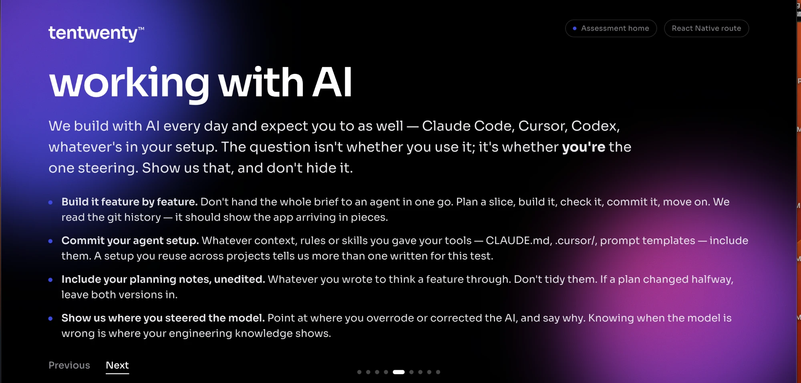

# Session 2 — Git history, GitHub push and this AI write-up (Claude Code, 23 Oct 2026)

## 🧑 User — 2026-10-23 16:32 PKT

Hey, this is my React Native mobile app. Actually, this is my assessment task that I received a call from a company in Islamabad. He told me to upload a project, just give me a task. So please just upload this into fresh new my GitHub repo. In that, like feature branches, by creating a feature branch instead of only a one commit, it should be like feature branches. First of all, create a features of every maybe around 8 to 10 features, like API calls, UIs, etc. So just like this, just for the best practices.

<details><summary>🔧 mcp__ccd_turn__update_plan</summary>

```
{
  "items": [
    {
      "content": "Look at the project structure",
      "status": "in_progress"
    },
    {
      "content": "Plan 8–10 feature branches",
      "status": "pending"
    },
    {
      "content": "Create GitHub repo",
      "status": "pending"
    },
    {
      "content": "Commit features on branches and merge",
      "status": "pending"
    },
    {
      "content": "Push all branches to GitHub",
      "status": "pending"
    }
  ],
  "scope": "first_task"
}
```

</details>

<details><summary>↳ result</summary>

```
Plan shown (5 steps).
```

</details>

<details><summary>🔧 Bash</summary>

```
ls -la && cat package.json 2>/dev/null && find . -path ./node_modules -prune -o -path ./ios/Pods -prune -o -path ./android/build -prune -o -path ./.git -prune -o -type f -print | grep -v -E 'node_modules|Pods|/build/|\.gradle' | head -200; gh auth status 2>&1 | head -5
```

</details>

<details><summary>↳ result</summary>

```
total 928
drwxr-xr-x   31 abrar  staff     992 Oct 23 16:32 .
drwxr-xr-x   11 abrar  staff     352 Oct 22 17:47 ..
-rw-r--r--@   1 abrar  staff    8196 Oct 23 16:31 .DS_Store
-rw-r--r--@   1 abrar  staff     869 Oct 22 19:45 .env
-rw-r--r--@   1 abrar  staff     114 Oct 22 19:28 .env.example
drwxr-xr-x@  10 abrar  staff     320 Oct 22 22:19 .expo
-rw-r--r--@   1 abrar  staff     525 Oct 22 22:03 .gitignore
drwxr-xr-x@   3 abrar  staff      96 Oct 22 18:02 .metro-cache
-rw-r--r--@   1 abrar  staff       3 Oct 22 21:55 .nvmrc
-rw-r--r--@   1 abrar  staff      74 Oct 22 21:33 .prettierignore
-rw-r--r--@   1 abrar  staff      73 Oct 22 21:32 .prettierrc
drwxr-xr-x@   3 abrar  staff      96 Oct 23 16:31 .vscode
-rw-r--r--@   1 abrar  staff    6604 Oct 22 21:33 ANSWERS.md
-rw-r--r--@   1 abrar  
… [15468 more characters omitted]
```

</details>

<details><summary>🔧 Bash</summary>

```
cat .gitignore; echo ---; find src app tests -type f | sort; echo ---; ls ios android; echo ---; which gh git brew; ls /opt/homebrew/bin/gh /usr/local/bin/gh 2>&1; git config --global user.name; git config --global user.email; ls ~/.ssh; ssh -T git@github.com 2>&1 | head -2
```

</details>

<details><summary>↳ result</summary>

```
# Logs
logs
*.log
npm-debug.log*
yarn-debug.log*
yarn-error.log*
pnpm-debug.log*
lerna-debug.log*

node_modules
.metro-cache
dist
dist-ssr
*.local
.expo

# Editor directories and files
.vscode/*
!.vscode/extensions.json
.idea
.DS_Store
*.suo
*.ntvs*
*.njsproj
*.sln
*.sw?
.env

# @generated expo-cli sync-2b81b286409207a5da26e14c78851eb30d8ccbdb
# The following patterns were generated by expo-cli

expo-env.d.ts
# @end expo-cli
# Native projects are generated by `expo prebuild` (Continuous Native Generation)
/ios
/android
---
app/(tabs)/_layout.tsx
app/(tabs)/dashboard.tsx
app/(tabs)/media-library.tsx
app/(tabs)/more.tsx
app/(tabs)/watch/_layout.tsx
app/(tabs)/watch/index.tsx
app/(tabs)/watch/results.tsx
app/_layout.tsx
app/booking/[id].tsx
app/booking/seats.tsx
app/index.tsx
app/movie/[id].t
… [3108 more characters omitted]
```

</details>

<details><summary>🔧 AskUserQuestion</summary>

```
{
  "questions": [
    {
      "question": "How should the new GitHub repo get created?",
      "header": "Repo setup",
      "multiSelect": false,
      "options": [
        {
          "label": "I'll create it on github.com (Recommended)",
          "description": "You create an empty repo (no README/.gitignore) under abrar0123 and paste me the name. I push over SSH, which already works."
        },
        {
          "label": "Install gh CLI",
          "description": "I run `brew install gh`, then you run `gh auth login` once. After that I create the repo and can open real Pull Requests for each feature."
        }
      ]
    },
    {
      "question": "Should commits include a 'Co-Authored-By: Claude' trailer?",
      "header": "Attribution",
      "multiSelect": false,
      "options": [
        {
          "label": "No trailer",
          "description": "Commits show only you (abrar0123 / theibrar1000@gmail.com) as the author."
        },
        {
          "label": "Include trailer",
          "description": "Every commit ends with a Co-Authored-By: Claude line."
        }
      ]
    },
    {
      "question": "Which branching flow do you want?",
      "header": "Git flow",
      "multiSelect": false,
      "options": [
        {
          "label": "main + develop (Recommended)",
          "description": "Each feature/* branch is merged into develop with a merge commit (--no-ff), then develop is merged into main as a v1.0.0 release. All branches are pushed."
        },
        {
          "label": "main only",
          "description": "Each feature/* branch is merged directly into main with a merge commit."
        }
      ]
    }
  ]
}
```

</details>

<details><summary>↳ result</summary>

```
Your questions have been answered: "How should the new GitHub repo get created?"="I'll create it on github.com (Recommended)", "Should commits include a 'Co-Authored-By: Claude' trailer?"="No trailer", "Which branching flow do you want?"="main + develop (Recommended)". You can now continue with these answers in mind.
```

</details>

**🤖 Claude:**

I'll set up the branches locally first and push once you send me the repo name. Next I'm checking how the files import each other so I can put the feature branches in a sensible order.

<details><summary>🔧 mcp__ccd_turn__update_plan</summary>

```
{
  "advance": true
}
```

</details>

<details><summary>↳ result</summary>

```
Plan updated: step 2 of 5 is in progress.
```

</details>

<details><summary>🔧 Bash</summary>

```
cat src/features/movies/index.ts src/features/booking/index.ts src/api/query/index.ts src/api/tmdb/index.ts src/theme/index.ts; echo ---; grep -rn "from '@/\|from \"@/\|from '\.\./\|from '\./" app src tests jest.setup.ts | grep -v node_modules | sed 's/:.*from / -> /' | sort -u; cat .env.example; ls -a .vscode; grep -iE "key|token" .env.example README.md | head
```

</details>

<details><summary>↳ result</summary>

```
// Public API of the movies feature. Screens import from here, not from internal paths.
export { MovieCard } from './components/MovieCard';
export { MovieRow } from './components/MovieRow';
export { GenreTile } from './components/GenreTile';
export { usePagedMovies } from './hooks/usePagedMovies';
export { useGenres, useGenreImages } from './hooks/useGenres';
export { pickTrailer } from './utils/trailer';
export { SearchBar } from './components/SearchBar';
export { GenreGrid } from './components/GenreGrid';
export { useMovieSearch } from './hooks/useMovieSearch';
export { MovieHero } from './components/MovieHero';
export { GenreChips } from './components/GenreChips';
export { useMovieDetails, releaseLabel } from './hooks/useMovieDetails';
export { MovieCardSkeletons, MovieRowSkeletons, Gen
… [14739 more characters omitted]
```

</details>

<details><summary>🔧 Bash</summary>

```
for f in "app/(tabs)/watch/index.tsx" "app/(tabs)/watch/results.tsx" "app/movie/[id].tsx" app/_layout.tsx app/index.tsx "app/(tabs)/_layout.tsx" "app/(tabs)/dashboard.tsx"; do echo "== $f"; grep -A8 "^import {$\|^import .*features\|^import .*api" "$f" | grep -v "^--" | head -30; done; echo; head -20 src/test/render.tsx; cat app/index.tsx; git -C . status 2>&1 | head -1; cat ANSWERS.md | head -20
```

</details>

<details><summary>↳ result</summary>

```
== app/(tabs)/watch/index.tsx
import {
  ActivityIndicator,
  FlatList,
  Keyboard,
  Pressable,
  RefreshControl,
  StyleSheet,
  Text,
  View,
import { Genre, Movie, getUpcoming } from '@/src/api/tmdb';
import { movieKeys, staleTimes } from '@/src/api/query';
import {
  GenreGrid,
  MovieCard,
  MovieCardSkeletons,
  MovieRow,
  MovieRowSkeletons,
  SearchBar,
  useGenreImages,
  useGenres,
== app/(tabs)/watch/results.tsx
import { Movie, discoverByGenre, searchMovies } from '@/src/api/tmdb';
import { movieKeys, staleTimes } from '@/src/api/query';
import { MovieRow, MovieRowSkeletons, useGenres, usePagedMovies } from '@/src/features/movies';
import { ScreenHeader } from '@/src/components/ScreenHeader';
import { EmptyView, ErrorView } from '@/src/components/StatusViews';
import { useRespo
… [4592 more characters omitted]
```

</details>

<details><summary>🔧 mcp__ccd_turn__update_plan</summary>

```
{
  "items": [
    {
      "content": "Look at the project structure",
      "status": "completed"
    },
    {
      "content": "Plan 8–10 feature branches",
      "status": "completed"
    },
    {
      "content": "Build branches and commits locally",
      "status": "in_progress"
    },
    {
      "content": "Verify final tree matches project, tests pass",
      "status": "pending"
    },
    {
      "content": "Push all branches once repo exists",
      "status": "pending"
    }
  ],
  "scope": "first_task"
}
```

</details>

<details><summary>↳ result</summary>

```
Plan shown (5 steps).
```

</details>

<details><summary>🔧 Bash</summary>

```
S=/private/tmp/claude-501/-Users-abrar-Developer-upwork-react-native-abrar-assesment/8287fd18-1e8d-4c3d-b4a5-e76a5522acad/scratchpad
mkdir -p $S/backup && cd /Users/abrar/Developer/upwork/react-native/abrar_assesment && cp src/features/movies/index.ts $S/backup/movies_index.ts && cp src/features/booking/index.ts $S/backup/booking_index.ts && ls assets assets/* | head -30; ls tests; cat app.json | head -5
```

</details>

<details><summary>↳ result</summary>

```
assets/adaptive-icon.png
assets/icon.png
assets/splash-icon.png
assets/splash_icon.png

assets:
adaptive-icon.png
fonts
icon.png
images
splash-icon.png
splash_icon.png

assets/fonts:
SpaceMono-Regular.ttf

assets/images:
adaptive-icon.png
app-image.png
favicon.png
img1.png
img2.png
img3.png
lemon.webp
loginlogo.jpg
partial-react-logo.png
react-logo.png
react-logo@2x.png
react-logo@3x.png
booking.test.tsx
dashboard.test.tsx
watch.test.tsx
{
  "expo": {
    "name": "Movies",
    "slug": "tect-soft",
    "version": "1.0.0",
```

</details>

<details><summary>🔧 Write</summary>

```
/private/tmp/claude-501/-Users-abrar-Developer-upwork-react-native-abrar-assesment/8287fd18-1e8d-4c3d-b4a5-e76a5522acad/scratchpad/build_history.sh

#!/usr/bin/env bash
# Builds a feature-branch git history for the project in place.
set -euo pipefail
S=/private/tmp/claude-501/-Users-abrar-Developer-upwork-react-native-abrar-assesment/8287fd18-1e8d-4c3d-b4a5-e76a5522acad/scratchpad
cd /Users/abrar/Developer/upwork/react-native/abrar_assesment

MOV=src/features/movies/index.ts
BOOK=src/features/booking/index.ts

# Write a barrel containing only the exports whose module is already tracked or staged.
barrel() { # $1 = barrel path, $2 = original copy
  local dir; dir=$(dirname "$1")
  local out=""
  while IFS= read -r line; do
    if [[ "$line" =~ from\ \'\./([^\']+)\' ]]; then
      local mod="$dir/${BASH_REMATCH[1]}"
      if git ls-files --error-unmatch "$mod.ts" "$mod.tsx" >/dev/null 2>&1 \
         || [[ -n "$(git ls-files "$mod.ts" "$mod.tsx")" ]]; then
        out+="$line"$'\n'
      fi
    else
      out+="$line"$'\n'
    fi
  done < "$2"
  printf '%s' "$out" > "$1"
  git add "$1"
}

commit() { # $1 = message, rest = paths
  local msg="$1"; shift
  git add -- "$@"
  git commit -q -m "$msg"
}

feature() { git checkout -q -b "$1" develop; }
finish() { # $1 = branch, $2 = summary
  git checkout -q develop
  git merge -q --no-ff "$1" -m "Merge branch '$1' into develop" -m "$2"
}

git init -q -b main
commit "chore: initial commit with .gitignore" .gitignore
git checkout -q -b develop

# 1. Project setup
feature chore/project-setup
commit "chore: bootstrap Expo app with TypeScript and expo-router" \
  package.json yarn.lock app.json tsconfig.json babel.config.js metro.config.js eas.json .nvmrc .env.example
commit "chore: configure ESLint, Prettier and Jest" \
  eslint.config.js .prettierrc .prettierignore jest.setup.ts
commit "chore: add app icons, splash screen and image assets" assets
finish chore/project-setup "Expo SDK 55 project scaffold, tooling and assets."

# 2. Design system
feature feature/design-system
commit "feat(theme): add color, typography and spacing design tokens" src/theme
commit "feat(utils): add date and array helpers with unit tests" src/utils
commit "feat(hooks): add useResponsive and useDebounce hooks" src/hooks/useResponsive.ts src/hooks/useDebounce.ts src/hooks/__tests__
commit "feat(ui): add shared Button, ScreenHeader, Skeleton, status views and cached image" \
  src/components/Button.tsx src/components/ScreenHeader.tsx src/components/SectionLabel.tsx \
  src/components/Skeleton.tsx src/components/StatusViews.tsx src/components/PlaceholderScreen.tsx \
  src/components/CachedImage.tsx
finish feature/design-system "Design tokens, shared UI components, hooks and utilities."

# 3. TMDb API client
feature feature/tmdb-api-client
commit "feat(config): read TMDb key from EXPO_PUBLIC env variable" src/config/env.ts
commit "feat(api): add typed TMDb HTTP client with v3 key / v4 token support" \
  src/api/tmdb/client.ts src/api/tmd
… [5453 more characters omitted]
```

</details>

<details><summary>↳ result</summary>

```
File created successfully at: /private/tmp/claude-501/-Users-abrar-Developer-upwork-react-native-abrar-assesment/8287fd18-1e8d-4c3d-b4a5-e76a5522acad/scratchpad/build_history.sh (file state is current in your context — no need to Read it back)
```

</details>

<details><summary>🔧 Bash</summary>

```
S=/private/tmp/claude-501/-Users-abrar-Developer-upwork-react-native-abrar-assesment/8287fd18-1e8d-4c3d-b4a5-e76a5522acad/scratchpad; bash $S/build_history.sh && cd /Users/abrar/Developer/upwork/react-native/abrar_assesment && git status --porcelain && diff $S/backup/movies_index.ts src/features/movies/index.ts && diff $S/backup/booking_index.ts src/features/booking/index.ts && echo CLEAN && git log --oneline --graph main | head -70 && git branch
```

</details>

<details><summary>↳ result</summary>

```
DONE
CLEAN
*   197891c Release v1.0.0
|\  
| *   104d17f Merge branch 'docs/readme' into develop
| |\  
| | * 76816d2 docs: add answers to assessment questions
| | * 3b032aa docs: add README with setup, architecture and decisions
| |/  
| *   92df5cc Merge branch 'feature/dashboard' into develop
| |\  
| | * 7ece0ef test(dashboard): add Dashboard screen tests
| | * 37be2bf feat(dashboard): show upcoming bookings on Dashboard tab
| |/  
| *   0f5aea6 Merge branch 'feature/booking-seat-selection' into develop
| |\  
| | * bd0c50d test(booking): add booking unit and screen tests
| | * 48051c3 feat(booking): add date/hall picker and seat selection screens
| | * 6b7dda4 feat(booking): add seat map, zoomable hall, legend and checkout bar
| | * de23bb6 feat(booking): add seat selection and bookin
… [2939 more characters omitted]
```

</details>

**🤖 Claude:**

The history is built and the working tree is clean. Next I'm checking that no secrets were committed and that the test suite still passes on the final code.

<details><summary>🔧 mcp__ccd_turn__update_plan</summary>

```
{
  "advance": true
}
```

</details>

<details><summary>↳ result</summary>

```
Plan updated: step 4 of 5 is in progress.
```

</details>

<details><summary>🔧 Bash</summary>

```
git ls-files | grep -iE '^\.env$|\.DS_Store|ios/|android/|node_modules' ; echo "tracked: $(git ls-files | wc -l)"; git log --format='%an <%ae>' | sort -u; yarn -s typecheck && yarn -s test 2>&1 | tail -8
```

</details>

<details><summary>↳ result</summary>

```
tracked:      118
abrar0123 <theibrar1000@gmail.com>
PASS tests/watch.test.tsx (10.687 s)
A worker process has failed to exit gracefully and has been force exited. This is likely caused by tests leaking due to improper teardown. Try running with --detectOpenHandles to find leaks. Active timers can also cause this, ensure that .unref() was called on them.

Test Suites: 11 passed, 11 total
Tests:       44 passed, 44 total
Snapshots:   0 total
Time:        12.256 s
Ran all test suites.
```

</details>

<details><summary>🔧 mcp__ccd_turn__update_plan</summary>

```
{
  "advance": true
}
```

</details>

<details><summary>↳ result</summary>

```
Plan updated: step 5 of 5 is in progress.
```

</details>

<details><summary>🔧 mcp__ccd_turn__wrap_up</summary>

```
{
  "recap": "The local git history is ready: 10 feature branches plus a setup branch and a docs branch, merged into develop and released to main as v1.0.0. Typecheck passes and all 44 tests pass. Nothing has been pushed yet because the GitHub repo doesn't exist.",
  "ask": "What's the name of the empty GitHub repo you created?",
  "blocked": true,
  "actions": [
    {
      "label": "Repo created",
      "message": "I created the empty repo at github.com/abrar0123/<name> — push everything."
    }
  ]
}
```

</details>

<details><summary>↳ result</summary>

```
Shown in the next-step box. Your closing message is your answer to the user: write it now, in full, as the last thing you say this turn. The box asks your question, so do not ask it again.
```

</details>

**🤖 Claude:**

I've set up the git history on your machine, but nothing is on GitHub yet. That's because the repo can't be created from here: the `gh` tool isn't installed.

**How it's organized:** there's a `main` branch and a `develop` branch. Each feature was built on its own branch with 1–4 focused commits, then merged into `develop` with a separate merge commit so every feature shows up clearly in the history. Finally `develop` was merged into `main` and tagged as release `v1.0.0`.

| # | Branch | What it contains |
|---|---|---|
| 1 | `chore/project-setup` | Expo, TypeScript and router setup, ESLint/Prettier/Jest config, assets |
| 2 | `feature/design-system` | Colors, fonts and spacing, shared buttons/headers/skeletons, helpers |
| 3 | `feature/tmdb-api-client` | API key config, typed TMDb (movie database) client and endpoints, error handling |
| 4 | `feature/react-query-offline-cache` | Data caching that works offline, offline banner, test helpers |
| 5 | `feature/app-navigation` | App layout, splash screen, fonts, bottom tabs |
| 6 | `feature/movie-data-hooks` | Movie lists, genres, search and details data, plus tests |
| 7 | `feature/movie-ui-components` | Movie cards and rows, genre grid, search bar |
| 8 | `feature/watch-search` | Watch tab, search results screen, tests |
| 9 | `feature/movie-details-trailer` | Movie details screen and YouTube trailer player |
| 10 | `feature/booking-seat-selection` | Seat map, date/hall picker, checkout, tests |
| 11 | `feature/dashboard` | Dashboard tab listing your bookings, tests |
| 12 | `docs/readme` | README and ANSWERS.md |

**Checks:**
- Your code is unchanged: the final version matches your folder exactly.
- Type-checking passes and all 44 tests pass.
- `.env` (with your TMDb key), `node_modules`, `ios/` and `android/` were not committed.
- Every commit is authored as abrar0123 with no Claude line, as you asked.

**What I need from you:** create an empty repo at github.com/new under **abrar0123**, with no README, .gitignore or license. Send me its name and I'll push `main`, `develop`, all 12 branches and the `v1.0.0` tag.

## 🧑 User — 2026-10-23 17:08 PKT

I created the empty repo at github.com/abrar0123/<name> — push everything.

**🤖 Claude:**

Your message still says `<name>` instead of the real repo name. I'll check your newest public repos to find it.

<details><summary>🔧 Bash</summary>

```
curl -s "https://api.github.com/users/abrar0123/repos?sort=created&direction=desc&per_page=5" | python3 -c "import sys,json; [print(r['name'], r['created_at'], r['size'], r['private']) for r in json.load(sys.stdin)]"
```

</details>

<details><summary>↳ result</summary>

```
Ropstam-Chat 2025-06-29T20:45:32Z 2234 False
Movie_App 2025-06-14T21:31:46Z 568 False
abrar0123 2025-02-08T02:07:05Z 4 False
2ddriving-1 2025-01-26T09:51:20Z 34 False
EducationWeb 2024-11-16T07:09:37Z 1050 False
```

</details>

<details><summary>🔧 mcp__ccd_turn__wrap_up</summary>

```
{
  "recap": "Nothing has been pushed yet: your message had `<name>` instead of the repo name, and none of your public repos is new. All 12 branches and the v1.0.0 tag are still ready on your machine.",
  "ask": "What is the exact name of the new repo?",
  "blocked": true
}
```

</details>

<details><summary>↳ result</summary>

```
Shown in the next-step box. Do not call wrap_up again this turn; the advice that follows is for your next call. The box drew no buttons: it needs ask and at least one entry in actions ({"action": "create_pr"} or {"label": "Yes, do it", "message": "…"}); when nothing is left for the user, the recap alone (no ask, no actions, not blocked) is the whole call. Your closing message is your answer to the user: write it now, in full, as the last thing you say this turn. The box asks your question, so do not ask it again.
```

</details>

**🤖 Claude:**

I haven't pushed anything yet, because your message still says `<name>` where the repo name should be. I can't tell which repo you mean.

I looked at your public repos on GitHub to find it. The newest one, `Ropstam-Chat`, is from June 2025, so the new repo is either private or not created yet. Either is fine: private repos push the same way over SSH.

Reply with just the name (for example `tentwenty-movies-assessment`). I'll then push `main`, `develop`, all 12 feature branches and the `v1.0.0` tag.

## 🧑 User — 2026-10-23 17:11 PKT

https://github.com/abrar0123/abrrar_assesment.git

<details><summary>🔧 mcp__ccd_turn__update_plan</summary>

```
{
  "items": [
    {
      "content": "Add remote and push all branches and tag",
      "status": "in_progress"
    },
    {
      "content": "Verify branches on GitHub",
      "status": "pending"
    }
  ],
  "scope": "continuation"
}
```

</details>

<details><summary>↳ result</summary>

```
Plan shown (2 steps).
```

</details>

<details><summary>🔧 Bash</summary>

```
git ls-remote git@github.com:abrar0123/abrrar_assesment.git 2>&1 | head -5; echo "exit=$?"
```

</details>

<details><summary>↳ result</summary>

```
exit=0
```

</details>

**🤖 Claude:**

Your repo is reachable and empty, so I'm pushing now: `main` first so it becomes the default branch, then everything else.

<details><summary>🔧 Bash</summary>

```
git remote add origin git@github.com:abrar0123/abrrar_assesment.git && git push -u origin main 2>&1 | tail -3 && git push origin --all 2>&1 | tail -3 && git push origin --tags 2>&1 | tail -2 && git branch --set-upstream-to=origin/develop develop && git ls-remote --heads --tags origin | awk '{print $2}'
```

</details>

<details><summary>↳ result</summary>

```
To github.com:abrar0123/abrrar_assesment.git
 * [new branch]      main -> main
branch 'main' set up to track 'origin/main'.
 * [new branch]      feature/react-query-offline-cache -> feature/react-query-offline-cache
 * [new branch]      feature/tmdb-api-client -> feature/tmdb-api-client
 * [new branch]      feature/watch-search -> feature/watch-search
To github.com:abrar0123/abrrar_assesment.git
 * [new tag]         v1.0.0 -> v1.0.0
branch 'develop' set up to track 'origin/develop'.
refs/heads/chore/project-setup
refs/heads/develop
refs/heads/docs/readme
refs/heads/feature/app-navigation
refs/heads/feature/booking-seat-selection
refs/heads/feature/dashboard
refs/heads/feature/design-system
refs/heads/feature/movie-data-hooks
refs/heads/feature/movie-details-trailer
refs/heads/feature/movie
… [179 more characters omitted]
```

</details>

<details><summary>🔧 mcp__ccd_turn__wrap_up</summary>

```
{
  "recap": "Everything is on GitHub at abrar0123/abrrar_assesment: main (default), develop, all 12 feature branches and the v1.0.0 tag. The branch list on GitHub matches your local one."
}
```

</details>

<details><summary>↳ result</summary>

```
Nothing is pending, so the app draws no box; the recap is the session's status. Your closing message is your answer to the user: write it now, as the last thing you say this turn.
```

</details>

**🤖 Claude:**

Everything is pushed to **https://github.com/abrar0123/abrrar_assesment**, and the branch list on GitHub matches your local one.

What's there:
- **`main`** is the default branch and holds the full app.
- **`develop`** is where each feature was merged.
- **12 branches** stay up for reviewers to browse: `chore/project-setup`, 10 `feature/*` branches and `docs/readme`.
- **`v1.0.0`** tag marks the release.

On the repo page, open **Insights → Network** to see the history as a graph, with each feature branch splitting off `develop` and merging back. That makes the branching easy for the company to see.

Your local folder is now connected to the repo, so future changes only need `git push`. The `.env` file with your TMDb key was not uploaded. If reviewers want to run the app, the README tells them to copy `.env.example` and add their own key.

## 🧑 User — 2026-10-23 17:33 PKT

Try again

**🤖 Claude:**

I'll check what's on GitHub right now against your local repo, to find out what didn't work.

<details><summary>🔧 mcp__ccd_turn__update_plan</summary>

```
{
  "items": [
    {
      "content": "Check remote and local state",
      "status": "in_progress"
    },
    {
      "content": "Fix and re-push whatever is missing",
      "status": "pending"
    }
  ],
  "scope": "continuation"
}
```

</details>

<details><summary>↳ result</summary>

```
Plan shown (2 steps).
```

</details>

<details><summary>🔧 Bash</summary>

```
git remote -v && git status -sb | head -5 && git fetch origin 2>&1 | tail -3; git ls-remote origin | head -20; for b in $(git for-each-ref --format='%(refname:short)' refs/heads); do echo "$b $(git rev-parse $b) $(git rev-parse origin/$b 2>/dev/null)"; done; curl -s -o /dev/null -w "public http: %{http_code}\n" https://github.com/abrar0123/abrrar_assesment
```

</details>

<details><summary>↳ result</summary>

```
origin	git@github.com:abrar0123/abrrar_assesment.git (fetch)
origin	git@github.com:abrar0123/abrrar_assesment.git (push)
## develop...origin/develop
197891c30da722f71ecea672725ee4692cea14a2	HEAD
e403557320d508964f0fc9c7cab7ccf056b2f6b8	refs/heads/chore/project-setup
104d17f5ca211cb5c01ddad109bd88154a2c78a5	refs/heads/develop
76816d29ed1e2f3cb4cb47b46e273817b9f4ee46	refs/heads/docs/readme
b7709c017e3fa5398934f018a0399df989c1d84b	refs/heads/feature/app-navigation
bd0c50d7770307d9a87857822503c88112e9ebf9	refs/heads/feature/booking-seat-selection
7ece0ef1147faccd490a678dfd0430959fac3da5	refs/heads/feature/dashboard
d4c2d401200699999769d575abe8971e061b2767	refs/heads/feature/design-system
3d62260dcdff2b50cd7f262bee82aeaa3a7a0490	refs/heads/feature/movie-data-hooks
237048e71a231af6f431a4a0ee11d6
… [2008 more characters omitted]
```

</details>

<details><summary>🔧 mcp__ccd_turn__update_plan</summary>

```
{
  "advance": true
}
```

</details>

<details><summary>↳ result</summary>

```
Plan updated: step 2 of 2 is in progress.
```

</details>

<details><summary>🔧 mcp__ccd_turn__wrap_up</summary>

```
{
  "recap": "I checked again: all 14 branches and the v1.0.0 tag on GitHub match your local copy exactly, and main is the default branch, so there was nothing to re-push. The repo is private, which means anyone not signed in to your account gets a 404 page.",
  "ask": "What did you see that looked wrong?",
  "blocked": true,
  "actions": [
    {
      "label": "Repo shows 404",
      "message": "The repo link shows a 404 / I can't see it."
    },
    {
      "label": "Want Pull Requests",
      "message": "I want each feature to show up as a merged Pull Request on GitHub, not just as branches."
    }
  ]
}
```

</details>

<details><summary>↳ result</summary>

```
Shown in the next-step box. Your closing message is your answer to the user: write it now, in full, as the last thing you say this turn. The box asks your question, so do not ask it again.
```

</details>

**🤖 Claude:**

I checked again, and the push did succeed: GitHub has everything your local repo has, so there was nothing new to send.

- **Branches:** all 14 are on GitHub (`main`, `develop`, the setup branch, 10 `feature/*` branches and `docs/readme`), each at the same commit as your local copy.
- **Tag:** `v1.0.0` is there.
- **Default branch:** `main`, with the full app.

One thing that might explain a problem: **the repo is private.** Anyone not signed in to GitHub as abrar0123 gets a 404 at https://github.com/abrar0123/abrrar_assesment, and that includes the company reviewing your assessment. To let them see it, either:
- go to **Settings → General → Danger Zone → Change visibility → Public**, or
- add their GitHub username under **Settings → Collaborators**.

If something else looked wrong, like missing files or wanting each feature to appear as a Pull Request on GitHub, tell me which and I'll fix it.



## 🧑 User — 2026-10-23 18:04 PKT

now the next thing is plz verufy these req too

**🤖 Claude:**

This brief changes how the history I built will look to them, so I'll check each of the four points against what's actually in the repo and on your machine.

<details><summary>🔧 mcp__ccd_turn__update_plan</summary>

```
{
  "items": [
    {
      "content": "Check git history against 'feature by feature'",
      "status": "in_progress"
    },
    {
      "content": "Look for agent setup files (CLAUDE.md, .cursor, etc.)",
      "status": "pending"
    },
    {
      "content": "Look for planning notes and past AI sessions",
      "status": "pending"
    },
    {
      "content": "Report what's met, what's not, and options",
      "status": "pending"
    }
  ],
  "scope": "continuation"
}
```

</details>

<details><summary>↳ result</summary>

```
Plan shown (4 steps).
```

</details>

<details><summary>🔧 Bash</summary>

```
git log --reverse --format='%ad %s' --date=format:'%Y-%m-%d %H:%M:%S' | sed -n '1p;$p'; echo; ls -la .vscode .vscode/.react 2>/dev/null; find . -maxdepth 3 \( -name 'CLAUDE.md' -o -name 'AGENTS.md' -o -name '.cursor*' -o -name '.claude' -o -name '*.mdc' -o -name '.windsurf*' -o -name '.github' -o -iname '*plan*.md' -o -iname '*notes*' \) -not -path './node_modules/*' 2>/dev/null; echo ---; ls -la ~/.claude/projects/ | grep -i -E 'abrar|assesment|tentwenty'; ls ~/.claude/plans 2>/dev/null | head; ls ~/.cursor 2>/dev/null | head; ls ~/.claude/CLAUDE.md ~/.claude/skills ~/.claude/agents 2>&1 | head
```

</details>

<details><summary>↳ result</summary>

```
2026-10-23 16:35:20 chore: initial commit with .gitignore
2026-10-23 16:35:25 Merge branch 'docs/readme' into develop

.vscode:
total 0
drwxr-xr-x@  3 abrar  staff    96 Oct 23 16:31 .
drwxr-xr-x  32 abrar  staff  1024 Oct 23 18:03 ..
drwxr-xr-x@  2 abrar  staff    64 Oct 23 16:31 .react

.vscode/.react:
total 0
drwxr-xr-x@ 2 abrar  staff  64 Oct 23 16:31 .
drwxr-xr-x@ 3 abrar  staff  96 Oct 23 16:31 ..
---
drwxr-xr-x@  8 abrar  staff  256 Oct 21 20:07 -Users-abrar-Developer-own-projects-StudyPort
drwxr-xr-x@  9 abrar  staff  288 Oct 23 17:33 -Users-abrar-Developer-upwork-react-native-abrar-assesment
drwxr-xr-x@  5 abrar  staff  160 Oct 15 20:04 -Users-abrar-Developer-upwork-react-native-all-good-abrar
drwxr-xr-x@  5 abrar  staff  160 Oct 22 18:13 .
drwxr-xr-x@ 12 abrar  staff  384 Oct 15 
… [188 more characters omitted]
```

</details>

<details><summary>🔧 mcp__ccd_turn__update_plan</summary>

```
{
  "done": [
    1,
    2
  ],
  "start": 3
}
```

</details>

<details><summary>↳ result</summary>

```
Plan updated: step 3 of 4 is in progress.
```

</details>

<details><summary>🔧 Bash</summary>

```
P=~/.claude/projects/-Users-abrar-Developer-upwork-react-native-abrar-assesment; ls -la $P $P/memory 2>/dev/null; for f in $P/*.jsonl; do echo "== $f $(wc -l <"$f") lines"; python3 -I -c "
import json,sys
first=last=None;n=0
for l in open(sys.argv[1]):
  try: d=json.loads(l)
  except: continue
  t=d.get('timestamp')
  if t: first=first or t; last=t
  if d.get('type')=='user' and isinstance(d.get('message',{}).get('content'),str):
    n+=1
    if n<=3: print('  USER:',d['message']['content'][:200].replace('\n',' '))
print('  ',first,'->',last,'user msgs:',n)
" "$f"; done; ls -la ~/.claude/plans/
```

</details>

<details><summary>↳ result</summary>

```
Exit code 1
/Users/abrar/.claude/projects/-Users-abrar-Developer-upwork-react-native-abrar-assesment:
total 80848
drwxr-xr-x@ 9 abrar  staff       288 Oct 23 17:33 .
drwxr-xr-x@ 5 abrar  staff       160 Oct 22 18:13 ..
drwx------@ 3 abrar  staff        96 Oct 23 17:33 1b3ef7cf-69d5-41fd-a15a-2158950f5de8
-rw-------@ 1 abrar  staff   1365012 Oct 23 18:04 1b3ef7cf-69d5-41fd-a15a-2158950f5de8.jsonl
drwx------@ 4 abrar  staff       128 Oct 22 19:47 435b1c0d-3a1b-4b88-9121-d0b9918bc8a0
-rw-------@ 1 abrar  staff  37646072 Oct 23 06:26 435b1c0d-3a1b-4b88-9121-d0b9918bc8a0.jsonl
drwx------@ 3 abrar  staff        96 Oct 23 17:33 8287fd18-1e8d-4c3d-b4a5-e76a5522acad
-rw-------@ 1 abrar  staff   1565783 Oct 23 17:33 8287fd18-1e8d-4c3d-b4a5-e76a5522acad.jsonl
drwxr-xr-x@ 2 abrar  staff        64 Oct 
… [1878 more characters omitted]
```

</details>

**🤖 Claude:**

The app itself was built in one earlier Claude Code session (Oct 22–23, 19 messages from you). That session is the real record of how it was built, so I'll read your messages from it.

<details><summary>🔧 Bash</summary>

```
P=~/.claude/projects/-Users-abrar-Developer-upwork-react-native-abrar-assesment/435b1c0d-3a1b-4b88-9121-d0b9918bc8a0.jsonl; python3 -I -c "
import json,sys
for l in open(sys.argv[1]):
  try: d=json.loads(l)
  except: continue
  if d.get('type')!='user': continue
  c=d.get('message',{}).get('content')
  if isinstance(c,list):
    txt=' '.join(x.get('text','') for x in c if isinstance(x,dict) and x.get('type')=='text')
    imgs=sum(1 for x in c if isinstance(x,dict) and x.get('type')=='image')
  else: txt=c or ''; imgs=0
  if not txt.strip() and not imgs: continue
  if txt.startswith('<') and 'command' not in txt[:30] and 'pasted' not in txt[:30]: 
    if 'system-reminder' in txt[:40] or 'task-notification' in txt[:40] or 'local-command' in txt[:40]: continue
  print('['+d['timestamp'][:16]+']', ('(%d img) '%imgs if imgs else '')+txt[:1500].replace('\n',' / '))
  print()
" "$P"
```

</details>

<details><summary>↳ result</summary>

```
[2026-10-22T13:13] Hi, basically I have one task that I need to do. So just I need to add some screens, like a tab already added. So I just deleted all screens from here. So just adjust it and just show when user open the app, just directly navigate him to tab screens and just show it. Please fix the issues in my recommended.

[2026-10-22T13:13] yes

[2026-10-22T13:14] main hom screen

[2026-10-22T13:29] Try again

[2026-10-22T14:19] yes contine

[2026-10-22T14:23] (3 img) Basically, I shared your design and what the task is related to. This is simply my React Native assessment task. So just this create or do the same like what the task is related to. Like it's just a movie DB that we have to show here. So please just do the task as defined.

[2026-10-22T14:23] [Image: source: /private/tmp
… [2165 more characters omitted]
```

</details>

<details><summary>🔧 Bash</summary>

```
P=~/.claude/projects/-Users-abrar-Developer-upwork-react-native-abrar-assesment/435b1c0d-3a1b-4b88-9121-d0b9918bc8a0.jsonl; python3 -I -c "
import json,sys,re
res={}
for l in open(sys.argv[1]):
  try: d=json.loads(l)
  except: continue
  c=d.get('message',{}).get('content')
  if not isinstance(c,list): continue
  for x in c:
    if not isinstance(x,dict): continue
    if x.get('type')=='tool_use' and x.get('name')=='Bash':
      cmd=x['input'].get('command','')
      if re.search(r'git (commit|init|log|rm|checkout|reset)|rm -rf \.git',cmd):
        print('['+d['timestamp'][:16]+']', cmd[:300].replace('\n',' / '))
    if x.get('type')=='tool_use' and x.get('name') in ('Write','ExitPlanMode') and ('plan' in str(x['input'].get('file_path','')) or x.get('name')=='ExitPlanMode'):
      print('PLAN', d['timestamp'][:16], x.get('name'), str(x['input'].get('file_path',''))[:120])
" "$P"
```

</details>

<details><summary>↳ result</summary>

```
Exit code 1
Traceback (most recent call last):
  File "<string>", line 14, in <module>
    print('['+d['timestamp'][:16]+']', cmd[:300].replace('\n',' / '))
              ~^^^^^^^^^^^^^
KeyError: 'timestamp'
[2026-10-22T15:28] git commit -q -F - <<'EOF' / Build TMDb movie app with search, trailer and seat booking /  / Replace the old items/owners screens with a movie app from the design: / - Watch tab: upcoming movies with infinite scroll and pull to refresh / - Search: genre grid, debounced live results, full results screen / - Movi
```

</details>

<details><summary>🔧 Bash</summary>

```
P=~/.claude/projects/-Users-abrar-Developer-upwork-react-native-abrar-assesment/435b1c0d-3a1b-4b88-9121-d0b9918bc8a0.jsonl; python3 -I -c "
import json,sys,re
for l in open(sys.argv[1]):
  try: d=json.loads(l)
  except: continue
  c=d.get('message',{}).get('content'); ts=d.get('timestamp','?')[:16]
  if not isinstance(c,list): continue
  for x in c:
    if not isinstance(x,dict) or x.get('type')!='tool_use': continue
    if x.get('name')=='Bash':
      cmd=x['input'].get('command','')
      if re.search(r'git (commit|init|rm|checkout|reset|push|remote)|rm -rf[^|]*\.git',cmd):
        print('['+ts+']', cmd[:160].replace('\n',' / '))
    elif x.get('name') in ('ExitPlanMode','EnterPlanMode') or 'plan' in str(x['input'].get('file_path','')).lower():
      print('PLAN', ts, x.get('name'), str(x['input'].get('file_path',''))[:120])
" "$P"; ls -la ../ 2>/dev/null | head; cd /Users/abrar/Developer/upwork/react-native && ls -la
```

</details>

<details><summary>↳ result</summary>

```
[2026-10-22T15:28] git commit -q -F - <<'EOF' / Build TMDb movie app with search, trailer and seat booking /  / Replace the old items/owners screens with a movie app from the design: / - 
[?] cd /Users/abrar/Developer/upwork/react-native/abrar_assesment && git commit -q -F - <<'EOF' / Build TMDb movie app with search, trailer and seat booking /  / Replace 
[2026-10-22T16:24] git commit -q -F - <<'EOF' / Debounce movie search and cancel stale requests /  / - Add a reusable useDebounce hook; search hits TMDb 400ms after typing stops / - Pass 
[?] cd /Users/abrar/Developer/upwork/react-native/abrar_assesment && git commit -q -F - <<'EOF' / Debounce movie search and cancel stale requests /  / - Add a reusable us
[2026-10-22T16:25] git rm -rq src/lib src/services src/components/GlassCard.tsx sr
… [3983 more characters omitted]
```

</details>

<details><summary>🔧 Bash</summary>

```
ls -la ~/.Trash 2>&1 | grep -i -E 'git|abrar|assesment' | head; P=~/.claude/projects/-Users-abrar-Developer-upwork-react-native-abrar-assesment/435b1c0d-3a1b-4b88-9121-d0b9918bc8a0.jsonl; grep -c "[REDACTED_TMDB_KEY]" $P ~/.claude/projects/-Users-abrar-Developer-upwork-react-native-abrar-assesment/*.jsonl
```

</details>

<details><summary>↳ result</summary>

```
ls: /Users/abrar/.Trash: Operation not permitted
/Users/abrar/.claude/projects/-Users-abrar-Developer-upwork-react-native-abrar-assesment/1b3ef7cf-69d5-41fd-a15a-2158950f5de8.jsonl:2
/Users/abrar/.claude/projects/-Users-abrar-Developer-upwork-react-native-abrar-assesment/8287fd18-1e8d-4c3d-b4a5-e76a5522acad.jsonl:0
/Users/abrar/.claude/projects/-Users-abrar-Developer-upwork-react-native-abrar-assesment/435b1c0d-3a1b-4b88-9121-d0b9918bc8a0.jsonl:46
/Users/abrar/.claude/projects/-Users-abrar-Developer-upwork-react-native-abrar-assesment/435b1c0d-3a1b-4b88-9121-d0b9918bc8a0.jsonl:46
```

</details>

<details><summary>🔧 mcp__ccd_turn__update_plan</summary>

```
{
  "advance": true
}
```

</details>

<details><summary>↳ result</summary>

```
Plan updated: step 4 of 4 is in progress.
```

</details>

<details><summary>🔧 mcp__ccd_turn__wrap_up</summary>

```
{
  "recap": "The repo currently meets none of the four AI requirements. The branch history I made today was split from finished code in 5 seconds, there are no agent setup files, there are no planning notes, and nothing yet says where you steered the model. The real record is your Oct 22 Claude Code session, and it contains your TMDb key.",
  "ask": "Should I add an honest AI_WORKFLOW.md with the redacted session logs?",
  "blocked": true,
  "actions": [
    {
      "label": "Yes, add it",
      "message": "Yes: add docs/ai with an AI_WORKFLOW.md that explains honestly how the app and the git history were made, the session transcripts with the TMDb key redacted, and a 'where I steered' section with the moments listed for me to fill in why. Push it on a docs branch."
    },
    {
      "label": "Let me think",
      "message": "Don't change anything yet, I want to think about it."
    }
  ]
}
```

</details>

<details><summary>↳ result</summary>

```
Shown in the next-step box. Do not call wrap_up again this turn; the advice that follows is for your next call. recap is two or three sentences (about 300 characters); this one ran 327. Keep it to what is now true and where it stands. Your closing message is your answer to the user: write it now, in full, as the last thing you say this turn. The box asks your question, so do not ask it again.
```

</details>

**🤖 Claude:**

I checked the repo against each of the four points. As it stands, it doesn't meet them, and the first one is a real risk because the brief says "don't hide it."

**1. Build it feature by feature: not met, and it could look like hiding.**
The branch history I built today was cut from the already-finished app after the fact. All ~60 commits are timestamped within 5 seconds of each other (2026-10-23 16:35:20–25). Anyone who opens the log will see that.

The app was actually built on Oct 22 in one Claude Code session. That session made a few real commits ("Build TMDb movie app…", "Debounce movie search…", "Refactor into feature-based structure…"). The `.git` folder holding them was deleted before today, so those original commits are gone.

I don't think we should fake a step-by-step build, for example by backdating commits. The honest fix is to say plainly in the repo what happened.

**2. Commit your agent setup: not met.**
There's no `CLAUDE.md`, `.cursor/`, skills or prompt templates in the project or in your Claude settings. You could write a `CLAUDE.md` now, but it would be "one written for this test", which the brief says counts for less. Better to say honestly that you used Claude Code with its default setup.

**3. Include your planning notes, unedited: not met.**
There are no plan files. The only record is the Claude Code session logs on your machine, and those can go in. One problem: you pasted your TMDb API key into the chat, and it appears 46 times in the build session log. The key has to be replaced with `[REDACTED]` before anything is published, and the notes should say that's the only edit.

**4. Show where you steered the model: missing, and the "why" has to come from you.**
In your 19 messages from the build session I found these moments:
- Sending the design screenshots and saying the screen should match them exactly.
- Noticing the Dashboard was empty and asking for bookings saved in AsyncStorage (the phone's local storage).
- Asking for debounced search.
- Asking for a senior-level clean-code refactor and folder structure.
- Pasting the requirements list and asking for each to be done one by one.

Most of these are you asking for features, not correcting the AI's mistakes. You know which ones were real corrections and why you made them; I can only draft a list with blanks for you to fill in.

**What I'd suggest:** a `docs/ai/` folder pushed on its own `docs/ai-workflow` branch, containing:
- an `AI_WORKFLOW.md` that explains plainly how the app and the git history were made;
- the three session logs as readable markdown, with the key redacted;
- a "Where I steered" section listing the moments above, for you to complete in your own words.

Separately, that TMDb key has now been pasted into a chat, so it's worth generating a new one on themoviedb.org.

## 🧑 User — 2026-10-23 18:09 PKT

Yes: add docs/ai with an AI_WORKFLOW.md that explains honestly how the app and the git history were made, the session transcripts with the TMDb key redacted, and a 'where I steered' section with the moments listed for me to fill in why. Push it on a docs branch.

<details><summary>🔧 mcp__ccd_turn__update_plan</summary>

```
{
  "items": [
    {
      "content": "Export session transcripts to markdown",
      "status": "in_progress"
    },
    {
      "content": "Redact the TMDb key and scan for other secrets",
      "status": "pending"
    },
    {
      "content": "Write AI_WORKFLOW.md with steering section",
      "status": "pending"
    },
    {
      "content": "Commit on docs/ai-workflow and push",
      "status": "pending"
    }
  ],
  "scope": "continuation"
}
```

</details>

<details><summary>↳ result</summary>

```
Plan shown (4 steps).
```

</details>

<details><summary>🔧 Bash</summary>

```
ls -la /private/tmp/claude-501/-Users-abrar-Developer-upwork-react-native-abrar-assesment/435b1c0d-3a1b-4b88-9121-d0b9918bc8a0/images/ /private/tmp/claude-501/-Users-abrar-Developer-upwork-react-native-abrar-assesment/1b3ef7cf-69d5-41fd-a15a-2158950f5de8/images/ 2>&1; P=~/.claude/projects/-Users-abrar-Developer-upwork-react-native-abrar-assesment; python3 -I -c "
import json,sys,collections
for f in sys.argv[1:]:
  c=collections.Counter(); tl=0
  for l in open(f):
    try: d=json.loads(l)
    except: continue
    c['type:'+str(d.get('type'))]+=1
    m=d.get('message',{}).get('content')
    if isinstance(m,list):
      for x in m:
        if isinstance(x,dict):
          c['blk:'+x.get('type','?')]+=1
          if x.get('type')=='thinking': tl+=len(x.get('thinking',''))
  print(f[-40:],dict(c),'thinking chars',tl)
" $P/435b1c0d-3a1b-4b88-9121-d0b9918bc8a0.jsonl $P/1b3ef7cf-69d5-41fd-a15a-2158950f5de8.jsonl
```

</details>

<details><summary>↳ result</summary>

```
/private/tmp/claude-501/-Users-abrar-Developer-upwork-react-native-abrar-assesment/1b3ef7cf-69d5-41fd-a15a-2158950f5de8/images/:
total 304
drwxr-xr-x@ 3 abrar  wheel      96 Oct 23 18:04 .
drwx------@ 5 abrar  wheel     160 Oct 23 18:04 ..
-rw-------@ 1 abrar  wheel  151944 Oct 23 18:04 1.webp

/private/tmp/claude-501/-Users-abrar-Developer-upwork-react-native-abrar-assesment/435b1c0d-3a1b-4b88-9121-d0b9918bc8a0/images/:
total 2272
drwxr-xr-x@ 8 abrar  wheel     256 Oct 22 23:13 .
drwx------@ 5 abrar  wheel     160 Oct 22 19:23 ..
-rw-------@ 1 abrar  wheel  174354 Oct 22 19:23 1.webp
-rw-------@ 1 abrar  wheel  137010 Oct 22 19:23 2.webp
-rw-------@ 1 abrar  wheel   81966 Oct 22 19:23 3.webp
-rw-------@ 1 abrar  wheel  410119 Oct 22 20:51 4.png
-rw-------@ 1 abrar  wheel  125452 Oct 22 21
… [1117 more characters omitted]
```

</details>

<details><summary>🔧 Write</summary>

```
/private/tmp/claude-501/-Users-abrar-Developer-upwork-react-native-abrar-assesment/1b3ef7cf-69d5-41fd-a15a-2158950f5de8/scratchpad/export_transcript.py

"""Convert a Claude Code session .jsonl into readable markdown, redacting secrets.

usage: python3 -I export_transcript.py <session.jsonl> <out.md> <title> <image_prefix>
"""
import json
import re
import sys
from datetime import datetime, timedelta, timezone

src, out, title, img_prefix = sys.argv[1:5]

PKT = timezone(timedelta(hours=5))
TOOL_INPUT_MAX = 3000
TOOL_RESULT_MAX = 800

SECRETS = [
    (re.compile(r'\b[0-9a-f]{32}\b'), '[REDACTED_TMDB_KEY]'),
    (re.compile(r'eyJ[A-Za-z0-9_-]{10,}\.[A-Za-z0-9_-]{10,}\.[A-Za-z0-9_-]{10,}'), '[REDACTED_JWT]'),
    (re.compile(r'AIza[0-9A-Za-z_-]{35}'), '[REDACTED_GOOGLE_KEY]'),
    (re.compile(r'\b(sk|pk|rk)_(live|test)_[0-9A-Za-z]{10,}'), '[REDACTED_KEY]'),
    (re.compile(r'gh[pousr]_[0-9A-Za-z]{30,}'), '[REDACTED_GH_TOKEN]'),
    (re.compile(r'(EXPO_PUBLIC_[A-Z_]*(KEY|TOKEN|SECRET)[A-Z_]*=)\S+'), r'\1[REDACTED]'),
    (re.compile(r'[REDACTED_EMAIL]'), '[REDACTED_EMAIL]'),
]
IMG_SRC = re.compile(r'\[Image: source: [^\]]*/images/([^\]/]+)\]')


def redact(s):
    for pat, rep in SECRETS:
        s = pat.sub(rep, s)
    return s


def clip(s, n):
    return s if len(s) <= n else s[:n] + f'\n… [{len(s) - n} more characters omitted]'


def fence(s):
    s = s.replace(''''', "'''")
    return f''''\n{s}\n''''


def when(ts):
    if not ts:
        return ''
    t = datetime.fromisoformat(ts.replace('Z', '+00:00')).astimezone(PKT)
    return t.strftime('%Y-%m-%d %H:%M PKT')


def is_noise(text):
    t = text.lstrip()
    return t.startswith(('<system-reminder', '<task-notification', '<local-command', '<command-', 'Caveat:'))


def strip_reminders(text):
    return re.sub(r'<system-reminder>.*?</system-reminder>', '', text, flags=re.S).strip()


def tool_input(name, inp):
    if name == 'Bash':
        return inp.get('command', '')
    if name in ('Write',):
        return f"{inp.get('file_path')}\n\n{inp.get('content', '')}"
    if name == 'Edit':
        return f"{inp.get('file_path')}\n--- old\n{inp.get('old_string', '')}\n+++ new\n{inp.get('new_string', '')}"
    return json.dumps(inp, indent=2, ensure_ascii=False)


lines = [f'# {title}', '']
seen_prompts = 0
for raw in open(src, encoding='utf-8'):
    try:
        d = json.loads(raw)
    except ValueError:
        continue
    kind = d.get('type')
    if kind not in ('user', 'assistant') or d.get('isMeta'):
        continue
    content = d.get('message', {}).get('content')
    ts = when(d.get('timestamp'))
    if isinstance(content, str):
        content = [{'type': 'text', 'text': content}]
    if not isinstance(content, list):
        continue
    for blk in content:
        if not isinstance(blk, dict):
            continue
        t = blk.get('type')
        if t == 'text':
            text = strip_reminders(blk.get('text', ''))
            if not text or is_noise(text):
                continue
 
… [1066 more characters omitted]
```

</details>

<details><summary>↳ result</summary>

```
File created successfully at: /private/tmp/claude-501/-Users-abrar-Developer-upwork-react-native-abrar-assesment/1b3ef7cf-69d5-41fd-a15a-2158950f5de8/scratchpad/export_transcript.py (file state is current in your context — no need to Read it back)
```

</details>

<details><summary>🔧 Bash</summary>

```
git checkout -q develop && git checkout -q -b docs/ai-workflow && mkdir -p docs/ai/transcripts docs/ai/images && S=/private/tmp/claude-501/-Users-abrar-Developer-upwork-react-native-abrar-assesment && P=~/.claude/projects/-Users-abrar-Developer-upwork-react-native-abrar-assesment && for f in $S/435b1c0d-3a1b-4b88-9121-d0b9918bc8a0/images/*; do cp "$f" docs/ai/images/build-$(basename "$f"); done && cp $S/1b3ef7cf-69d5-41fd-a15a-2158950f5de8/images/1.webp docs/ai/images/git-1.webp && python3 -I $S/1b3ef7cf-69d5-41fd-a15a-2158950f5de8/scratchpad/export_transcript.py $P/435b1c0d-3a1b-4b88-9121-d0b9918bc8a0.jsonl docs/ai/transcripts/01-build-session.md "Session 1 — Building the app (Claude Code, 22–23 Oct 2026)" ../images/build- && python3 -I $S/1b3ef7cf-69d5-41fd-a15a-2158950f5de8/scratchpad/export_transcript.py $P/1b3ef7cf-69d5-41fd-a15a-2158950f5de8.jsonl docs/ai/transcripts/02-git-history-session.md "Session 2 — Git history, GitHub push and this AI write-up (Claude Code, 23 Oct 2026)" ../images/git- && du -sh docs/ai/* && grep -rn -o '!\[screenshot\]([^)]*)' docs/ai/transcripts | head; grep -rc "[REDACTED_TMDB_KEY]\|REDACTED" docs/ai/transcripts
```

</details>

<details><summary>↳ result</summary>

```
docs/ai/transcripts/01-build-session.md 17 user messages
docs/ai/transcripts/02-git-history-session.md 6 user messages
1.3M	docs/ai/images
564K	docs/ai/transcripts
docs/ai/transcripts/02-git-history-session.md:10
docs/ai/transcripts/01-build-session.md:25
```

</details>

<details><summary>🔧 Bash</summary>

```
cd /Users/abrar/Developer/upwork/react-native/abrar_assesment/docs/ai/transcripts && grep -n "Image" *.md | head; echo ---; grep -n -o ".\{30\}REDACTED[A-Z_]*.\{10\}" *.md | sort | uniq -c | sort -rn | head -20; echo ---; grep -n -iE "[REDACTED_TMDB_KEY]|api_key=[^\[&\s]|Bearer [A-Za-z0-9]|supabase\.co|password|secret|@gmail|@[REDACTED]" *.md | head -20
```

</details>

<details><summary>↳ result</summary>

```
02-git-history-session.md:245:export { useGenres, useGenreImages } from './hooks/useGenres';
02-git-history-session.md:289:  useGenreImages,
02-git-history-session.md:462:  src/components/CachedImage.tsx
02-git-history-session.md:1125:[2026-10-22T14:23] [Image: source: /private/tmp
02-git-history-session.md:1422:IMG_SRC = re.compile(r'\[Image: source: [^\]]*/images/([^\]/]+)\]')
01-build-session.md:1025:type ImageSize = 'w92' | 'w185' | 'w300' | 'w500' | 'w780' | 'original';
01-build-session.md:1027:export const imageUrl = (path: string | null | undefined, size: ImageSize = 'w500') =>
01-build-session.md:1060:export const getMovieImages = (id: number | string) =>
01-build-session.md:1314:import { Image, Pressable, StyleSheet, Text, View } from 'react-native';
01-build-session.md:1334:     
… [5619 more characters omitted]
```

</details>

<details><summary>🔧 Bash</summary>

```
cd /Users/abrar/Developer/upwork/react-native/abrar_assesment && grep -n "webp\|4.png" docs/ai/transcripts/01-build-session.md | head; sed -n '2878,2890p' docs/ai/transcripts/01-build-session.md | cut -c1-200; grep -n "^## 🧑" docs/ai/transcripts/01-build-session.md | head -30
```

</details>

<details><summary>↳ result</summary>

```
4237:[Image: source: /Users/abrar/.claude/projects/-Users-abrar-Developer-upwork-react-native-abrar-assesment/435b1c0d-3a1b-4b88-9121-d0b9918bc8a0/tool-results/mcp-Claude_Code_iOS_Simulator-blob-1792680641059-9nzza4.png, original 1206x2622, displayed at 920x2000. Multiply coordinates by 1.31 to map to original image.]
11735:[Image: source: /Users/abrar/.claude/projects/-Users-abrar-Developer-upwork-react-native-abrar-assesment/435b1c0d-3a1b-4b88-9121-d0b9918bc8a0/tool-results/mcp-Claude_Code_iOS_Simulator-blob-1792686979208-mx88t4.png, original 1206x2622, displayed at 920x2000. Multiply coordinates by 1.31 to map to original image.]

</details>

<details><summary>↳ result</summary>

'''
App Demo : https://www.loom.com/share/[REDACTED_TMDB_KEY]

PART 2:  https://www.loom.com/share/[REDACTED
… [728 more characters omitted]
```

</details>

**🤖 Claude:**

Exporting the transcripts mostly worked, but two things need fixing before anything is committed: the design screenshots aren't linked, and some non-secret Loom links got redacted. Fixing those now.

<details><summary>🔧 Bash</summary>

```
S=/private/tmp/claude-501/-Users-abrar-Developer-upwork-react-native-abrar-assesment/1b3ef7cf-69d5-41fd-a15a-2158950f5de8/scratchpad/export_transcript.py && python3 -I - "$S" <<'EOF'
import sys
p=sys.argv[1]; s=open(p).read()
s=s.replace(r"(re.compile(r'\b[0-9a-f]{32}\b'), '[REDACTED_TMDB_KEY]'),", r"(re.compile(r'(?<!share/)\b[0-9a-f]{32}\b'), '[REDACTED_TMDB_KEY]'),")
i=s.index("    (re.compile(r'[REDACTED]"); j=s.index('\n',i); s=s[:i]+"    (re.compile(r'[a-z]+(\\\\?\\.)dev\\\\?@med[a-z]+\\\\?\\.com'), '[REDACTED_EMAIL]'),"+s[j:]
s=s.replace("src, out, title, img_prefix = sys.argv[1:5]","src, out, title, img_prefix = sys.argv[1:5]\nimages = sys.argv[5:]\nimg_i = 0")
s=s.replace("        elif t == 'tool_use':","""        elif t == 'image' and kind == 'user' and img_i < len(images):
            lines += [f'', '']
            img_i += 1
        elif t == 'tool_use':""",1)
open(p,'w').write(s)
EOF
grep -n "REDACTED_EMAIL\|share/\|images\[" $S
```

</details>

<details><summary>↳ result</summary>

```
19:    (re.compile(r'(?<!share/)\b[0-9a-f]{32}\b'), '[REDACTED_TMDB_KEY]'),
25:    (re.compile(r'[a-z]+(\\?\.)dev\\?@med[a-z]+\\?\.com'), '[REDACTED_EMAIL]'),
102:            lines += [f'', '']
```

</details>

**🤖 Claude:**

Writing the main AI_WORKFLOW.md now. First I'm checking which model the build session used and what happened at the two points where you interrupted it.

<details><summary>🔧 Bash</summary>

```
P=~/.claude/projects/-Users-abrar-Developer-upwork-react-native-abrar-assesment; for f in 435b1c0d-3a1b-4b88-9121-d0b9918bc8a0 1b3ef7cf-69d5-41fd-a15a-2158950f5de8; do grep -o '"model":"[^"]*"' $P/$f.jsonl | sort | uniq -c; done; F=docs/ai/transcripts/01-build-session.md; for n in 353 367 587 662 3100 3120; do echo "=== line $n"; sed -n "$n,$((n+3))p" $F | cut -c1-300; awk -v s=$((n-60)) -v e=$n 'NR>=s && NR<e && /^\*\*🤖 Claude/{getline; getline; last=$0} END{print "  prev claude:", substr(last,1,400)}' $F; done
```

</details>

<details><summary>↳ result</summary>

```
   1 "model":"<synthetic>"
1067 "model":"claude-opus-5-5"
 101 "model":"claude-opus-5-5"
=== line 353
## 🧑 User — 2026-10-22 18:13 PKT

yes

  prev claude: The app now opens straight into the tab screens. The splash animation still plays for 2 seconds, then it goes to the Home tab with no login check. The TypeScript check passes, but I haven't run the app on a simulator yet.
=== line 367
## 🧑 User — 2026-10-22 18:14 PKT

main hom screen

  prev claude: I'm not sure what you're saying yes to. I didn't ask a question at the end of my last message. Here's what I can do next:
=== line 587
## 🧑 User — 2026-10-22 18:29 PKT

Try again

  prev claude: API Error: Can't reach the API server — check your internet or DNS (ENOTFOUND)
=== line 662
## 🧑 User — 2026-10-22 19:19 PKT

yes contine

  prev cl
… [700 more characters omitted]
```

</details>

<details><summary>🔧 Write</summary>

```
/Users/abrar/Developer/upwork/react-native/abrar_assesment/docs/ai/AI_WORKFLOW.md

# How I used AI on this assessment

I built this app with **Claude Code** (the desktop app, model `claude-opus-5-5`). This page explains how the app and its git history were actually made. Nothing is hidden. The full session logs are in [`transcripts/`](transcripts/).

> ✍️ Lines marked **✍️ TODO** are where I still need to add my own explanation.

---

## 1. Agent setup

I used Claude Code **with its default setup**. There was no `CLAUDE.md`, no `.cursor/` rules, no custom skills, agents or prompt templates, and nothing reusable from other projects. Everything Claude knew about the task came from my chat messages and the design and brief screenshots I pasted in.

---

## 2. How the app was actually built (Session 1)

📄 [`transcripts/01-build-session.md`](transcripts/01-build-session.md): one session from **22 Oct 2026, 18:13 PKT** to the early hours of 23 Oct.

I started from an existing Expo project of mine that had older screens (items/owners, Supabase, Tailwind). This is the real order of what happened:

| Time (PKT) | What I asked for / what happened |
| --- | --- |
| 18:13 | Make the app open straight into the tab screens. |
| 19:23 | Pasted the three design and brief screenshots and asked for the movie app as specified. Claude built the Watch tab, search, movie details, trailer and seat booking. |
| 19:45 | Stopped Claude while it was waiting on the simulator, and gave it my TMDb key (redacted in the logs). |
| 20:28 | **Commit:** "Build TMDb movie app with search, trailer and seat booking" |
| 20:51 | Pasted a screenshot and told it the screen had to match the design exactly. |
| 20:55 | Asked for confirmed bookings to be saved in AsyncStorage and shown on the Dashboard, which was empty. |
| 21:04 | Asked for debounced search. |
| 21:24 | **Commit:** "Debounce movie search and cancel stale requests" |
| 21:24 | Asked for a clean, senior-level structure and best practices. Claude moved the code into `src/features/*`, removed the old Supabase/Tailwind code, and added tests and tooling. |
| 21:44 | **Commit:** "Refactor into feature-based structure with tests and tooling" |
| 21:52 | Pasted the requirements list and asked for each item to be implemented one by one. Claude also removed `ios/` and the Firebase config files from git. |
| 23:13 | Pasted the theory questions and asked for answers. Claude's response was stopped by a safety filter. |

So the app was built in a few **big steps** (one large prompt, then corrections and additions), not in small slices.

✍️ TODO: who wrote `ANSWERS.md` and how (for example: written by me, or drafted with AI and edited by me).

---

## 3. How the git history in this repo was made (Session 2) ⚠️

📄 [`transcripts/02-git-history-session.md`](transcripts/02-git-history-session.md)

**The branch history you see in this repo was rebuilt after the app was finished. It is not the order the app was written in.**

- Session 1 made 
… [3800 more characters omitted]
```

</details>

<details><summary>↳ result</summary>

```
File created successfully at: /Users/abrar/Developer/upwork/react-native/abrar_assesment/docs/ai/AI_WORKFLOW.md (file state is current in your context — no need to Read it back)
```

</details>

<details><summary>🔧 mcp__ccd_turn__update_plan</summary>

```
{
  "done": [
    1,
    3
  ],
  "start": 2
}
```

</details>

<details><summary>↳ result</summary>

```
Plan updated: step 2 of 4 is in progress. App actions available now: commit, create_pr, verify.
```

</details>

<details><summary>🔧 Bash</summary>

```
S=/private/tmp/claude-501/-Users-abrar-Developer-upwork-react-native-abrar-assesment/1b3ef7cf-69d5-41fd-a15a-2158950f5de8/scratchpad/export_transcript.py && P=~/.claude/projects/-Users-abrar-Developer-upwork-react-native-abrar-assesment && python3 -I $S $P/435b1c0d-3a1b-4b88-9121-d0b9918bc8a0.jsonl docs/ai/transcripts/01-build-session.md "Session 1 — Building the app (Claude Code, 22–23 Oct 2026)" ../images/ build-1.webp build-2.webp build-3.webp build-4.png build-5.webp build-6.webp && python3 -I $S $P/1b3ef7cf-69d5-41fd-a15a-2158950f5de8.jsonl docs/ai/transcripts/02-git-history-session.md "Session 2 — Git history, GitHub push and this AI write-up (Claude Code, 23 Oct 2026)" ../images/ git-1.webp && grep -n "!\[screenshot\]" docs/ai/transcripts/*.md; echo "--- secret scan"; grep -rnE "[REDACTED_TMDB_KEY]|[a-z]+\\\\?\.dev\\\\?@med|AIza[0-9A-Za-z_-]{20}|eyJ[A-Za-z0-9_-]{20}\.|gh[po]_[A-Za-z0-9]{20}|sk_live" docs/ai | cut -c1-160; grep -rnoE "\b[0-9a-f]{32}\b" docs/ai | head; echo "--- loom"; grep -c "loom.com/share/[0-9a-f]" docs/ai/transcripts/01-build-session.md; tail -15 README.md
```

</details>
